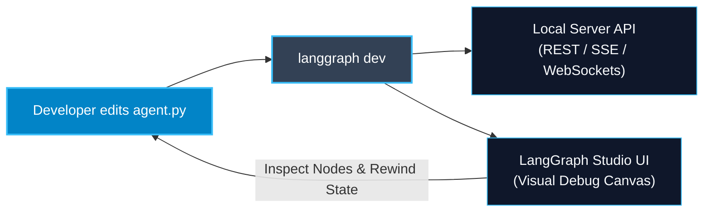

# LangGraph CLI and Configuration — langgraph.json

> "Manually wiring FastAPI endpoints, WebSockets, background queues, and checkpoint tables for every agent is tedious. The LangGraph CLI turns any graph into a production-grade server in one command."

---

### Step 1: Why Do We Need This?

#### The Real Problem

When transitioning a LangGraph prototype into a production service:
1. You have to write boilerplate FastAPI code for streaming, thread management, checkpoints, and health endpoints.
2. You need background task queues (Celery/Redis) to handle long-running agents that take 5 minutes to run.
3. You need WebSocket or SSE handlers for real-time telemetry.
4. Setting up a local development UI to visualize, inspect, and step through graphs takes days of frontend work.

Developers waste 60% of their time writing plumbing code instead of improving the agent's logic.

#### Why LangGraph Solves It

LangGraph provides the **LangGraph CLI** and `langgraph.json`:
- Define your graph entry points, dependencies, and environment variables in a single declarative `langgraph.json` file.
- Run `langgraph dev` in your terminal: it automatically boots a high-performance server with REST endpoints, streaming APIs, background workers, and persistent SQLite storage.
- It automatically launches **LangGraph Studio**, a visual interactive UI to test, inspect, and debug your graph locally with 0 setup.

---

### Step 2: What Is It?

#### Simple Explanation

Think of **Vite or Next.js for AI Agents**:
- Just like `npm run dev` in Next.js automatically starts a web server, enables hot-reloading, and serves your React components:
- `langgraph dev` automatically starts an agent server, enables code hot-reloading, spins up API endpoints, and launches a visual canvas to test your agent.

#### Core CLI Commands Overview

| Command | What It Does In Simple English |
| :--- | :--- |
| **`langgraph new`** | Scaffolds a new agent repository with best-practice templates. |
| **`langgraph dev`** | Starts the local development server with hot-reload and opens LangGraph Studio UI. |
| **`langgraph build`** | Builds a production-ready Docker container image containing your graph and dependencies. |
| **`langgraph up`** | Launches the production server locally or in Docker. |

---

### Step 3: Real-World Example

#### Rapid Agent Development & Visual Debugging

Imagine building a multi-agent customer support workflow:
- You configure `langgraph.json` pointing to `agent.py:graph`.
- You run `langgraph dev` in terminal.
- A visual web studio opens at `http://localhost:8123`.
- You type a test query into the studio canvas:
  - You see nodes light up green as they execute in real time.
  - You click on any node to view its exact input and output JSON state deltas.
  - You can edit state on the canvas and replay branches instantly.
- **What it outputs:** 10x faster iteration cycle from idea to production.

---

### Step 4: How Does It Work?

1. **Install CLI:** `pip install "langgraph-cli[inmem]"`.
2. **Create `langgraph.json`:** Create a declarative config file in your project root:
   ```json
   {
     "dependencies": ["."],
     "graphs": {
       "support_agent": "./src/agent.py:graph"
     },
     "env": ".env"
   }
   ```
3. **Run Dev Server:** Type `langgraph dev` in your shell.
4. **Interact via API or Studio:** The CLI exposes standard OpenAPI endpoints (`/threads`, `/runs/stream`) and connects to LangGraph Studio.

---

### Step 5: Code Example

Here is an example of a complete project structure, the `langgraph.json` configuration, and the companion graph file:

#### File 1: `langgraph.json` (Project Root)

```json
{
  "dependencies": ["."],
  "graphs": {
    "enterprise_support": "./agent.py:graph"
  },
  "env": ".env",
  "python_version": "3.11"
}
```

#### File 2: `agent.py` (Compiled Graph Entry Point)

```python
from typing import TypedDict, Annotated, List
from langchain_core.messages import BaseMessage, HumanMessage, AIMessage
from langgraph.graph import StateGraph, START, END, add_messages

# 1. State definition
class SupportState(TypedDict):
    messages: Annotated[List[BaseMessage], add_messages]
    ticket_category: str

# 2. Nodes
def classify_ticket_node(state: SupportState) -> dict:
    last_msg = state["messages"][-1].content.lower()
    if "refund" in last_msg or "invoice" in last_msg:
        cat = "billing"
    elif "bug" in last_msg or "crash" in last_msg:
        cat = "technical_support"
    else:
        cat = "general_inquiry"
        
    return {"ticket_category": cat}

def answer_ticket_node(state: SupportState) -> dict:
    cat = state.get("ticket_category", "general_inquiry")
    reply = f"Hello! Your ticket has been logged under department: [{cat.upper()}]. An agent will contact you shortly."
    return {"messages": [AIMessage(content=reply)]}

# 3. Assemble Graph
builder = StateGraph(SupportState)
builder.add_node("classifier", classify_ticket_node)
builder.add_node("responder", answer_ticket_node)

builder.add_edge(START, "classifier")
builder.add_edge("classifier", "responder")
builder.add_edge("responder", END)

# Export the compiled graph variable matching langgraph.json ('agent.py:graph')!
graph = builder.compile()

if __name__ == "__main__":
    # Test locally in terminal
    result = graph.invoke({
        "messages": [HumanMessage(content="I need a refund for my recent bill.")],
        "ticket_category": ""
    })
    print(result["messages"][-1].content)
```

---

### Step 6: How Is It Used in Production?

#### Production Patterns & Edge Cases

| Scenario | Production Challenge | Recommended Solution |
| :--- | :--- | :--- |
| **Docker Container Builds** | Installing heavy ML libraries into custom images takes 20 minutes. | Use `langgraph build -t my-agent:v1` to generate optimized Docker images using LangGraph's base image. |
| **Missing Environment Secrets** | API keys missing when the CLI server boots. | Reference your environment file in `langgraph.json` under `"env": ".env"`. |
| **Multiple Graphs in One Repo** | A monorepo hosting 5 different agents for different departments. | Define multiple keys under `"graphs"` in `langgraph.json` (e.g. `"support": "./...", "billing": "./..."`). |

---

### Step 7: Quick Revision

- `langgraph.json` declares your graph paths, dependencies, and environment files.
- `langgraph dev` starts a local server with auto-reload, streaming, and LangGraph Studio.
- `langgraph build` creates a production Docker image with one command.
- It eliminates the need to write custom FastAPI wrappers for basic deployments.
- Multiple graphs can be exposed from a single configuration file.

---

### Step 8: Final Flow Diagram



---

### Step 9: Quiz

Try answering these questions to check your understanding:

1. What file is used to configure graphs, dependencies, and environment files for the LangGraph CLI?
   - A) `package.json`
   - B) `langgraph.json`
   - C) `docker-compose.yml`
   - D) `Makefile`

2. What terminal command launches the local development server with hot-reload and opens LangGraph Studio?
   - A) `langgraph run`
   - B) `langgraph dev`
   - C) `python -m graph`
   - D) `npm start`

3. What does the string `"./agent.py:graph"` in `langgraph.json` specify?
   - A) The database password
   - B) The file path (`./agent.py`) and the variable name of the compiled graph (`graph`)
   - C) A git commit hash
   - D) An OpenAI API key

4. How do you generate an optimized production Docker image using the LangGraph CLI?
   - A) `langgraph build -t my-agent:latest`
   - B) `docker save`
   - C) `pip install docker`
   - D) `langgraph copy`

*Submit your answers (e.g. 1-B, 2-B, 3-B, 4-A) to verify your score!*
