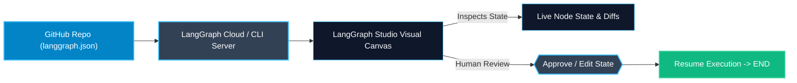

# LangGraph Cloud and Studio — Observability and Debugging

> "Debugging a stateful, cyclical agent using print statements is painful. LangGraph Studio provides a live visual IDE to see, edit, and replay every state transition."

---

### Step 1: Why Do We Need This?

#### The Real Problem

When an agent fails in production:
- Did the LLM output bad JSON?
- Did the tool return an empty array?
- Did a reducer accidentally overwrite a key?
- Did the router pick the wrong conditional edge?

If you only have terminal logs:
- You have to scroll through 2,000 lines of messy console logs.
- You cannot see the graph layout or visual edge transitions.
- You cannot pause execution, edit state in a web form, and test if your bug fix works.

#### Why LangGraph Solves It

LangGraph provides **LangGraph Studio** and **LangGraph Cloud**:
- **LangGraph Studio:** A dedicated desktop and web visual IDE designed specifically for agent graphs.
  - Interactive flowchart canvas of your nodes and edges.
  - Real-time step highlighting as nodes execute.
  - State editor: inspect state values, edit keys directly, and resume paused breakpoints.
- **LangGraph Cloud:** A managed serverless deployment platform that scales agent background workers, handles multi-user queues, and integrates with LangSmith telemetry.

---

### Step 2: What Is It?

#### Simple Explanation

Think of a **flight simulator and air traffic radar**:
- Writing code in a text editor is like building an airplane engine blindfolded.
- **LangGraph Studio** is the flight simulator: you can test extreme weather, pause mid-air, tweak the wing angles, and see how the plane reacts before flying with real passengers.
- **LangGraph Cloud** is the international airport infrastructure: runway towers, baggage conveyors, and ground crew handling hundreds of flights concurrently.

#### Studio Feature Breakdown

| Feature | What It Does In Simple English |
| :--- | :--- |
| **Interactive Canvas** | Visual layout of nodes, edges, conditional branches, and subgraphs. |
| **Step-by-Step Stepper** | Run one node at a time; inspect state before and after each transition. |
| **State Time-Travel UI** | Click any past node on the timeline to inspect historical state snapshots. |
| **Interrupt / HITL Panel** | Web buttons to Approve, Edit, or Reject executions paused at breakpoints. |

---

### Step 3: Real-World Example

#### Debugging a Hallucinated SQL Agent in LangGraph Studio

Imagine testing a SQL generation agent:
- In terminal testing, the agent kept returning *"Query failed"*.
- You launch **LangGraph Studio**:
  1. You trigger the graph with a test prompt: *"Find top 5 customers by sales"*.
  2. You watch the node `generate_sql` light up red.
  3. You click the node: the state viewer clearly highlights that the model generated `FROM usr_table` instead of `FROM users`.
  4. Directly in the Studio state editor, you fix the SQL string to `FROM users`.
  5. You click *"Resume Node"*. The database executes successfully, returning the top 5 records!
- **What it outputs:** Bug diagnosed and fixed in 45 seconds without adding a single `print()` statement.

---

### Step 4: How Does It Work?

1. **Local Access via CLI:** Running `langgraph dev` starts the local API and provides a link to open LangGraph Studio in your browser or desktop app.
2. **Graph Inspection:** Studio connects to the local LangGraph server via REST and WebSockets.
3. **Graph Topology Rendering:** Studio parses `builder.compile()` and renders interactive Mermaid-like vector diagrams.
4. **Cloud Deployment:** Connecting your GitHub repository to LangGraph Cloud deploys your agents to scalable cloud infrastructure with automated CI/CD builds.

---

### Step 5: Code Example

Here is a clean LangGraph agent equipped with human-in-the-loop review, designed specifically for testing in LangGraph Studio:

```python
from typing import TypedDict, Annotated, List, Optional
from langchain_core.messages import BaseMessage, HumanMessage, AIMessage
from langgraph.graph import StateGraph, START, END, add_messages
from langgraph.checkpoint.memory import MemorySaver

# 1. State definition
class MarketingStudioState(TypedDict):
    product_name: str
    target_demographic: str
    drafted_tweet: Optional[str]
    is_approved: bool

# 2. Node 1: AI drafts social media post
def draft_tweet_node(state: MarketingStudioState) -> dict:
    product = state["product_name"]
    demo = state["target_demographic"]
    
    # Generate tweet draft
    tweet = f"🚀 Supercharge your workflow with {product}! Perfect for {demo}. Get 20% off today: https://link.com/deal"
    return {"drafted_tweet": tweet}

# 3. Node 2: Publish action (Human approval required in Studio UI!)
def publish_tweet_node(state: MarketingStudioState) -> dict:
    print(f"-> [PUBLISHED TO TWITTER]: {state['drafted_tweet']}")
    return {"is_approved": True}

# 4. Assemble Graph
builder = StateGraph(MarketingStudioState)
builder.add_node("drafter", draft_tweet_node)
builder.add_node("publisher", publish_tweet_node)

builder.add_edge(START, "drafter")
builder.add_edge("drafter", "publisher")
builder.add_edge("publisher", END)

# Checkpointer required for Studio visualization and breakpoints
checkpointer = MemorySaver()

# Halt before 'publisher' so developers can review in LangGraph Studio!
graph = builder.compile(
    checkpointer=checkpointer,
    interrupt_before=["publisher"]
)

# Export for langgraph.json
# Run: 'langgraph dev' in terminal to open this in LangGraph Studio!
if __name__ == "__main__":
    config = {"configurable": {"thread_id": "studio_demo_01"}}
    
    # Initial run stops at publisher
    graph.invoke({
        "product_name": "SkillVault AI",
        "target_demographic": "Backend Engineers",
        "drafted_tweet": None,
        "is_approved": False
    }, config=config)
    
    state = graph.get_state(config)
    print("Graph paused at node:", state.next)
    print("Draft ready for review in LangGraph Studio:", state.values["drafted_tweet"])
```

---

### Step 6: How Is It Used in Production?

#### Production Patterns & Edge Cases

| Scenario | Production Challenge | Recommended Solution |
| :--- | :--- | :--- |
| **Production Cloud Isolation** | Testing code in production LangGraph Cloud modifies live customer databases. | Use LangGraph Cloud "Preview Environments" to test branch deploys against staging databases. |
| **Secret Management** | API keys (OpenAI, Anthropic, Stripe) exposed in source control. | Store secrets in LangGraph Cloud Dashboard environment variables, never in `langgraph.json`. |
| **High Load Autoscaling** | 10,000 users trigger heavy agents simultaneously. | LangGraph Cloud automatically scales Celery/Redis task workers to prevent server crashes. |

---

### Step 7: Quick Revision

- LangGraph Studio is a visual IDE for testing, debugging, and inspecting graphs.
- It displays an interactive node-and-edge canvas with live step execution tracking.
- You can inspect state, edit values in place, and resume paused breakpoints directly in the UI.
- `langgraph dev` automatically spins up Studio connected to your local code.
- LangGraph Cloud provides serverless hosting, autoscaling workers, and automated GitHub CI/CD.

---

### Step 8: Final Flow Diagram



---

### Step 9: Quiz

Try answering these questions to check your understanding:

1. What is LangGraph Studio?
   - A) A video game
   - B) A visual web and desktop IDE for inspecting, testing, and debugging LangGraph agent workflows
   - C) A music recording app
   - D) A database driver

2. How can you test Human-in-the-Loop approval buttons inside LangGraph Studio?
   - A) By compiling with `interrupt_before=["node_name"]`; Studio automatically displays an interactive resume/approval panel
   - B) By unplugging your monitor
   - C) By writing an assembly script
   - D) Studio does not support HITL

3. Where should sensitive production secrets (like API keys) be configured in LangGraph Cloud?
   - A) Hardcoded in GitHub public README
   - B) In the LangGraph Cloud environment variables dashboard
   - C) In the browser local storage
   - D) In comments inside Python code

4. What happens when you edit state directly inside the LangGraph Studio UI and click Resume?
   - A) The computer restarts
   - B) A new state snapshot is created and execution continues forward using the edited values
   - C) The graph is deleted
   - D) An error is raised

*Submit your answers (e.g. 1-B, 2-A, 3-B, 4-B) to verify your score!*
