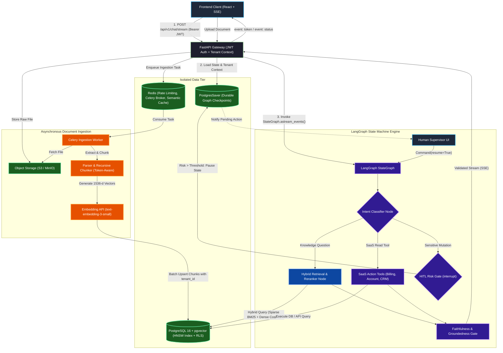
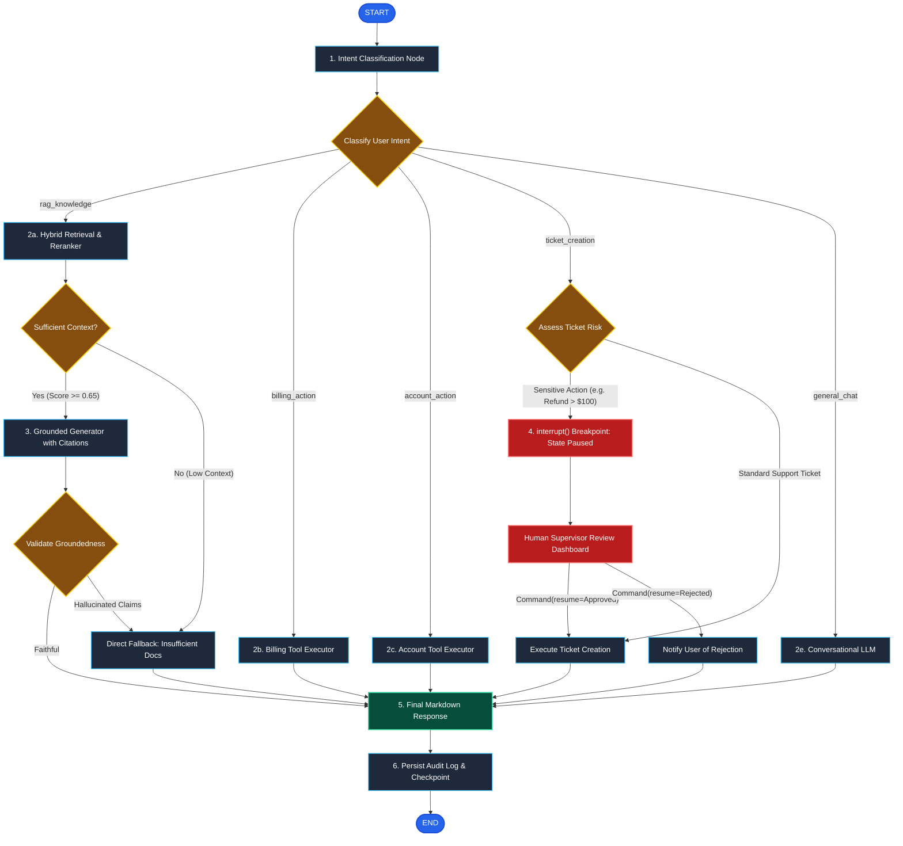

# Project 4: Production-Grade Multi-Tenant AI Chat Assistant & RAG Platform

> **Difficulty**: Expert / Principal | **Estimated Time**: 12–16 hours | **Stack**: LangGraph, LangChain, Python FastAPI, PostgreSQL 16 (`pgvector`), Redis, Celery, React/SSE

---

## 1. Project Overview

In this capstone project, you will architect and build an enterprise-grade conversational AI assistant for a multi-tenant SaaS application. Unlike simple demonstration chatbots, a production SaaS assistant must enforce absolute cross-tenant data isolation, seamlessly route queries between retrieval-augmented generation (RAG) and SaaS operational tools, pause safely via Human-in-the-Loop (HITL) breakpoints for sensitive transactions, and stream tokens with intermediate telemetry in real-time.



---

## 2. Core Architectural Pillars

### Pillar 1: 3-Layer Multi-Tenant Data Isolation
To prevent cross-tenant data leakage during vector search:
1. **JWT Cryptographic Extraction**: `tenant_id` and `user_id` are extracted strictly from signed JWT claims in FastAPI dependencies.
2. **PostgreSQL Row-Level Security (RLS)**: Enforced via `SET LOCAL app.current_tenant_id = :org_id;` for every session.
3. **Partitioned Vector Retrieval**: Explicit `WHERE organization_id = :org_id` applied prior to/during HNSW vector distance indexing.

```sql
-- Migration: Enable Row-Level Security on Document Chunks
ALTER TABLE document_chunks ENABLE ROW LEVEL SECURITY;

CREATE POLICY tenant_isolation_policy ON document_chunks
    FOR ALL
    USING (organization_id = NULLIF(current_setting('app.current_tenant_id', true), '')::uuid);
```

### Pillar 2: Asynchronous Document Ingestion Pipeline
Document processing is offloaded to Celery workers using Redis as a message broker:
1. File upload to S3/MinIO with SHA-256 deduplication.
2. Text extraction across PDF, DOCX, Markdown, and HTML.
3. Token-aware semantic chunking (800 tokens, 120 token overlap using `tiktoken`).
4. OpenAI `text-embedding-3-small` 1536-dimensional vector generation.
5. Atomic database transaction: existing chunks for that document version are deleted before inserting fresh chunks.

### Pillar 3: Two-Stage Hybrid Retrieval & Reranking
Pure dense vector search misses exact technical IDs (e.g. `ERR_409`, SKU numbers), while pure lexical search misses semantic nuances.
- **Stage 1 (Fusion)**: Executes pgvector HNSW cosine search alongside PostgreSQL Full-Text Search (`tsvector`), combining top-25 results using **Reciprocal Rank Fusion (RRF)** ($k=60$).
- **Stage 2 (Reranking)**: The top-20 fused candidates are scored by a cross-encoder (`cross-encoder/ms-marco-MiniLM-L-6-v2`), filtering out any chunks below a 0.65 relevance score.

$$\text{RRF\_Score}(d) = \sum_{m \in M} \frac{1}{60 + \text{rank}_m(d)}$$

---

## 3. LangGraph Agentic State Machine



### LangGraph Implementation Code

```python
# app/ai/graphs/assistant_graph.py
from typing import Annotated, Literal, Optional, List, Dict, Any
from typing_extensions import TypedDict
from langchain_core.messages import BaseMessage, HumanMessage, AIMessage, SystemMessage
from langgraph.graph import StateGraph, START, END
from langgraph.graph.message import add_messages
from langgraph.checkpoint.postgres.aio import AsyncPostgresSaver
from langgraph.types import interrupt
from pydantic import BaseModel, Field

# 1. State Schema
class AssistantState(TypedDict):
    messages: Annotated[List[BaseMessage], add_messages]
    organization_id: str
    user_id: str
    user_role: str
    intent: Optional[Literal["rag_knowledge", "billing_action", "account_action", "ticket_creation", "general_chat"]]
    retrieved_docs: List[Dict[str, Any]]
    tool_output: Optional[Dict[str, Any]]
    confidence_score: float
    citations: List[Dict[str, Any]]
    final_response: Optional[str]

# 2. Structured Output Intent Classifier
class IntentClassification(BaseModel):
    intent: Literal["rag_knowledge", "billing_action", "account_action", "ticket_creation", "general_chat"] = Field(
        description="The primary category of the user's inquiry."
    )
    confidence: float = Field(description="Confidence score between 0.0 and 1.0")
    reasoning: str = Field(description="Brief reason for the classification")

# 3. Nodes
async def classify_intent_node(state: AssistantState, config: Dict[str, Any]) -> Dict[str, Any]:
    llm = config["configurable"]["llm"].with_structured_output(IntentClassification)
    last_message = state["messages"][-1].content

    system_prompt = (
        "You are an intent classifier for a multi-tenant SaaS assistant. "
        "Classify the user inquiry into exactly one of: rag_knowledge, billing_action, "
        "account_action, ticket_creation, general_chat."
    )
    decision: IntentClassification = await llm.ainvoke([
        SystemMessage(content=system_prompt),
        HumanMessage(content=last_message)
    ])
    return {
        "intent": decision.intent,
        "confidence_score": decision.confidence
    }

async def rag_retrieval_node(state: AssistantState, config: Dict[str, Any]) -> Dict[str, Any]:
    retriever = config["configurable"]["retriever"]
    embedder = config["configurable"]["embedder"]
    session = config["configurable"]["db_session"]
    
    query = state["messages"][-1].content
    query_vector = await embedder.aembed_query(query)
    
    docs = await retriever.retrieve(
        session=session,
        query=query,
        query_vector=query_vector,
        org_id=state["organization_id"],
        top_k=4
    )
    return {"retrieved_docs": docs}

async def rag_generate_node(state: AssistantState, config: Dict[str, Any]) -> Dict[str, Any]:
    llm = config["configurable"]["llm"]
    docs = state["retrieved_docs"]
    
    if not docs:
        fallback = (
            "I could not find sufficient information in your organization's documentation "
            "to answer your question accurately. Please contact your administrator or support team."
        )
        return {
            "final_response": fallback,
            "messages": [AIMessage(content=fallback)],
            "citations": []
        }

    context_str = "\n\n".join([
        f"[Doc {i+1} | Source: {d['metadata'].get('doc_title', 'Doc')} | Page {d['metadata'].get('page_number', 1)}]:\n{d['content']}"
        for i, d in enumerate(docs)
    ])

    system_prompt = f"""You are a strict, enterprise-grade AI assistant. 
Answer the user's question using ONLY the provided documentation context below.
Rules:
1. If the answer cannot be directly determined from the context, state that you do not have sufficient information.
2. DO NOT make up policies, dates, or SLA guarantees.
3. Reference sources inline using [Doc X, Page Y].

Context:
{context_str}
"""
    response = await llm.ainvoke([
        SystemMessage(content=system_prompt),
        *state["messages"]
    ])

    citations = [
        {
            "doc_id": d["id"],
            "title": d["metadata"].get("doc_title", "Document"),
            "page": d["metadata"].get("page_number", 1),
            "relevance": d.get("relevance_score", 1.0)
        }
        for d in docs
    ]

    return {
        "final_response": response.content,
        "messages": [response],
        "citations": citations
    }

async def billing_tool_node(state: AssistantState, config: Dict[str, Any]) -> Dict[str, Any]:
    billing_service = config["configurable"]["billing_service"]
    org_id = state["organization_id"]
    
    subscription = await billing_service.get_active_subscription(org_id)
    summary = (
        f"**Subscription Status**: {subscription['status'].upper()}\n"
        f"- **Plan**: {subscription['plan_name']}\n"
        f"- **Billing Interval**: {subscription['interval']}\n"
        f"- **Current Period End**: {subscription['current_period_end']}\n"
        f"- **Seats Allocated**: {subscription['seats_used']} / {subscription['seats_total']}"
    )
    return {
        "final_response": summary,
        "messages": [AIMessage(content=summary)],
        "tool_output": subscription
    }

async def ticket_creation_node(state: AssistantState, config: Dict[str, Any]) -> Dict[str, Any]:
    user_query = state["messages"][-1].content
    is_sensitive = any(w in user_query.lower() for w in ["refund", "cancel subscription", "credit", "delete account"])
    
    if is_sensitive and state["user_role"] != "admin":
        approval_decision = interrupt({
            "action": "CREATE_SENSITIVE_TICKET",
            "reason": "Request contains financial or cancellation keywords from non-admin user",
            "requested_by": state["user_id"],
            "organization_id": state["organization_id"],
            "details": user_query
        })
        
        if not approval_decision.get("approved"):
            rejection_msg = "Your request was reviewed by a supervisor and could not be approved automatically."
            return {"final_response": rejection_msg, "messages": [AIMessage(content=rejection_msg)]}

    ticket_service = config["configurable"]["ticket_service"]
    ticket = await ticket_service.create_ticket(
        org_id=state["organization_id"],
        user_id=state["user_id"],
        subject="AI Assistant Escalation",
        description=user_query
    )
    result = f"Support ticket **#{ticket['id']}** has been created successfully."
    return {
        "final_response": result,
        "messages": [AIMessage(content=result)],
        "tool_output": ticket
    }

# 4. Conditional Edge Router
def route_intent(state: AssistantState) -> str:
    intent = state.get("intent", "general_chat")
    if intent == "rag_knowledge":
        return "rag_retrieval"
    elif intent == "billing_action":
        return "billing_tool"
    elif intent == "ticket_creation":
        return "ticket_creation"
    return "general_chat"

# 5. Graph Compilation
def build_assistant_graph(checkpointer: AsyncPostgresSaver) -> StateGraph:
    workflow = StateGraph(AssistantState)

    workflow.add_node("classify_intent", classify_intent_node)
    workflow.add_node("rag_retrieval", rag_retrieval_node)
    workflow.add_node("rag_generate", rag_generate_node)
    workflow.add_node("billing_tool", billing_tool_node)
    workflow.add_node("ticket_creation", ticket_creation_node)

    workflow.add_edge(START, "classify_intent")
    workflow.add_conditional_edges(
        "classify_intent",
        route_intent,
        {
            "rag_retrieval": "rag_retrieval",
            "billing_tool": "billing_tool",
            "ticket_creation": "ticket_creation",
            "general_chat": "rag_generate"
        }
    )

    workflow.add_edge("rag_retrieval", "rag_generate")
    workflow.add_edge("rag_generate", END)
    workflow.add_edge("billing_tool", END)
    workflow.add_edge("ticket_creation", END)

    return workflow.compile(checkpointer=checkpointer)
```

---

## 4. Real-Time Token & Event Streaming via FastAPI SSE

```python
# app/api/routes/chat.py
import json
from typing import AsyncGenerator
from fastapi import APIRouter, Depends, Request
from fastapi.responses import StreamingResponse
from langchain_core.messages import HumanMessage
from app.api.dependencies import get_current_user
from app.schemas.auth import AuthenticatedUser
from app.schemas.chat import ChatRequest
from app.ai.graphs.assistant_graph import build_assistant_graph
from app.database.session import get_db, get_checkpointer

router = APIRouter(prefix="/chat", tags=["Chat"])

@router.post("/stream")
async def chat_stream_endpoint(
    request: Request,
    body: ChatRequest,
    current_user: AuthenticatedUser = Depends(get_current_user),
    session = Depends(get_db)
):
    checkpointer = await get_checkpointer()
    graph = build_assistant_graph(checkpointer)

    thread_id = f"org_{current_user.organization_id}:conv_{body.conversation_id}"
    config = {
        "configurable": {
            "thread_id": thread_id,
            "llm": request.app.state.chat_llm,
            "embedder": request.app.state.embedder,
            "retriever": request.app.state.retriever,
            "billing_service": request.app.state.billing_service,
            "ticket_service": request.app.state.ticket_service,
            "db_session": session
        }
    }

    initial_input = {
        "messages": [HumanMessage(content=body.message)],
        "organization_id": current_user.organization_id,
        "user_id": current_user.user_id,
        "user_role": current_user.role,
        "retrieved_docs": [],
        "citations": []
    }

    async def event_generator() -> AsyncGenerator[str, None]:
        try:
            yield f"event: open\ndata: {json.dumps({'status': 'connected', 'thread_id': thread_id})}\n\n"

            async for event in graph.astream_events(initial_input, config=config, version="v2"):
                if await request.is_disconnected():
                    break

                kind = event["event"]

                # Telemetry intermediate progress events
                if kind == "on_chain_start" and event["name"] == "classify_intent":
                    yield f"event: status\ndata: {json.dumps({'message': 'Analyzing request intent...'})}\n\n"
                elif kind == "on_chain_start" and event["name"] == "rag_retrieval":
                    yield f"event: status\ndata: {json.dumps({'message': 'Searching organization knowledge base...'})}\n\n"
                elif kind == "on_chain_start" and event["name"] == "billing_tool":
                    yield f"event: status\ndata: {json.dumps({'message': 'Querying subscription records...'})}\n\n"

                # Direct token streaming
                elif kind == "on_chat_model_stream":
                    chunk_content = event["data"]["chunk"].content
                    if chunk_content:
                        yield f"event: token\ndata: {json.dumps({'token': chunk_content})}\n\n"

                # Citations and completion
                elif kind == "on_chain_end" and event["name"] == "LangGraph":
                    output = event["data"].get("output", {})
                    citations = output.get("citations", [])
                    yield f"event: citations\ndata: {json.dumps({'citations': citations})}\n\n"
                    yield f"event: done\ndata: {json.dumps({'status': 'completed'})}\n\n"

        except Exception as e:
            yield f"event: error\ndata: {json.dumps({'error': str(e)})}\n\n"

    return StreamingResponse(
        event_generator(),
        media_type="text/event-stream",
        headers={"Cache-Control": "no-cache", "X-Accel-Buffering": "no"}
    )
```

---

## 5. Senior Interview Battle Cards

### Battle Card 1: Multi-Tenant Vector Isolation
* **Question**: *"How do you guarantee that Company A never accesses Company B's private documents during vector similarity retrieval?"*
* **Answer**:  
  "We implement a **3-Layer Defense-in-Depth model**:
  1. **Cryptographic Token Extraction**: `tenant_id` is parsed strictly from the verified, cryptographically signed RSA-256 JWT in FastAPI middleware. We never read `org_id` from client headers or request bodies.
  2. **Database Kernel RLS Layer**: In every database session, we invoke `SET LOCAL app.current_tenant_id = :org_id;`. PostgreSQL's Row-Level Security policy automatically drops any row whose `organization_id` does not match the session tenant ID, even if an engineer writes a raw SQL query forgetting the WHERE clause.
  3. **HNSW Filtered Search**: In pgvector, we execute an iterative filtered HNSW query:
     `SELECT id, content FROM document_chunks WHERE organization_id = :org_id ORDER BY embedding <=> :query LIMIT k;`  
     This ensures that the distance calculation and nearest neighbor traversal are strictly bound within the partition of that tenant."

---

### Battle Card 2: The "Lost in the Middle" Problem & Context Bloat
* **Question**: *"Why not just pass the top 20 retrieved chunks directly to GPT-4o? Why introduce BM25, RRF, and a Cross-Encoder?"*
* **Answer**:  
  "Feeding 20 raw chunks (approx. 10,000–16,000 tokens) causes three major production failures:
  1. **The 'Lost in the Middle' Phenomenon**: As proven by Liu et al., LLM attention degrades heavily on information situated in the middle of long contexts. Critical facts get missed.
  2. **Cost and Latency**: TTFT (Time-to-First-Token) increases linearly with input prompt token count, and API costs balloon by 5x.
  3. **High False Positive Rate**: Pure dense vector search frequently retrieves chunks that share broad topical similarity but lack the exact technical keyword or error code required.
  
  Our **Two-Stage Hybrid Pipeline** solves this:
  - Stage 1: We cast a broad net with Dense HNSW (semantic) + Sparse BM25 (exact keyword match), merging them via **Reciprocal Rank Fusion ($k=60$)** to form a 20-candidate pool.
  - Stage 2: We run a lightweight, deep **Cross-Encoder reranker** (`ms-marco-MiniLM-L-6-v2`) that performs joint cross-attention across (query, passage) pairs. We take only the top 4 chunks that pass a strict confidence threshold ($\ge 0.65$). This reduces input tokens by 75% and guarantees peak attention focus."

---

### Battle Card 3: Streaming Tokens with Agent Tool Calling
* **Question**: *"When using LangGraph with tool calls, how do you stream responses to the frontend without leaking raw JSON function calling syntax to the user?"*
* **Answer**:  
  "When an LLM executes a tool call, it emits tokens structured as JSON function schemas (e.g., `{"name": "get_subscription", "arguments": "{\"org_id\": ...}"}`). If streamed directly, the user sees ugly JSON fragments before the tool runs.
  
  We resolve this using LangGraph's `astream_events(version='v2')`:
  1. We inspect the event metadata: tokens coming from `on_chat_model_stream` are only forwarded to the client SSE stream if the parent node is a conversational generation node (`rag_generate` or `direct_chat`).
  2. When a tool node is triggered, we emit a structured **status event** (`event: status`, data: `{"message": "Checking billing records..."}`) rather than raw tokens.
  3. Once the tool finishes, the downstream formatting node generates natural language tokens, which stream cleanly to the client. This provides an enterprise UX with zero JSON leakage."

---

### Battle Card 4: Durable Human-in-the-Loop (HITL) Checkpoints
* **Question**: *"If a user asks to cancel their subscription or issue a refund, and your bot pauses for a human supervisor who takes 14 hours to review it, how do you prevent worker thread starvation and handle server restarts?"*
* **Answer**:  
  "We utilize **LangGraph's dynamic `interrupt()` with `PostgresSaver` checkpointing**.
  - When the risk gate detects a sensitive action (e.g., refund > \$100), the graph executes `interrupt({'action': 'REFUND_REQUEST', ...})`.
  - LangGraph immediately serializes the entire `AssistantState` into the `checkpoints` table in PostgreSQL under the unique `thread_id` and terminates the execution thread. No Celery worker or FastAPI process remains running or blocked in memory.
  - 14 hours later, the supervisor logs into the dashboard, clicks 'Approve', and the frontend hits `POST /api/v1/chat/resume`.
  - The backend loads the checkpoint from Postgres, injects `Command(resume={'approved': True})`, and resumes execution precisely at the tool execution node. If the backend crashed or was redeployed in the meantime, state was safely persisted in PostgreSQL."

---

### Battle Card 5: Production RAG Evaluation Without Human Labeling
* **Question**: *"How do you continuously evaluate retrieval and generation quality in production without paying human annotators to review thousands of daily chats?"*
* **Answer**:  
  "We implement automated continuous evaluation using the **RAG Triad** via **Ragas** and an **LLM-as-a-Judge** pipeline:
  1. **Context Relevance**: Measures whether retrieved chunks are focused and free of noise. Evaluated by asking a small evaluator model (e.g., `gpt-4o-mini`) if each sentence in the context is necessary to answer the query.
  2. **Groundedness / Faithfulness**: Measures whether the generated response contains only claims supported by the retrieved context. We parse the answer into atomic claims and verify them against the context snippets.
  3. **Answer Relevance**: Measures whether the response directly addresses the user's question.
  
  In production, we log 5% of all live interactions to **LangSmith / OpenTelemetry**. Queries with low user feedback (thumbs down) or low faithfulness scores trigger automated Slack alerts and are added to a regression evaluation dataset for continuous prompt and chunking fine-tuning."
