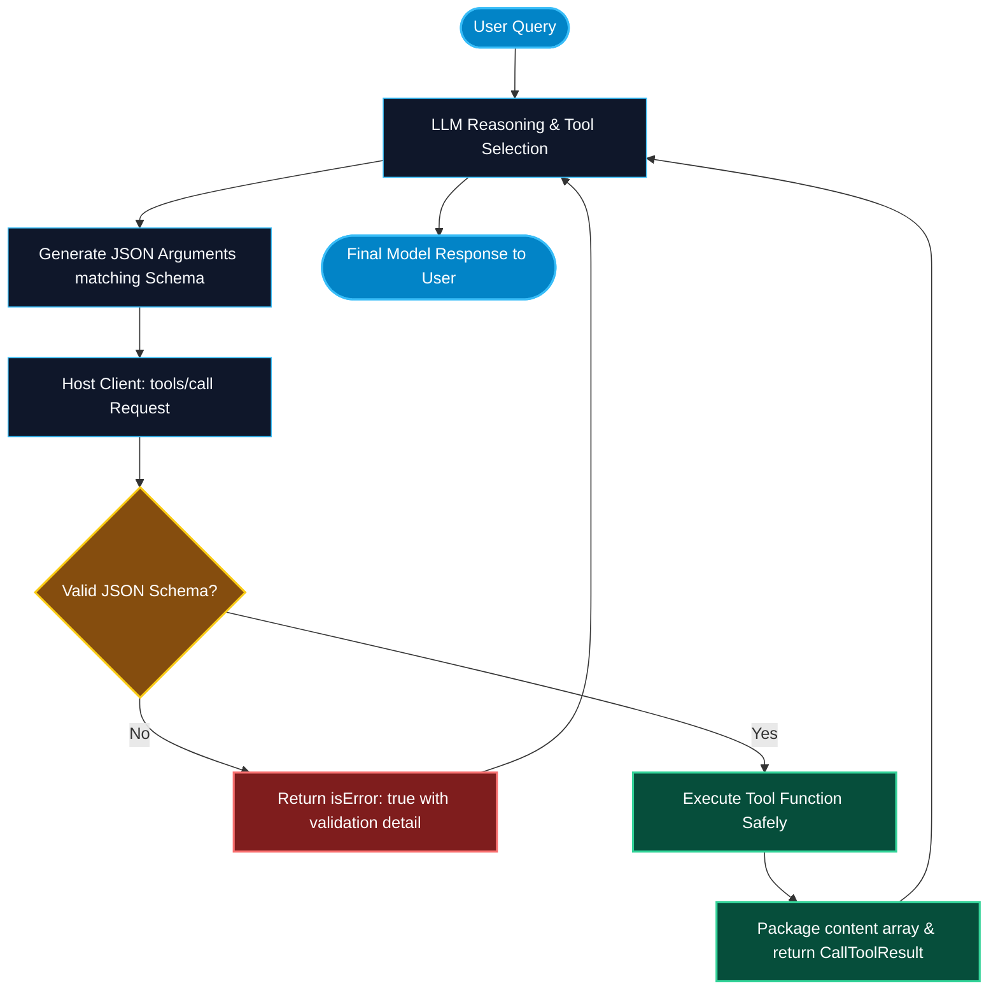

# Tools and Callable Functions in MCP

> "An LLM without tools is a brilliant brain trapped in a jar. MCP Tools provide the hands, legs, and API keys that allow models to safely interact with the physical and digital world."

---


### Step 1: Why Do We Need This?

#### The Real Problem

Foundation models possess extensive general knowledge, but they suffer from three critical boundaries:
1. **Knowledge Cutoff:** They do not know what happened five minutes ago in your production database.
2. **Hallucination:** When asked to perform complex arithmetic, SQL syntax verification, or JSON schema conversions, models can generate plausible-sounding falsehoods.
3. **Inability to Act:** A model cannot natively send an email, restart a Kubernetes pod, or write a file to disk without external execution machinery.

#### Why MCP Tools Solve It

The **Tools primitive** in MCP exposes executable functions to the model with standard contracts:
- **Model-Controlled:** The model autonomously determines *when* to call a tool and *what arguments* to provide based on its reasoning chain.
- **Strict Schema Enforcement:** Every tool exposes a JSON Schema defining its required parameters, types, and constraints.
- **Standardized Results:** Tools return structured content blocks (text, images, or embedded resources) along with explicit error flags (`isError: true/false`), allowing the model to recover gracefully from exceptions.

---

### Step 2: What Is It?

#### Simple Explanation: The Model's Hands and Tools

Think of an LLM as a surgeon in an operating theater. The surgeon has the intelligence to make diagnoses, but they cannot operate with bare hands. 
The **MCP Tools** are the specialized surgical instruments on the tray:
- The scalpels, clamps, and monitors.
- Each instrument has a label (`name`), an instruction manual explaining when to pick it up (`description`), and a specific grip requirement (`inputSchema`).

#### Core Elements of an MCP Tool

| Field | Purpose | Example |
| :--- | :--- | :--- |
| **`name`** | Unique alphanumeric identifier for tool invocation. | `execute_sql_query` |
| **`description`** | Clear natural language explanation used by the model for tool selection. | `Executes a read-only SELECT query on the Postgres analytics replica.` |
| **`inputSchema`** | Valid JSON Schema object specifying properties, types, and required fields. | `{"type": "object", "properties": {"query": {"type": "string"}}}` |
| **`content`** | List of result items returned to the model (`text`, `image`, or `resource`). | `[{"type": "text", "text": "Query returned 14 rows."}]` |
| **`isError`** | Boolean flag indicating whether the execution failed. | `true` if table does not exist or syntax error occurs. |

---

### Step 3: Real-World Example

#### The Incident Response Remediation Tool

Imagine a production MCP server connected to an enterprise AWS infrastructure:
1. An SRE tells Claude: *"The checkout service is throwing 504 errors in US-East-1. Check pod status and restart if failing."*
2. The model reviews its available tools and picks `get_pod_status(namespace="checkout", region="us-east-1")`.
3. The tool returns: `{"pod_name": "checkout-7f9b8c", "status": "CrashLoopBackOff", "restarts": 14}`.
4. The model recognizes the crash loop and calls `restart_deployment(deployment="checkout", namespace="checkout")`.
5. The tool triggers the rolling restart, verifies new pods are running, and returns `status: "Successfully rolled out version 2.4.1"`.

---

### Step 4: How Does It Work?

```text
Host App / LLM                                         MCP Server
      │                                                     │
      │ ── 1. tools/list (Request) ───────────────────────> │
      │ <─ 2. [{name, description, inputSchema}] ───────────│
      │                                                     │
      │ [User asks question]                                │
      │ [LLM selects tool & generates JSON parameters]      │
      │                                                     │
      │ ── 3. tools/call {name: "get_user", arguments} ───> │
      │                                                     │
      │                                          [Validate params]
      │                                          [Execute function]
      │                                                     │
      │ <─ 4. CallToolResult {content: [...], isError} ─────│
      │                                                     │
      │ [LLM analyzes output and generates answer]          │
```

1. **Discovery:** During startup or on capability refresh, the host sends `tools/list`.
2. **Registration:** The server returns the tool inventory. The host translates these into the LLM's native function calling format (e.g. Anthropic `tools` or OpenAI `tools`).
3. **Inference & Dispatch:** When the LLM generates a tool call request, the host extracts the name and parameters, dispatches `tools/call` to the MCP server.
4. **Validation & Execution:** The server validates incoming arguments against the JSON Schema. If invalid, it returns `isError: true` without crashing. If valid, it executes the code.
5. **Observation Return:** The server packages the return value into a standardized `CallToolResult` containing `content` blocks.

---

### Step 5: Code Example: Python MCP Tool Server

Here is a complete, runnable Python script demonstrating tool definition, JSON schema generation, and invocation handling:

```python
# tool_server_demo.py
import json
import sqlite3
from typing import Dict, Any

class DatabaseToolServer:
    def __init__(self):
        # Create an in-memory SQLite database for demo
        self.conn = sqlite3.connect(":memory:")
        self._init_db()

    def _init_db(self):
        cursor = self.conn.cursor()
        cursor.execute("CREATE TABLE inventory (id INT, product TEXT, stock INT)")
        cursor.execute("INSERT INTO inventory VALUES (1, 'MacBook Pro M4', 25)")
        cursor.execute("INSERT INTO inventory VALUES (2, 'Dell XPS 15', 8)")
        cursor.execute("INSERT INTO inventory VALUES (3, 'Keychron Q1', 0)")
        self.conn.commit()

    def list_tools(self) -> list:
        """Returns the MCP tool definitions for the host."""
        return [
            {
                "name": "check_stock",
                "description": "Checks available warehouse stock for a specific product name.",
                "inputSchema": {
                    "type": "object",
                    "properties": {
                        "product_name": {
                            "type": "string",
                            "description": "Full or partial name of the product to search"
                        }
                    },
                    "required": ["product_name"]
                }
            }
        ]

    def call_tool(self, name: str, arguments: Dict[str, Any]) -> Dict[str, Any]:
        """Dispatches tool execution with parameter validation and error boundaries."""
        if name != "check_stock":
            return {
                "isError": True,
                "content": [{"type": "text", "text": f"Error: Tool '{name}' is unknown."}]
            }

        product_name = arguments.get("product_name")
        if not product_name:
            return {
                "isError": True,
                "content": [{"type": "text", "text": "Validation Error: 'product_name' argument is required."}]
            }

        try:
            cursor = self.conn.cursor()
            cursor.execute(
                "SELECT product, stock FROM inventory WHERE product LIKE ?", 
                (f"%{product_name}%",)
            )
            rows = cursor.fetchall()

            if not rows:
                return {
                    "isError": False,
                    "content": [{"type": "text", "text": f"No products matching '{product_name}' found."}]
                }

            result_str = "\n".join([f"- {r[0]}: {r[1]} units in stock" for r in rows])
            return {
                "isError": False,
                "content": [{"type": "text", "text": f"Inventory Results:\n{result_str}"}]
            }
        except Exception as err:
            return {
                "isError": True,
                "content": [{"type": "text", "text": f"Database execution error: {str(err)}"}]
            }

if __name__ == "__main__":
    server = DatabaseToolServer()
    print("Registered Tools:\n", json.dumps(server.list_tools(), indent=2))
    
    # Simulate valid tool call
    res = server.call_tool("check_stock", {"product_name": "MacBook"})
    print("\nCall Result (Valid):", res)

    # Simulate invalid call
    res_err = server.call_tool("check_stock", {})
    print("\nCall Result (Invalid):", res_err)
```

---

### Step 6: How Is It Used in Production?

#### Production Patterns & Edge Cases

| Scenario | Production Challenge | Recommended Solution |
| :--- | :--- | :--- |
| **SQL / Command Injection** | LLM passes raw shell commands or malicious SQL statements as tool arguments. | Never concatenate strings in tools. Always use parameterized queries (`?`, `%s`) or safe subprocess execution without `shell=True`. |
| **Excessive Execution Time** | A tool running an intensive report takes 60 seconds, timing out client connections. | Set explicit timeout thresholds (e.g. 15s) and return intermediate progress tokens via MCP progress streaming. |
| **Side-Effect Idempotency** | Network retries trigger duplicate credit card charges or duplicate emails. | Require client to supply an `idempotency_key` argument in mutating tools; reject replays. |
| **Destructive Actions** | Model attempts to delete production rows or drop schema tables. | Classify tools into read vs write tiers; force Host Human-in-the-Loop (HITL) approval gates before executing mutating tools. |

---

### Step 7: Quick Revision

- **Tools** are model-controlled executable actions that allow LLMs to read dynamic data and perform mutations.
- Tools must publish a strict **JSON Schema** describing all expected properties and types.
- The return payload must be an array of **`content` blocks** (text, images, or resources) and an **`isError`** boolean flag.
- Setting `isError: true` allows the LLM to understand the failure and self-correct rather than crashing the agent loop.
- Production tools must use parameterization and enforce idempotent operations to prevent duplicate mutations.

---

### Step 8: Final Flow Diagram



---

### Step 9: Quiz

1. Who determines when an MCP Tool is invoked and what arguments are supplied?
   - A) The developer hardcoding the loop
   - B) The LLM autonomously based on reasoning and the tool's natural language description
   - C) The operating system kernel scheduler
   - D) The database administrator

2. What standard must be used to describe the parameter types of an MCP tool?
   - A) OpenAPI 2.0 Swagger YAML
   - B) JSON Schema
   - C) C++ header definitions
   - D) GraphQL Schema Definition Language

3. What should an MCP server return when an executed tool experiences an expected domain error (such as a database query timeout)?
   - A) Kill the child process immediately
   - B) Return a `CallToolResult` with `isError: true` and an explanatory text content block
   - C) Send an empty string with status code 200
   - D) Reformat the host machine's drive

4. What is the benefit of setting `isError: true` in a tool response instead of raising an unhandled exception?
   - A) It costs fewer API tokens
   - B) It allows the LLM to inspect the failure reason and retry with corrected parameters
   - C) It shuts down the computer automatically
   - D) It skips all remaining prompts

*Submit your answers (e.g. 1-B, 2-B, 3-B, 4-B) to verify your score!*

