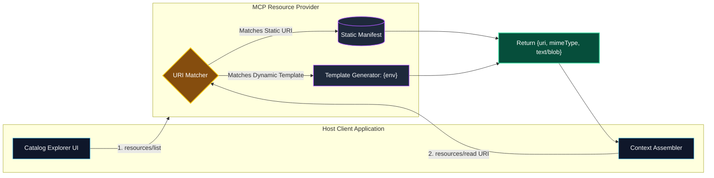

# Resources and Resource Templates in MCP

> "If Tools are the active hands that operate on the world, Resources are the books, blueprints, and live feeds that provide the model with grounded ground truth."

---


### Step 1: Why Do We Need This?

#### The Real Problem

In many LLM workflows, you do not want the model to actively call an arbitrary function with unpredictable side-effects. Instead:
- You want the user or host application to attach specific contextual artifacts—such as a configuration file, an application schema, API documentation, or a live debug log.
- Without a standard protocol, applications invent custom file-attachment logic, clipboard scraping, or ad-hoc RAG pipelines.
- Standard file paths (`/var/log/app.log`) do not generalize to cloud databases, remote Git repositories, or dynamic microservice metrics.

#### Why Resources Solve It

The **Resources primitive** in MCP provides a standardized way for servers to expose read-only data to the host application and the LLM:
- **Application-Controlled:** The host application or end user decides *which* resources to attach to the conversation context, providing deterministic grounding.
- **URI-Addressed:** Every resource has a globally unique URI (e.g., `file:///app.py`, `postgres://schema/orders`, `docker://container/104/logs`).
- **MIME-Type Aware:** Resources declare their MIME type (`text/plain`, `application/json`, `image/png`, `application/pdf`), allowing the host to render or parse them correctly.
- **Dynamic Resource Templates:** Servers can declare URI templates (RFC 6570) like `db://tables/{tableName}/schema` to expose millions of parametric records without enumerating them all in advance.

---

### Step 2: What Is It?

#### Simple Explanation: The Library Reference Desk

Think of an MCP Server as a giant research library:
- **A Static Resource** is an encyclopedic volume sitting on a designated shelf with a specific call number (URI: `library://reference/v1`).
- **A Resource Template** is the microfilm lookup machine: you type in the year and topic (`library://archives/{year}/{topic}`), and it retrieves the exact document on demand.
- The patron (the Host application) can browse the catalog (`resources/list`), look up an item by URI (`resources/read`), and read the contents into memory.

#### Core Resource Elements

| Property | Purpose | Example |
| :--- | :--- | :--- |
| **`uri`** | Unique uniform resource identifier for the data stream. | `git://repository/main/commits/HEAD` |
| **`name`** | Human-readable title displayed in the client UI. | `Latest Git Commit Diff` |
| **`description`** | Detailed description of the resource's contents and schema. | `Unified diff comparing HEAD to origin/main` |
| **`mimeType`** | IANA media type defining data formatting. | `text/x-diff`, `application/json`, `image/png` |
| **`text`** | UTF-8 encoded text payload for textual resources. | `"commit 4f910a...\nAuthor: Alice"` |
| **`blob`** | Base64-encoded binary payload for images, PDFs, or binary files. | `"iVBORw0KGgoAAAANSUhEUgAA..."` |

---

### Step 3: Real-World Example

#### The Database Architecture Assistant

An architect wants to design a new microservice based on existing database tables:
1. The host connects to an MCP PostgreSQL server.
2. The user sees a dropdown of available resources in Cursor or Claude Desktop:
   - `postgres://db/schema/users`
   - `postgres://db/schema/subscriptions`
   - `postgres://db/indexes`
3. The user clicks to attach `postgres://db/schema/subscriptions`.
4. The client fetches the resource via `resources/read`. The server returns the exact DDL (Data Definition Language) with primary keys, indexes, and foreign keys.
5. The LLM receives the DDL directly in its context window and designs the new microservice without running a single SQL query.

---

### Step 4: How Does It Work?

```text
Host Application                                       MCP Server
       │                                                    │
       │ ── 1. resources/list (Request) ──────────────────> │
       │ <─ 2. [{uri, name, mimeType}] ─────────────────────│
       │                                                    │
       │ ── 3. resources/templates/list (Request) ────────> │
       │ <─ 4. [{uriTemplate: "file://{path}"}] ───────────│
       │                                                    │
       │ [User or Agent requests specific resource URI]     │
       │                                                    │
       │ ── 5. resources/read {"uri": "file://app.py"} ───> │
       │ <─ 6. {contents: [{uri, mimeType, text}]} ──────── │
       │                                                    │
       │ ── 7. resources/subscribe {"uri": "file://app.py"} │
       │ <─ 8. notifications/resources/updated ──────────── │
```

1. **Static Discovery:** Host queries `resources/list` to find fixed resources.
2. **Dynamic Discovery:** Host queries `resources/templates/list` to discover parametric URI patterns (e.g. `issue://jira/{key}`).
3. **Reading:** Host calls `resources/read` passing the specific `uri`. The server returns a list of content blocks with either `text` (UTF-8) or `blob` (base64 binary).
4. **Live Subscriptions:** Clients can subscribe to resource updates via `resources/subscribe`. When the underlying file or data changes, the server fires a `notifications/resources/updated` notification, enabling real-time streaming updates.

---

### Step 5: Code Example: Python Resource Server with Templates

Here is a runnable Python MCP server demonstrating both static resources and dynamic URI templates:

```python
# resource_server_demo.py
import re
from typing import Dict, Any, List

class CloudConfigResourceServer:
    def __init__(self):
        # In-memory mock configuration documents
        self.configs = {
            "production": {
                "db_pool_size": 50,
                "log_level": "WARN",
                "enable_debug_toolbar": False,
                "allowed_origins": ["https://app.company.com"]
            },
            "staging": {
                "db_pool_size": 10,
                "log_level": "DEBUG",
                "enable_debug_toolbar": True,
                "allowed_origins": ["*"]
            }
        }

    def list_resources(self) -> List[Dict[str, Any]]:
        """Returns static, cataloged resources."""
        return [
            {
                "uri": "config://cluster/overview",
                "name": "Cluster Deployment Overview",
                "description": "High-level inventory of deployed enterprise environments",
                "mimeType": "application/json"
            }
        ]

    def list_resource_templates(self) -> List[Dict[str, Any]]:
        """Exposes dynamic URI templates using RFC 6570 syntax."""
        return [
            {
                "uriTemplate": "config://environments/{env}/settings",
                "name": "Environment Specific Configuration",
                "description": "Retrieves the JSON configuration for a target environment (e.g. production, staging)",
                "mimeType": "application/json"
            }
        ]

    def read_resource(self, uri: str) -> Dict[str, Any]:
        """Resolves URI and returns data content."""
        import json

        # Handle static resource
        if uri == "config://cluster/overview":
            return {
                "contents": [
                    {
                        "uri": uri,
                        "mimeType": "application/json",
                        "text": json.dumps({"active_environments": list(self.configs.keys())}, indent=2)
                    }
                ]
            }

        # Handle dynamic template match: config://environments/{env}/settings
        match = re.match(r"^config://environments/([^/]+)/settings$", uri)
        if match:
            env_name = match.group(1)
            if env_name in self.configs:
                return {
                    "contents": [
                        {
                            "uri": uri,
                            "mimeType": "application/json",
                            "text": json.dumps(self.configs[env_name], indent=2)
                        }
                    ]
                }
            else:
                raise ValueError(f"Environment '{env_name}' does not exist.")

        raise ValueError(f"Unknown resource URI: {uri}")

if __name__ == "__main__":
    server = CloudConfigResourceServer()
    print("Static Resources:", server.list_resources())
    print("Resource Templates:", server.list_resource_templates())
    
    # Read static resource
    print("\nRead Static Overview:")
    print(server.read_resource("config://cluster/overview")["contents"][0]["text"])

    # Read dynamic template resource
    print("\nRead Dynamic Production Settings:")
    print(server.read_resource("config://environments/production/settings")["contents"][0]["text"])
```

---

### Step 6: How Is It Used in Production?

#### Production Patterns & Edge Cases

| Scenario | Production Challenge | Recommended Solution |
| :--- | :--- | :--- |
| **Megabyte File Blobs** | Loading a 200MB server log exhausts host memory and LLM token limit. | Enforce byte-range headers or pagination parameters (e.g., `log://app?lines=200&offset=1000`). |
| **Binary Assets (Images/PDFs)** | Passing diagrams or scanned documents into vision-capable models. | Base64-encode the payload and set explicit MIME types (e.g. `image/png`, `application/pdf`). |
| **Resource Stale Caching** | Host caches a resource indefinitely while underlying files are modified by developers. | Implement `resources/subscribe` and fire `notifications/resources/updated` whenever the file hash changes. |
| **Path Traversal Attacks** | Malicious client requests URI `file://../../../etc/passwd`. | Sanitize and resolve all URIs against a strict authorized root path whitelist; reject dot-dot traversals. |

---

### Step 7: Quick Revision

- **Resources** represent passive, read-only data streams addressed via unique **URIs**.
- Unlike Tools, Resources are typically attached by the host application or user to establish deterministic context.
- Servers can expose static resources (`resources/list`) or dynamic patterns (`resources/templates/list`).
- Content can be transmitted as UTF-8 **`text`** or base64-encoded **`blob`** for binary data.
- Clients can subscribe to resource URIs to receive automatic update notifications when data changes.

---

### Step 8: Final Flow Diagram



---

### Step 9: Quiz

1. How do MCP Resources differ fundamentally from MCP Tools?
   - A) Resources are always written in C++ while tools are written in Python
   - B) Resources represent read-only context addressed via URIs, whereas Tools represent executable actions
   - C) Resources cost money while Tools are always free
   - D) Resources cannot be sent over network connections

2. What RFC specification is used to define dynamic Resource Templates in MCP?
   - A) RFC 2616 (HTTP 1.1)
   - B) RFC 6570 (URI Template)
   - C) RFC 7519 (JSON Web Tokens)
   - D) RFC 2119 (Key words for RFCs)

3. How should binary data (such as a PNG screenshot or PDF document) be encoded inside an MCP resource payload?
   - A) As raw 8-bit unescaped bytes in the JSON string
   - B) In the `blob` property as a Base64-encoded string with appropriate `mimeType`
   - C) Printed as hex values into `stderr`
   - D) Uploaded to Dropbox and linked

4. What notification can an MCP server send when a subscribed resource's underlying data changes?
   - A) `notifications/resources/updated`
   - B) `alert/emergency`
   - C) `tools/call`
   - D) `email/dispatch`

*Submit your answers (e.g. 1-B, 2-B, 3-B, 4-A) to verify your score!*

