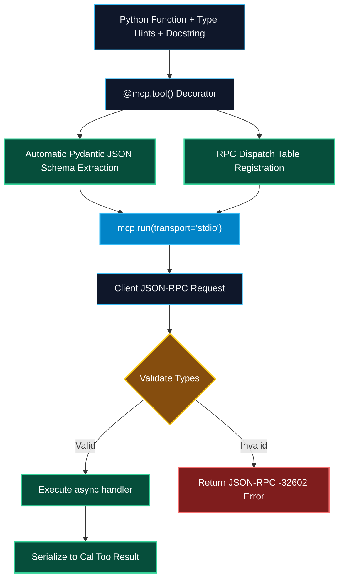

# Python MCP SDK and FastMCP

> "Just as FastAPI revolutionized REST API development with Python type hints and Pydantic schemas, FastMCP revolutionizes agent integrations by turning standard Python functions into discoverable MCP tools in two lines of code."

---


### Step 1: Why Do We Need This?

#### The Real Problem

Writing a raw JSON-RPC 2.0 server from scratch requires an enormous amount of repetitive boilerplate:
- Manually inspecting Python docstrings and building nested JSON Schema dictionaries.
- Parsing and deserializing JSON payloads on incoming socket/pipe streams.
- Routing methods (`tools/list`, `tools/call`, `resources/read`) via manual string matching.
- Catching exceptions, converting them into numeric JSON-RPC error codes, and formatting error objects.

#### Why FastMCP Solves It

The official `mcp` Python SDK (created by Anthropic) provides **FastMCP**, a high-level developer framework:
- **FastAPI-Like Syntax:** Use familiar decorators (`@mcp.tool()`, `@mcp.resource()`, `@mcp.prompt()`).
- **Automatic Schema Inference:** FastMCP reads your standard Python type annotations (`int`, `str`, `List[str]`, Pydantic models) and function docstrings, automatically generating valid JSON Schema definitions.
- **Context Injection:** Functions can inject an optional `Context` parameter to access logging, progress tokens, and client capabilities.
- **Dual Transport:** Switch between `stdio` and `sse` transports with a single parameter (`mcp.run(transport="stdio")` vs `mcp.run(transport="sse")`).

---

### Step 2: What Is It?

#### Simple Explanation: The Pythonic Decorator Magic

Think of FastMCP like a **smart translator for your existing Python code**:
- You write an ordinary Python function:
  ```python
  def add_numbers(a: int, b: int) -> int:
      """Adds two integers together."""
      return a + b
  ```
- You add one line on top: `@mcp.tool()`.
- FastMCP automatically inspects the function signature, creates the JSON Schema `{a: integer, b: integer}`, maps the docstring to the tool description, registers the RPC dispatch handler, and packages the return value into a valid MCP `CallToolResult`.

#### Core FastMCP Decorators Table

| Decorator | What It Declares | Return Type Convention |
| :--- | :--- | :--- |
| **`@mcp.tool()`** | An executable action for the LLM. | String, dictionary, Pydantic model, or Image object. |
| **`@mcp.resource("uri://...")`** | A static or templated read-only context stream. | String (UTF-8 text) or Bytes (binary). |
| **`@mcp.prompt()`** | A user-facing slash command template. | String, list of message dictionaries, or PromptMessage objects. |
| **`ctx: Context`** | Injected execution context inside any handler. | Provides `ctx.info()`, `ctx.report_progress()`, `ctx.read_resource()`. |

---

### Step 3: Real-World Example

#### The Server Performance Telemetry Service

Let's build an MCP server that gives AI coding assistants (like Cursor and Claude) real-time access to the local developer machine's CPU, memory, and disk health:
- The developer runs: `python server.py`.
- Claude Desktop instantly detects three capabilities:
  1. Tool: `get_system_stats()`
  2. Resource: `system://processes/top`
  3. Prompt: `/diagnose_slow_machine`
- When the user asks: *"Why is my build taking forever?"*, Claude calls `get_system_stats()`, notices 98% memory consumption, reads `system://processes/top`, and identifies an orphaned Docker container hogging 16GB of RAM.

---

### Step 4: How Does It Work?

```text
Developer Function Definition:
    @mcp.tool()
    def query_user(user_id: int) -> dict: ...
         │
         ▼
Type Reflection & Schema Engine:
    - Analyzes type hints: user_id -> integer
    - Extracts docstring: "Fetches user profile..."
    - Generates JSON Schema: {"type": "object", "properties": {"user_id": {"type": "integer"}}}
         │
         ▼
Dispatch & Execution Runtime:
    - Receives: {"method": "tools/call", "params": {"name": "query_user", "arguments": {"user_id": 42}}}
    - Validates: 42 is valid int
    - Executes: query_user(user_id=42)
    - Returns: {"content": [{"type": "text", "text": "{\"name\": \"Alice\"}"}]}
```

1. **Decoration Phase:** When the script loads, `@mcp.tool()` registers the function in the FastMCP registry.
2. **Schema Compilation:** FastMCP utilizes `pydantic` internally to build OpenAPI/JSON Schema parameter objects.
3. **Transport Initialization:** Calling `mcp.run()` starts the chosen transport loop (`asyncio` stream reader for stdio, or `starlette` / `uvicorn` for SSE).
4. **RPC Handling:** Incoming JSON-RPC calls are validated, executed asynchronously, and serialized back to the client.

---

### Step 5: Code Example: Complete FastMCP Server

Here is a complete, production-ready Python MCP server using FastMCP:

```python
# fastmcp_server.py
"""
To run this server:
1. pip install "mcp[cli]" psutil pydantic
2. python fastmcp_server.py
"""
import psutil
from typing import Dict, Any, List
from mcp.server.fastmcp import FastMCP, Context

# Initialize FastMCP Server
mcp = FastMCP(
    name="DevEnvironmentMonitor",
    instructions="Provides live system metrics, top process inspection, and health diagnostic prompts."
)

# 1. TOOL DEFINITION
@mcp.tool()
async def get_system_metrics() -> Dict[str, Any]:
    """Returns real-time CPU, RAM, and Disk utilization percentages."""
    return {
        "cpu_percent": psutil.cpu_percent(interval=0.1),
        "memory_percent": psutil.virtual_memory().percent,
        "disk_percent": psutil.disk_usage("/").percent,
        "total_ram_gb": round(psutil.virtual_memory().total / (1024 ** 3), 2)
    }

# 2. DYNAMIC RESOURCE TEMPLATE
@mcp.resource("system://metrics/{metric_name}")
def get_metric_resource(metric_name: str) -> str:
    """Provides deep-dive raw text metric for a specific hardware subsystem."""
    if metric_name == "cpu":
        freq = psutil.cpu_freq()
        return f"CPU Frequency: {freq.current:.2f} Mhz (Min: {freq.min}, Max: {freq.max})"
    elif metric_name == "memory":
        vm = psutil.virtual_memory()
        return f"Total: {vm.total} bytes | Available: {vm.available} bytes | Used: {vm.used} bytes"
    else:
        return f"Unknown metric category: '{metric_name}'. Available: cpu, memory."

# 3. CONTEXT-AWARE TOOL WITH PROGRESS
@mcp.tool()
async def kill_heavy_processes(threshold_percent: float, ctx: Context) -> str:
    """Scans and reports processes consuming more than the threshold CPU percent."""
    await ctx.info(f"Scanning process table for threshold > {threshold_percent}%...")
    await ctx.report_progress(50, 100)
    
    flagged = []
    for proc in psutil.process_iter(['pid', 'name', 'cpu_percent']):
        try:
            if proc.info['cpu_percent'] and proc.info['cpu_percent'] > threshold_percent:
                flagged.append(f"PID {proc.info['pid']} ({proc.info['name']}): {proc.info['cpu_percent']}%")
        except (psutil.NoSuchProcess, psutil.AccessDenied):
            continue

    await ctx.report_progress(100, 100)
    return "Flagged Processes:\n" + ("\n".join(flagged) if flagged else "None detected.")

# 4. PROMPT TEMPLATE
@mcp.prompt()
def diagnose_machine_health(urgency: str = "normal") -> str:
    """Interactive prompt for diagnosing developer laptop performance slowdowns."""
    return (
        f"You are a Senior Systems Administrator diagnosing a machine performance issue (Urgency: {urgency.upper()}).\n"
        f"1. Call the 'get_system_metrics' tool to inspect current CPU and RAM loads.\n"
        f"2. If CPU > 80%, invoke 'kill_heavy_processes' with a threshold of 20% to find runaway tasks.\n"
        f"3. Provide a concise, bulleted remediation plan."
    )

if __name__ == "__main__":
    # Default transport: 'stdio' for Claude Desktop / Cursor
    # To run as HTTP SSE: mcp.run(transport="sse")
    mcp.run(transport="stdio")
```

---

### Step 6: How Is It Used in Production?

#### Production Patterns & Edge Cases

| Scenario | Production Challenge | Recommended Solution |
| :--- | :--- | :--- |
| **Blocking Synchronous I/O** | A synchronous database query blocks Python's async event loop, freezing all concurrent MCP requests. | Use asynchronous drivers (`asyncpg`, `httpx`, `aiofiles`) or offload sync calls with `asyncio.to_thread()`. |
| **Uncaught Server Exceptions** | An unhandled runtime error crashes the FastMCP server, killing the client connection. | FastMCP automatically catches handler exceptions and maps them to `isError: true` responses; add explicit try/except for domain errors. |
| **Complex Nested Pydantic Inputs**| Passing nested configurations (e.g. filters, sorting, auth tokens) as tool inputs. | Define standard Pydantic models as function parameter types; FastMCP generates the exact nested JSON Schema. |
| **Claude Desktop Integration** | Connecting local FastMCP scripts to desktop hosts. | Use `uv` or `pipx` in `claude_desktop_config.json` (`command: "uv", args: ["run", "--with", "mcp", "fastmcp_server.py"]`). |

---

### Step 7: Quick Revision

- **FastMCP** is the high-level Python framework inside the official Anthropic `mcp` SDK.
- Decorate standard functions with **`@mcp.tool()`**, **`@mcp.resource()`**, and **`@mcp.prompt()`**.
- Type annotations (`str`, `int`, `List`, Pydantic models) automatically generate validated JSON Schema parameter definitions.
- Inject **`ctx: Context`** to emit client logging (`ctx.info()`) and stream progress percentages (`ctx.report_progress()`).
- Execute via `mcp.run(transport="stdio")` for local developer tools, or `transport="sse"` for remote microservices.

---

### Step 8: Final Flow Diagram



---

### Step 9: Quiz

1. What framework within the official Python `mcp` SDK provides high-level decorator-based server development?
   - A) FlaskMCP
   - B) FastMCP
   - C) DjangoMCP
   - D) CeleryMCP

2. How does FastMCP construct the JSON Schema required for an MCP tool's parameters?
   - A) It prompts GPT-4 over the network to guess the types
   - B) It automatically inspects Python function signatures, type annotations, and Pydantic models
   - C) The developer must manually hand-code raw JSON files on disk
   - D) It randomly assigns string types to everything

3. What parameter can be injected into a FastMCP tool function to stream progress and send log messages to the client?
   - A) `request: HttpRequest`
   - B) `ctx: Context`
   - C) `db: Session`
   - D) `env: OS`

4. How do you launch a FastMCP server to communicate over standard input/output with Claude Desktop?
   - A) `mcp.serve_socket(8080)`
   - B) `mcp.run(transport="stdio")`
   - C) `print("Start Server")`
   - D) `mcp.deploy_to_aws()`

*Submit your answers (e.g. 1-B, 2-B, 3-B, 4-B) to verify your score!*

