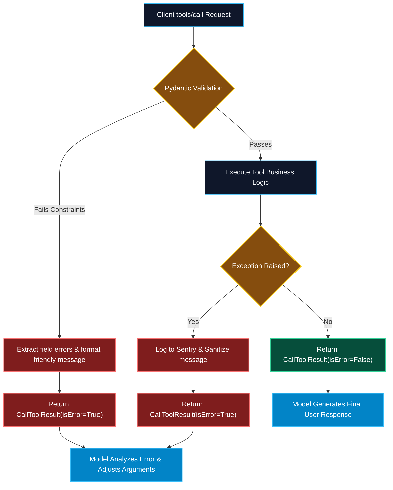

# Error Handling and Input Validation in Python MCP Servers

> "In traditional APIs, bad input comes from buggy code. In agentic AI systems, bad input comes from probabilistic models that hallucinate arguments. Bulletproof validation and structured errors are your only line of defense."

---


### Step 1: Why Do We Need This?

#### The Real Problem

LLMs are probabilistic reasoning engines, not deterministic compilers:
- A model might pass an integer `"user_id": 42` when your function expects a UUID string.
- A model might hallucinate an enum value that does not exist (`"role": "super_mega_admin"`).
- A model might pass dangerous SQL injection payloads (`"DROP TABLE users;"`).
- If an MCP server crashes with an unhandled Python traceback, the child process dies, the OS pipe closes with EOF, and the entire host conversation terminates abruptly.

#### Why Validation & Structured Errors Solve It

A resilient MCP server implements a **two-tier defense system**:
1. **Protocol Errors (JSON-RPC Layer):** When the request violates protocol rules (e.g., missing parameter, unknown method), return standard numeric JSON-RPC error codes (`-32602 Invalid params`, `-32601 Method not found`).
2. **Application Errors (Tool Execution Layer):** When parameters are syntactically valid but the operation fails (e.g. *"User with ID 404 does not exist"*), return a standard `CallToolResult` with **`isError: True`**. The model reads this error message and autonomously self-corrects!

---

### Step 2: What Is It?

#### Simple Explanation: The Airport Security Checkpoint

Think of incoming tool calls like **passengers boarding an airplane**:
- **Protocol Validation (Passport Control):** If the passenger has no passport, or a forged ID, they are rejected at the gate (`JSON-RPC Error -32600`).
- **Input Schema Validation (Baggage Scanner):** If they attempt to bring contraband or bags exceeding weight limits, Pydantic catches it immediately before execution (`isError: True`).
- **Execution (The Flight):** If bad weather forces a diversion, the pilot informs the passenger gracefully (`isError: True` with polite explanation) instead of crashing the plane.

#### Error Hierarchy Table

| Layer | Trigger | Return Mechanism | Effect on LLM |
| :--- | :--- | :--- | :--- |
| **Protocol Failure** | Client calls non-existent method or invalid JSON-RPC envelope. | JSON-RPC Error Object (`code: -32601`) | Client logs error; terminates call. |
| **Schema Validation Failure** | Missing required arguments or failed Pydantic field constraint. | `CallToolResult(isError=True)` with Pydantic errors | Model sees parameter error and retries with corrected types. |
| **Domain Logic Failure** | Resource not found, third-party API rate limited, or syntax error. | `CallToolResult(isError=True)` with domain error message | Model reasons about failure and adopts alternative plan. |

---

### Step 3: Real-World Example

#### The Safe SQL Query Executor

Consider a tool that executes analytical queries on PostgreSQL:
- An LLM calls `execute_analytical_query(sql="DROP TABLE customers;")`.
- **Validation Guard:** Pydantic field validator inspects the string:
  ```python
  if not sql.strip().upper().startswith("SELECT"):
      raise ValueError("Security Violation: Only read-only SELECT queries are permitted.")
  ```
- **The Outcome:** The server returns `isError: True` with the explanation. The model does not crash; instead, it outputs: *"I cannot drop tables because this tool is strictly read-only. Would you like me to inspect the schema instead?"*

---

### Step 4: How Does It Work?

```text
Incoming tools/call payload
            │
            ▼
    [Pydantic Validation] ────────── Invalid ──────────┐
            │ Valid                                    ▼
            ▼                               Return CallToolResult:
    [Execute Tool Logic]                    - isError: True
            │                               - text: "Validation failed: [detail]"
    ┌───────┴───────┐                                  │
Success          Exception                             │
    │               │                                  │
    ▼               ▼                                  │
Return:         Return:                                │
isError: False  isError: True                          │
text: [Data]    text: "Query failed: [detail]"         │
    │               │                                  │
    └───────────────┼──────────────────────────────────┘
                    ▼
          Delivered to Host LLM
          (Model reads error and retries)
```

---

### Step 5: Code Example: Robust Pydantic Validation & Error Isolation

Here is a runnable Python script showing production-grade input validation using Pydantic v2 and clean error boundaries:

```python
# robust_validation_server.py
from typing import Dict, Any, List
from pydantic import BaseModel, Field, field_validator, ValidationError
import re

# 1. Define Strict Pydantic Input Schema
class CreateUserSchema(BaseModel):
    username: str = Field(
        min_length=3, 
        max_length=20, 
        description="Alphanumeric username between 3 and 20 characters."
    )
    email: str = Field(description="Valid corporate email address.")
    department: str = Field(
        default="Engineering",
        description="Department name. Must be one of: Engineering, Finance, Support."
    )

    @field_validator("username")
    @classmethod
    def validate_username(cls, v: str) -> str:
        if not re.match(r"^[a-zA-Z0-9_-]+$", v):
            raise ValueError("Username contains illegal characters. Only a-z, 0-9, _, - are allowed.")
        return v.lower()

    @field_validator("email")
    @classmethod
    def validate_email(cls, v: str) -> str:
        if not re.match(r"^[^@]+@[^@]+\.[^@]+$", v):
            raise ValueError("Invalid email format.")
        return v.lower()

    @field_validator("department")
    @classmethod
    def validate_dept(cls, v: str) -> str:
        allowed = {"engineering", "finance", "support"}
        if v.lower() not in allowed:
            raise ValueError(f"Department '{v}' is invalid. Allowed: {', '.join(allowed)}")
        return v.capitalize()

# 2. Server Tool Dispatcher with Multi-Tier Error Isolation
class ProductionUserServer:
    def handle_create_user(self, raw_arguments: Dict[str, Any]) -> Dict[str, Any]:
        """Validates arguments via Pydantic and isolates all failure modes."""
        # Step 1: Input Validation Boundary
        try:
            validated_input = CreateUserSchema(**raw_arguments)
        except ValidationError as err:
            error_details = []
            for e in err.errors():
                loc = ".".join(str(x) for x in e["loc"])
                error_details.append(f"Field '{loc}': {e['msg']}")
            
            return {
                "isError": True,
                "content": [
                    {
                        "type": "text",
                        "text": "Parameter Validation Failed:\n" + "\n".join(error_details)
                    }
                ]
            }

        # Step 2: Business Logic Execution Boundary
        try:
            # Simulate a domain business constraint check
            if validated_input.username == "admin":
                raise PermissionError("The username 'admin' is reserved and cannot be created.")

            # Simulate successful creation
            return {
                "isError": False,
                "content": [
                    {
                        "type": "text",
                        "text": f"User '{validated_input.username}' successfully created in department '{validated_input.department}'."
                    }
                ]
            }
        except PermissionError as p_err:
            return {
                "isError": True,
                "content": [{"type": "text", "text": f"Business Rule Violation: {str(p_err)}"}]
            }
        except Exception as unhandled:
            # Mask sensitive stack traces in production
            return {
                "isError": True,
                "content": [{"type": "text", "text": f"Internal execution failure: {str(unhandled)}"}]
            }

if __name__ == "__main__":
    server = ProductionUserServer()

    # Case 1: Valid Input
    print("--- Test 1: Valid Payload ---")
    res1 = server.handle_create_user({"username": "alice_dev", "email": "alice@company.com", "department": "Finance"})
    print(res1)

    # Case 2: Validation Failure (Invalid email & illegal username)
    print("\n--- Test 2: Invalid Parameters ---")
    res2 = server.handle_create_user({"username": "a!", "email": "bad-email", "department": "Marketing"})
    print(res2["content"][0]["text"])

    # Case 3: Domain Error
    print("\n--- Test 3: Domain Rule Violation ---")
    res3 = server.handle_create_user({"username": "admin", "email": "admin@company.com"})
    print(res3["content"][0]["text"])
```

---

### Step 6: How Is It Used in Production?

#### Production Patterns & Edge Cases

| Scenario | Production Challenge | Recommended Solution |
| :--- | :--- | :--- |
| **Leaking Database Credentials** | A database crash exposes passwords or internal hostnames in the exception message returned to the LLM. | Catch raw exceptions, log them to internal Sentry / Datadog, and return sanitized error strings to the client. |
| **Model Hallucinating Extra Fields** | Model passes unexpected keys (`{"sql": "...", "format": "excel"}`) not in schema. | Configure Pydantic model with `model_config = ConfigDict(extra="forbid")` to reject unknown fields. |
| **Infinite Error Retry Loops** | Model repeatedly calls a failing tool with identical bad arguments. | Track consecutive errors per tool in host agent state; abort after 3 identical failures. |
| **Downstream Rate Limiting (429)** | External API returns HTTP 429 Too Many Requests. | Return `isError: True` with explicit exponential backoff advice: *"Rate limited; please wait 5 seconds before retrying."* |

---

### Step 7: Quick Revision

- Distinguish between **Protocol Errors** (JSON-RPC level) and **Tool Errors** (`isError: True` level).
- Always validate incoming tool arguments using **Pydantic v2 schemas** with regex and value validators.
- Never let unhandled Python exceptions crash the MCP server process; wrap handlers in try/except blocks.
- Returning `isError: True` gives the LLM the context it needs to self-correct and retry successfully.
- Sanitize error messages before returning them to prevent leaking database connection strings or secrets.

---

### Step 8: Final Flow Diagram



---

### Step 9: Quiz

1. What happens if an unhandled Python exception crashes an MCP server running over standard input/output?
   - A) The operating system automatically rewrites the code
   - B) The process terminates, the stdio pipe closes with EOF, and the host conversation breaks
   - C) Claude generates an apology poem
   - D) The database rolls back all transactions from last year

2. Why is returning `CallToolResult` with `isError: True` preferable to raising a fatal server exception?
   - A) It saves GPU memory
   - B) It informs the LLM of the specific failure, enabling it to self-correct its parameters and retry
   - C) It is required by copyright law
   - D) It speeds up Python compilation

3. Which Pydantic configuration prevents models from injecting undocumented hallucinated parameters into tool calls?
   - A) `extra="allow"`
   - B) `extra="forbid"`
   - C) `debug=True`
   - D) `strict=False`

4. Why should raw database exception tracebacks be sanitized before returning to an MCP client?
   - A) Because tracebacks are copyrighted
   - B) To avoid leaking database credentials, internal hostnames, and table structures into model context
   - C) Because JSON does not support letters
   - D) To reduce network bandwidth by 99%

*Submit your answers (e.g. 1-B, 2-B, 3-B, 4-B) to verify your score!*

