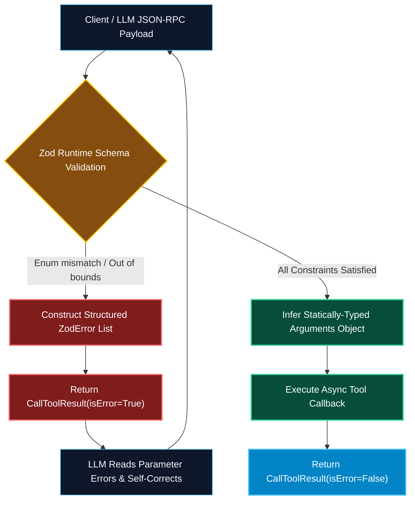

# Type Safety and Zod Schema Patterns in TypeScript MCP

> "TypeScript types disappear at runtime. If you rely solely on compile-time interfaces, an LLM will send invalid data that crashes your production services. Zod provides the dual-layer armor: compile-time types for developers, and runtime schema enforcement for models."

---


### Step 1: Why Do We Need This?

#### The Real Problem

When building tool integrations for LLMs, you face a unique duality:
1. **Developer Experience:** You want static autocomplete, IntelliSense, and type checking in your IDE when writing the tool handler.
2. **Runtime Model Safety:** TypeScript interfaces (`interface UserQuery { id: string }`) are erased during JavaScript compilation. The LLM that calls your tool at runtime only sees raw JSON.
If a model hallucinates an invalid string when an integer was expected, or omits a required property, standard TypeScript code throws runtime `TypeError: Cannot read properties of undefined`.

#### Why Zod Solves It

**Zod** is a TypeScript-first schema declaration and validation library. The official MCP TypeScript SDK integrates natively with Zod:
- **Single Source of Truth:** You define the schema once using Zod.
- **Automatic JSON Schema Export:** The MCP SDK compiles your Zod schema into standard JSON Schema for the `tools/list` protocol payload.
- **Automatic Type Inference:** The SDK infers the exact TypeScript type for your tool's callback function argument (`z.infer<typeof Schema>`).
- **Rich Prompting via `.describe()`:** Every Zod property can carry natural language descriptions that guide the LLM's parameter selection.

---

### Step 2: What Is It?

#### Simple Explanation: The Dual Blueprint and Mold

Think of Zod in MCP like an **industrial casting mold**:
- The **Blueprint (JSON Schema):** Given to the client LLM so it knows the exact dimensions and tolerances required to cast a part.
- **The Physical Mold (Runtime Validator):** When the LLM pours molten JSON into the mold, any excess flash, missing corners, or incorrect alloys are rejected instantly before the part enters the assembly line.

#### Core Zod Patterns for MCP Tools

| Pattern | Zod Syntax | Compiled JSON Schema Effect |
| :--- | :--- | :--- |
| **Descriptions** | `z.string().describe("User email")` | Adds `"description"` field used by LLM for parameter reasoning. |
| **Enums** | `z.enum(["read", "write", "admin"])` | Restricts parameter to explicit string literals (`"enum": [...]`). |
| **Defaults** | `z.number().default(10)` | Automatically injects value if omitted by LLM. |
| **Optionality** | `z.string().optional()` | Removes property from the schema's `"required"` array. |
| **Refinements** | `z.string().regex(/^prod-[a-z]+$/)` | Enforces regex pattern validation before execution. |

---

### Step 3: Real-World Example

#### The Enterprise Microservice Deployment Tool

Consider an MCP tool that initiates blue-green deployments to Kubernetes clusters:
- The model must supply:
  - `cluster`: Must be one of `["us-west-prod", "eu-central-prod", "apac-prod"]`
  - `replicas`: Integer between 1 and 50
  - `canaryPercentage`: Number between 0.0 and 100.0 (default 10.0)
  - `environmentVariables`: Key-value dictionary of strings
- If the model tries to set `replicas: 5000` or `cluster: "my-laptop"`, Zod blocks the execution before the Kubernetes API is touched.

---

### Step 4: How Does It Work?

```text
Developer Defines Tool with Zod Shape:
server.tool("deploy_app", {
  serviceName: z.string().describe("Target microservice"),
  replicas: z.number().int().min(1).max(20).default(3)
}, async (args) => {
  // args is statically typed: { serviceName: string, replicas: number }
})
         │
         ▼
SDK Compiles to JSON Schema (for tools/list):
{
  "type": "object",
  "properties": {
    "serviceName": { "type": "string", "description": "Target microservice" },
    "replicas": { "type": "integer", "minimum": 1, "maximum": 20, "default": 3 }
  },
  "required": ["serviceName"]
}
         │
         ▼
Runtime Execution (tools/call):
Incoming arguments validated against Zod -> Safe execution!
```

---

### Step 5: Code Example: Advanced Zod Schema Implementation

Here is a complete, runnable TypeScript implementation showing advanced Zod validation patterns:

```typescript
// advanced-zod-server.ts
import { McpServer } from "@modelcontextprotocol/sdk/server/mcp.js";
import { StdioServerTransport } from "@modelcontextprotocol/sdk/server/stdio.js";
import { z } from "zod";

const server = new McpServer({
  name: "advanced-schema-guardian",
  version: "1.0.0"
});

// 1. COMPLEX TOOL WITH NESTED ZOD VALIDATION
server.tool(
  "create_database_backup",
  "Creates an automated snapshot of a target database with retention policies.",
  {
    databaseName: z
      .string()
      .min(3)
      .max(30)
      .regex(/^[a-z0-9_]+$/, "Database name must be lowercase alphanumeric with underscores")
      .describe("Name of the database cluster to snapshot"),
    
    backupType: z
      .enum(["full", "differential", "transaction_log"])
      .default("differential")
      .describe("Type of backup snapshot to capture"),

    retentionDays: z
      .number()
      .int()
      .min(1)
      .max(365)
      .default(30)
      .describe("Number of days to preserve snapshot before lifecycle purge"),

    storageTier: z
      .enum(["STANDARD", "GLACIER", "DEEP_ARCHIVE"])
      .default("STANDARD")
      .describe("S3 storage classification for cost optimization"),

    tags: z
      .record(z.string(), z.string())
      .optional()
      .describe("Key-value metadata tags for AWS billing allocation")
  },
  async ({ databaseName, backupType, retentionDays, storageTier, tags }) => {
    // In this handler, all parameters are strongly typed and guaranteed valid
    const snapshotId = `snap-${databaseName}-${Date.now()}`;
    const tagCount = tags ? Object.keys(tags).length : 0;

    return {
      content: [
        {
          type: "text",
          text: `Snapshot Initiated Successfully!\n` +
                `- Snapshot ID: ${snapshotId}\n` +
                `- Target: ${databaseName}\n` +
                `- Type: ${backupType}\n` +
                `- Retention: ${retentionDays} days\n` +
                `- Tier: ${storageTier}\n` +
                `- Attached Tags: ${tagCount}`
        }
      ]
    };
  }
);

// 2. RUN WITH STDIO TRANSPORT
async function main() {
  const transport = new StdioServerTransport();
  await server.connect(transport);
}

main().catch(console.error);
```

---

### Step 6: How Is It Used in Production?

#### Production Patterns & Edge Cases

| Scenario | Production Challenge | Recommended Solution |
| :--- | :--- | :--- |
| **Missing Parameter Descriptions** | LLM misinterprets the purpose of a parameter, passing wrong data formats. | Always append `.describe("...")` to every Zod property; this text directly instructs the LLM's reasoning engine. |
| **Strict Date Formats** | Model sends date as timestamp or informal string (`"yesterday"`). | Use `z.string().datetime()` to force standard ISO-8601 strings (`2025-01-15T08:30:00Z`). |
| **Enum Drift** | New enum options added in code are not reflected in model prompt cache. | Expose resources (`resources/read`) listing valid active options dynamically if enum lists change frequently. |
| **Large Arrays in Arguments** | Model attempts to pass a 5,000-item array in a single tool call argument. | Constrain array inputs: `z.array(z.string()).max(100, "Maximum batch size is 100 items.")`. |

---

### Step 7: Quick Revision

- Zod bridges the gap between **compile-time TypeScript types** and **runtime JSON Schema validation**.
- The MCP TypeScript SDK compiles Zod schemas directly into standard OpenAPI / JSON Schema format.
- Always use **`.describe()`** on every parameter to guide the model's function-calling reasoning.
- Use **`z.enum()`** to constrain categorical options and prevent string hallucinations.
- Zod catches malformed inputs automatically, returning structured validation failures before handler execution.

---

### Step 8: Final Flow Diagram



---

### Step 9: Quiz

1. Why is `.describe()` critical when defining Zod schema properties for MCP tools?
   - A) It speeds up the CPU compilation speed
   - B) It provides the natural language description compiled into the JSON Schema that informs the LLM how to populate the parameter
   - C) It is required by TypeScript to compile to JavaScript
   - D) It encrypts the parameter with AES-256

2. What Zod method restricts a tool parameter to a fixed list of allowed string literals?
   - A) `z.literalArray()`
   - B) `z.enum([...])`
   - C) `z.fixed()`
   - D) `z.whitelist()`

3. How does Zod handle optional parameters in an MCP tool definition?
   - A) It throws a compilation warning
   - B) Calling `.optional()` removes the property from the required properties list in the generated JSON Schema
   - C) It converts the value to null
   - D) It deletes the tool

4. What happens when an LLM sends `{ replicas: -5 }` to a tool defining `z.number().int().min(1)`?
   - A) The computer crashes
   - B) The database is deleted
   - C) Zod rejects the execution and returns a structured validation error payload with `isError: true`
   - D) The value is automatically multiplied by -1

*Submit your answers (e.g. 1-B, 2-B, 3-B, 4-C) to verify your score!*

