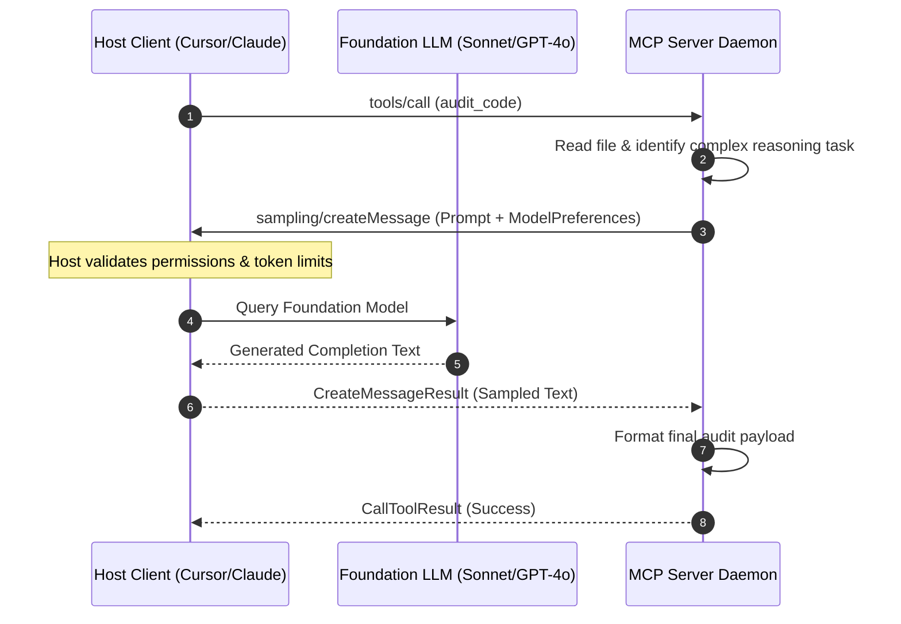

# Sampling and LLM Feedback Loops in MCP

> "Traditionally, tools were dumb calculators and servers were passive data pipes. With MCP Sampling, the server can borrow the host LLM's brain to summarize data, resolve ambiguity, and run autonomous inner-loop reasoning."

---


### Step 1: Why Do We Need This?

#### The Real Problem

Often, an MCP server needs intelligent reasoning of its own while processing a tool or resource request:
- An enterprise PDF server fetches a 300-page scanned document. Returning 300 pages of raw text would blow up the host model's context window. The server needs to summarize the document *before* returning the tool result.
- A database tool receives unstructured natural language search queries and needs to generate valid vector search terms.
- **The Security Nightmare:** Without Sampling, the server author has to embed their own OpenAI or Anthropic API key directly inside the MCP server configuration. This leaks private keys, duplicates billing, and violates zero-trust enterprise security.

#### Why MCP Sampling Solves It

The **Sampling primitive (`sampling/createMessage`)** turns the relationship bidirectional:
- **Zero API Key Leakage:** The MCP server does not need its own LLM API key. It delegates reasoning back to the Host application (Claude Desktop, Cursor, etc.).
- **Centralized Billing & Governance:** All model inferences run under the user's existing host subscription or enterprise corporate contract.
- **Human-in-the-Loop Oversight:** Host applications can inspect server sampling requests and prompt the user for permission before calling the model, preventing runaway token costs.

---

### Step 2: What Is It?

#### Simple Explanation: Consulting the Chief Architect

Think of the MCP Server as an engineer on a construction site, and the Host as the **Chief Architect sitting in the command trailer**:
- The engineer is laying bricks (running code).
- The engineer hits a snag: *"This blueprint has two conflicting measurements. Instead of guessing, let me ask the Chief Architect."*
- The engineer radios the trailer (`sampling/createMessage`): *"Can you review this specific conflict and tell me which tolerance to use?"*
- The Chief Architect evaluates the problem and radios back the decision. The engineer continues working with zero external consultants required!

#### Sampling Parameters Table

| Field | Purpose | Example |
| :--- | :--- | :--- |
| **`messages`** | Array of message objects (`role: "user" / "assistant"`) defining the prompt context. | `[{"role": "user", "content": {"type": "text", "text": "Summarize this log"}}]` |
| **`systemPrompt`** | Custom system instructions governing the sampled generation. | `"You are an expert log analyzer. Extract only ERROR entries."` |
| **`modelPreferences`**| Hints for host model selection (`hints`, `costPriority`, `speedPriority`). | `{"speedPriority": 0.8, "intelligencePriority": 0.2}` |
| **`maxTokens`** | Maximum tokens allowed for the sampled completion. | `1024` |
| **`stopSequences`** | Array of string tokens that immediately halt generation. | `["---END---", "\n\n"]` |

---

### Step 3: Real-World Example

#### The Smart Git Commit Generator

Consider a Git MCP server providing a `create_smart_commit` tool:
1. The tool runs `git diff --staged` locally, producing 2,000 lines of raw code diffs.
2. Rather than returning the giant diff to the host, the server invokes `ctx.session.create_message()`:
   - System prompt: *"Generate a single-line conventional commit message summarizing these staged changes."*
   - User message: The raw diff text.
3. The host application runs Claude 3.5 Sonnet or Claude 3.5 Haiku and returns: `"feat(auth): migrate session tokens to HTTP-only secure cookies"`.
4. The server executes `git commit -m "feat(auth)..."` and returns a concise success confirmation to the user.

---

### Step 4: How Does It Work?

```text
Host Application                                       MCP Server
       │                                                    │
       │ ── 1. initialize (capabilities: {sampling: {}}) ─> │
       │                                                    │
       │ ── 2. tools/call {name: "smart_summarize"} ──────> │
       │                                                    │
       │                                         [Reads raw 10MB file]
       │                                         [Needs LLM summary]
       │                                                    │
       │ <─ 3. sampling/createMessage (Request) ─────────── │
       │                                                    │
       │ [Host prompts user: "Allow server to sample LLM?"] │
       │ [Host dispatches prompt to Foundation Model]       │
       │                                                    │
       │ ── 4. CreateMessageResult (Response) ────────────> │
       │                                                    │
       │                                         [Packages summary]
       │ <─ 5. CallToolResult {content: [{summary}]} ───────│
```

1. **Capability Check:** During handshake, client indicates `"sampling": {}` in capabilities.
2. **Execution Need:** Inside a tool handler, server decides an LLM completion is needed.
3. **Sampling Dispatch:** Server calls `sampling/createMessage` with prompt messages and model hints.
4. **Host Approval & Inference:** Host displays permission dialog (if configured) and calls its configured LLM provider.
5. **Resume Work:** Server receives completion text and resumes execution.

---

### Step 5: Code Example: Python FastMCP Server with Sampling

Here is a complete, runnable Python script showing how an MCP server requests LLM completions using `Context`:

```python
# sampling_server.py
from mcp.server.fastmcp import FastMCP, Context
import mcp.types as types

mcp = FastMCP("AutonomousCodeAuditor")

@mcp.tool()
async def audit_and_refactor_snippet(code: str, ctx: Context) -> str:
    """Audits a code snippet by sampling the host LLM to extract security vulnerabilities."""
    await ctx.info("Sending code snippet to Host LLM via sampling/createMessage...")

    # 1. Construct Sampling Request Payload
    sampling_request = types.CreateMessageRequestParams(
        messages=[
            types.SamplingMessage(
                role="user",
                content=types.TextContent(
                    type="text",
                    text=(
                        f"Review the following Python snippet for OWASP security vulnerabilities.\n"
                        f"If vulnerable, provide the refactored code.\n\n"
                        f"```python\n{code}\n```"
                    )
                )
            )
        ],
        systemPrompt="You are an elite AppSec Security Auditor. Provide concise, bulleted findings followed by clean code.",
        maxTokens=1000,
        # Instruct the host to favor high intelligence over speed
        modelPreferences=types.ModelPreferences(
            intelligencePriority=0.9,
            speedPriority=0.1,
            costPriority=0.1
        )
    )

    # 2. Invoke Sampling on Host Client
    try:
        response = await ctx.session.create_message(sampling_request)
        
        # 3. Extract Generated Text
        sampled_text = ""
        if response.content.type == "text":
            sampled_text = response.content.text

        return f"### Security Audit Result (Generated via Host LLM):\n\n{sampled_text}"
    except Exception as err:
        return f"Sampling failed: {str(err)}. Ensure your host client supports the 'sampling' capability."

if __name__ == "__main__":
    mcp.run(transport="stdio")
```

---

### Step 6: How Is It Used in Production?

#### Production Patterns & Edge Cases

| Scenario | Production Challenge | Recommended Solution |
| :--- | :--- | :--- |
| **Host Lacks Sampling Support** | Older host applications do not support `sampling/createMessage`. | Inspect `ctx.session.client_capabilities.sampling` before calling; fall back to deterministic algorithms if `None`. |
| **Runaway Token Costs** | Server enters an infinite recursive loop calling sampling repeatedly. | Enforce hard max iteration counts (e.g. max 3 sampling loops per tool execution) and set conservative `maxTokens`. |
| **Model Selection Preferences** | Server requests an expensive flagship model for trivial string formatting. | Set `costPriority: 0.9` and `speedPriority: 0.8` to encourage the host to route to lightweight models (Claude 3.5 Haiku, GPT-4o-mini). |
| **Human Approval Friction** | User receives a popup every time the server samples, destroying UX. | Host applications configure domain-level approval rules (e.g. *"Always allow sampling for Git MCP server up to 5,000 tokens"*). |

---

### Step 7: Quick Revision

- **Sampling (`sampling/createMessage`)** allows an MCP server to request LLM generations from the host application.
- Eliminates the need to hardcode API keys or embed foreign LLM libraries inside MCP servers.
- Centralizes billing, security governance, and model selection under the host's configuration.
- Servers can supply **`modelPreferences`** prioritizing `intelligence`, `speed`, or `cost`.
- Always verify client capability support before dispatching sampling requests to ensure backward compatibility.

---

### Step 8: Final Flow Diagram



---

### Step 9: Quiz

1. What primary security advantage does MCP Sampling offer over embedding LLM API keys directly into MCP servers?
   - A) It encrypts the hard drive
   - B) The server never touches or stores API keys; all model queries route through the host's existing subscription and governance
   - C) It prevents users from accessing the internet
   - D) It reduces RAM usage to zero

2. What JSON-RPC method does a server dispatch to request an LLM completion from the host?
   - A) `llm/generate`
   - B) `sampling/createMessage`
   - C) `ai/ask`
   - D) `model/predict`

3. What field in `sampling/createMessage` allows the server to recommend using a fast, economical model instead of a slow, costly one?
   - A) `cpuThrottle`
   - B) `modelPreferences` (e.g. `costPriority: 0.8`, `speedPriority: 0.8`)
   - C) `discountCode`
   - D) `gpuSelection`

4. What must a server do before attempting to call `sampling/createMessage`?
   - A) Reboot the operating system
   - B) Verify that the client declared the `sampling` capability during the initialization handshake
   - C) Charge the user's PayPal account
   - D) Check if it is raining

*Submit your answers (e.g. 1-B, 2-B, 3-B, 4-B) to verify your score!*

