# Authentication and Authorization in MCP

> "An unauthenticated remote MCP server is an open backdoor into your enterprise VPC. Proper authentication verifies WHO is speaking; granular authorization governs WHAT tools and resources they are allowed to touch."

---


### Step 1: Why Do We Need This?

#### The Real Problem

When running MCP over local `stdio`, security is inherited from the operating system user account. But when you deploy MCP servers as **remote HTTP/SSE microservices**:
- Anyone who discovers the URL (`https://mcp-db.internal.corp/sse`) could connect, enumerate internal schemas, and invoke production mutations.
- Different users have different privilege levels: a junior engineer should only query staging data, while a site reliability lead has access to production restart tools.
- Without an identity layer, audit logs cannot trace *which* human developer or automated agent triggered a specific tool call.

#### Why Enterprise Auth Solves It

Securing remote MCP servers requires a standardized **Identity & Access Management (IAM)** layer:
1. **Authentication (AuthN):** Verify identity using industry standards: **OAuth2 / OpenID Connect (OIDC)** Bearer Tokens, API Keys, or Mutual TLS (mTLS).
2. **Authorization (AuthZ):** Enforce **Role-Based Access Control (RBAC)**: filter the tool and resource catalog so users only see and execute actions authorized for their role.
3. **Audit Attribution:** Stamp every tool execution with the authenticated user ID (`sub`), tenant ID, and department in compliance logs.

---

### Step 2: What Is It?

#### Simple Explanation: The Hotel Keycard and VIP Lounge

Think of remote MCP security like an **upscale business hotel**:
- **Authentication (Check-in Desk):** You show your passport and credit card. The hotel gives you an electronic keycard (**JWT Token**).
- **Transport (The Elevator):** You tap your card in the elevator to access the building.
- **Authorization (Floor & Room Access):**
  - Your card opens your standard room (**Read-only developer tools**).
  - Your card *does not* open the penthouse executive suite (**Destructive database tools**)—unless your card has the `Admin` permission programmed into its magnetic stripe (**RBAC Role Claim**).

#### Core Authentication Mechanisms

| Mechanism | Ideal Use Case | Pros | Cons |
| :--- | :--- | :--- | :--- |
| **OAuth2 / OIDC JWT** | User-facing desktop hosts (Cursor, Claude) connecting to enterprise cloud. | Seamless SSO with Okta, Google Workspace, Azure AD. | Requires token refresh handling. |
| **Pre-Shared API Keys** | Automated CI/CD pipelines, background scripts, GitHub Actions. | Simple setup, fast validation. | Key rotation overhead, risk of hardcoded leaks. |
| **Mutual TLS (mTLS)** | Microservice-to-microservice inside Kubernetes service mesh (Istio). | Cryptographically signed at transport layer; zero token overhead. | Complex certificate management (PKI). |

---

### Step 3: Real-World Example

#### The FinTech Tiered Tool Gateway

A financial institution deploys an MCP server for account management:
- **Junior Analyst:** Authenticates via Okta. Roles: `["analyst"]`.
  - When they list tools, they only see: `get_account_balance`, `search_transactions`.
  - Calling `initiate_wire_transfer` returns `403 Forbidden`.
- **Treasury Lead:** Authenticates via Okta with MFA. Roles: `["analyst", "treasury_admin"]`.
  - When they list tools, they see all tools including: `initiate_wire_transfer`.
  - Every transaction is signed with their user ID (`sub: "usr_99182"`), creating an immutable audit trail for SEC compliance.

---

### Step 4: How Does It Work?

```text
Client (Host)                                         Remote MCP SSE Gateway
   │                                                             │
   │ ── 1. GET /sse (Authorization: Bearer <JWT>) ─────────────> │
   │                                                             │ [Validate JWT signature via JWKS]
   │                                                             │ [Extract claims: sub, roles]
   │                                                             │ [Bind UserContext to Session]
   │ <─ 2. HTTP 200 (event: endpoint, data: /msg?sessionId=X) ── │
   │                                                             │
   │ ── 3. POST /msg?sessionId=X (tools/list) ─────────────────> │
   │                                                             │ [Filter tools by user roles]
   │ <─ 4. Return Role-Filtered Tool Catalog ─────────────────── │
   │                                                             │
   │ ── 5. POST /msg?sessionId=X (tools/call: initiate_wire) ──> │
   │                                                             │ [Authorize: Has 'treasury_admin'?]
   │                                                             │ [No: Return isError: true (403)]
   │                                                             │ [Yes: Execute & write audit log]
```

1. **Token Transport:** Client includes the `Authorization` header during the initial `/sse` connection and in subsequent `/messages` POST requests.
2. **Signature Verification:** The server validates the cryptographic signature against the identity provider's public keys (JWKS).
3. **Session Binding:** The decoded user identity and role set are stored in the server's session state.
4. **Catalog Filtering:** When the client requests `tools/list`, the server only returns tools that the user is authorized to execute.
5. **Enforcement:** If a client attempts to forge a tool call to an unauthorized method, the dispatcher blocks execution immediately.

---

### Step 5: Code Example: Python MCP Server with JWT & RBAC

Here is a runnable Python server demonstrating JWT authentication and role-based tool authorization:

```python
# auth_rbac_server.py
import time
import jwt  # pip install pyjwt
from typing import Dict, Any, List

# Secret key for demo (In production, verify using public keys from JWKS)
JWT_SECRET = "super-secure-enterprise-jwt-key"
JWT_ALGORITHM = "HS256"

# Define Tool Permissions Matrix
TOOL_PERMISSIONS = {
    "view_account_metrics": ["analyst", "manager", "admin"],
    "export_financial_report": ["manager", "admin"],
    "purge_customer_data": ["admin"]
}

class AuthenticatedMCPSession:
    def __init__(self, token: str):
        # Authenticate token and extract user claims
        self.user = self._verify_and_authenticate(token)
        print(f"[AUTH SUCCESS]: Connected user '{self.user['username']}' (Roles: {self.user['roles']})")

    def _verify_and_authenticate(self, token: str) -> Dict[str, Any]:
        try:
            payload = jwt.decode(token, JWT_SECRET, algorithms=[JWT_ALGORITHM])
            return {
                "user_id": payload["sub"],
                "username": payload["username"],
                "roles": payload.get("roles", [])
            }
        except jwt.ExpiredSignatureError:
            raise PermissionError("Authentication Failed: JWT token has expired.")
        except jwt.InvalidTokenError as err:
            raise PermissionError(f"Authentication Failed: Invalid token ({str(err)}).")

    def list_authorized_tools(self) -> List[str]:
        """Filters available tools strictly matching user roles."""
        user_roles = set(self.user["roles"])
        authorized = []
        for tool_name, allowed_roles in TOOL_PERMISSIONS.items():
            if user_roles.intersection(allowed_roles):
                authorized.append(tool_name)
        return authorized

    def execute_tool(self, tool_name: str, arguments: Dict[str, Any]) -> Dict[str, Any]:
        """Enforces authorization check before invoking tool logic."""
        if tool_name not in TOOL_PERMISSIONS:
            return {"isError": True, "content": [{"type": "text", "text": f"Tool '{tool_name}' unknown."}]}

        allowed_roles = TOOL_PERMISSIONS[tool_name]
        user_roles = set(self.user["roles"])

        # Check authorization boundary
        if not user_roles.intersection(allowed_roles):
            print(f"[SECURITY ALERT]: User '{self.user['username']}' unauthorized for '{tool_name}'!")
            return {
                "isError": True,
                "content": [
                    {
                        "type": "text",
                        "text": f"403 Forbidden: Your roles {list(user_roles)} lack authorization for '{tool_name}'."
                    }
                ]
            }

        # Simulated Execution with Audit Log
        print(f"[AUDIT LOG]: User '{self.user['username']}' successfully executed '{tool_name}'")
        return {
            "isError": False,
            "content": [{"type": "text", "text": f"Successfully executed '{tool_name}' for user {self.user['username']}."}]
        }

if __name__ == "__main__":
    # Generate mock tokens
    analyst_token = jwt.encode(
        {"sub": "usr-101", "username": "alice_analyst", "roles": ["analyst"], "exp": time.time() + 3600},
        JWT_SECRET, algorithm=JWT_ALGORITHM
    )
    admin_token = jwt.encode(
        {"sub": "usr-999", "username": "bob_admin", "roles": ["admin"], "exp": time.time() + 3600},
        JWT_SECRET, algorithm=JWT_ALGORITHM
    )

    # 1. Analyst Session
    print("--- 1. Testing Analyst Privileges ---")
    session_alice = AuthenticatedMCPSession(analyst_token)
    print("Alice's Visible Tools:", session_alice.list_authorized_tools())
    # Alice runs legal tool
    print(session_alice.execute_tool("view_account_metrics", {}))
    # Alice attempts illegal admin tool
    print(session_alice.execute_tool("purge_customer_data", {}))

    # 2. Admin Session
    print("\n--- 2. Testing Admin Privileges ---")
    session_bob = AuthenticatedMCPSession(admin_token)
    print("Bob's Visible Tools:", session_bob.list_authorized_tools())
    # Bob runs admin tool
    print(session_bob.execute_tool("purge_customer_data", {}))
```

---

### Step 6: How Is It Used in Production?

#### Production Patterns & Edge Cases

| Scenario | Production Challenge | Recommended Solution |
| :--- | :--- | :--- |
| **Token Expiry on SSE Stream** | An SSE connection lasts 8 hours, but JWT expires after 60 minutes. | Client sends refreshed JWT on every upstream `POST /messages`; server periodically re-validates session claims. |
| **Multi-Tenant Data Segregation** | A single shared MCP server serves 100 enterprise customers. | Extract `tenant_id` from the JWT and inject it automatically into all database queries (`WHERE tenant_id = :tenant_id`). |
| **Cursor & Claude Desktop Config** | Passing Authorization headers in standard client configurations. | Use the `headers` block in `claude_desktop_config.json`: `"headers": { "Authorization": "Bearer eyJhbGci..." }`. |
| **Key Rotation & Zero Downtime** | IdP rotates RS256 signing keys every 30 days. | Cache the provider's JWKS (JSON Web Key Set) and refresh dynamically upon encountering an unrecognized key ID (`kid`). |

---

### Step 7: Quick Revision

- Remote MCP servers must enforce both **Authentication** (identity) and **Authorization** (permissions).
- Use **OAuth2 / OIDC JWT tokens** for developer desktop clients and **mTLS** for internal service meshes.
- Filter the tool and resource catalog dynamically in `tools/list` so clients only see actions their role permits.
- Never rely on the LLM to respect permissions; enforce RBAC checks deterministically inside the server dispatcher.
- Stamp all executions with authenticated user IDs to maintain audit logs for compliance.

---

### Step 8: Final Flow Diagram

```mermaid
flowchart TD
    ClientReq["Incoming Client Request with Bearer Token"]:::nodeStyle --> VerifyJWT{"Validate JWT Signature (JWKS)"}:::decision
    
    VerifyJWT -- "Expired / Invalid Signature" --> Reject401["Return 401 Unauthorized"]:::errorStyle
    VerifyJWT -- "Valid" --> ExtractClaims["Extract sub, username, and roles array"]:::actionStyle
    
    ExtractClaims --> RequestType{"Request Type?"}:::decision
    RequestType -- "tools/list" --> FilterTools["Filter tool catalog strictly by user roles"]:::actionStyle
    FilterTools --> ReturnCatalog["Return Scoped Tools"]:::startStyle
    
    RequestType -- "tools/call" --> CheckRBAC{"User roles contain tool permission?"}:::decision
    CheckRBAC -- "No" --> Reject403["Return isError: true (403 Forbidden)"]:::errorStyle
    CheckRBAC -- "Yes" --> AuditLog["Write signed audit log: user + tool"]:::actionStyle
    AuditLog --> Exec["Execute Tool Handler"]:::startStyle

    classDef nodeStyle fill:#0f172a,stroke:#38bdf8,stroke-width:1px,color:#f8fafc;
    classDef decision fill:#854d0e,stroke:#facc15,stroke-width:2px,color:#ffffff;
    classDef errorStyle fill:#7f1d1d,stroke:#f87171,stroke-width:2px,color:#ffffff;
    classDef actionStyle fill:#064e3b,stroke:#34d399,stroke-width:2px,color:#ffffff;
    classDef startStyle fill:#0284c7,stroke:#38bdf8,stroke-width:2px,color:#ffffff;
```



---

### Step 9: Quiz

1. Why must authorization checks be enforced inside the MCP server rather than relying on prompt instructions to the LLM?
   - A) Because LLMs do not know what time it is
   - B) Because prompt instructions can be bypassed by prompt injection, whereas server code deterministically blocks unauthorized calls
   - C) Because servers are cheaper than LLMs
   - D) To make the responses shorter

2. What standard HTTP header carries the OAuth2 user access token when connecting to a remote MCP SSE gateway?
   - A) `Cookie`
   - B) `Authorization: Bearer <token>`
   - C) `User-Agent`
   - D) `Accept-Language`

3. What should an MCP server return in `tools/list` when an authenticated user only has the "Viewer" role?
   - A) All tools in the system with passwords
   - B) Only the read-only tools permitted for the "Viewer" role
   - C) An empty array
   - D) An error 500

4. What is the benefit of Mutual TLS (mTLS) for MCP servers running inside a Kubernetes cluster?
   - A) It guarantees zero network packets are lost
   - B) It provides mutual cryptographic identity verification between pods at the transport layer without managing token lifecycles
   - C) It eliminates the need for Docker
   - D) It bypasses firewalls automatically

*Submit your answers (e.g. 1-B, 2-B, 3-B, 4-B) to verify your score!*

