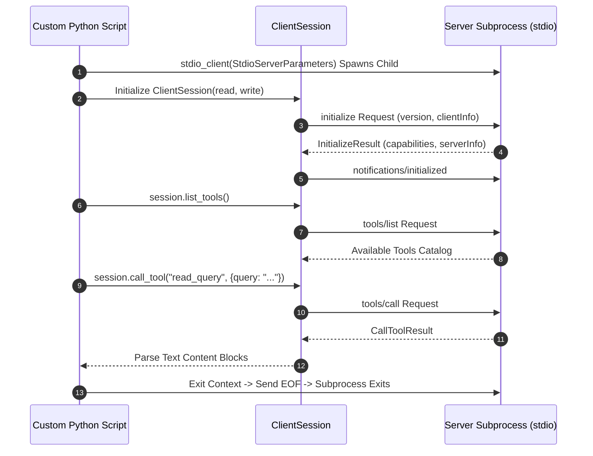

# Building Custom MCP Clients in Python

> "You do not need to rely on Claude Desktop or Cursor to harness the power of MCP. Building your own custom Python client lets you embed standardized MCP tools into automated cron jobs, Slack bots, and enterprise agentic pipelines."

---


### Step 1: Why Do We Need This?

#### The Real Problem

While GUI host applications (Claude Desktop, Cursor) are great for interactive human development, modern enterprise architectures require **headless and automated AI workflows**:
- An automated CI/CD bot on GitHub Actions needs to query a database MCP server to verify migrations before deployment.
- A FastAPI microservice needs to connect to an internal SRE MCP server to auto-remediate failing pods.
- A custom customer service agent needs to connect to three different enterprise MCP servers (Salesforce, Zendesk, Stripe).
- You cannot launch Claude Desktop in a headless Docker container on AWS Lambda; you must write a **custom MCP Client**.

#### Why the Python Client SDK Solves It

The official `mcp` Python SDK provides high-level client primitives:
- **`stdio_client` / `sse_client`:** Asynchronous context managers that spawn subprocesses or open HTTP SSE connections.
- **`ClientSession`:** High-level session manager handling the JSON-RPC lifecycle, handshake negotiation, request/response tracking, and notifications.
- **Asynchronous Execution:** Built on Python's native `asyncio` and `anyio`, allowing one host application to maintain dozens of concurrent client sessions effortlessly.

---

### Step 2: What Is It?

#### Simple Explanation: Building Your Own Web Browser

Think of an MCP Server like a web server (like Wikipedia):
- Chrome, Safari, and Firefox are standard web browsers (**Claude Desktop, Cursor**).
- But if you want to write an automated Python script that fetches pages, you write a Python script using `requests` or `httpx` (**A Custom MCP Client**).
- The custom client speaks the exact same protocol (HTTP / JSON-RPC), but runs autonomously inside your code.

#### Core Python Client Primitives

| Class / Function | Purpose |
| :--- | :--- |
| **`StdioServerParameters`** | Configuration model holding `command`, `args`, and `env` for the child process. |
| **`stdio_client(params)`** | Async context manager spawning the process and yielding read/write streams. |
| **`ClientSession(read, write)`**| The protocol driver managing the active communication channel. |
| **`session.initialize()`** | Dispatches the initialization handshake and negotiates capabilities. |
| **`session.list_tools()`** | Queries available tools from the server. |
| **`session.call_tool(name, args)`**| Dispatches a tool execution request and awaits the result. |

---

### Step 3: Real-World Example

#### The Autonomous DevOps Sentry Bot

An autonomous Python script runs every hour on Kubernetes:
1. It launches a local Git MCP server using `stdio_client`.
2. It initializes a `ClientSession`.
3. It calls `session.list_tools()` and finds `get_unmerged_prs` and `run_security_scan`.
4. It calls `get_unmerged_prs()`, checks for open PRs older than 7 days, and runs security scans.
5. If vulnerabilities are found, it posts an alert directly to Slack—all executed autonomously without human intervention.

---

### Step 4: How Does It Work?

```text
Custom Python Script
       │
       ▼
[stdio_client(StdioServerParameters)] ── Spawns Subprocess
       │
       ▼ Yields (read_stream, write_stream)
[async with ClientSession(read, write) as session]
       │
       ├── 1. await session.initialize()
       │      (Performs protocol version check & capability exchange)
       │
       ├── 2. tools = await session.list_tools()
       │      (Retrieves tool names, descriptions, and JSON Schemas)
       │
       ├── 3. result = await session.call_tool("calc", {"x": 10})
       │      (Sends tools/call and parses CallToolResult)
       │
       ▼
Exits Context Block ── Subprocess gracefully terminated & pipes closed!
```

---

### Step 5: Code Example: Complete Runnable Python MCP Client

Here is a complete, production-ready Python script that launches an MCP server, negotiates the protocol, queries the tool inventory, executes a tool, and reads a resource:

```python
# custom_mcp_client.py
import asyncio
import sys
from mcp import ClientSession, StdioServerParameters
from mcp.client.stdio import stdio_client

async def run_client():
    # 1. Define Server Launch Parameters
    # We will launch the official SQLite MCP server as a demonstration
    server_params = StdioServerParameters(
        command="npx",
        args=["-y", "@modelcontextprotocol/server-sqlite", "--db-path", ":memory:"],
        env=None
    )

    print("[CLIENT]: Spawning MCP Server subprocess...")

    # 2. Open stdio transport streams
    async with stdio_client(server_params) as (read_stream, write_stream):
        print("[CLIENT]: Stdio transport established. Initializing ClientSession...")

        # 3. Create ClientSession instance
        async with ClientSession(read_stream, write_stream) as session:
            # 4. Perform the Handshake
            init_result = await session.initialize()
            print(f"[CLIENT]: Handshake Succeeded! Connected to: {init_result.serverInfo.name} (v{init_result.serverInfo.version})")
            print(f"[CLIENT]: Server Capabilities: {init_result.capabilities}\n")

            # 5. Discover Tools
            print("--- Discovering Available Tools ---")
            tools_response = await session.list_tools()
            for t in tools_response.tools:
                print(f"-> Tool Found: '{t.name}': {t.description}")

            # 6. Call a Tool (Create a test table)
            print("\n--- Executing Tool: 'read_query' to create table ---")
            create_table_sql = "CREATE TABLE employees (id INT PRIMARY KEY, name TEXT, role TEXT);"
            call_result = await session.call_tool(
                name="read_query",
                arguments={"query": create_table_sql}
            )

            # 7. Inspect Tool Results
            print("Tool Execution Status (isError):", call_result.isError)
            for content in call_result.content:
                if content.type == "text":
                    print("Tool Output:", content.text)

            # 8. Insert and Query Data
            print("\n--- Inserting & Querying Data ---")
            await session.call_tool(
                name="read_query",
                arguments={"query": "INSERT INTO employees VALUES (1, 'Ada Lovelace', 'Lead Architect');"}
            )
            query_result = await session.call_tool(
                name="read_query",
                arguments={"query": "SELECT * FROM employees;"}
            )
            for content in query_result.content:
                if content.type == "text":
                    print("Query Result:\n", content.text)

    print("\n[CLIENT]: Session and subprocess closed cleanly.")

if __name__ == "__main__":
    asyncio.run(run_client())
```

---

### Step 6: How Is It Used in Production?

#### Production Patterns & Edge Cases

| Scenario | Production Challenge | Recommended Solution |
| :--- | :--- | :--- |
| **Connecting to Multiple Servers** | A custom agent needs tools from 5 distinct MCP servers. | Maintain a `Dict[str, ClientSession]` dictionary and route tool calls based on server name prefixes (e.g. `db_query`, `github_pr`). |
| **Timeout Protection** | A buggy or hung MCP server takes 5 minutes to answer `list_tools()`. | Wrap calls with `asyncio.wait_for(session.call_tool(...), timeout=15.0)`. |
| **Remote SSE Client** | Connecting to an HTTP/SSE server instead of a local subprocess. | Use `from mcp.client.sse import sse_client` and connect via `async with sse_client("https://.../sse") as (r, w):`. |
| **Crash Recovery & Auto-Restart** | Subprocess dies unexpectedly due to OOM. | Implement an exponential backoff reconnect loop that re-spawns the process and re-runs `initialize()`. |

---

### Step 7: Quick Revision

- You can programmatically connect to any MCP server using the official **`mcp` Python SDK**.
- Use **`StdioServerParameters`** and **`stdio_client`** for subprocesses; use **`sse_client`** for remote HTTP endpoints.
- Always perform **`await session.initialize()`** immediately after connecting before calling tools or reading resources.
- Use **`await session.list_tools()`** to fetch schemas and convert them into your model's format.
- Execute tools with **`await session.call_tool(name, arguments)`** and inspect `content` blocks.

---

### Step 8: Final Flow Diagram



---

### Step 9: Quiz

1. What class in the official Python SDK manages the JSON-RPC message lifecycle, request correlation, and tool dispatch for a client?
   - A) `ServerSession`
   - B) `ClientSession`
   - C) `HttpClient`
   - D) `SubprocessDriver`

2. What method must be invoked on `ClientSession` before requesting tools or resources?
   - A) `session.login()`
   - B) `session.initialize()`
   - C) `session.start()`
   - D) `session.run()`

3. Which context manager is used to connect to a remote MCP server hosted over HTTP Server-Sent Events?
   - A) `stdio_client`
   - B) `sse_client`
   - C) `tcp_client`
   - D) `udp_client`

4. How do you protect a custom Python MCP client from hanging indefinitely if a tool crashes?
   - A) By deleting the tool
   - B) By wrapping client calls in `asyncio.wait_for(..., timeout=N)`
   - C) By increasing the CPU clock speed
   - D) By restarting the router

*Submit your answers (e.g. 1-B, 2-B, 3-B, 4-B) to verify your score!*

