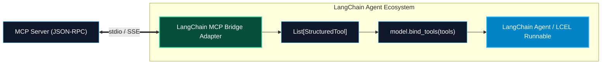

# LangChain MCP Adapters and Tool Bridging

> "Why maintain separate tools for LangChain, separate tools for Claude, and separate tools for Cursor? By bridging MCP servers into LangChain BaseTools, you write your capabilities once as an MCP server and run them inside any LangChain or LangGraph pipeline."

---


### Step 1: Why Do We Need This?

#### The Real Problem

LangChain is the most widely adopted framework for building LLM applications, but historically:
- Developers wrote custom `BaseTool` subclasses tightly coupled to Python code.
- If a team wanted to use the same tool in Claude Desktop, Cursor, or a Node.js microservice, they had to rewrite the tool from scratch in each environment.
- The open-source community is building thousands of standardized MCP servers (PostgreSQL, Brave Search, GitHub, Slack). 
- LangChain developers should not have to wait for someone to write a `langchain-community` wrapper for every single service.

#### Why MCP Adapters Solve It

An **MCP-to-LangChain Adapter** bridges the two worlds:
1. Connects to any standard MCP server via `stdio` or `SSE`.
2. Automatically translates MCP tool schemas into LangChain **`StructuredTool`** objects.
3. Maps JSON Schema parameter constraints into dynamic **Pydantic** models.
4. Routes LangChain's `_arun()` tool execution directly to the MCP server's `session.call_tool()`.

---

### Step 2: What Is It?

#### Simple Explanation: The Universal Plug Adapter

Think of LangChain as a **North American electrical outlet**, and an MCP server as a **European hair dryer with round prongs**:
- You do not throw away the hair dryer or rewire your house wall.
- You snap on an **MCP Adapter plug**: it takes the European prongs (JSON-RPC 2.0 messages) and fits them securely into the American outlet (LangChain's `BaseTool` interface).
- Current flows seamlessly: your LangChain agent can now invoke the MCP server without realizing it is talking across an external protocol.

#### Core Concept Mapping

| MCP Primitive | LangChain Equivalent | Mapping Mechanism |
| :--- | :--- | :--- |
| **`Tool` definition** | `StructuredTool` / `BaseTool` | Tool name and description mapped 1:1. |
| **`inputSchema`** | `args_schema` (Pydantic model) | Dynamically compiled from JSON Schema via `create_model`. |
| **`tools/call`** | `tool.invoke()` / `tool.ainvoke()` | Dispatches JSON-RPC request to `ClientSession`. |
| **`CallToolResult`** | `ToolMessage` / string output | Content blocks concatenated into return string. |

---

### Step 3: Real-World Example

#### The Polyglot LangChain Research Assistant

An AI engineering team uses LangChain LCEL (LangChain Expression Language) to build a market research assistant:
1. The team connects to two external MCP servers:
   - `@modelcontextprotocol/server-brave-search` (Web search)
   - `sqlite-mcp-server` (Financial database)
2. The adapter loads all tools from both servers as a unified list: `[brave_web_search, read_query]`.
3. The tools are bound directly to `ChatOpenAI(model="gpt-4o").bind_tools(tools)`.
4. The LangChain agent reasons, searches the web via Brave MCP, queries financial metrics via SQLite MCP, and answers the user—with zero custom tool code written!

---

### Step 4: How Does It Work?

```text
MCP Server (Postgres Engine)
       │
       │ ── 1. tools/list ────────────────────────────────────────┐
       │                                                          ▼
       │                                            [MCP Adapter Engine]
       │                                            1. Extract tool.name & description
       │                                            2. Convert inputSchema -> Pydantic Model
       │                                            3. Wrap in StructuredTool.from_function
       │                                                          │
       │                                                          ▼
       │                                            List[BaseTool] ready for LangChain!
       │                                                          │
       │                                                          ▼
LangChain Agent Loop                                [llm.bind_tools(tools)]
       │                                                          │
       │ ── 2. LangChain executes tool.ainvoke(args) ─────────────┘
       ▼
session.call_tool(name, args)
       │
       ▼
Returns output string to LangChain ChatMessageHistory!
```

---

### Step 5: Code Example: Production MCP-to-LangChain Bridge

Here is a complete, runnable Python script that converts an MCP server's tools into LangChain `StructuredTool` objects and runs an LCEL agent chain:

```python
# langchain_mcp_bridge.py
import asyncio
from typing import List, Dict, Any
from pydantic import create_model, Field

from mcp import ClientSession, StdioServerParameters
from mcp.client.stdio import stdio_client

from langchain_core.tools import StructuredTool
from langchain_core.messages import HumanMessage, ToolMessage
from langchain_openai import ChatOpenAI

def json_schema_to_pydantic_fields(properties: Dict[str, Any], required: List[str]) -> Dict[str, Any]:
    """Dynamically converts JSON Schema property types into Pydantic field definitions."""
    fields = {}
    type_mapping = {
        "string": str,
        "integer": int,
        "number": float,
        "boolean": bool,
        "array": list,
        "object": dict
    }
    
    for prop_name, prop_meta in properties.items():
        json_type = prop_meta.get("type", "string")
        py_type = type_mapping.get(json_type, Any)
        description = prop_meta.get("description", "")
        
        if prop_name in required:
            fields[prop_name] = (py_type, Field(description=description))
        else:
            default_val = prop_meta.get("default", None)
            fields[prop_name] = (py_type, Field(default=default_val, description=description))
            
    return fields

async def load_mcp_tools(session: ClientSession) -> List[StructuredTool]:
    """Discovers MCP tools and converts them into native LangChain StructuredTools."""
    mcp_tools_resp = await session.list_tools()
    langchain_tools = []

    for tool in mcp_tools_resp.tools:
        # 1. Dynamically build Pydantic schema for tool arguments
        schema_dict = tool.inputSchema or {}
        props = schema_dict.get("properties", {})
        reqs = schema_dict.get("required", [])
        
        fields = json_schema_to_pydantic_fields(props, reqs)
        ArgsSchema = create_model(f"{tool.name}Schema", **fields)

        # 2. Define async execution closure bound to this tool name
        async def _tool_caller(tool_name=tool.name, **kwargs) -> str:
            call_res = await session.call_tool(tool_name, kwargs)
            if call_res.isError:
                return f"Error executing {tool_name}: " + " ".join(c.text for c in call_res.content if c.type == "text")
            return "\n".join(c.text for c in call_res.content if c.type == "text")

        # 3. Create LangChain StructuredTool
        lc_tool = StructuredTool.from_function(
            coroutine=_tool_caller,
            name=tool.name,
            description=tool.description or "",
            args_schema=ArgsSchema
        )
        langchain_tools.append(lc_tool)

    return langchain_tools

async def main():
    # 1. Launch a mock SQLite MCP server
    server_params = StdioServerParameters(
        command="npx",
        args=["-y", "@modelcontextprotocol/server-sqlite", "--db-path", ":memory:"]
    )

    async with stdio_client(server_params) as (read, write):
        async with ClientSession(read, write) as session:
            await session.initialize()
            print("[BRIDGE]: Successfully connected to MCP server.")

            # 2. Convert MCP tools to LangChain tools
            langchain_tools = await load_mcp_tools(session)
            print(f"[BRIDGE]: Converted {len(langchain_tools)} MCP tools to LangChain BaseTools:")
            for t in langchain_tools:
                print(f" - {t.name}: {t.description}")

            # 3. Execute directly via LangChain invoke
            print("\n--- Invoking LangChain tool directly ---")
            query_tool = next(t for t in langchain_tools if t.name == "read_query")
            out = await query_tool.ainvoke({"query": "SELECT 100 * 42 AS answer;"})
            print("Direct LangChain Output:", out)

if __name__ == "__main__":
    asyncio.run(main())
```

---

### Step 6: How Is It Used in Production?

#### Production Patterns & Edge Cases

| Scenario | Production Challenge | Recommended Solution |
| :--- | :--- | :--- |
| **Session Lifetime Binding** | The LangChain tool outlives the `ClientSession` context, causing closed stream errors. | Manage `ClientSession` inside a long-lived application lifespan singleton rather than per-request blocks. |
| **Complex Nested JSON Schemas** | JSON Schema contains nested `$defs` or `anyOf` unions that break simple field parsers. | Use the official `langchain-mcp-adapters` package or `pydantic.TypeAdapter` for full JSON Schema v7 resolution. |
| **Multimodal Content Return** | An MCP tool returns both images (`image/png`) and text. | Parse `call_res.content` and return LangChain multimodal message parts (`{"type": "image_url", "image_url": ...}`). |
| **Tool Name Collisions** | Two MCP servers export a tool named `search`. | Prefix tool names with server namespace when importing into LangChain (e.g. `github__search`, `slack__search`). |

---

### Step 7: Quick Revision

- An MCP-to-LangChain adapter allows any MCP server to be used as standard LangChain **`BaseTool`** objects.
- Parameter schemas are translated into dynamic **Pydantic models** (`args_schema`), ensuring LangChain passes validated arguments.
- Tool executions are dispatched asynchronously via **`session.call_tool()`**.
- Eliminates duplicate tool development across LangChain, Claude Desktop, and Cursor.
- Namespace tool names (`server_prefix__tool_name`) to prevent collisions across multi-server setups.

---

### Step 8: Final Flow Diagram



---

### Step 9: Quiz

1. What class in LangChain represents a strongly-typed tool with a Pydantic argument schema?
   - A) `GenericFunction`
   - B) `StructuredTool`
   - C) `ActionBlock`
   - D) `LambdaTool`

2. How does an MCP adapter convert an MCP tool's `inputSchema` into LangChain's type system?
   - A) By ignoring parameter types completely
   - B) By dynamically compiling the JSON Schema into a Pydantic model (`args_schema`)
   - C) By converting it to XML
   - D) By prompting ChatGPT to rewrite the code

3. What happens if two MCP servers export a tool with the exact same name (e.g. `query`)?
   - A) The computer explodes
   - B) A tool name collision occurs; the adapter should prefix tool names with unique server identifiers
   - C) LangChain deletes both tools
   - D) It executes both simultaneously

4. What is the primary architectural advantage of using MCP tools inside LangChain?
   - A) It makes Python run as fast as C
   - B) Write tool capabilities once as an open MCP server and reuse them across LangChain, LangGraph, Claude, and Cursor
   - C) It eliminates the need for an LLM
   - D) It reduces RAM usage to 0 MB

*Submit your answers (e.g. 1-B, 2-B, 3-B, 4-B) to verify your score!*

