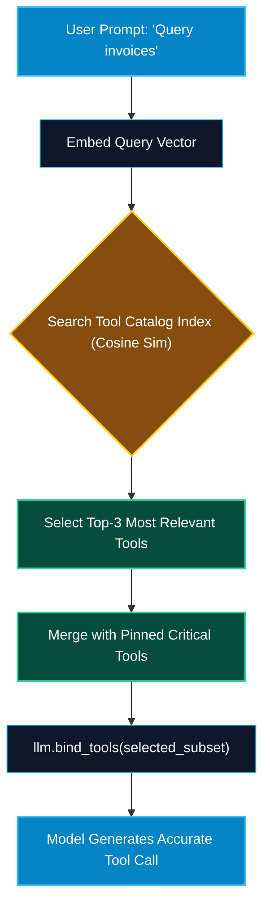

# Dynamic Tool Discovery and Agent Execution

> "If you give an LLM 100 tools at once, its reasoning collapses under cognitive overload. Dynamic Tool Discovery retrieves only the 3 to 5 tools relevant to the current user intent, maximizing precision while slashing token costs."

---


### Step 1: Why Do We Need This?

#### The Real Problem

As an enterprise adopts the Model Context Protocol, the number of available tools grows rapidly:
- You have a Database server (15 tools), a GitHub server (25 tools), an AWS server (40 tools), a Slack server (10 tools), and a Jira server (20 tools)—**over 110 tools total**.
- **Context Window Exhaustion:** Passing 110 detailed JSON Schemas consumes 20,000+ tokens *on every single model turn*, costing thousands of dollars a day.
- **Model Confusion & Tool Hallucination:** Benchmark studies show that as the number of available tools exceeds 15–20, model tool selection accuracy plummets. The model picks the wrong tool or hallucinates arguments.

#### Why Dynamic Discovery Solves It

**Dynamic Tool Discovery** introduces a two-tier retrieval architecture:
1. **Tool Catalog Registry:** All connected MCP servers register their tools and natural language descriptions into an in-memory vector or keyword index.
2. **Intent-Based Retrieval:** When the user enters a prompt, the system performs semantic search to retrieve only the **top-K most relevant tools** (e.g., top 4).
3. **Dynamic Binding:** Only those 4 tools are bound to the model for that conversation turn.

---

### Step 2: What Is It?

#### Simple Explanation: The Department Store Directory

Imagine walking into a massive 10-story department store with 50,000 items:
- You do not want a clerk to read the entire 50,000-item inventory catalog to you at the front entrance.
- You look at the **Store Directory board** (Dynamic Index): *"I need new running shoes."*
- The directory points you directly to **Floor 4, Athletic Footwear** (Target MCP Server). You review only the running shoes on that shelf, pick your model, and check out in seconds.

#### Core Components of a Dynamic Tool Router

| Component | Purpose | Technical Implementation |
| :--- | :--- | :--- |
| **Tool Registry** | Central map of all connected MCP servers and their exported tools. | Dictionary of `server_id -> List[Tool]`. |
| **Semantic Tool Index** | Vector store or BM25 index embedding tool descriptions. | ChromaDB, pgvector, or in-memory cosine similarity. |
| **Tool Retriever** | Queries the index with user prompt and yields top-K tool schemas. | `retriever.get_relevant_tools(query, top_k=4)`. |
| **Dynamic Model Binder** | Binds the retrieved subset to the LLM on the fly. | `model.bind_tools(selected_tools)`. |

---

### Step 3: Real-World Example

#### The Enterprise IT Helpdesk Agent

An IT support agent is connected to 5 MCP servers:
1. User prompt: *"Can you grant Alice access to the production analytics read-only replica in AWS RDS?"*
2. **Without Dynamic Discovery:** All 120 tools from AWS, Slack, GitHub, Jira, and PostgreSQL are injected into the context window.
3. **With Dynamic Discovery:** The retriever runs semantic similarity between the user prompt and all tool descriptions:
   - Matches: `aws_rds_grant_access` (score: 0.92), `postgres_verify_user` (score: 0.88), `aws_iam_list_roles` (score: 0.84).
   - Ignored: All 117 unrelated tools (Slack channels, GitHub PRs, S3 buckets).
4. The model receives only the 3 relevant tools, selects `aws_rds_grant_access` with 100% precision, and completes the task in 1.2 seconds.

---

### Step 4: How Does It Work?

```text
User Query: "Check why customer #104 was double billed in Stripe"
                       │
                       ▼
            [Semantic Tool Retriever]
   (Searches index of 150 tool descriptions across 6 MCP servers)
                       │
                       ▼ Top-3 Tools Retrieved:
   1. stripe_get_customer_charges (Score: 0.94)
   2. stripe_refund_charge        (Score: 0.91)
   3. postgres_query_ledger       (Score: 0.87)
                       │
                       ▼
            [Dynamic LLM Binding]
         llm.bind_tools([Tool1, Tool2, Tool3])
                       │
                       ▼
            [Model Calls Tool1 & Resolves Query]
```

---

### Step 5: Code Example: Python Semantic Tool Discovery Engine

Here is a complete, runnable Python script demonstrating dynamic tool retrieval and execution:

```python
# dynamic_tool_router.py
import math
from typing import List, Dict, Any

class MockEmbeddingEngine:
    """Simulates text embeddings for semantic similarity demonstration."""
    KEYWORDS = {
        "database": [1.0, 0.0, 0.0, 0.1],
        "sql": [0.9, 0.1, 0.0, 0.0],
        "github": [0.0, 1.0, 0.0, 0.2],
        "pr": [0.0, 0.9, 0.1, 0.0],
        "cloud": [0.0, 0.0, 1.0, 0.1],
        "billing": [0.2, 0.0, 0.8, 0.9],
        "payment": [0.1, 0.0, 0.7, 1.0]
    }

    @classmethod
    def get_embedding(cls, text: str) -> List[float]:
        vec = [0.0, 0.0, 0.0, 0.0]
        words = text.lower().split()
        for w in words:
            for kw, kw_vec in cls.KEYWORDS.items():
                if kw in w:
                    vec = [v + kv for v, kv in zip(vec, kw_vec)]
        norm = math.sqrt(sum(x * x for x in vec)) or 1.0
        return [x / norm for x in vec]

def cosine_similarity(v1: List[float], v2: List[float]) -> float:
    return sum(a * b for a, b in zip(v1, v2))

class DynamicToolRouter:
    def __init__(self):
        # Master catalog of registered MCP tools across multiple servers
        self.catalog: List[Dict[str, Any]] = []

    def register_tool(self, server_name: str, tool_name: str, description: str):
        embedding = MockEmbeddingEngine.get_embedding(f"{tool_name} {description}")
        self.catalog.append({
            "server": server_name,
            "name": tool_name,
            "description": description,
            "embedding": embedding
        })

    def retrieve_relevant_tools(self, query: str, top_k: int = 2) -> List[Dict[str, Any]]:
        """Finds top-K relevant tools based on cosine similarity."""
        query_vec = MockEmbeddingEngine.get_embedding(query)
        scored = []
        for tool in self.catalog:
            score = cosine_similarity(query_vec, tool["embedding"])
            scored.append((score, tool))

        # Sort descending by score
        scored.sort(key=lambda x: x[0], reverse=True)
        return [item[1] for item in scored[:top_k]]

if __name__ == "__main__":
    router = DynamicToolRouter()

    # Register 6 tools from 3 different servers
    router.register_tool("postgres-server", "query_database_sql", "Executes SQL queries against relational tables.")
    router.register_tool("postgres-server", "inspect_table_schema", "Shows database table column definitions and types.")
    router.register_tool("github-server", "create_pull_request", "Opens a new pull request on a GitHub repository.")
    router.register_tool("github-server", "review_pr_diff", "Inspects code differences and comments on GitHub PR.")
    router.register_tool("billing-server", "refund_payment", "Issues a credit card refund for a customer billing transaction.")
    router.register_tool("billing-server", "get_invoice_history", "Retrieves past payment invoices and receipts.")

    print(f"[ROUTER]: Registered {len(router.catalog)} total tools in dynamic catalog.\n")

    # Test Query 1: Finance
    q1 = "A customer is disputing a payment charge. Can we refund them?"
    selected_1 = router.retrieve_relevant_tools(q1, top_k=2)
    print(f"Query: '{q1}'")
    print("Dynamically Selected Tools:", [t["name"] for t in selected_1])

    # Test Query 2: Software Dev
    print()
    q2 = "I finished the bug fix. Can you open a PR on github?"
    selected_2 = router.retrieve_relevant_tools(q2, top_k=2)
    print(f"Query: '{q2}'")
    print("Dynamically Selected Tools:", [t["name"] for t in selected_2])
```

---

### Step 6: How Is It Used in Production?

#### Production Patterns & Edge Cases

| Scenario | Production Challenge | Recommended Solution |
| :--- | :--- | :--- |
| **Server Failover & Redundancy** | Primary PostgreSQL MCP server crashes during a critical query. | Router detects disconnect and automatically fails over tool dispatch to a standby read-replica MCP server. |
| **Always-On Core Tools** | Critical tools (like `calculator` or `exit_conversation`) must never be filtered out. | Designate a `pinned_tools` list that is always included alongside the dynamically retrieved top-K tools. |
| **Stale Index Embeddings** | Server tools change dynamically at runtime. | Re-index tools when server emits `notifications/tools/list_changed`. |
| **Retriever Misses Relevant Tool** | User prompt uses informal jargon that vector search ranks low. | Implement Hybrid Search combining BM25 keyword matching with dense vector embeddings. |

---

### Step 7: Quick Revision

- Exposing 100+ tools simultaneously degrades LLM reasoning and consumes excessive context tokens.
- **Dynamic Tool Discovery** uses semantic search to bind only the **top-K relevant tools** per turn.
- The router listens for **`notifications/tools/list_changed`** to keep the tool index fresh.
- Always include **pinned tools** (e.g., standard utilities) that should never be excluded.
- Implement automatic **server failover** to maintain high availability across redundant MCP nodes.

---

### Step 8: Final Flow Diagram



---

### Step 9: Quiz

1. Why is passing 100+ tools to an LLM simultaneously considered an anti-pattern?
   - A) Because the keyboard will stop responding
   - B) It exhausts token budgets and degrades model tool-selection accuracy
   - C) Because JSON only allows 10 items
   - D) It violates copyright law

2. What technique is used by Dynamic Tool Discovery to select the best tools for a user query?
   - A) Random coin flip
   - B) Semantic search (vector similarity / BM25) over tool names and descriptions
   - C) Sorting alphabetically
   - D) Asking the user to type the tool's memory address

3. What notification informs the dynamic tool router that an MCP server has updated its tool inventory?
   - A) `notifications/tools/list_changed`
   - B) `alert/tools_modified`
   - C) `reload/tools`
   - D) `event/refresh`

4. What is the role of "pinned tools" in a dynamic discovery router?
   - A) Tools that cannot be run on Mondays
   - B) Essential utilities that are always bound to the model regardless of the search query
   - C) Tools that require a 4-digit PIN code
   - D) Deprecated tools scheduled for deletion

*Submit your answers (e.g. 1-B, 2-B, 3-A, 4-B) to verify your score!*

