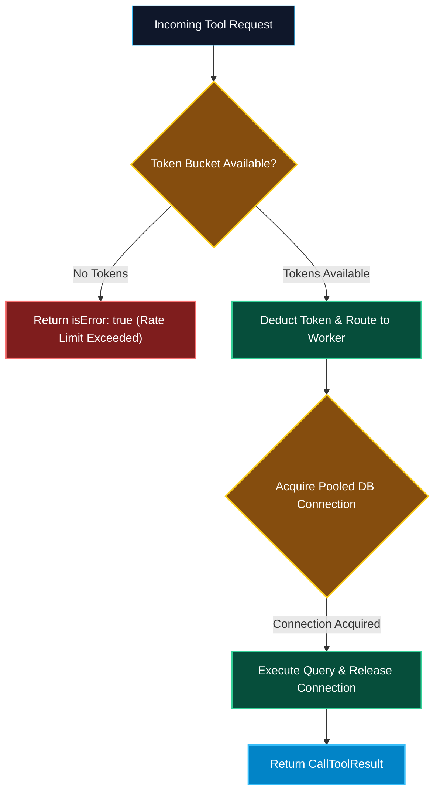

# Rate Limiting, Caching, and Connection Pools in MCP

> "An uncontrolled autonomous agent can invoke a tool 50 times in two seconds. Without distributed rate limiting, intelligent resource caching, and connection pooling, your AI agents will inadvertently launch a Denial of Service attack against your own backend databases."

---


### Step 1: Why Do We Need This?

#### The Real Problem

LLM agents behave very differently from human users:
- When a human uses a software tool, they click, pause, read, and type (1 request every 5–10 seconds).
- When an autonomous agent enters a loop, it can trigger **30 tool calls per second**, overwhelming downstream APIs (Stripe, GitHub, Jira) and triggering immediate `429 Too Many Requests` or massive API overage charges.
- Agents frequently re-read the exact same static resources (e.g. `postgres://schema/v1` or `api://docs`) on every single prompt turn, generating redundant database load.
- Spawning new TCP and SSL handshakes for every tool call introduces 100–300ms of unnecessary latency.

#### Why Rate Limiting, Caching, and Pooling Solve It

Enterprise MCP Gateways implement a three-pillar performance shield:
1. **Token-Bucket Rate Limiting:** Enforces per-user and per-tool quotas (e.g. max 10 calls/minute for expensive financial tools) to prevent runaway loops.
2. **Resource Caching (Redis Cache-Aside):** Caches `resources/read` payloads with Time-To-Live (TTL) or invalidates them dynamically via `notifications/resources/updated`.
3. **Connection Pooling:** Maintains warm, multiplexed database and HTTP connection pools to eliminate handshake overhead.

---

### Step 2: What Is It?

#### Simple Explanation: The Highway Toll Plaza and Rest Stop

Think of requests heading into your database like **vehicles on a crowded expressway**:
- **Connection Pools (The Express Lanes):** Instead of stopping to build a brand new bridge across the river for every single car, the highway keeps 10 paved bridge lanes open at all times.
- **Rate Limiting (The Toll Plaza Gates):** Prevents too many cars from flooding onto a bridge at once. If traffic exceeds capacity, the gate metered release holds cars back smoothly.
- **Resource Caching (The Rest Stop Convenience Store):** Instead of driving 50 miles into the city to buy a roadmap, the information desk at the highway rest stop already has the roadmap printed and handed to you instantly.

#### Core Performance Building Blocks

| Technique | Where Applied | Key Benefit |
| :--- | :--- | :--- |
| **Token-Bucket Rate Limiting** | Gateway Tool Dispatcher | Throttles runaway agent loops; protects downstream API limits. |
| **Redis Cache-Aside** | Resource Provider (`resources/read`) | Delivers sub-millisecond context payloads; reduces DB CPU. |
| **Connection Pooling** | Database & HTTP Clients | Reuses persistent TCP connections; eliminates handshake latency. |

---

### Step 3: Real-World Example

#### The High-Throughput E-Commerce Incident

An e-commerce company connects 50 support agents to a Customer Database MCP server:
- Agent A runs an automated customer history audit. The model enters a tight loop calling `query_customer_orders` 80 times in 10 seconds.
- **Rate Limiter Action:** The token bucket exhausts after 20 calls. The gateway intercepts call #21 and returns `isError: true`: *"Rate limit exceeded for tool 'query_customer_orders'. Please retry in 5 seconds."*
- The model pauses, summarizes the first 20 orders, and reports back safely without crashing the customer database.
- Meanwhile, all 50 agents frequently read `store://catalog/taxonomy`. The gateway caches the 2MB taxonomy tree in Redis with a 1-hour TTL, serving 99% of requests from RAM in 0.4ms.

---

### Step 4: How Does It Work?

```text
Incoming tools/call or resources/read
                  │
                  ▼
      [Token Bucket Rate Limiter] ── Limit Exceeded ──> Return 429 / isError: true
                  │ Allowed
                  ▼
        Request Type Check?
        ┌─────────┴─────────┐
        ▼                   ▼
[resources/read]      [tools/call]
        │                   │
  Check Redis Cache   Borrow pooled connection
  ┌─────┴─────┐             │
 Hit        Miss            ▼
  │           │       Execute SQL / API
  ▼           ▼             │
Return      Fetch DB        ▼
In-Memory   Store Redis  Return pooled connection
  │           │             │
  └─────┬─────┘             ▼
        ▼              Return CallToolResult
  Return Payload
```

---

### Step 5: Code Example: Python Rate Limiter & Resource Cache

Here is a complete, runnable Python script implementing a Token-Bucket Rate Limiter and an in-memory TTL Resource Cache for MCP:

```python
# rate_limited_cache_gateway.py
import time
from typing import Dict, Any, Optional

class TokenBucketRateLimiter:
    """Implements token-bucket rate limiting for MCP tools."""
    def __init__(self, capacity: int, refill_rate_per_sec: float):
        self.capacity = capacity
        self.refill_rate = refill_rate_per_sec
        self.tokens = float(capacity)
        self.last_refill = time.time()

    def allow_request(self, cost: int = 1) -> bool:
        now = time.time()
        elapsed = now - self.last_refill
        # Refill tokens based on elapsed time
        self.tokens = min(float(self.capacity), self.tokens + elapsed * self.refill_rate)
        self.last_refill = now

        if self.tokens >= cost:
            self.tokens -= cost
            return True
        return False

class ResourceCache:
    """Implements Time-To-Live (TTL) caching for MCP resources."""
    def __init__(self, default_ttl_sec: int = 60):
        self.cache: Dict[str, Dict[str, Any]] = {}
        self.default_ttl = default_ttl_sec

    def get(self, uri: str) -> Optional[str]:
        entry = self.cache.get(uri)
        if not entry:
            return None
        if time.time() > entry["expires_at"]:
            del self.cache[uri]
            return None
        return entry["data"]

    def set(self, uri: str, data: str, ttl: Optional[int] = None):
        lifespan = ttl or self.default_ttl
        self.cache[uri] = {
            "data": data,
            "expires_at": time.time() + lifespan
        }

class ResilientMCPGateway:
    def __init__(self):
        # Allow burst of 5 calls, refilling at 1 token every 2 seconds (0.5/sec)
        self.limiter = TokenBucketRateLimiter(capacity=5, refill_rate_per_sec=0.5)
        self.cache = ResourceCache(default_ttl_sec=3)

    def read_resource(self, uri: str) -> Dict[str, Any]:
        """Cache-Aside pattern for reading resources."""
        cached_text = self.cache.get(uri)
        if cached_text:
            print(f"[CACHE HIT]: Serving '{uri}' directly from in-memory cache.")
            return {"uri": uri, "text": cached_text, "fromCache": True}

        print(f"[CACHE MISS]: Fetching '{uri}' from slow backend storage...")
        # Simulate slow DB / filesystem read
        fresh_data = f"Latest schema definitions for {uri} at timestamp: {time.time():.2f}"
        self.cache.set(uri, fresh_data, ttl=3)
        return {"uri": uri, "text": fresh_data, "fromCache": False}

    def call_tool(self, name: str, args: Dict[str, Any]) -> Dict[str, Any]:
        """Rate-limited tool invocation."""
        if not self.limiter.allow_request():
            return {
                "isError": True,
                "content": [
                    {
                        "type": "text",
                        "text": f"Rate Limit Exceeded: Tool '{name}' has exceeded its quota. Please back off."
                    }
                ]
            }

        return {
            "isError": False,
            "content": [{"type": "text", "text": f"Successfully executed tool '{name}'."}]
        }

if __name__ == "__main__":
    gateway = ResilientMCPGateway()

    # 1. Test Resource Caching (TTL = 3 seconds)
    print("--- 1. Testing Resource Caching ---")
    print(gateway.read_resource("postgres://schema/orders"))
    print(gateway.read_resource("postgres://schema/orders")) # Should hit cache!

    # 2. Test Rate Limiting (Burst Capacity = 5)
    print("\n--- 2. Testing Rate Limiting (Burst of 7 Rapid Calls) ---")
    for i in range(1, 8):
        res = gateway.call_tool("execute_heavy_sql", {"id": i})
        status = "ALLOWED" if not res["isError"] else "THROTTLED"
        print(f"Call #{i}: {status} -> {res['content'][0]['text']}")
```

---

### Step 6: How Is It Used in Production?

#### Production Patterns & Edge Cases

| Scenario | Production Challenge | Recommended Solution |
| :--- | :--- | :--- |
| **Distributed Multi-Pod Gateway** | Multiple gateway pods need unified rate limiting across cluster. | Implement Token Bucket using Redis Lua scripts (`redis.call('EVAL', ...)`) for atomic token decrements. |
| **Immediate Cache Invalidation** | Schema migration alters database table; cached schema is now stale. | When a migration tool completes, emit `notifications/resources/updated` and evict key from Redis immediately. |
| **Database Pool Starvation** | Slow analytical queries exhaust all 20 connections in pool. | Segregate pools: maintain separate connection pools for analytical reads vs transactional writes. |
| **Client-Side Exponential Backoff** | Client hammer gateway immediately upon receiving a rate-limit error. | Include a `Retry-After: 5` header or recommend backoff intervals in the `isError` text payload. |

---

### Step 7: Quick Revision

- Rate limiting is mandatory to protect downstream services from runaway autonomous agent loops.
- Use the **Token-Bucket algorithm** to allow reasonable burst activity while enforcing strict sustained throughput limits.
- Implement the **Cache-Aside pattern** for `resources/read` to avoid hammering databases with identical schema queries.
- Evict cached resources dynamically when the server fires **`notifications/resources/updated`**.
- Reuse persistent **connection pools** to eliminate TLS/TCP handshake latency on every tool call.

---

### Step 8: Final Flow Diagram



---

### Step 9: Quiz

1. Why are autonomous AI agents more prone to causing backend Denial of Service than human operators?
   - A) Because agents use more electricity
   - B) Because agents can execute tool calling loops programmatically in milliseconds without human reaction delays
   - C) Because agents only use Linux
   - D) Because agents do not have IP addresses

2. What algorithm is standard for enforcing rate limits while allowing short bursts of tool calls?
   - A) Bubble Sort
   - B) Token Bucket
   - C) Binary Search
   - D) Dijkstra's Algorithm

3. How should an MCP gateway handle an incoming `resources/read` request if the data is already stored in its Redis cache?
   - A) Discard the request
   - B) Return the cached payload immediately without querying the backend database
   - C) Re-query the database to make sure Redis was not lying
   - D) Shut down the server

4. What notification allows an MCP server to invalidate a cached resource immediately when data changes?
   - A) `notifications/resources/updated`
   - B) `cache/delete`
   - C) `alert/flush`
   - D) `redis/evict`

*Submit your answers (e.g. 1-B, 2-B, 3-B, 4-A) to verify your score!*

