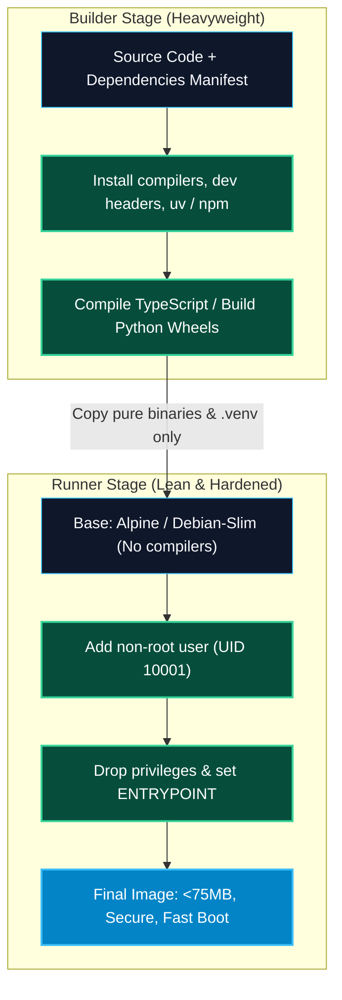

# Dockerizing and Packaging MCP Servers

> "A 1.5GB Docker image with compiler tools and root privileges is an invitation for slow cold starts and security vulnerabilities. Production MCP packaging demands multi-stage builds, minimal Distroless runtimes, and sub-100MB footprints."

---


### Step 1: Why Do We Need This?

#### The Real Problem

When transitioning an MCP server from a developer laptop to cloud infrastructure:
- **Environment Drift:** A Python script that works on macOS fails on Linux due to missing native C libraries (`libpq-dev`, `gcc`).
- **Bloated Images:** Naive Dockerfiles that copy the entire project tree and leave build tools (`gcc`, `pip`, `npm`) installed produce 1.2GB–2GB container images.
- **Cold Start Latency:** On serverless platforms (Google Cloud Run, AWS Fargate), downloading a 2GB image introduces 15–30 seconds of cold-start delay before the first SSE connection opens.
- **Root Vulnerabilities:** Running containers as `root` grants unnecessary privileges that can lead to host container breakout exploits.

#### Why Production Packaging Solves It

Modern container packaging enforces strict optimization:
1. **Multi-Stage Builds:** Compile dependencies in a heavyweight `builder` stage, but copy only the pure runtime binaries into a lean `runner` stage.
2. **Minimal Base Images:** Use Alpine Linux or Google Container Tools **Distroless** images to shrink image sizes to under 75MB.
3. **Layer Caching:** Order `COPY` and `RUN` instructions so dependency caches invalidate only when `package.json` or `pyproject.toml` changes.
4. **Non-Root Execution:** Always create an unprivileged system user (`UID 10001`) with dropped capabilities.

---

### Step 2: What Is It?

#### Simple Explanation: The Clean Delivery Truck

Think of building a container like **manufacturing a high-performance sports car**:
- **Builder Stage (The Factory):** You need heavy cranes, welders, metal presses, and blueprints (`gcc`, `python-dev`, `npm`).
- **Runner Stage (The Showroom Floor):** Once the car is assembled, you drive the car onto the street. You do not tow the welding machines, scrap metal, and cranes behind the car!
- The resulting container contains *only* the car, making it lightweight, fast, and secure.

#### Core Container Directives for MCP

| Directive | Purpose | Best Practice for MCP |
| :--- | :--- | :--- |
| **`FROM python:3.12-slim`** | Base OS image selection. | Use `-slim` or `-alpine` instead of full Debian bases. |
| **`COPY --from=builder`** | Copies compiled dependencies without build tools. | Keep runner image devoid of compilers and package managers. |
| **`USER 10001:10001`** | Drops root permissions. | Never run as root; prevent privilege escalation. |
| **`EXPOSE 8000`** | Documents network port for SSE servers. | Not needed for stdio-only containers. |

---

### Step 3: Real-World Example

#### The Ultra-Lightweight FastMCP Production Container

An enterprise data platform packages their Python FastMCP database server:
- Initial naive build: **1.35 GB** (Ubuntu base + build-essential + pip cache).
- Optimized multi-stage build using `python:3.12-slim` and `uv`: **68 MB**.
- **Cold-start reduction:** Image pull time in AWS ECS dropped from 22 seconds to **1.1 seconds**.

---

### Step 4: How Does It Work?

```text
[BUILDER STAGE]
  Base: python:3.12-slim
  - Install gcc, libpq-dev
  - Install dependencies into virtualenv (/app/.venv) using uv / pip
          │
          ▼ (Only compiled .venv is copied across the boundary)
[RUNNER STAGE]
  Base: python:3.12-slim (Pure runtime)
  - Create non-root user (UID 10001)
  - Copy /app/.venv from builder
  - Copy application code (server.py)
  - Set USER 10001
  - Set ENTRYPOINT ["python", "server.py"]
```

---

### Step 5: Code Example: Production Multi-Stage Dockerfiles

#### 1. Production Python FastMCP Dockerfile

```dockerfile
# Dockerfile.python-mcp
# Stage 1: Build & Dependency Resolution
FROM python:3.12-slim AS builder

WORKDIR /app

# Install uv for blazing-fast, deterministic dependency compilation
COPY --from=ghcr.io/astral-sh/uv:latest /uv /bin/uv

# Copy dependency manifests first to maximize Docker layer caching
COPY pyproject.toml requirements.txt ./

# Install dependencies into dedicated virtualenv
RUN uv venv /opt/venv && \
    uv pip install --no-cache -r requirements.txt

# Stage 2: Hardened Runtime Container
FROM python:3.12-slim AS runner

WORKDIR /app

# Create unprivileged system user
RUN groupadd -g 10001 mcpgrp && \
    useradd -u 10001 -g mcpgrp -s /bin/false mcpuser

# Copy virtual environment and source code
COPY --from=builder /opt/venv /opt/venv
COPY server.py ./

# Set environment paths and disable Python buffering
ENV PATH="/opt/venv/bin:$PATH" \
    PYTHONUNBUFFERED=1 \
    PYTHONDONTWRITEBYTECODE=1

USER 10001:10001

# For SSE server: EXPOSE 8000
# For Stdio server: No EXPOSE needed

ENTRYPOINT ["python", "server.py"]
```

#### 2. Production TypeScript Node.js MCP Dockerfile

```dockerfile
# Dockerfile.typescript-mcp
# Stage 1: Build TypeScript to JavaScript
FROM node:20-alpine AS builder

WORKDIR /app
COPY package*.json tsconfig.json ./
RUN npm ci

COPY src/ ./src/
RUN npm run build && npm prune --production

# Stage 2: Minimal Distroless / Alpine Runner
FROM node:20-alpine AS runner

WORKDIR /app

# Create non-root user
RUN addgroup -S -g 10001 mcpgrp && \
    adduser -S -u 10001 -G mcpgrp mcpuser

COPY --from=builder --chown=mcpuser:mcpgrp /app/node_modules ./node_modules
COPY --from=builder --chown=mcpuser:mcpgrp /app/dist ./dist
COPY --from=builder --chown=mcpuser:mcpgrp /app/package.json ./package.json

USER 10001:10001
ENV NODE_ENV=production

ENTRYPOINT ["node", "dist/index.js"]
```

#### 3. Essential `.dockerignore` File

```text
# .dockerignore
.git
.github
node_modules
dist
__pycache__
*.pyc
.env*
.venv
venv
Dockerfile*
*.log
```

---

### Step 6: How Is It Used in Production?

#### Production Patterns & Edge Cases

| Scenario | Production Challenge | Recommended Solution |
| :--- | :--- | :--- |
| **PID 1 Zombie Process Reaping** | Node.js running as PID 1 in container fails to forward SIGTERM or reap child zombies. | Install `tini` or `dumb-init` as the container entrypoint (`ENTRYPOINT ["tini", "--", "node", "index.js"]`). |
| **Native C Database Drivers** | Python `psycopg2` requires complex C shared libraries (`libpq.so.5`). | Switch to pure-Python or async drivers like `asyncpg` or install `libpq5` in the runner stage without full dev headers. |
| **Container Layer Cache Invalidation**| Modifying one line in `server.py` forces Docker to re-download all NPM/pip dependencies. | Always `COPY` manifest files (`package.json`, `requirements.txt`) before copying source directories. |
| **Secrets in Image Layers** | Accidentally baking `DATABASE_URL` into `ENV` in the Dockerfile. | Never set secrets in Dockerfiles; pass secrets dynamically at runtime via Kubernetes Secrets or AWS Secrets Manager. |

---

### Step 7: Quick Revision

- Always use **multi-stage Docker builds** to isolate build tools (`gcc`, `npm ci`) from production runtimes.
- Use **`-slim`** or **`-alpine`** base images to keep final image footprints under 100MB.
- Optimize layer caching by copying dependency manifests (`package.json`, `pyproject.toml`) before source code.
- Always run containers as a **non-root user** (`USER 10001:10001`).
- Set **`PYTHONUNBUFFERED=1`** to ensure immediate stdio JSON-RPC message flushing.

---

### Step 8: Final Flow Diagram



---

### Step 9: Quiz

1. Why are multi-stage Docker builds recommended for production MCP servers?
   - A) They make the code open source
   - B) They separate compiler tools and dev dependencies from the final image, drastically reducing image size and attack surface
   - C) They require less RAM on the developer's laptop
   - D) They eliminate the need for Docker

2. Why should `requirements.txt` or `package.json` be copied before the rest of the application code in a Dockerfile?
   - A) To make the file read in alphabetical order
   - B) To take advantage of Docker layer caching so dependencies are only re-installed when manifests change
   - C) It is required by the Docker daemon syntax
   - D) To format the JSON

3. What user should execute the MCP server inside a production container?
   - A) `root`
   - B) An unprivileged non-root user (e.g. `UID 10001`)
   - C) `admin`
   - D) `guest`

4. What tool helps Node.js containers properly handle Unix signals (SIGTERM) and reap zombie processes when running as PID 1?
   - A) `tini` or `dumb-init`
   - B) Webpack
   - C) Babel
   - D) ESLint

*Submit your answers (e.g. 1-B, 2-B, 3-B, 4-A) to verify your score!*

