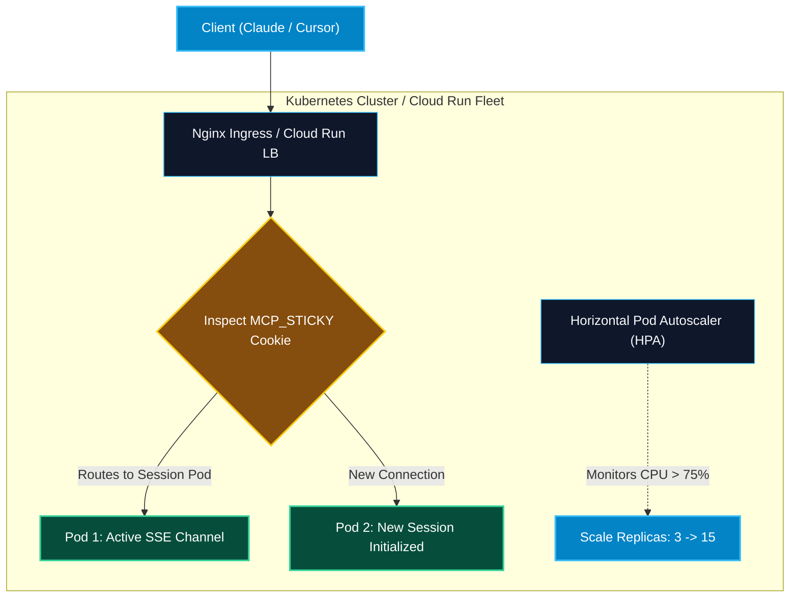

# Kubernetes and Cloud Run Deployment for MCP

> "A single container on a lone VM is a single point of failure. Deploying your MCP server to Kubernetes and Google Cloud Run ensures high availability, automated rolling updates, and elastic auto-scaling under heavy agent workloads."

---


### Step 1: Why Do We Need This?

#### The Real Problem

Running a remote MCP SSE server on a single bare VM introduces serious enterprise risks:
- If the server process crashes due to an out-of-memory error, all active agent conversations disconnect abruptly.
- During high-traffic hours, 200 developers querying databases simultaneously can spike CPU to 100%, causing tool requests to time out.
- Performing an update requires stopping the process, causing downtime.
- In serverless environments, default HTTP timeouts can sever long-lived SSE connections after 60 seconds.

#### Why Cloud Orchestration Solves It

Modern container platforms provide enterprise orchestration:
1. **Kubernetes:** Provides self-healing pods, **Horizontal Pod Autoscaling (HPA)**, rolling zero-downtime updates, and declarative ingress management.
2. **Google Cloud Run / AWS ECS:** Offers fully managed, serverless execution with automatic TLS certificates, pay-per-use billing, and seamless scaling from zero to thousands of instances.
3. **Health Probes:** Distinct **Liveness** (`/healthz`) and **Readiness** (`/readyz`) probes guarantee traffic routes only to healthy pods.

---

### Step 2: What Is It?

#### Simple Explanation: The Coordinated Fleet of Delivery Vans

Think of a single container like **one delivery driver**:
- If that driver gets a flat tire, all deliveries stop.
- **Kubernetes is the automated Fleet Manager**:
  - Keeps 5 vans on the road at all times (**Deployment replicas**).
  - If a van breaks down, the manager immediately dispatches a replacement (**Self-Healing**).
  - If a holiday shopping surge doubles the orders, the manager calls in 10 more vans (**Horizontal Pod Autoscaler**).
  - Routes traffic to vans that have completed their morning inspection (**Readiness Probes**).

#### Core Kubernetes Architecture Components for MCP

| Component | Role in MCP Deployment | Configuration Detail |
| :--- | :--- | :--- |
| **Deployment** | Manages replicas, container lifecycle, and rolling updates. | `replicas: 3`, `strategy: RollingUpdate`. |
| **Service** | Internal load balancer assigning a stable virtual IP. | `type: ClusterIP`, port 8000. |
| **Ingress** | Exposes external HTTPS with sticky sessions and SSE buffering disabled. | `nginx.ingress.kubernetes.io/proxy-buffering: "off"`. |
| **HPA** | Scales pods dynamically based on CPU/RAM utilization. | `minReplicas: 2`, `maxReplicas: 20`, `targetCPU: 75%`. |

---

### Step 3: Real-World Example

#### The Elastic Enterprise DevOps Assistant

A global software company runs an MCP GitHub & DevOps server:
- At 9:00 AM (European & US East start time), thousands of engineers start working in Cursor.
- The Kubernetes HPA detects CPU climbing past 70% and scales the deployment from 3 pods to 18 pods in 40 seconds.
- An Ingress controller distributes SSE connections evenly using cookie-based sticky sessions.
- At night, traffic drops, and the HPA scales the pods back down to 3, minimizing cloud hosting costs.

---

### Step 4: How Does It Work?

```text
External Host (Claude Desktop / Cursor)
       │
       ▼
[Cloud Load Balancer / Ingress Controller]
  - Terminates TLS (HTTPS)
  - Disables proxy buffering (X-Accel-Buffering: no)
  - Enforces Cookie Sticky Session (affinity: cookie)
       │
       ├── Forward /sse ─────────────┐
       ├── Forward /messages?session ┘
       │
       ▼
[Kubernetes Service (ClusterIP)]
       │
       ┌───────────────┼───────────────┐
       ▼               ▼               ▼
   [Pod 1]         [Pod 2]         [Pod 3]
  (Active SSE)   (Active SSE)    (Active SSE)
```

1. **Ingress Sticky Sessions:** In an SSE architecture, the client's `GET /sse` and subsequent `POST /messages?sessionId=...` must route to the **same pod** that holds the in-memory session transport.
2. **Buffering Disabled:** Ingress annotations disable Nginx response buffering to allow real-time event streaming.
3. **Health Probing:** Kubernetes periodically checks `/healthz` to replace unhealthy pods automatically.

---

### Step 5: Production Manifests & Commands

#### 1. Complete Kubernetes Deployment & Ingress Manifest

```yaml
# mcp-k8s-deployment.yaml
apiVersion: apps/v1
kind: Deployment
metadata:
  name: enterprise-mcp-gateway
  namespace: ai-platform
  labels:
    app: mcp-gateway
spec:
  replicas: 3
  strategy:
    type: RollingUpdate
    rollingUpdate:
      maxSurge: 1
      maxUnavailable: 0
  selector:
    matchLabels:
      app: mcp-gateway
  template:
    metadata:
      labels:
        app: mcp-gateway
    spec:
      terminationGracePeriodSeconds: 60
      containers:
        - name: mcp-server
          image: ghcr.io/my-org/mcp-gateway:v1.2.0
          imagePullPolicy: IfNotPresent
          ports:
            - containerPort: 8000
              name: http
          env:
            - name: PORT
              value: "8000"
            - name: DATABASE_URL
              valueFrom:
                secretKeyRef:
                  name: mcp-secrets
                  key: database-url
          resources:
            requests:
              cpu: "250m"
              memory: "256Mi"
            limits:
              cpu: "1000m"
              memory: "1Gi"
          livenessProbe:
            httpGet:
              path: /healthz
              port: 8000
            initialDelaySeconds: 10
            periodSeconds: 15
          readinessProbe:
            httpGet:
              path: /readyz
              port: 8000
            initialDelaySeconds: 5
            periodSeconds: 5
---
apiVersion: v1
kind: Service
metadata:
  name: mcp-gateway-svc
  namespace: ai-platform
spec:
  type: ClusterIP
  selector:
    app: mcp-gateway
  ports:
    - port: 80
      targetPort: 8000
      name: http
---
apiVersion: networking.k8s.io/v1
kind: Ingress
metadata:
  name: mcp-gateway-ingress
  namespace: ai-platform
  annotations:
    kubernetes.io/ingress.class: "nginx"
    cert-manager.io/cluster-issuer: "letsencrypt-prod"
    # CRITICAL: Disable Nginx response buffering for SSE streaming
    nginx.ingress.kubernetes.io/proxy-buffering: "off"
    nginx.ingress.kubernetes.io/proxy-read-timeout: "3600"
    nginx.ingress.kubernetes.io/proxy-send-timeout: "3600"
    # CRITICAL: Sticky sessions to bind POST /messages to the pod holding GET /sse
    nginx.ingress.kubernetes.io/affinity: "cookie"
    nginx.ingress.kubernetes.io/session-cookie-name: "MCP_STICKY"
    nginx.ingress.kubernetes.io/session-cookie-expires: "86400"
spec:
  tls:
    - hosts:
        - mcp.internal.company.com
      secretName: mcp-tls-cert
  rules:
    - host: mcp.internal.company.com
      http:
        paths:
          - path: /
            pathType: Prefix
            backend:
              service:
                name: mcp-gateway-svc
                port:
                  number: 80
```

#### 2. Serverless Google Cloud Run Deployment

Google Cloud Run provides an ideal serverless environment for remote SSE MCP servers:

```bash
# Deploy to Google Cloud Run with 60-minute timeout and HTTP/2 enabled
gcloud run deploy enterprise-mcp-server \
  --image gcr.io/my-project/mcp-server:v1.0.0 \
  --platform managed \
  --region us-central1 \
  --allow-unauthenticated \
  --port 8000 \
  --timeout 3600 \
  --concurrency 80 \
  --min-instances 1 \
  --max-instances 10 \
  --memory 512Mi \
  --cpu 1 \
  --set-secrets DATABASE_URL=mcp-db-url:latest
```

---

### Step 6: How Is It Used in Production?

#### Production Patterns & Edge Cases

| Scenario | Production Challenge | Recommended Solution |
| :--- | :--- | :--- |
| **Ingress Buffering Hangs SSE** | Ingress buffers SSE chunks; client never sees events until connection terminates. | Set `nginx.ingress.kubernetes.io/proxy-buffering: "off"` on Kubernetes Ingress. |
| **Long-Lived Connection Timeouts** | Cloud Run or AWS ALB terminates connections after 60 seconds of idle time. | Increase timeout to 3600 seconds (`--timeout 3600`) and emit a comment heartbeat (`: ping\n\n`) every 15s. |
| **Graceful Pod Eviction** | Kubernetes kills pod instantly during rollout, severing active tool calls. | Configure `terminationGracePeriodSeconds: 60` and catch SIGTERM to drain ongoing tool executions before exit. |
| **Cold-Start Latency on Serverless**| Cloud Run scales to zero, causing 5-second connection delay on the next morning prompt. | Configure `--min-instances 1` so at least one warm container is always standing by. |

---

### Step 7: Quick Revision

- Deploying MCP servers over **Kubernetes** or **Google Cloud Run** provides enterprise high availability and autoscaling.
- In multi-pod deployments, configure **sticky sessions** (cookie affinity) so `/sse` and `/messages` route to the same pod.
- You must explicitly **disable proxy buffering** (`proxy-buffering: off`) on Ingress controllers to enable real-time SSE streaming.
- Set **`terminationGracePeriodSeconds`** to allow in-flight database and tool calls to complete before pods terminate.
- On serverless platforms (Cloud Run), set request timeouts to **3600s** and configure `--min-instances 1` to eliminate cold starts.

---

### Step 8: Final Flow Diagram



---

### Step 9: Quiz

1. Why are sticky sessions mandatory on the Ingress controller when scaling an SSE MCP server to multiple pods?
   - A) Because Kubernetes cannot count past 1
   - B) Because a client's upstream `POST /messages` must reach the exact pod holding that client's open `GET /sse` socket
   - C) To make Docker run faster
   - D) To comply with copyright regulations

2. What Kubernetes Ingress annotation must be set to prevent Nginx from holding SSE event streams in its memory buffer?
   - A) `nginx.ingress.kubernetes.io/proxy-buffering: "off"`
   - B) `nginx.ingress.kubernetes.io/ssl-redirect: "true"`
   - C) `nginx.ingress.kubernetes.io/fast: "true"`
   - D) `nginx.ingress.kubernetes.io/gzip: "on"`

3. What setting prevents serverless platforms like Google Cloud Run from experiencing cold starts when a user opens their IDE?
   - A) `--max-instances 100`
   - B) `--min-instances 1`
   - C) `--no-cpu-throttling`
   - D) `--memory 4Gi`

4. What is the role of `terminationGracePeriodSeconds: 60` in a Kubernetes Deployment manifest for MCP?
   - A) It deletes the pod after 60 seconds
   - B) It gives in-flight long-running tool executions up to 60 seconds to finish before the pod is forcibly killed
   - C) It delays pod startup by 1 minute
   - D) It restarts the pod every 60 seconds

*Submit your answers (e.g. 1-B, 2-A, 3-B, 4-B) to verify your score!*

