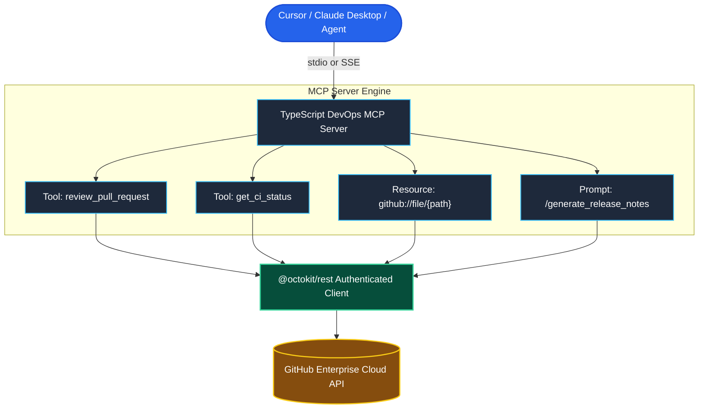

# Project 2: Enterprise GitHub and DevOps MCP Server

> **Difficulty**: Advanced | **Estimated Time**: 6–8 hours | **Stack**: TypeScript, @modelcontextprotocol/sdk, @octokit/rest, Express, Zod, Docker

---

## 1. Project Overview

In this capstone project, you will build an **Enterprise GitHub & DevOps Control Plane MCP Server** in TypeScript. This server bridges GitHub and CI/CD operations directly into AI hosts (Cursor, Claude Desktop, and autonomous agents), exposing:
1. **Pull Request Review & Audit Tools:** Tools to inspect PR diffs, post inline review comments, and check CI workflow run statuses.
2. **Git Tree Resources:** Dynamic resources (`github://repo/{owner}/{repo}/file/{path}`) for streaming repository code into model context without manual copy-pasting.
3. **Automated Release Notes Prompt:** Slash command `/generate_release_notes` that compares branches and compiles semantically categorized changelogs.
4. **Dual Transport Support:** Runs via local `stdio` for developer laptops or remote `Express SSE` for company-wide deployment.



---

## 2. Architecture & Data Model

- **Authentication:** Authenticates with GitHub API using fine-grained Personal Access Tokens (PAT) or GitHub App installation tokens passed via the `GITHUB_TOKEN` environment variable.
- **Safety Boundaries:** Mutating operations (`merge_pull_request`) require explicit dry-run flags or confirmation parameters.
- **Resource Streaming:** Large file requests are capped to prevent overflowing LLM context limits.

---

## 3. Step-by-Step Implementation

### Step 1: Initialize Project & Dependencies

```bash
mkdir enterprise-github-mcp && cd enterprise-github-mcp
npm init -y
npm install @modelcontextprotocol/sdk @octokit/rest zod dotenv
npm install --save-dev typescript @types/node tsx
```

### Step 2: Implementation Code

```typescript
// src/index.ts
import { McpServer, ResourceTemplate } from "@modelcontextprotocol/sdk/server/mcp.js";
import { StdioServerTransport } from "@modelcontextprotocol/sdk/server/stdio.js";
import { Octokit } from "@octokit/rest";
import { z } from "zod";
import dotenv from "dotenv";

dotenv.config();

const GITHUB_TOKEN = process.env.GITHUB_TOKEN;
if (!GITHUB_TOKEN) {
  console.error("FATAL: GITHUB_TOKEN environment variable is required.");
  process.exit(1);
}

// Initialize Octokit client
const octokit = new Octokit({ auth: GITHUB_TOKEN });

// Initialize MCP Server
const server = new McpServer({
  name: "enterprise-github-devops",
  version: "1.0.0"
});

// --- 1. TOOLS: PR REVIEW & CI INSPECTION ---
server.tool(
  "get_pull_request_diff",
  "Fetches the unified code diff for a specific pull request.",
  {
    owner: z.string().describe("Repository owner or organization"),
    repo: z.string().describe("Repository name"),
    pullNumber: z.number().int().describe("Pull request number")
  },
  async ({ owner, repo, pullNumber }) => {
    try {
      const { data: diff } = await octokit.rest.pulls.get({
        owner,
        repo,
        pull_number: pullNumber,
        mediaType: { format: "diff" }
      });

      return {
        content: [
          {
            type: "text",
            text: `### Unified Diff for ${owner}/${repo}#${pullNumber}:\n\n\`\`\`diff\n${diff}\n\`\`\``
          }
        ]
      };
    } catch (err: any) {
      return {
        isError: true,
        content: [{ type: "text", text: `GitHub API Error: ${err.message}` }]
      };
    }
  }
);

server.tool(
  "get_ci_workflow_status",
  "Retrieves the latest GitHub Actions CI run status for a branch or commit.",
  {
    owner: z.string().describe("Repository owner"),
    repo: z.string().describe("Repository name"),
    branch: z.string().default("main").describe("Target branch name")
  },
  async ({ owner, repo, branch }) => {
    try {
      const { data } = await octokit.rest.actions.listWorkflowRunsForRepo({
        owner,
        repo,
        branch,
        per_page: 5
      });

      if (!data.workflow_runs.length) {
        return {
          content: [{ type: "text", text: `No CI runs found for branch '${branch}'.` }]
        };
      }

      const summary = data.workflow_runs.map((r) => (
        `- **${r.name}** (#${r.run_number}): \`${r.conclusion || r.status}\` | Commit: [${r.head_commit?.id.substring(0, 7)}] - ${r.head_commit?.message}`
      )).join("\n");

      return {
        content: [
          {
            type: "text",
            text: `### CI Runs for ${owner}/${repo} (${branch}):\n${summary}`
          }
        ]
      };
    } catch (err: any) {
      return {
        isError: true,
        content: [{ type: "text", text: `GitHub API Error: ${err.message}` }]
      };
    }
  }
);

// --- 2. DYNAMIC RESOURCES: REPO FILE INSPECTION ---
server.resource(
  "github-file",
  new ResourceTemplate("github://repo/{owner}/{repo}/file/{path}", { list: undefined }),
  { mimeType: "text/plain", description: "Direct access to files stored in GitHub repository" },
  async (uri, { owner, repo, path }) => {
    try {
      const { data } = await octokit.rest.repos.getContent({
        owner,
        repo,
        path
      });

      if ("content" in data && typeof data.content === "string") {
        const decodedContent = Buffer.from(data.content, "base64").toString("utf-8");
        return {
          contents: [
            {
              uri: uri.href,
              mimeType: "text/plain",
              text: decodedContent
            }
          ]
        };
      } else {
        throw new Error("Specified path is a directory or binary asset.");
      }
    } catch (err: any) {
      throw new Error(`Failed to load GitHub resource: ${err.message}`);
    }
  }
);

// --- 3. PROMPTS: AUTOMATED RELEASE NOTES ---
server.prompt(
  "generate_release_notes",
  "Generates standardized Markdown release notes comparing two Git tags or branches.",
  {
    owner: z.string().describe("Repository owner"),
    repo: z.string().describe("Repository name"),
    base: z.string().describe("Base tag or branch (e.g. v1.0.0)"),
    head: z.string().default("main").describe("Head tag or branch to compare")
  },
  async ({ owner, repo, base, head }) => {
    return {
      description: `Release notes template comparing ${base}...${head}`,
      messages: [
        {
          role: "user",
          content: {
            type: "text",
            text: `You are a Technical Product Manager compiling release notes for ${owner}/${repo}.\n` +
                  `1. Review the commits and PRs between base '${base}' and head '${head}'.\n` +
                  `2. Group changes into: Features, Bug Fixes, Breaking Changes, and Performance.\n` +
                  `3. Format the final output in clean GitHub-Flavored Markdown.`
          }
        }
      ]
    };
  }
);

// --- 4. START TRANSPORT ---
async function main() {
  const transport = new StdioServerTransport();
  await server.connect(transport);
  console.error("[DEVOPS MCP]: Connected via Stdio transport.");
}

main().catch(console.error);
```

---

## 4. Testing & Verification

1. **Test with MCP Inspector:**
   ```bash
   GITHUB_TOKEN="ghp_yourTokenHere" \
   npx @modelcontextprotocol/inspector npx tsx src/index.ts
   ```
2. **Verify Tool Call:**
   - Execute: `get_pull_request_diff(owner="facebook", repo="react", pullNumber=31000)`
   - Response: Returns full unified Git diff in Markdown fences.

---

## 5. Production Optimization & Deployment

Configure inside Cursor (`.cursor/mcp.json`):

```json
{
  "mcpServers": {
    "enterprise-github": {
      "command": "node",
      "args": ["/Users/alice/tools/enterprise-github-mcp/dist/index.js"],
      "env": {
        "GITHUB_TOKEN": "ghp_secure_corporate_token_123"
      }
    }
  }
}
```

