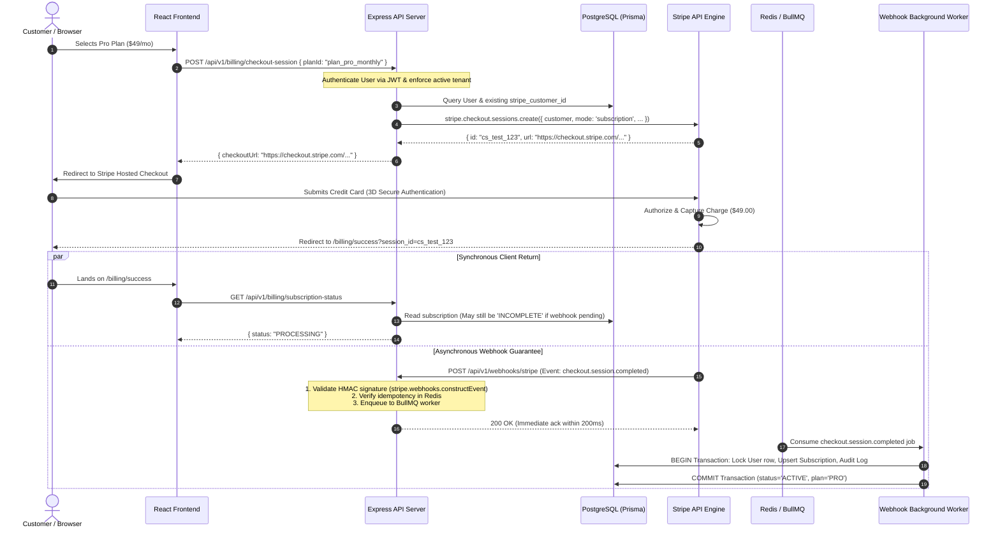

# Production Stripe Billing & Webhook Event Machine

> **Module**: Phase 01 — Stripe Billing System | **Lesson**: 01  
> **Tech Stack**: Node.js, TypeScript, Express, PostgreSQL, Prisma, Stripe SDK, BullMQ, Redis

---

## 1. System Topology & The Distributed 2PC Dilemma

In enterprise SaaS, handling payments is essentially solving the **Distributed Two-Phase Commit (2PC) problem**. You are coordinating state mutations across two completely independent storage systems that cannot participate in a unified database transaction:
1. **Stripe's Ledger**: The ultimate financial source of truth regarding charges, payment methods, disputes, and subscription statuses.
2. **Your Application Database**: The internal source of truth for user permissions, feature flags, team seats, and account entitlements.



---

## 2. Asynchronous Webhook Processing with BullMQ

Stripe enforces a strict timeout: if your webhook handler takes longer than 2 seconds to respond, Stripe assumes failure, terminates the connection, and schedules exponential retries. If your API executes database transactions, sends welcome emails, or synchronizes Salesforce CRM during the HTTP request, your server will choke under traffic spikes.

### The Decoupled Architecture
1. **Lightweight Controller**: Validates the cryptographic signature (`stripe-signature`), records the event ID in Redis, pushes the event payload into BullMQ, and immediately responds with `res.status(200).json({ received: true })`.
2. **Dedicated Background Worker**: Consumes events from Redis, processes database mutations inside ACID transactions, and handles idempotency.

```typescript
// src/workers/stripeWebhookWorker.ts
import { Worker, Job } from 'bullmq';
import Stripe from 'stripe';
import { prisma } from '../lib/prisma';
import { stripe } from '../lib/stripe';
import { redis } from '../lib/redis';

interface WebhookJobData {
  event: Stripe.Event;
}

export const stripeWebhookWorker = new Worker<WebhookJobData>(
  'stripe-webhooks',
  async (job: Job<WebhookJobData>) => {
    const { event } = job.data;
    const eventId = event.id;

    // Distributed lock to prevent concurrent processing of the exact same event
    const lockKey = `lock:webhook:${eventId}`;
    const acquired = await redis.set(lockKey, 'locked', 'EX', 60, 'NX');
    if (!acquired) {
      console.log(`[Worker] Event ${eventId} is already being processed by another worker. Skipping.`);
      return;
    }

    try {
      switch (event.type) {
        case 'checkout.session.completed': {
          const session = event.data.object as Stripe.Checkout.Session;
          await handleCheckoutSessionCompleted(session);
          break;
        }
        case 'customer.subscription.updated': {
          const subscription = event.data.object as Stripe.Subscription;
          await handleSubscriptionUpdated(subscription);
          break;
        }
        case 'invoice.payment_failed': {
          const invoice = event.data.object as Stripe.Invoice;
          await handleInvoicePaymentFailed(invoice);
          break;
        }
        default:
          console.log(`[Worker] Unhandled event type: ${event.type}`);
      }
    } finally {
      await redis.del(lockKey);
    }
  },
  {
    connection: redis,
    concurrency: 10, // Process up to 10 events concurrently across workers
  }
);
```

---

## 3. Handling Out-of-Order Webhook Delivery

Stripe delivers webhooks via distributed infrastructure. Webhook events can and do arrive **out of order**:
- `customer.subscription.updated` (Event B: customer upgraded from Pro to Enterprise at $t_2$) might arrive **before** `customer.subscription.updated` (Event A: customer upgraded from Basic to Pro at $t_1$).
- If your system naively applies Event A after Event B, you will downgrade the customer to Pro and corrupt their account permissions!

### The Solution: Monotonic Event Timestamp Verification
Stripe attaches a unix timestamp `created` to every event. Before updating the subscription, we compare the event timestamp against the `last_event_created_at` recorded on the subscription row:

```typescript
async function handleSubscriptionUpdated(stripeSub: Stripe.Subscription) {
  const stripeSubscriptionId = stripeSub.id;
  const eventCreatedAt = new Date(stripeSub.created * 1000);

  await prisma.$transaction(async (tx) => {
    // Acquire row-level lock on the subscription record
    const existing = await tx.$queryRaw<Array<{ id: string; last_event_created_at: Date }>>`
      SELECT id, last_event_created_at 
      FROM subscriptions 
      WHERE stripe_subscription_id = ${stripeSubscriptionId}
      FOR UPDATE
    `;

    if (existing.length > 0 && existing[0].last_event_created_at) {
      if (existing[0].last_event_created_at > eventCreatedAt) {
        console.warn(`[Stripe Worker] Stale event detected for sub ${stripeSubscriptionId}. Skipping.`);
        return;
      }
    }

    await tx.subscription.update({
      where: { stripeSubscriptionId },
      data: {
        status: stripeSub.status.toUpperCase() as any,
        currentPeriodStart: new Date(stripeSub.current_period_start * 1000),
        currentPeriodEnd: new Date(stripeSub.current_period_end * 1000),
        cancelAtPeriodEnd: stripeSub.cancel_at_period_end,
        lastEventCreatedAt: eventCreatedAt,
      },
    });
  });
}
```
