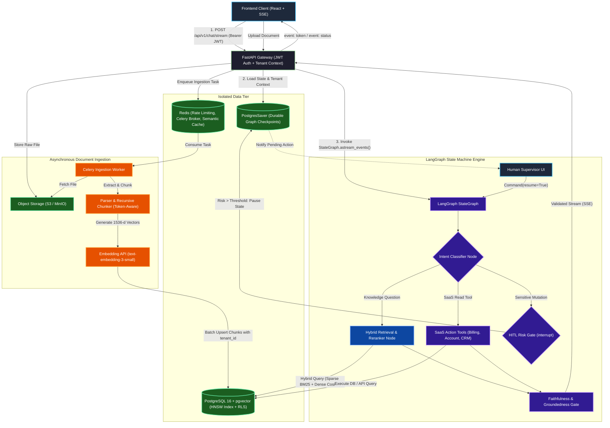

# Multi-Tenant RAG & LangGraph Agentic Architecture

> **Module**: Phase 02 — Multi-Tenant AI Support & RAG Platform | **Lesson**: 01  
> **Tech Stack**: Python 3.11+, FastAPI, LangChain, LangGraph, PostgreSQL 16 (`pgvector`), Celery, Redis

---

## 1. System Topology & Architectural Blueprint

In multi-tenant SaaS environments, AI assistants must never treat all enterprise documents as a monolithic corpus. Proprietary company manuals, employee salary bands, and security architecture docs from Organization A must remain strictly invisible to queries originating from Organization B.



---

## 2. 3-Layer Multi-Tenant Defense-in-Depth Model

```
┌─────────────────────────────────────────────────────────────────┐
│ Layer 1: Cryptographic JWT Context Injection                    │
│   - tenant_id & user_id extracted from validated JWT claims     │
│   - Client cannot override tenant_id via headers/body/params    │
└────────────────────────────────┬────────────────────────────────┘
                                 │
                                 ▼
┌─────────────────────────────────────────────────────────────────┐
│ Layer 2: PostgreSQL Row-Level Security (RLS)                    │
│   - SET LOCAL app.current_tenant_id = :org_id;                  │
│   - Hard kernel-level barrier on all SQL queries               │
└────────────────────────────────┬────────────────────────────────┘
                                 │
                                 ▼
┌─────────────────────────────────────────────────────────────────┐
│ Layer 3: Vector Metadata Hard Filtering                         │
│   - WHERE organization_id = :org_id AND access_level <= :role   │
│   - Filter executed before/during HNSW vector distance scan     │
└─────────────────────────────────────────────────────────────────┘
```

### 1. Cryptographic Extraction via FastAPI Dependency
We extract the tenant identity strictly from verified RSA-256 JWT claims. Any tenant ID supplied in the request body or URL path is rejected:

```python
# app/api/dependencies.py
from fastapi import Depends, HTTPException, Security, status
from fastapi.security import HTTPAuthorizationCredentials, HTTPBearer
from jose import JWTError, jwt
from app.core.config import settings
from app.schemas.auth import AuthenticatedUser

security = HTTPBearer()

async def get_current_user(
    credentials: HTTPAuthorizationCredentials = Security(security)
) -> AuthenticatedUser:
    token = credentials.credentials
    try:
        payload = jwt.decode(token, settings.JWT_SECRET_KEY, algorithms=[settings.JWT_ALGORITHM])
        user_id: str = payload.get("sub")
        org_id: str = payload.get("org_id")
        role: str = payload.get("role", "member")
        
        if not user_id or not org_id:
            raise HTTPException(status_code=401, detail="Invalid token claims: missing sub or org_id")
        return AuthenticatedUser(user_id=user_id, organization_id=org_id, role=role)
    except JWTError as e:
        raise HTTPException(status_code=401, detail=f"JWT validation failed: {str(e)}")
```

### 2. PostgreSQL Row-Level Security (RLS) Policy
In PostgreSQL, RLS guarantees that even if a developer writes `SELECT * FROM document_chunks` omitting the WHERE clause, the database kernel automatically restricts results to the tenant matching the session parameter:

```sql
ALTER TABLE document_chunks ENABLE ROW LEVEL SECURITY;

CREATE POLICY tenant_isolation_policy ON document_chunks
    FOR ALL
    USING (organization_id = NULLIF(current_setting('app.current_tenant_id', true), '')::uuid);
```

```python
# Database session setup inside FastAPI request
async with session.begin():
    await session.execute(
        text("SET LOCAL app.current_tenant_id = :org_id"),
        {"org_id": str(user.organization_id)}
    )
    # RLS enforced for all subsequent queries in this transaction
```

---

## 3. Asynchronous Ingestion & Token-Aware Chunking

Document ingestion is offloaded to a background Celery worker to avoid blocking API threads during heavy PDF and DOCX processing:

```python
# app/workers/chunking.py
import tiktoken
from langchain_text_splitters import RecursiveCharacterTextSplitter

class TokenAwareChunker:
    def __init__(self, chunk_size: int = 800, chunk_overlap: int = 120):
        self.tokenizer = tiktoken.get_encoding("cl100k_base")
        self.splitter = RecursiveCharacterTextSplitter(
            chunk_size=chunk_size,
            chunk_overlap=chunk_overlap,
            length_function=lambda text: len(self.tokenizer.encode(text)),
            separators=["\n## ", "\n### ", "\n\n", "\n", ". ", " ", ""],
            keep_separator=True
        )

    def split_text(self, text: str) -> list[str]:
        return [c.strip() for c in self.splitter.split_text(text) if len(c.strip()) > 20]
```
