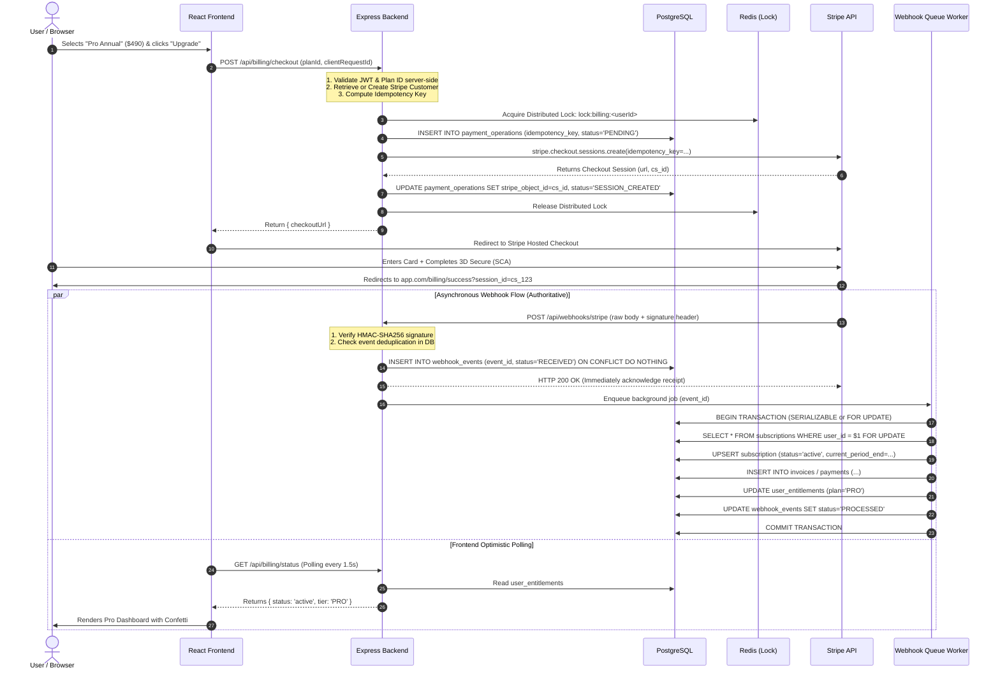
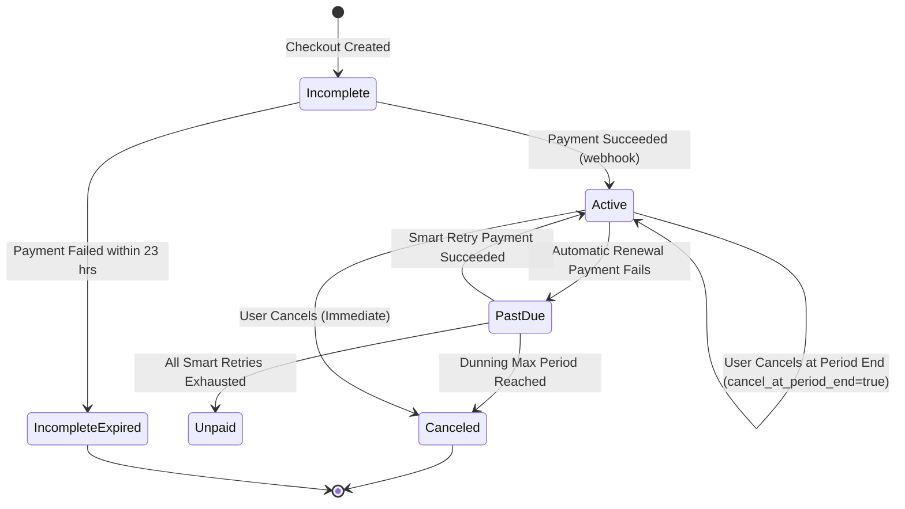

# Project 4 — Production-Grade Stripe Billing & Subscription Management Architecture

**Phases Combined:** Phase 1 (Payment Fundamentals), Phase 2 (Webhooks & Event Processing), Phase 3 (Stripe Integration), Phase 6 (Recurring Payments & Subscriptions), Phase 7 (Refunds & Disputes), and Phase 8 (Security & Compliance)

---

## 1. Problem Statement

In real-world SaaS platforms, payment and subscription billing is among the most mission-critical and error-prone sub-systems. Engineering failures in payment systems lead directly to double charges, lost revenue, chargeback penalties, and legal compliance violations.

The core engineering challenge stems from a fundamental distributed systems reality: **Stripe and your internal database (e.g. PostgreSQL) cannot participate in a shared ACID transaction (Two-Phase Commit / 2PC)**.
- If Stripe charges the customer's card, but your database crashes before saving the subscription, the customer has paid but receives no access (**Revenue Theft / Inconsistent State**).
- If your database records an active subscription before Stripe confirms payment, the user receives paid features without paying (**Freeloading / Financial Loss**).
- If a user double-clicks the "Upgrade" button, or two concurrent webhook workers process the same renewal event, standard `READ COMMITTED` isolation allows **Lost Updates** and duplicate charges.

This project designs and implements an end-to-end, production-grade **SaaS Billing & Subscription Management Platform** based on Stripe Billing, covering the complete lifecycle from checkout initiation to webhook deduplication, database row-level locking, proration math, recurring billing, dunning management, and interview-ready architectural battle-cards.

---

## 2. Distributed Architecture: Stripe vs. PostgreSQL Consistency

### 2.1 The Distributed Dilemma & System Boundaries

```
   ┌────────────────────────────────┐                 ┌─────────────────────────────────┐
   │        Stripe Platform         │                 │      Application Database       │
   │  - Authoritative for Money     │    NO 2PC /     │  - Authoritative for Accounts   │
   │  - Payment Authorization       │◄──DISTRIBUTED──►│  - User Entitlements & Roles    │
   │  - Bank SCA / 3D Secure        │    BOUNDARY     │  - Feature Gate Enforcement     │
   └───────────────┬────────────────┘                 └────────────────┬────────────────┘
                   │                                                   │
                   │        POST /api/webhooks/stripe                  │
                   └───────────────────────────────────────────────────┘
                               (At-Least-Once Delivery)
```

1. **Stripe is the single source of truth for financial balances and payment authorization.**
2. **PostgreSQL is the single source of truth for user accounts and active feature entitlements.**
3. **They synchronize via an asynchronous, idempotent event stream backed by persistent event deduplication and database row locking.**

### 2.2 Why Frontend Success Redirects (`success_url`) Are Never Trusted

> [!CAUTION]
> **Production Rule:** Never grant subscription entitlements inside the backend handler of the frontend `success_url` redirect.

When Stripe redirects a user to `https://app.com/billing/success?session_id=cs_test_123`:
1. The user might close their browser tab or lose internet connectivity before the redirect completes.
2. A malicious actor could forge query parameters to probe `/billing/success?session_id=fake_session`.
3. 3D Secure / SCA asynchronous bank challenges may still be in a `processing` state.

**The Production Pattern:**
- The frontend redirect page renders an optimistic loading state: *"Finalizing payment with your bank..."*.
- The backend activates the subscription **strictly upon receiving and verifying the `checkout.session.completed` / `invoice.paid` webhook**.
- The frontend polls `GET /api/billing/subscription/status` or listens to a Server-Sent Events (SSE) / WebSocket connection to transition the UI once the database transaction commits.

---

## 3. End-to-End Payment Flow & Sequence



---

## 4. Preventing Duplicate & Dual Payments (The 4 Vectors)

A production payment engine must guard against four distinct duplicate payment failure modes:

| Failure Vector | Technical Root Cause | Production Defense Mechanism |
| :--- | :--- | :--- |
| **Vector A: User Clicks Pay Button Repeatedly** | User spamming clicks due to UI lag or impatience. | **Client-side debouncing** (`isSubmitting = true`) + client generates UUID `clientRequestId` stored in `payment_operations.idempotency_key` with a **DB unique constraint**. |
| **Vector B: Concurrent Requests Hit Server Pods** | Parallel requests hitting different instances at the same millisecond. | **Redis Distributed Lock** (`SET lock:checkout:<userId> <token> NX PX 5000`) + **PostgreSQL Row-Level Lock** (`SELECT ... FOR UPDATE`). |
| **Vector C: Stripe Charges Card but Backend Times Out** | Upstream network drops the HTTP response before backend can persist the session ID. | Generate deterministic business idempotency key `hash(userId + priceId + dayBucket)` and pass it directly to Stripe SDK: `stripe.checkout.sessions.create({ ... }, { idempotencyKey })`. Stripe returns original session without charging twice. |
| **Vector D: Duplicate Webhook Events (At-Least-Once Delivery)** | Stripe resends webhook events during network retries or partitions. | Webhook deduplication journal: `INSERT INTO webhook_events (stripe_event_id, ...) VALUES ($1, ...) ON CONFLICT (stripe_event_id) DO NOTHING`. If 0 rows affected, exit immediately. |

---

## 5. ACID Properties in Financial Ledgers

### 5.1 Atomicity
A subscription fulfillment creates multiple side effects across different tables:
1. Recording the payment ledger entry (`payments`).
2. Recording the invoice record (`invoices`).
3. Advancing the subscription status (`subscriptions`).
4. Provisioning user feature entitlements (`user_entitlements`).
5. Writing to the audit log (`audit_logs`).

All 5 operations must commit together or roll back completely. In Prisma / PostgreSQL:

```typescript
await prisma.$transaction(async (tx) => {
  // 1. Lock subscription row to prevent concurrent worker conflicts
  await tx.$executeRaw`SELECT * FROM subscriptions WHERE user_id = ${userId} FOR UPDATE`;

  // 2. Upsert subscription state
  await tx.subscription.upsert({ ... });

  // 3. Grant feature entitlement
  await tx.userEntitlement.update({
    where: { userId },
    data: { planTier: 'PRO', maxSeats: 10, isActive: true },
  });

  // 4. Record payment ledger entry
  await tx.payment.create({ ... });

  // 5. Mark webhook event processed
  await tx.webhookEvent.update({
    where: { stripeEventId },
    data: { processingStatus: 'PROCESSED', processedAt: new Date() },
  });
});
```

### 5.2 Consistency (Integer Minor Units)
- **Zero Floating-Point Numbers:** All monetary amounts are stored as **integers representing cents/paise** (e.g., \$49.00 = `4900`). Floating-point numbers (`FLOAT`, `DOUBLE`) in JavaScript or SQL cause IEEE 754 precision rounding errors that corrupt financial ledgers.
- **Database Invariants:**
  - Foreign key integrity ensures an invoice cannot exist without a valid customer and user.
  - `CHECK (amount_paid_cents >= 0)`
  - `CHECK (refunded_amount_cents <= amount_paid_cents)`

### 5.3 Isolation (`SELECT ... FOR UPDATE`)
- Standard `READ COMMITTED` isolation allows **Lost Updates** if two webhooks (e.g., `invoice.payment_succeeded` and `customer.subscription.updated`) update the subscription concurrently.
- **Pessimistic Concurrency Control:** Running `SELECT ... FOR UPDATE` forces concurrent workers to execute sequentially, eliminating race conditions.

### 5.4 Durability
- Once the database transaction commits, the record is written to PostgreSQL's Write-Ahead Log (WAL). Even if the application container crashes immediately, state is guaranteed recovered upon restart.

---

## 6. Subscription Lifecycle & State Machine



### The 8 Canonical Stripe Subscription States

| Status | Meaning | Entitlement Policy |
| :--- | :--- | :--- |
| `incomplete` | Initial state while waiting for 3D Secure authentication or off-session authorization. | **NO ACCESS** |
| `incomplete_expired` | Initial payment authorization failed and expired (23-hour window closed). | **NO ACCESS** (Hard fail) |
| `trialing` | Free trial period without active charge. | **FULL ACCESS** |
| `active` | Payment verified, current period valid. | **FULL ACCESS** |
| `past_due` | Recurring invoice payment failed; Stripe Smart Retries currently running. | **GRACE PERIOD ACCESS** (Typically 3–7 days with warning banner) |
| `unpaid` | All automated retry attempts failed; invoices remain open. | **REVOKE ACCESS** (Prompt to update card) |
| `canceled` | Subscription terminated permanently. | **REVOKE ACCESS** (Downgrade to Free tier) |
| `paused` | Temporarily frozen (e.g., paused billing trial). | **READ-ONLY ACCESS** |

---

## 7. Proration, Upgrades, Downgrades & Billing Cycle Anchors

### 7.1 Mathematical Model of Proration

When a user switches plans mid-cycle, Stripe calculates proration based on the exact second the change occurs:

$$\text{Net Charge} = \text{Cost of New Plan for Remaining Time} - \text{Credit for Unused Time on Old Plan}$$

#### Concrete Example:
- **Billing Period:** 30 days (Day 1 to Day 30).
- **Old Plan:** Basic Monthly (\$30/month = \$1.00/day).
- **New Plan:** Pro Monthly (\$60/month = \$2.00/day).
- **Upgrade Day:** Day 10 (10 days used on Basic, 20 days remaining).

**Calculation:**
1. **Unused Credit on Old Plan:** $20 \text{ days} \times \$1.00 = -\$20.00$
2. **Cost for Remaining Time on New Plan:** $20 \text{ days} \times \$2.00 = +\$40.00$
3. **Prorated Invoice Due Today:** $\$40.00 - \$20.00 = +\$20.00$

### 7.2 Previewing Upcoming Invoices

A production application **never upgrades a customer blindly**. It previews the charge first using Stripe's `invoices.retrieveUpcoming`:

```typescript
const upcomingInvoice = await stripe.invoices.retrieveUpcoming({
  customer: stripeCustomerId,
  subscription: stripeSubscriptionId,
  subscription_items: [
    {
      id: currentSubscriptionItemId,
      price: newPriceId, // target plan
    },
  ],
  subscription_proration_behavior: 'create_prorations',
});

// Returns exact amount due today (in cents) + itemized line items
const amountDueToday = upcomingInvoice.amount_due;
```

### 7.3 Upgrades vs Downgrades Workflow
- **Upgrades (Basic $\rightarrow$ Pro):** Executed **immediately** with `proration_behavior: 'always_invoice'`, charging the difference to the card on file immediately. Local entitlements are upgraded when `invoice.paid` arrives.
- **Downgrades (Pro $\rightarrow$ Basic):** Scheduled for the **end of the current billing cycle** (`proration_behavior: 'none'`). The customer retains Pro access until their current paid period expires, avoiding refund friction.

---

## 8. Complete Database Schema (Prisma ORM)

```prisma
datasource db {
  provider = "postgresql"
  url      = env("DATABASE_URL")
}

generator client {
  provider = "prisma-client-js"
}

enum SubscriptionStatus {
  INCOMPLETE
  INCOMPLETE_EXPIRED
  TRIALING
  ACTIVE
  PAST_DUE
  CANCELED
  UNPAID
  PAUSED
}

enum BillingInterval {
  MONTH
  YEAR
}

enum PaymentStatus {
  PENDING
  SUCCEEDED
  FAILED
  REFUNDED
}

enum WebhookStatus {
  RECEIVED
  PROCESSING
  PROCESSED
  FAILED
}

model User {
  id             String          @id @default(uuid())
  email          String          @unique
  passwordHash   String
  createdAt      DateTime        @default(now())
  updatedAt      DateTime        @updatedAt
  
  stripeCustomer StripeCustomer?
  subscription   Subscription?
  payments       Payment[]
  invoices       Invoice[]
  entitlement    UserEntitlement?
  auditLogs      AuditLog[]

  @@map("users")
}

model StripeCustomer {
  id               String   @id @default(uuid())
  userId           String   @unique
  stripeCustomerId String   @unique
  createdAt        DateTime @default(now())
  
  user             User     @relation(fields: [userId], references: [id], onDelete: Cascade)

  @@index([stripeCustomerId])
  @@map("stripe_customers")
}

model Product {
  id              String   @id @default(uuid())
  name            String
  description     String?
  stripeProductId String   @unique
  isActive        Boolean  @default(true)
  prices          Price[]

  @@map("products")
}

model Price {
  id              String          @id @default(uuid())
  productId       String
  stripePriceId   String          @unique
  amountCents     Int             // e.g. 4900 for $49.00 (ALWAYS INTEGER)
  currency        String          @default("usd")
  billingInterval BillingInterval
  isActive        Boolean         @default(true)

  product         Product         @relation(fields: [productId], references: [id])
  subscriptions   Subscription[]

  @@map("prices")
}

model Subscription {
  id                   String             @id @default(uuid())
  userId               String             @unique
  stripeSubscriptionId String             @unique
  stripeCustomerId     String
  priceId              String
  status               SubscriptionStatus
  currentPeriodStart   DateTime
  currentPeriodEnd     DateTime
  cancelAtPeriodEnd    Boolean            @default(false)
  canceledAt           DateTime?
  lastEventCreatedAt   DateTime           // Fencing token for out-of-order events
  createdAt            DateTime           @default(now())
  updatedAt            DateTime           @updatedAt

  user                 User               @relation(fields: [userId], references: [id], onDelete: Cascade)
  price                Price              @relation(fields: [priceId], references: [id])
  invoices             Invoice[]
  payments             Payment[]

  @@index([stripeSubscriptionId])
  @@index([status])
  @@map("subscriptions")
}

model PaymentOperation {
  id               String   @id @default(uuid())
  userId           String
  idempotencyKey   String   @unique // Business idempotency key
  operationType    String   // 'CHECKOUT', 'UPGRADE', 'ONE_TIME'
  status           String   // 'PENDING', 'SUCCESS', 'FAILED'
  stripeObjectId   String?
  createdAt        DateTime @default(now())
  updatedAt        DateTime @updatedAt

  @@index([idempotencyKey])
  @@map("payment_operations")
}

model Payment {
  id                    String        @id @default(uuid())
  userId                String
  subscriptionId        String?
  stripePaymentIntentId String        @unique
  stripeChargeId        String?
  amountCents           Int           // Integer minor units (cents)
  currency              String        @default("usd")
  status                PaymentStatus
  createdAt             DateTime      @default(now())

  user                  User          @relation(fields: [userId], references: [id])
  subscription          Subscription? @relation(fields: [subscriptionId], references: [id])
  refunds               Refund[]

  @@index([stripePaymentIntentId])
  @@map("payments")
}

model Invoice {
  id                String   @id @default(uuid())
  userId            String
  subscriptionId    String?
  stripeInvoiceId   String   @unique
  amountDueCents    Int
  amountPaidCents   Int
  currency          String   @default("usd")
  status            String   // 'paid', 'open', 'void', 'uncollectible'
  hostedInvoiceUrl  String?
  pdfUrl            String?
  createdAt         DateTime @default(now())

  user              User          @relation(fields: [userId], references: [id])
  subscription      Subscription? @relation(fields: [subscriptionId], references: [id])

  @@index([stripeInvoiceId])
  @@map("invoices")
}

model Refund {
  id             String   @id @default(uuid())
  paymentId      String
  stripeRefundId String   @unique
  amountCents    Int
  status         String
  reason         String?
  createdAt      DateTime @default(now())

  payment        Payment  @relation(fields: [paymentId], references: [id])

  @@map("refunds")
}

model WebhookEvent {
  id               String        @id @default(uuid())
  stripeEventId    String        @unique // Dedup unique constraint
  eventType        String
  processingStatus WebhookStatus @default(RECEIVED)
  payload          Json
  errorMessage     String?
  receivedAt       DateTime      @default(now())
  processedAt      DateTime?

  @@index([stripeEventId])
  @@map("webhook_events")
}

model UserEntitlement {
  id            String   @id @default(uuid())
  userId        String   @unique
  planTier      String   // 'FREE', 'BASIC', 'PRO', 'ENTERPRISE'
  maxSeats      Int      @default(1)
  hasAiFeatures Boolean  @default(false)
  isActive      Boolean  @default(true)
  updatedAt     DateTime @updatedAt

  user          User     @relation(fields: [userId], references: [id], onDelete: Cascade)

  @@map("user_entitlements")
}

model AuditLog {
  id         String   @id @default(uuid())
  userId     String?
  action     String   // 'SUBSCRIPTION_UPGRADED', 'REFUND_ISSUED'
  entityType String
  entityId   String
  metadata   Json?
  createdAt  DateTime @default(now())

  user       User?    @relation(fields: [userId], references: [id])

  @@map("audit_logs")
}
```

---

## 9. Production Code Implementation

### 9.1 Express Webhook Controller (Raw Body + Signature Verification + Fast ACK)

```typescript
// src/controllers/webhook.controller.ts
import { Request, Response } from 'express';
import Stripe from 'stripe';
import { stripe } from '../lib/stripe';
import { prisma } from '../lib/prisma';
import { webhookQueue } from '../queues/webhook.queue';

export const handleStripeWebhook = async (req: Request, res: Response) => {
  const sig = req.headers['stripe-signature'];
  const webhookSecret = process.env.STRIPE_WEBHOOK_SECRET!;

  if (!sig) {
    return res.status(400).send('Missing stripe-signature header');
  }

  let event: Stripe.Event;

  try {
    // CRITICAL: req.body must be the RAW buffer, NOT parsed JSON!
    event = stripe.webhooks.constructEvent(req.body, sig, webhookSecret);
  } catch (err: any) {
    console.error(`⚠️ Webhook signature verification failed: ${err.message}`);
    return res.status(400).send(`Webhook Error: ${err.message}`);
  }

  // 1. Durable Deduplication: Store event ID in DB with ON CONFLICT DO NOTHING
  try {
    await prisma.webhookEvent.create({
      data: {
        stripeEventId: event.id,
        eventType: event.type,
        payload: event as any,
        processingStatus: 'RECEIVED',
      },
    });

    // 2. Offload heavy business logic to background queue (BullMQ/Redis)
    await webhookQueue.add('process-stripe-event', {
      eventId: event.id,
      eventType: event.type,
    });

    // 3. Promptly ACK Stripe within 500ms to avoid retry storms
    return res.status(200).json({ received: true });
  } catch (dbError: any) {
    // If Prisma throws P2002 (unique constraint violation), event was already ingested
    if (dbError.code === 'P2002') {
      console.log(`ℹ️ Duplicate webhook event ${event.id} already received. Skipping.`);
      return res.status(200).json({ received: true, deduplicated: true });
    }
    console.error('Database error during webhook logging:', dbError);
    return res.status(500).send('Internal Server Error');
  }
};
```

### 9.2 Checkout Session Controller with Business Idempotency

```typescript
// src/controllers/checkout.controller.ts
import { Request, Response } from 'express';
import { stripe } from '../lib/stripe';
import { prisma } from '../lib/prisma';

export const createCheckoutSession = async (req: Request, res: Response) => {
  const userId = req.user.id; // from JWT middleware
  const { priceId, clientRequestId } = req.body;

  // 1. Verify price exists and is active in our DB (NEVER trust client price)
  const priceRecord = await prisma.price.findUnique({
    where: { id: priceId, isActive: true },
    include: { product: true },
  });
  if (!priceRecord) {
    return res.status(400).json({ error: 'Invalid or inactive price plan.' });
  }

  // 2. Compute deterministic idempotency key for this business operation
  const idempotencyKey = `checkout_${userId}_${priceRecord.stripePriceId}_${clientRequestId}`;

  // 3. Retrieve or Create Stripe Customer
  let customer = await prisma.stripeCustomer.findUnique({ where: { userId } });
  let stripeCustomerId: string;

  if (!customer) {
    const user = await prisma.user.findUnique({ where: { id: userId } });
    const createdStripeCust = await stripe.customers.create({
      email: user!.email,
      metadata: { userId },
    });
    customer = await prisma.stripeCustomer.create({
      data: {
        userId,
        stripeCustomerId: createdStripeCust.id,
      },
    });
  }
  stripeCustomerId = customer.stripeCustomerId;

  // 4. Check if payment operation already exists (Idempotent response)
  const existingOp = await prisma.paymentOperation.findUnique({
    where: { idempotencyKey },
  });
  if (existingOp && existingOp.stripeObjectId) {
    const existingSession = await stripe.checkout.sessions.retrieve(existingOp.stripeObjectId);
    return res.json({ checkoutUrl: existingSession.url });
  }

  // 5. Create durable PENDING operation
  await prisma.paymentOperation.upsert({
    where: { idempotencyKey },
    create: {
      userId,
      idempotencyKey,
      operationType: 'CHECKOUT',
      status: 'PENDING',
    },
    update: {},
  });

  // 6. Create Stripe Checkout Session with Stripe Idempotency Key
  const session = await stripe.checkout.sessions.create(
    {
      customer: stripeCustomerId,
      mode: 'subscription',
      payment_method_types: ['card'],
      line_items: [
        {
          price: priceRecord.stripePriceId,
          quantity: 1,
        },
      ],
      success_url: `${process.env.APP_URL}/billing/success?session_id={CHECKOUT_SESSION_ID}`,
      cancel_url: `${process.env.APP_URL}/billing/cancel`,
      subscription_data: {
        metadata: { userId, planTier: priceRecord.product.name },
      },
    },
    { idempotencyKey }
  );

  // 7. Update operation with Stripe session ID
  await prisma.paymentOperation.update({
    where: { idempotencyKey },
    data: { stripeObjectId: session.id, status: 'SESSION_CREATED' },
  });

  return res.json({ checkoutUrl: session.url });
};
```

---

## 10. Senior Interview Battle-Cards: Top 5 Grilling Questions

### Q1: "What happens if Stripe charges the customer's card, but your backend crashes before saving the subscription in PostgreSQL?"
**Your Senior Answer:**
> "That is the classic dual-write distributed systems problem. Because Stripe and PostgreSQL cannot share a 2-Phase Commit, we decouple payment execution from database fulfillment using an **Idempotent Webhook Event Queue**:
> 1. When the checkout session completes, Stripe persists the charge in its immutable ledger and fires a `checkout.session.completed` webhook.
> 2. If our server crashed during checkout redirect, it doesn't matter: the redirect endpoint does not grant access anyway.
> 3. Stripe retries the webhook over 72 hours with exponential backoff until our server acknowledges with an HTTP 200.
> 4. When our server recovers, it receives the event, verifies the HMAC signature, enqueues it, and executes the subscription activation inside an atomic PostgreSQL transaction.
> 5. Additionally, we run a nightly reconciliation cron job that queries Stripe's Events API (`/v1/events?type=checkout.session.completed`) and reconciles any unfulfilled orders."

---

### Q2: "Why do you use `SELECT ... FOR UPDATE` when handling webhooks?"
**Your Senior Answer:**
> "Under high concurrency or network retries, Stripe can fire `customer.subscription.updated` and `invoice.payment_succeeded` within milliseconds of each other. If two worker pods process these events concurrently under standard `READ COMMITTED` isolation, they both read the initial subscription row simultaneously and perform conflicting updates, resulting in a **Lost Update anomaly**.
> 
> By running `SELECT ... FOR UPDATE`, PostgreSQL places an exclusive row-level lock on the user's subscription record. Worker #1 acquires the lock and commits its state change; Worker #2 blocks until Worker #1 commits, then reads the updated state and applies its transition cleanly."

---

### Q3: "How do you handle out-of-order webhook delivery where an update event arrives before the creation event?"
**Your Senior Answer:**
> "We implement a two-tier defense:
> 1. **Fencing Tokens via Stripe Event Timestamps:** Every subscription row stores `last_event_created_at`. If an incoming webhook has an `event.created` timestamp older than what is stored on the record, we know it's a delayed out-of-order event and discard it.
> 2. **Authoritative Fetch Pattern:** Instead of trusting the serialized state inside the webhook payload, our worker uses the webhook as a signal to fetch the authoritative, real-time object directly from `stripe.subscriptions.retrieve(id)`. This guarantees that even if events arrive out of sequence, our database always syncs to Stripe's true state."

---

### Q4: "Why do we store monetary values as integers instead of floats or decimals?"
**Your Senior Answer:**
> "Floating-point numbers in computing follow the IEEE 754 standard, which represents decimals in base-2 binary fractions. This produces precision errors: for example, `0.1 + 0.2` in JavaScript evaluates to `0.30000000000000004`.
> 
> Over thousands of billing cycles, floating-point rounding errors cause financial drift and ledger mismatches. In production, we represent all currency amounts in their **integer minor units** (cents for USD, paise for INR, pence for GBP). \$49.99 is stored as `4999`. Arithmetic is exact, and formatting to decimals occurs strictly at the UI presentation boundary."

---

### Q5: "Walk me through the exact math and API calls when a user upgrades from a \$19/month plan to a \$49/month plan 10 days into their 30-day billing cycle."
**Your Senior Answer:**
> "1. **Proration Math:**
>    - The billing cycle is 30 days. The user consumed 10 days of the \$19 plan, leaving 20 days unused.
>    - **Unused Credit:** $\frac{20}{30} \times \$19.00 = -\$12.67$.
>    - **Cost of New Plan for remaining 20 days:** $\frac{20}{30} \times \$49.00 = +\$32.67$.
>    - **Net Amount Due Immediately:** $\$32.67 - \$12.67 = \$20.00$.
> 
> 2. **API Implementation:**
>    - First, we call `stripe.invoices.retrieveUpcoming()` with `subscription_items` and `proration_behavior: 'create_prorations'` to display a transparent preview of the \$20.00 charge to the user on the frontend.
>    - Once confirmed, we call `stripe.subscriptions.update(subId, { items: [{ id: itemId, price: newPriceId }], proration_behavior: 'always_invoice', payment_behavior: 'error_if_incomplete' })`.
>    - Stripe immediately attempts to charge the card on file for the \$20.00 difference.
>    - Once the resulting `invoice.paid` webhook arrives at our backend, we update our PostgreSQL subscription row and grant the higher tier entitlements."
