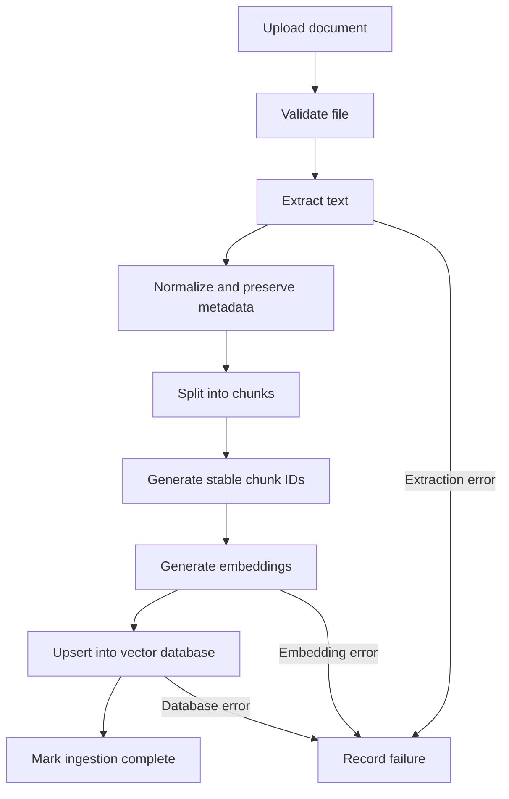

> 📚 **[Production RAG Curriculum](../README.md)** | ⬅️ [Module 1.2: Document Loaders and Document Processing](../01-roadmap-and-loaders/02-document-loaders-and-processing.md) | ➡️ [Module 2.2: macOS Python Environment & Dependencies Setup](02-macos-python-environment-setup.md)

---

# Module 2 — Chunking Strategies in Production RAG

Lesson 2 · Advanced RAG Engineering · Python

Man, this is one of the most important parts of RAG. Even if you choose a great embedding model and a powerful LLM, **poor chunking can cause your RAG system to retrieve the wrong information or miss the answer entirely.**

We'll build on our previous lesson's PDF loader and learn five strategies:

1. Fixed-size chunking
2. Overlapping chunking
3. Recursive chunking
4. Semantic chunking
5. Parent-child chunking

We'll finish by implementing a production-oriented chunking pipeline that preserves metadata, handles document boundaries and creates stable chunk IDs.

## 1. What is chunking, and why do we need it?

Suppose a company policy PDF contains 50 pages and 20,000 words.

We usually don't want to create one embedding for the entire PDF. That embedding represents too much information at once, making it harder to retrieve the specific paragraph that answers a user's question.

Instead, we split the document into smaller pieces called **chunks**.

```
[Original Document]
(Refund policy · 50 pages · 20,000 words)
       │
       ▼
[Chunking Engine]
(Recursive Character Splitter · Chunk size: 500 tokens · Overlap: 75 tokens)
       │
       ▼
[Granular Document Chunks]
(Chunk 1: Eligibility ──► Chunk 2: Timeline ──► Chunk 3: Exceptions ──► Chunk 4: Support)
```

Each chunk can be embedded separately and stored in a vector database. When a user asks a question, we retrieve the most relevant chunks rather than the whole document.

### The three chunking parameters you need to know

| Parameter | Meaning | Example |
|---|---|---|
| Chunk size | Maximum or target size of a chunk | 500 tokens |
| Chunk overlap | Content repeated between adjacent chunks | 75 tokens |
| Separators | Boundaries used when splitting text | `\n\n`, `\n`, spaces |

**Important:** Tokens and characters are not the same. A token is a unit used by a language model; one token can be a word, part of a word, punctuation or another text unit. Production systems often measure chunk sizes in tokens because model limits are token-based.

---

## 2. Strategy 1 — Fixed-size chunking

### How it works

Fixed-size chunking splits text into pieces of a chosen size, without considering the meaning of the text.

For example, suppose our document contains:

```text
Customers may request a refund within 30 days.

Approved refunds are processed within 5 business days.

Some products are excluded from the refund policy.
```

With a character chunk size of 60, the splitter cuts the text into consecutive 60-character pieces, except for the final shorter piece.

This is simple, fast and predictable, but it may cut sentences in the middle.

### Python implementation

```python

def fixed_size_chunk(text: str, chunk_size: int = 500) -> list[str]:
    if chunk_size <= 0:
        raise ValueError("chunk_size must be positive")

    return [
        text[i:i + chunk_size]
        for i in range(0, len(text), chunk_size)
        if text[i:i + chunk_size].strip()
    ]

text = """
Customers may request a refund within 30 days.
Approved refunds are processed within 5 business days.
Some products are excluded from the refund policy.
"""

chunks = fixed_size_chunk(text, chunk_size=60)

for index, chunk in enumerate(chunks, start=1):
    print(f"Chunk {index}: {chunk!r}")

```

This example measures **characters**, not tokens. It demonstrates the strategy, but it is not yet a good production default.

### Advantages and disadvantages

**Advantages**
- Very simple
- Fast and inexpensive
- Predictable chunk lengths
- Easy to implement

**Disadvantages**
- Can split sentences
- Can separate facts from context
- Can damage tables and code blocks
- May reduce retrieval quality

**When to use it:** As a baseline, for simple text, or when predictable splitting matters more than preserving semantic boundaries.

---

## 3. Strategy 2 — Overlapping chunking

Fixed-size chunking has a weakness: an important fact might be divided between two chunks.

Suppose the document says:

> Refund requests must be submitted within 30 days of purchase. Approved refunds are processed within 5 business days.

If the split happens between the first and second sentence, a retrieved chunk might contain only half of the relevant information.

Overlap repeats part of one chunk in the next, helping preserve context around boundaries.

  Example: 100-character chunks with 20 characters of overlap

**Chunk 1**
Characters 0–99

Repeat characters 80–99

**Chunk 2**
Characters 80–179

Repeat characters 160–179

**Chunk 3**
Characters 160–259

### Python implementation

```python

def overlapping_chunk(
    text: str,
    chunk_size: int = 500,
    overlap: int = 75,
) -> list[str]:
    if chunk_size <= 0:
        raise ValueError("chunk_size must be positive")

    if overlap < 0 or overlap >= chunk_size:
        raise ValueError("overlap must be >= 0 and < chunk_size")

    chunks = []
    step = chunk_size - overlap

    for start in range(0, len(text), step):
        chunk = text[start:start + chunk_size]

        if chunk.strip():
            chunks.append(chunk)

        if start + chunk_size >= len(text):
            break

    return chunks

text = (
    
1. Refund requests must be submitted within 30 days. 
    
1. Approved refunds are processed within 5 business days. 
    
1. Some products are excluded from the refund policy. 
) * 5

chunks = overlapping_chunk(
    text,
    chunk_size=100,
    overlap=20,
)

for i, chunk in enumerate(chunks, start=1):
    print(f"\nChunk {i} ({len(chunk)} chars):\n{chunk}")

```

Here, the step is:

\[
\text{step}=\text{chunk size}-\text{overlap}
\]

For a chunk size of 500 characters and overlap of 75 characters, the next chunk begins 425 characters after the previous chunk's starting position.

### How much overlap should you use?

A starting experiment might use 10–20% overlap, but this is a tuning parameter, not a universal rule.

Too little overlap can lose context at boundaries. Too much overlap creates duplicate content, increases embedding and storage costs, and can cause retrieval results to contain the same information repeatedly.

**Production tip:** Overlap is a safety net, not a substitute for intelligent splitting. We'll use recursive chunking as our default starting point.

---

## 4. Strategy 3 — Recursive chunking

This is a strong general-purpose default for many text-based RAG systems.

### The idea

Instead of cutting text at arbitrary positions, recursive chunking tries to split it at increasingly smaller structural boundaries.

A common separator priority is:

1. `\n\n` — paragraph boundaries
2. `\n` — line boundaries
3. `" "` — word boundaries
4. `""` — individual characters, as a last resort

The splitter tries larger boundaries first. If a paragraph is too large, it splits that paragraph further.

  ### Recursive splitting in action

**Full document**
Several paragraphs

**Paragraph 1**
Fits the limit

**Paragraph 2**
Too large

**Split paragraph 2 by lines, then words if necessary**

### Python implementation with LangChain

Install the text splitter package:

```bash
pip install langchain-text-splitters
```

Then implement:

```python

from langchain_text_splitters import RecursiveCharacterTextSplitter

text = """
Refund Policy

Customers may request a refund within 30 days of purchase.
The product must meet the eligibility requirements.

Processing

Approved refunds are processed within 5 business days.
Bank processing times may vary.
"""

splitter = RecursiveCharacterTextSplitter(
    chunk_size=500,
    chunk_overlap=75,
    length_function=len,  # Characters, not tokens
    separators=["\n\n", "\n", " ", ""],
    add_start_index=True,
)

chunks = splitter.create_documents(
    [text],
    metadatas=[{
        "source": 
1. refund_policy.txt
        "document_id": 
1. refund-policy-v1
    }],
)

for chunk in chunks:
    print("Metadata:", chunk.metadata)
    print("Content:", chunk.page_content)
    print("-" * 40)

```

Notice that the example includes `add_start_index=True`. The resulting document metadata includes a start index, which helps us trace the chunk back to the original text.

### Why recursive chunking is usually better

It attempts to preserve paragraph and line boundaries, so chunks are generally more coherent than arbitrary fixed-size slices.

However, it is not perfect. It doesn't understand meaning in the way a human does. If a paragraph is too large, it can still separate a question from its answer or split a table across multiple chunks.

Also, `chunk_size=500` here means approximately 500 characters because we're using `len`. If you use a token-counting function, the interpretation changes.

**When to use it:** General document RAG, knowledge bases, policy documents, technical documentation and many PDF ingestion pipelines.

---

## 5. Strategy 4 — Semantic chunking

Recursive chunking uses structural boundaries. Semantic chunking attempts to use **meaning**.

Consider these sentences:

1. “Customers can request a refund within 30 days.”
2. “Eligible refunds are processed within five business days.”
3. “The company's office is located in Hyderabad.”
4. “The office opens at 9 AM.”

The first two sentences are about refunds. The last two are about office information.

A semantic chunker tries to keep related sentences together and identify meaningful topic changes.

### How it works

  Split the document into sentences or other small text units.
  Generate embeddings for those units.
  Compare embeddings of neighboring units to estimate semantic similarity.
  Identify substantial changes in meaning.
  Group related units into chunks, subject to size constraints.

A common measure is cosine similarity:

\[
\operatorname{sim}(a,b)=
\frac{a\cdot b}{\|a\|\|b\|}
\]

Higher cosine similarity means the vectors point in more similar directions. The value alone does not guarantee that two passages are relevant to a specific question.

### A simplified implementation

This example uses sentence embeddings from `sentence-transformers` and groups consecutive sentences when their semantic similarity is high.

Install:

```bash
pip install sentence-transformers numpy
```

```python

import re
import numpy as np
from sentence_transformers import SentenceTransformer

model = SentenceTransformer("all-MiniLM-L6-v2")

def semantic_chunk(
    text: str,
    similarity_threshold: float = 0.45,
    max_sentences: int = 5,
) -> list[str]:
    sentences = [
        s.strip()
        for s in re.split(r"(?<=[.!?])\s+", text.strip())
        if s.strip()
    ]

    if not sentences:
        return []

    embeddings = model.encode(
        sentences,
        normalize_embeddings=True,
    )

    chunks = []
    current = [sentences[0]]

    for i in range(1, len(sentences)):
        similarity = float(
            np.dot(embeddings[i - 1], embeddings[i])
        )

        should_split = (
            similarity < similarity_threshold
            or len(current) >= max_sentences
        )

        if should_split:
            chunks.append(" ".join(current))
            current = [sentences[i]]
        else:
            current.append(sentences[i])

    if current:
        chunks.append(" ".join(current))

    return chunks

text = (
    
1. Customers can request a refund within 30 days. 
    
1. Eligible refunds are processed within five business days. 
    
1. Our office is located in Hyderabad. 
    
1. The office opens at 9 AM.
)

for i, chunk in enumerate(semantic_chunk(text), start=1):
    print(f"Chunk {i}: {chunk}")

```

This is an educational implementation, not a complete semantic chunker. The threshold of `0.45` is illustrative and needs validation against your data. Sentence similarity can be noisy, and consecutive sentences can be related even when their embedding similarity is modest.

For real systems, use a token budget as well as semantic boundaries. You can also compare a sentence with a running chunk representation instead of only comparing it to the immediately preceding sentence.

### Advantages and disadvantages

| Advantages | Disadvantages |
|---|---|
| Can preserve topic boundaries | More expensive than simple splitting |
| Useful for heterogeneous documents | Requires an embedding model during ingestion |
| May improve retrieval on some datasets | Thresholds need tuning and evaluation |
| Can create more coherent passages | Can produce inconsistent chunk sizes |

Semantic chunking is not automatically better than recursive chunking. It adds complexity, latency and embedding costs during ingestion. Measure whether it improves your actual retrieval benchmark before adopting it.

**When to use it:** Documents with frequent topic changes, complex prose or cases where evaluation shows structural splitting is not retrieving sufficiently coherent evidence.

---

## 6. Strategy 5 — Parent-child chunking

This is particularly useful for production RAG because it separates two different needs:

- **Precise retrieval:** Search small chunks.
- **Sufficient context:** Give the LLM a larger passage.

Suppose a document has a long section about refund eligibility. The answer to one question might be contained in a single sentence, but the surrounding paragraphs may explain important exceptions.

If we embed the entire section, retrieval may be less precise. If we embed tiny chunks, the LLM may miss the context.

Parent-child chunking addresses this.

**Parent chunk**

A full section containing refund rules, eligibility requirements and exceptions.

Split into smaller child chunks

**Child 1**
30-day refund period

**Child 2**
Eligibility conditions

**Child 3**
Exceptions

Search child vectors, then fetch the parent

**LLM receives relevant parent context**
The answer can use surrounding rules and exceptions.

### Python implementation

We'll create parent records, split them into children and keep a reference from every child to its parent.

For clarity, this example uses in-memory storage. In production, child embeddings would be stored in a vector database and parent records would be kept in a database or document store.

```python

from uuid import uuid4
from langchain_text_splitters import RecursiveCharacterTextSplitter

def build_parent_child_chunks(
    sections: list[dict],
) -> tuple[dict, list[dict]]:
    parent_store = {}
    child_records = []

    child_splitter = RecursiveCharacterTextSplitter(
        chunk_size=250,
        chunk_overlap=40,
    )

    for section in sections:
        parent_id = str(uuid4())

        parent = {
            "parent_id": parent_id,
            "text": section["text"],
            "metadata": section["metadata"],
        }
        parent_store[parent_id] = parent

        children = child_splitter.split_text(section["text"])

        for index, child_text in enumerate(children):
            child_records.append({
                "child_id": str(uuid4()),
                "parent_id": parent_id,
                "text": child_text,
                "metadata": {
                    **section["metadata"],
                    "parent_id": parent_id,
                    "child_index": index,
                },
            })

    return parent_store, child_records

sections = [
    {
        "text": (
            
1. Refund requests must be made within 30 days. 
            
1. Products must meet the eligibility requirements. 
            
1. Some sale items are excluded. 
            
1. Approved refunds are processed within five business days.
        ),
        "metadata": {
            "source": 
1. refund_policy.pdf
            "section": 
1. Refund Policy
        },
    }
]

parents, children = build_parent_child_chunks(sections)

print("Parents:", len(parents))
print("Children:", len(children))

# After vector search returns a child:
retrieved_child = children[0]
parent = parents[retrieved_child["parent_id"]]

print("Matched child:", retrieved_child["text"])
print("Full parent context:", parent["text"])

```

### What happens in a real query?

1. Embed the user's question.
2. Search the vector database for the top matching child chunks.
3. Collect their `parent_id` values.
4. Fetch the corresponding parent records.
5. Deduplicate parent IDs.
6. Send the most relevant parent context to the LLM.

**Production consideration:** Parent-child chunking can increase the amount of context sent to the LLM. If you retrieve ten children belonging to the same parent, you shouldn't blindly send that parent ten times. Deduplicate the parent IDs and enforce a context-token budget.

Also, the parent is not always the correct context size. If a parent is an entire 100-page document, fetching it defeats the purpose. A parent should usually represent a manageable logical section.

---

## 7. Compare all five strategies

| Strategy | Boundary awareness | Ingestion cost | Best starting use |
|---|---|---|---|
| Fixed-size | None | Very low | Baselines, simple text |
| Overlapping | None, but preserves boundary context | Low | Simple documents needing continuity |
| Recursive | Structural boundaries | Low | General-purpose RAG |
| Semantic | Meaning-based boundaries | Higher | Complex prose, when benchmarks justify it |
| Parent-child | Small retrieval units + larger context | Moderate | Knowledge bases needing precise retrieval and broader context |

My recommendation: **start with recursive chunking, add modest overlap, and evaluate it before introducing semantic or parent-child chunking.** Those advanced strategies solve specific problems, but extra complexity alone does not improve answer quality.

# 8. Build a production-oriented chunking module

Now let's combine what we've learned into a reusable implementation.

We'll use the document structure from Module 1:

```python
{
    "text": 
1. Document content...
    "metadata": {
        "source": 
1. refund_policy.pdf
        "page": 1,
        "document_type": "pdf"
    }
}
```

Our production-oriented chunker should:

- Preserve source and page metadata.
- Use recursive splitting with overlap.
- Generate stable IDs so repeated ingestion doesn't create duplicate logical chunks.
- Track character offsets for traceability.
- Reject invalid configuration.
- Avoid mixing content from different pages into one chunk.
- Keep the chunk size and overlap configurable.

Install the dependency if you haven't already:

```bash
pip install langchain-text-splitters
```

### Implementation: `app/chunking.py`

```python

import hashlib
import json

from langchain_text_splitters import RecursiveCharacterTextSplitter

def stable_id(*parts: str) -> str:
    """Create a deterministic identifier from input values."""
    payload = json.dumps(parts, ensure_ascii=False)
    return hashlib.sha256(payload.encode("utf-8")).hexdigest()

def chunk_documents(
    documents: list[dict],
    chunk_size: int = 500,
    chunk_overlap: int = 75,
) -> list[dict]:
    """
    Split page-level documents into chunks.

    chunk_size and chunk_overlap are measured in characters.
    """
    if chunk_size <= 0:
        raise ValueError("chunk_size must be positive")

    if not 0 <= chunk_overlap < chunk_size:
        raise ValueError(
            
1. chunk_overlap must be >= 0 and < chunk_size
        )

    splitter = RecursiveCharacterTextSplitter(
        chunk_size=chunk_size,
        chunk_overlap=chunk_overlap,
        length_function=len,
        separators=["\n\n", "\n", " ", ""],
        add_start_index=True,
        strip_whitespace=True,
    )

    output = []

    for document in documents:
        text = document["text"].strip()
        metadata = document["metadata"]

        if not text:
            continue

        if not metadata.get("source"):
            raise ValueError("Every document needs a source")

        # Keep the page/document as the splitting boundary.
        split_docs = splitter.create_documents(
            [text],
            metadatas=[metadata],
        )

        document_version = metadata.get(
            
1. document_version
            "v1",
        )

        for index, split_doc in enumerate(split_docs):
            chunk_text = split_doc.page_content
            start_index = split_doc.metadata.get("start_index")

            chunk_id = stable_id(
                str(metadata["source"]),
                str(document_version),
                str(metadata.get("page", "")),
                str(start_index),
                chunk_text,
            )

            output.append({
                "chunk_id": chunk_id,
                "text": chunk_text,
                "metadata": {
                    **split_doc.metadata,
                    "document_version": document_version,
                    "chunk_index": index,
                    "start_index": start_index,
                },
            })

    return output

if __name__ == "__main__":
    sample_documents = [
        {
            "text": (
                
1. Refund requests must be submitted within 30 days. 
                
1. Approved refunds are processed within five business 
                
1. days. Contact support for exceptions.
            ),
            "metadata": {
                "source": 
1. refund_policy.pdf
                "page": 1,
                "document_type": "pdf",
                "document_version": "v1",
            },
        }
    ]

    chunks = chunk_documents(
        sample_documents,
        chunk_size=80,
        chunk_overlap=15,
    )

    for chunk in chunks:
        print(json.dumps(chunk, indent=2))

```

### Why these implementation choices matter

**Stable IDs:** The same source, version, page, starting offset and content produce the same ID. This helps with idempotent ingestion. If content changes, the ID will generally change too.

**Versioning:** Document versioning helps you track updates. However, generating new IDs alone does not delete stale records from the vector database. A production ingestion workflow must also identify and remove obsolete chunks.

**Page boundaries:** We split each page independently in this example. This makes page-level citations straightforward, but can separate context across a page break. If a paragraph continues on the next page, a more advanced pipeline can reconstruct logical sections across pages while preserving the source-page ranges.

**Character size:** The implementation uses character counts for simplicity. For a production deployment, consider a tokenizer-aware size function, especially when your embedding model has strict token limits. The chunk size must remain within the selected embedding model's input limit.

**Offsets:** Offsets help trace chunks to source text, but offsets from normalized text may not correspond exactly to byte offsets or positions in the original PDF. If exact source highlighting matters, retain an extraction map.

## 9. Production ingestion architecture

Here's how the chunker fits into the system we're building:



In production, each ingestion job should have a document ID, version, status and retry policy. If embedding generation fails halfway through, retrying the job should not leave duplicated or mixed versions of chunks.

For large document collections, run ingestion as a background job rather than keeping the user's upload request waiting until every page has been processed.

## 10. How do we know if our chunking is good?

Don't judge chunking just by how readable the chunks look. Evaluate how they affect retrieval and final answers.

Create a test set of real questions and their expected source passages. Then compare candidate chunking configurations.

Useful measurements include:

- **Recall@k:** Does the top-k retrieved set contain the relevant passage?
- **MRR:** How highly is the first relevant passage ranked?
- **Context precision:** How much of the retrieved context is relevant?
- **Answer faithfulness:** Is the generated answer supported by the retrieved evidence?
- **Latency and cost:** How much do chunking choices affect ingestion, search and generation?

For example, compare recursive chunking with a 500-character target and 75-character overlap against a 1,000-character target with 100-character overlap. Keep the embedding model, retrieval settings and evaluation questions consistent so the comparison is meaningful.

These values are experiment settings, not universal production recommendations.

## 11. Common production mistakes

**Using one chunk size for every data type**

Tables, source code, policy documents and conversational transcripts have different structures. Evaluate suitable splitters for each.

---

**Using excessive overlap**

This can inflate storage costs and cause duplicate retrieval results. Use only enough overlap to improve boundary continuity.

---

**Discarding metadata**

Without source, page, document version and access-control information, citations, updates and secure filtering become difficult.

---

**Optimizing chunking without a retrieval benchmark**

A sophisticated semantic chunker may perform worse than a simple recursive splitter on your specific documents. Test before deploying.

# 12. Quick knowledge check

  1. Which strategy is a good general-purpose starting point for document RAG?

- [ ] Fixed-size splitting only
- [ ] Recursive chunking with measured overlap
- [ ] Always use semantic chunking

---

  2. Why does semantic chunking need an embedding model during ingestion?

- [ ] To compare the meaning of neighboring text units
- [ ] To create the final answer before a question is asked
- [ ] To assign PDF page numbers

---

  3. In parent-child retrieval, which content should normally be searched first?

- [ ] The entire document
- [ ] Small child chunks
- [ ] The final LLM answer

---

  4. Why aren't stable chunk IDs sufficient for document updates?

- [ ] They prevent all content from changing
- [ ] They automatically delete all old vector records
- [ ] The ingestion workflow must still remove or replace stale chunks


> **Key takeaway:** Recursive chunking is a sensible baseline.

> **Key takeaway:** Semantic chunking compares embedding representations.

> **Key takeaway:** Child chunks provide precise retrieval.

> **Key takeaway:** Stale records need explicit lifecycle management.

## What you should remember

- Fixed-size chunking is simple but ignores structure.
- Overlap helps preserve context at boundaries.
- Recursive chunking respects document structure and is a good starting point.
- Semantic chunking uses embeddings to find meaningful boundaries.
- Parent-child chunking combines precise retrieval with broader context.
- Production chunking must preserve metadata, support document updates, respect token limits and be evaluated using real questions.

**Next lesson:** Embeddings and similarity search — how text becomes vectors, how a vector database finds relevant chunks, and how to implement semantic retrieval in Python.

---

> 📚 **[Return to Curriculum Index](../README.md)** | ⬅️ [Previous: Module 1.2: Document Loaders and Document Processing](../01-roadmap-and-loaders/02-document-loaders-and-processing.md) | ➡️ [Next: Module 2.2: macOS Python Environment & Dependencies Setup](02-macos-python-environment-setup.md)
