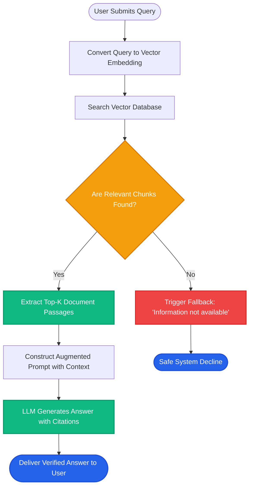

# Lesson 1: What is RAG (Retrieval-Augmented Generation)?

Man, welcome to RAG! Let's start with the most important foundation: why large language models alone cannot solve your business problems, and how RAG fixes that without retraining the model.


---

### Step 1: Why Do We Need This?

Large language models (LLMs) like GPT-4 or Claude write smooth, confident text. But in real software engineering, using a raw LLM creates three big failures:

1. **They hallucinate:** An LLM does not check facts. It guesses the next likely word. If it does not know the answer, it invents believable lies with total confidence.
2. **They have a knowledge cutoff:** An LLM only knows what existed before its training ended. It has zero knowledge of what happened yesterday or this morning.
3. **They do not know your private data:** An LLM was trained on public internet text. It has never seen your company HR policies, private customer tickets, or internal code repositories.

Why not just retrain or fine-tune the model whenever your data updates?
- Retraining costs hundreds of thousands of dollars and takes weeks.
- Fine-tuning changes model style, but it is unreliable for storing hard facts. It can still hallucinate private data.

We need a system that gives the LLM fresh, private facts right at the moment the user asks a question.

---

### Step 2: What Is It?

**RAG** stands for **Retrieval-Augmented Generation**. 

Let's break down the three words:
- **Retrieval:** Search your private files to find the exact paragraphs that relate to the user's question.
- **Augmented:** Add those paragraphs into the prompt alongside the question.
- **Generation:** Ask the LLM to write the final answer using *only* those retrieved paragraphs.

#### The Everyday Analogy: Closed-Book vs Open-Book Exam
- **Raw LLM is a Closed-Book Exam:** The student sits in an exam hall with no books. If they memorized the answer months ago, they answer correctly. If they forgot or never learned it, they guess and make mistakes.
- **RAG is an Open-Book Exam:** The student sits with a giant reference library. When a question appears, an assistant quickly pulls the exact two pages needed and places them on the desk. The student reads those pages and writes a truthful answer backed by evidence.

```
Without RAG:  User Question ───────────────────────────► LLM (Guesses from memory) ──► Risky Answer
With RAG:     User Question ──► Search Private Docs ──► Context + Prompt ──► LLM ──► Grounded Truth
```

---

### Step 3: Real-World Example

Imagine an e-commerce support bot for an online electronics store.

- **User asks:** *"Can I return a opened laptop bought 18 days ago?"*
- **Raw LLM behavior:** It guesses: *"Most electronic stores offer a 30-day return policy, so yes, you can return it!"* (The customer ships it back, gets rejected by warehouse staff, and files a complaint.)
- **RAG behavior:**
  1. The retrieval system searches the internal store policy database.
  2. It finds section 4.2: *"Laptops and tablets must be returned within 14 days. Opened boxes incur a 15% restocking fee."*
  3. The prompt sends this text to the LLM: *"Answer the user question using ONLY this policy snippet."*
  4. The LLM responds: *"No. Laptops must be returned within 14 days of purchase. Because 18 days have passed, this item is outside the return window."*

The answer is 100% accurate, verifiable, and safe.

---

### Step 4: How Does It Work?

A production RAG system works in two distinct pipelines:

```
[Offline Ingestion]  Raw Docs ──► Split Chunks ──► Embeddings ──► Vector Database
                                                                         │
[Online Query]       User Query ──► Embed Query ──► Search Similar ──────┘
                                                          │
                                                    Top Context
                                                          │
                     Augmented Prompt (Context + Query) ──► LLM ──► Final Answer
```

1. **Ingestion Pipeline (Runs Once or on Schedule):**
   - You collect raw documents (PDFs, Markdown, Notion pages).
   - You break long documents into small pieces called **chunks** (e.g., 300 to 500 words).
   - You turn each chunk into a list of numbers called an **embedding** that represents its meaning.
   - You save these embeddings in a **vector database**.

2. **Query Pipeline (Runs on Every User Request):**
   - The user submits a question.
   - The system turns the question into an embedding.
   - The vector database finds the top `k` chunks with meanings closest to the question.
   - The system pastes those chunks into a system prompt.
   - The LLM reads the context and returns an answer citing those facts.

---

### Step 5: Code Example

Here is a clean, minimal RAG example in Python. It shows the core logic without hiding details:

```python
"""
Minimal Working RAG Demonstration
Shows how retrieval grounds an LLM response.
"""

from typing import List

# 1. Our private company documents (normally stored in a database)
KNOWLEDGE_BASE = [
    {
        "id": "doc_1",
        "text": "SkillVault premium membership costs $29 per month and includes unlimited mock interviews."
    },
    {
        "id": "doc_2",
        "text": "Refund requests are accepted within 7 days of subscription start date if zero sessions were used."
    },
    {
        "id": "doc_3",
        "text": "To reset your password, visit skillvault.com/reset and enter your registered work email."
    }
]

def simple_keyword_retriever(query: str, docs: List[dict], top_k: int = 1) -> List[dict]:
    """Finds the most relevant document based on keyword matches."""
    query_words = set(query.lower().split())
    
    scored_docs = []
    for doc in docs:
        doc_words = set(doc["text"].lower().split())
        overlap = len(query_words.intersection(doc_words))
        scored_docs.append((overlap, doc))
    
    # Sort by highest word overlap
    scored_docs.sort(key=lambda x: x[0], reverse=True)
    return [doc for score, doc in scored_docs[:top_k]]

def build_rag_prompt(query: str, retrieved_docs: List[dict]) -> str:
    """Combines retrieved facts with the user question into a prompt."""
    context_text = "\n".join([f"- {d['text']}" for d in retrieved_docs])
    
    prompt = f"""You are a helpful customer support AI.
Answer the user's question using ONLY the facts provided in the Context below.
If the answer cannot be found in the context, say 'I do not have enough information to answer that.'

Context:
{context_text}

User Question: {query}
Answer:"""
    return prompt

# Test the pipeline
if __name__ == "__main__":
    user_query = "Can I get a refund if I signed up 5 days ago?"
    
    # Step 1: Retrieve
    matches = simple_keyword_retriever(user_query, KNOWLEDGE_BASE, top_k=1)
    
    # Step 2: Augment
    final_prompt = build_rag_prompt(user_query, matches)
    
    print("--- AUGMENTED PROMPT SENT TO LLM ---")
    print(final_prompt)
```

---

### Step 6: How Is It Used in Production?

| Production Challenge | Why It Breaks | How Engineers Fix It | Latency & Cost Impact |
| :--- | :--- | :--- | :--- |
| **Garbage In, Garbage Out** | Bad chunking retrieves useless fragments | Use semantic chunking and clean raw HTML/PDF noise | Minor indexing cost; zero extra latency |
| **Hallucination on Empty Retrieval** | The retriever finds nothing, but the LLM guesses anyway | Add strict system rules: *"If context lacks the answer, decline to answer"* | Saves token costs on hallucinations |
| **Context Window Bloat** | Stuffing 20 documents into prompt slows down response | Retrieve top 3-5 chunks, then run a reranker | Reduces prompt tokens by 60%, lower API bills |
| **Outdated Information** | Vector database retains stale policy documents | Implement document update and deletion triggers | Requires CDC (Change Data Capture) pipeline |

---

### Step 7: Quick Revision

- **RAG = Retrieval + Augmentation + Generation.**
- **The Core Goal:** Feed fresh, private documents to an LLM at query time so it answers with grounded facts instead of guessing.
- **Weights Do Not Change:** Unlike fine-tuning, RAG never modifies model weights. When policies change, you just update the database.
- **Two Pipelines:** An offline ingestion pipeline (chunking + embedding) and an online query pipeline (search + generation).
- **Interview Answer:** *"RAG is an architectural pattern that retrieves relevant documents from an external store and injects them into the prompt so the LLM produces accurate, verifiable answers without retraining."*

---

### Step 8: Final Flow Diagram



---

### Step 9: Quiz

Test your understanding of RAG fundamentals. Submit your answers as `1-A, 2-B, 3-C, 4-D` to check your score:

**1. Why is RAG preferred over fine-tuning when dealing with company policies that change every week?**
- A) Fine-tuning does not support English text as well as RAG.
- B) RAG allows instant updates by modifying documents in a database, whereas fine-tuning requires slow and expensive model retraining.
- C) Fine-tuning models deletes previous knowledge completely.
- D) RAG eliminates the need for an LLM entirely.

**2. In the four-stage RAG flow, which step runs ahead of time rather than per user query?**
- A) Indexing and embedding source documents.
- B) Augmenting the user prompt.
- C) Generating the final token stream.
- D) Searching the vector database.

**3. What happens if a user asks a question, and the retriever pulls three completely irrelevant chunks?**
- A) The vector database crashes immediately.
- B) The LLM is likely to hallucinate or give an incorrect answer based on poor context.
- C) The LLM automatically rewrites the vector database records.
- D) The embedding model retrains itself.

**4. What is the role of 'Augmentation' in RAG?**
- A) Increasing the parameter count of the transformer model.
- B) Combining retrieved facts with the user question into a structured prompt.
- C) Speeding up the GPU clock cycle during inference.
- D) Translating the user query into foreign languages.

*(Submit your answers to check your progress!)*
