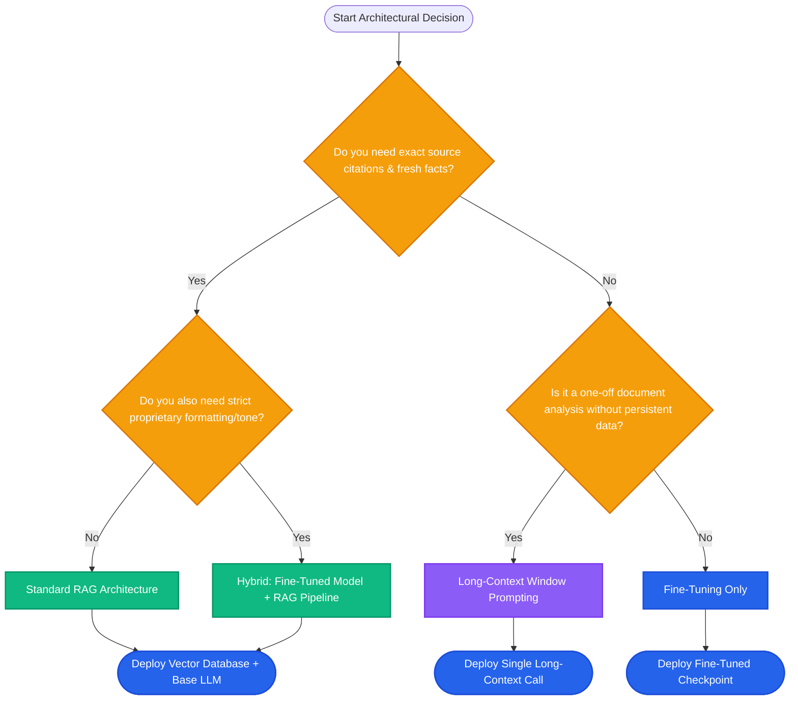

# Lesson 2: RAG vs Fine-Tuning vs Long-Context Window

Man, in Lesson 1 we saw how RAG solves hallucination and private knowledge limits. But beginners often ask: *"Can't we just fine-tune the model with our documents, or dump all our files into a 1-million-token context window?"*

Let's break down the exact engineering trade-offs between all three approaches so you always pick the right tool for production.

---

### Step 1: Why Do We Need This?

When companies want an AI assistant that knows their internal documentation, engineering teams often waste months picking the wrong strategy:

1. **The Fine-Tuning Trap:** A team spends $20,000 fine-tuning a model on company policy PDFs. Next week, HR changes the remote work policy. The model still recites the old rules. Worse, it blends numbers and invents fake clauses. They discover that fine-tuning is great for teaching a model *how to speak*, but awful for teaching it *exact facts*.
2. **The Long-Context Trap:** Another team decides to bypass vector databases and dump 500 pages of text into a model with a 1-million token context window on every query. The system works, but each user message takes 25 seconds to reply and costs $0.50 in API tokens. The monthly bill hits $15,000 for simple support questions.

Without knowing when to use RAG, when to fine-tune, and when to use long-context windows, you will burn time, money, and compute.

---

### Step 2: What Is It?

There are three ways to give an LLM specialized knowledge:

1. **RAG (The Researcher with a Library):** The model weights stay unchanged. At question time, a search system fetches the 2 or 3 exact pages needed and gives them to the model.
2. **Fine-Tuning (The Student Passing an Exam):** You train the model on curated input-output pairs. This alters the internal weights. The model memorizes patterns, tone, and specific output structures.
3. **Long Context (Reading the Whole Book Every Time):** You paste the entire document library directly into the prompt without searching. The model reads everything from start to finish for every single question.

#### Simple Everyday Analogy
| Approach | Analogy | Best Strength | Biggest Weakness |
| :--- | :--- | :--- | :--- |
| **RAG** | Student with an open book and quick index cards | Instant fact updates, exact source links | Requires search infrastructure |
| **Fine-Tuning** | Student who trained for months to write in medical style | Deep style change, fast short queries | Very expensive to update facts |
| **Long Context** | Student reading an entire encyclopedia before every answer | Zero database setup | High cost per query, high latency |

---

### Step 3: Real-World Example

Let's look at three real production engineering scenarios:

- **Scenario A: Company Legal & HR Portal (Winner: RAG)**
  - Documents change weekly. Employees need exact source citations for company policies.
  - You must prove why the AI said "employees get 20 vacation days."
  - *RAG is the only choice because facts update instantly and provide citations.*

- **Scenario B: Medical Diagnosis Style or SQL Generation (Winner: Fine-Tuning)**
  - A healthcare app needs the LLM to output doctor notes in a strict HIPAA-compliant SOAP format.
  - A base LLM often forgets the exact JSON structure and tone.
  - *Fine-tuning trains the model's weights to reliably output this specialized style every time.*

- **Scenario C: Analyzing a Single Murder Mystery Novel (Winner: Long Context)**
  - A user uploads a single 300-page book and asks: *"Which clues in chapters 2, 7, and 19 point to the butler?"*
  - The clues are scattered across chapters and depend on complex story flow.
  - *Long context is best here because it's a one-off task and setting up a vector database is unnecessary.*

---

### Step 4: How Does It Work?

Here is how each approach processes a user request:

```
RAG:
User Query ──► Fast Search (Vector DB) ──► Top 3 Chunks (2k tokens) ──► Base LLM ──► Fast Answer ($)

Fine-Tuning:
User Query ──► Model with Updated Weights (Pre-baked Knowledge & Style) ────────────► Fast Answer ($)

Long-Context:
User Query + Entire 200k Token Document Corpus ───────────────────────► Base LLM ──► Slow Answer ($$$)
```

#### Decision Matrix

| Dimension | RAG | Fine-Tuning | Long Context |
| :--- | :--- | :--- | :--- |
| **Primary Use Case** | Dynamic facts & private retrieval | Tone, style, strict output formatting | Complex one-off document analysis |
| **Knowledge Freshness** | Immediate (update the database) | Requires retraining runs | Immediate (paste new text) |
| **Source Citations** | Yes (exact chunk pointers) | No (black-box neural weights) | Difficult (model reads entire text) |
| **Cost per Query** | Low (only top chunks sent) | Low (short prompt sent) | Very high (paying for hundreds of thousands of tokens) |
| **Hallucination Risk** | Low (grounded in context) | Medium to High (can misremember) | Low to Medium (can lose facts in middle) |

---

### Step 5: Code Example

Here is a Python decision helper showing how a production router picks the correct strategy based on business constraints:

```python
"""
Decision Router: Chooses RAG, Fine-Tuning, or Long-Context
"""

from typing import Dict, Literal

Strategy = Literal["RAG", "FINE_TUNING", "LONG_CONTEXT", "HYBRID_RAG_FINE_TUNING"]

def choose_ai_strategy(requirements: Dict[str, bool]) -> Strategy:
    """
    Evaluates business needs and selects the optimal approach.
    """
    needs_citations = requirements.get("needs_citations", False)
    frequent_data_updates = requirements.get("frequent_data_updates", False)
    strict_style_or_syntax = requirements.get("strict_style_or_syntax", False)
    small_single_document = requirements.get("small_single_document", False)

    # Rule 1: One-off analysis on a single self-contained doc
    if small_single_document and not frequent_data_updates:
        return "LONG_CONTEXT"

    # Rule 2: Both strict specialized style AND dynamic private facts
    if strict_style_or_syntax and (frequent_data_updates or needs_citations):
        return "HYBRID_RAG_FINE_TUNING"

    # Rule 3: Dynamic facts, documentation, or verifiable sources needed
    if frequent_data_updates or needs_citations:
        return "RAG"

    # Rule 4: Fixed facts, specialized syntax/tone/classification only
    if strict_style_or_syntax:
        return "FINE_TUNING"

    return "RAG"

if __name__ == "__main__":
    hr_bot_needs = {
        "needs_citations": True,
        "frequent_data_updates": True,
        "strict_style_or_syntax": False,
        "small_single_document": False
    }
    
    selected = choose_ai_strategy(hr_bot_needs)
    print(f"Selected Strategy for HR Bot: {selected}")
    # Output: Selected Strategy for HR Bot: RAG
```

---

### Step 6: How Is It Used in Production?

| Architecture Choice | When Engineers Get It Wrong | The Production Solution | Real Impact |
| :--- | :--- | :--- | :--- |
| **Attempting to inject facts via Fine-Tuning** | Fine-tuning a model on company wikis causes hallucinations and high retraining costs | Use RAG for all facts; reserve fine-tuning for syntax/tone | Saves 90% in training expenses |
| **Overusing Long Context for simple Q&A** | Sending 100k tokens per query creates 15-second latency | Use vector search to retrieve only relevant 3k tokens | Reduces latency from 15s to 1.2s |
| **The 'Lost in the Middle' Problem** | Long-context models often ignore facts placed in the middle of long prompts | Keep context chunks concise and top-ranked | Eliminates missing-answer bugs |
| **Ignoring the Hybrid Powerhouse** | Assuming you must pick only one method | Fine-tune a small model (e.g. Llama-3-8B) for format, then feed it RAG chunks | Best performance and lowest inference cost |

---

### Step 7: Quick Revision

- **RAG:** Best for facts, private data, fast-updating info, and verifiable citations.
- **Fine-Tuning:** Best for learning voice, tone, formatting, and specialized skills (like generating Cypher queries).
- **Long Context:** Best for one-off reasoning over a complete file where setting up a database is unnecessary.
- **Golden Rule:** *Fine-tune for form and style; use RAG for facts and knowledge.*
- **Interview Answer:** *"Fine-tuning adjusts model behavior and style, while RAG provides fresh factual context at query time. For rapidly changing private enterprise data, RAG is far cheaper, faster to update, and provides verifiable citations."*

---

### Step 8: Final Flow Diagram



---

### Step 9: Quiz

Test your architectural knowledge. Submit your answers as `1-A, 2-B, 3-C, 4-D`:

**1. A company updates its refund policy every Friday morning. Which approach makes these new policies available to users by Friday afternoon with the least effort?**
- A) Fine-tune the LLM over the weekend.
- B) Update the document in the RAG vector database.
- C) Train a new foundational model from scratch.
- D) Convert the policy into a Python library.

**2. Why is fine-tuning generally a poor choice for storing factual company knowledge?**
- A) Fine-tuning deletes the model's ability to speak English.
- B) Knowledge in neural weights is diffused and prone to hallucination without source citations.
- C) Fine-tuned models cannot accept prompts longer than 10 tokens.
- D) Fine-tuning is only compatible with open-source models.

**3. What is the primary operational drawback of using a 1-million-token context window for every customer support message?**
- A) The model refuses to answer questions about customer support.
- B) Every query incurs massive latency and high input token costs.
- C) Long-context models cannot process text in paragraphs.
- D) Context windows can only accept JSON data.

**4. When is a Hybrid approach (Fine-Tuning + RAG) recommended?**
- A) When you want to eliminate the need for GPU servers.
- B) When you need both specialized domain formatting/tone and up-to-date verifiable factual retrieval.
- C) Only when building video games.
- D) When your documents have zero text.

*(Submit your answers to check your progress!)*
