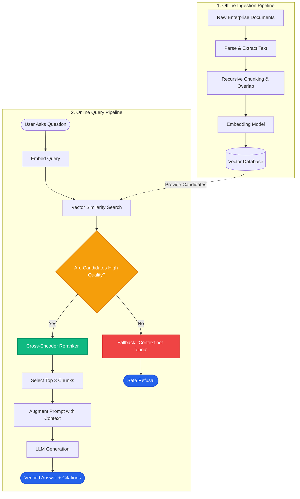

# Lesson 3: RAG Architecture Overview

Man, in Lessons 1 and 2 we understood the theory and trade-offs of RAG. Now let's look at the complete engineering blueprint. 

When a RAG system fails in production, is it because chunking was too small? Because embeddings lost context? Or because the prompt was messy? To debug and build production-grade AI systems, you need a clear mental map of every moving part.


---

### Step 1: Why Do We Need This?

Beginners often think RAG is just two lines of code: `vector_db.search()` and `llm.invoke()`. 

In real production systems, this simplistic view breaks immediately:
1. **Unidentified failure points:** If the user gets an incorrect answer, you cannot tell where the error happened. Was the document parsed poorly? Did the chunk size split a table in half? Did the vector search miss the right chunk? Or did the LLM ignore the context?
2. **High latency:** Without understanding the components, engineers run slow models at every step, creating 8-second response times.
3. **High operational costs:** Without a clear pipeline architecture, teams re-embed entire document libraries repeatedly whenever a single file changes.

A clean architectural separation between the **Ingestion Loop** (offline) and the **Query Loop** (online) solves all of these problems.

---

### Step 2: What Is It?

A complete production RAG architecture consists of two distinct pipelines:

1. **The Ingestion Pipeline (Offline / Background):**
   - Takes raw documents (PDFs, Markdown, Word, Notion, SQL).
   - Cleans the text and strips out garbage characters.
   - Splits long text into smaller pieces called **chunks**.
   - Converts each chunk into a mathematical vector (embedding).
   - Stores the text, embeddings, and metadata in a **vector store**.

2. **The Retrieval & Generation Pipeline (Online / Real-time):**
   - Takes the incoming user question.
   - Converts the question into an embedding.
   - Searches the vector store for the closest chunks.
   - (Optional but vital) Re-scores the retrieved chunks with a **Reranker**.
   - Assembles the top chunks into a structured prompt.
   - Passes the prompt to the LLM to generate the final verified response.

#### The Everyday Analogy: Modern Courier Delivery
- **Ingestion is Warehouse Sorting:** Parcels arrive in bulk, get tagged with barcodes, and are placed on labeled warehouse shelves. This happens long before a customer orders.
- **Retrieval is Order Dispatch:** A customer places an order. The warehouse scanner finds the exact shelf, grabs the package, packs it into a delivery box, and delivers it to the customer's doorstep.

---

### Step 3: Real-World Example

Imagine building an AI assistant for a hospital with 50,000 internal clinical guidelines.

- **Ingestion Pipeline:**
  - 50,000 PDF guidelines are loaded.
  - A parser extracts text while preserving clinical tables.
  - Documents are split into 400-token chunks with 50-token overlap.
  - Embeddings are generated and stored in a vector database tagged with department metadata (e.g., `department: cardiology`).

- **Query Pipeline:**
  - A doctor asks: *"What is the emergency protocol for acute chest pain during surgery?"*
  - The query is embedded and filtered by `department: cardiology`.
  - The retriever fetches the top 10 relevant chunks in 45 milliseconds.
  - A reranker sorts them and keeps the top 3 highest-quality passages.
  - The LLM receives the prompt and responds with the exact steps and clinical citations.

---

### Step 4: How Does It Work?

Here is the exact data flow across all components:

```
[INGESTION PIPELINE - Asynchronous]
Raw Files (PDF/HTML) ──► Document Parser ──► Text Chunker ──► Embedding Model ──► Vector Database
                                                                                      │
[QUERY PIPELINE - Synchronous < 2 sec]                                                │
User Question ──► Embedding Model ──► Semantic Search (Top-K) ────────────────────────┘
                                              │
                                       Top Chunks
                                              │
                                       Reranker Model (Cross-Encoder)
                                              │
                                       Top-3 Best Passages
                                              │
User Question + Filtered Context ──► Prompt Template ──► LLM ──► Grounded Answer + Source Link
```

#### Component Responsibilities:
1. **Document Loader:** Reads native file formats and extracts clean text and document metadata (author, date, URL).
2. **Text Splitter:** Divides text into small chunks so they fit nicely into context windows and preserve single ideas.
3. **Embedding Model:** Transforms human text into vectors of numbers (e.g., 1536 dimensions) that capture semantic meaning.
4. **Vector Store:** High-performance database optimized for vector math (cosine similarity, HNSW indexing).
5. **Reranker:** A high-precision model that grades how well each retrieved chunk actually answers the specific query.
6. **Generator (LLM):** The language model that produces human-friendly sentences grounded strictly in the context.

---

### Step 5: Code Example

Here is a clean Python blueprint demonstrating the modular architecture:

```python
"""
Modular Production RAG Architecture Blueprint
"""

from typing import List, Dict

class DocumentIngestionPipeline:
    """Handles parsing, chunking, embedding, and storage."""
    def __init__(self, vector_store: Dict[str, str]):
        self.vector_store = vector_store

    def ingest_document(self, doc_id: str, content: str, chunk_size: int = 100) -> None:
        # Step 1: Clean and split content into chunks
        words = content.split()
        chunks = [
            " ".join(words[i:i + chunk_size]) 
            for i in range(0, len(words), chunk_size)
        ]
        
        # Step 2: Store chunks (in production, compute and store embeddings)
        for idx, chunk in enumerate(chunks):
            chunk_key = f"{doc_id}_chunk_{idx}"
            self.vector_store[chunk_key] = chunk
        print(f"Ingested {len(chunks)} chunks for {doc_id}")


class RAGQueryEngine:
    """Handles search, prompt assembly, and answer generation."""
    def __init__(self, vector_store: Dict[str, str]):
        self.vector_store = vector_store

    def retrieve(self, query: str, top_k: int = 2) -> List[str]:
        # Simple similarity simulation
        query_words = set(query.lower().split())
        scored = []
        for key, text in self.vector_store.items():
            score = len(query_words.intersection(set(text.lower().split())))
            scored.append((score, text))
        
        scored.sort(key=lambda x: x[0], reverse=True)
        return [text for score, text in scored[:top_k]]

    def generate_answer(self, query: str) -> str:
        # Step 1: Retrieve relevant context
        context_chunks = self.retrieve(query)
        context = "\n".join(context_chunks)
        
        # Step 2: Augment prompt
        prompt = (
            f"Context:\n{context}\n\n"
            f"Question: {query}\n"
            f"Answer based strictly on context:"
        )
        
        # Step 3: LLM generation simulation
        return f"Synthesized Response for '{query}' using retrieved facts:\n{context}"


if __name__ == "__main__":
    db: Dict[str, str] = {}
    
    # 1. Run Ingestion (Offline)
    ingestion = DocumentIngestionPipeline(db)
    sample_text = (
        "PostgreSQL 16 introduced enhanced logical replication and CPU acceleration. "
        "Pgvector enables fast vector similarity searches directly inside Postgres tables."
    )
    ingestion.ingest_document("pg_manual", sample_text, chunk_size=10)
    
    # 2. Run Query (Online)
    engine = RAGQueryEngine(db)
    result = engine.generate_answer("What does pgvector do?")
    print("\n--- FINAL ANSWER ---")
    print(result)
```

---

### Step 6: How Is It Used in Production?

| Architecture Stage | Typical Failure | Production Fix | Latency / Cost Impact |
| :--- | :--- | :--- | :--- |
| **Ingestion: Parsing** | Complex PDF tables turned into jumbled words | Use layout-aware OCR/parsers (e.g. Unstructured, LlamaParse) | Ingestion takes longer; zero query latency impact |
| **Ingestion: Chunking** | Sentence cut in half mid-thought | Use recursive text splitting with 10-20% overlap | Small storage increase; improves search accuracy |
| **Retrieval: Vector Search** | Keyword-specific terms (like product SKUs) missed | Use Hybrid Search (Vector + BM25 keyword matching) | +15ms query latency; eliminates missed lookups |
| **Retrieval: Reranking** | Top 10 chunks contain irrelevant filler | Pass retrieved chunks through a Cross-Encoder Reranker | +50ms latency; cuts input tokens by 50% |
| **Generation: Prompting** | LLM ignores context when answer is missing | Add explicit negative constraints: *"State 'Unknown' if not in context"* | Prevents hallucination; reduces output token costs |

---

### Step 7: Quick Revision

- **Two Core Pipelines:** Ingestion (offline, runs when data changes) and Querying (online, runs per user request).
- **Ingestion Steps:** Load documents -> Parse & clean -> Chunk -> Embed -> Store in Vector DB.
- **Query Steps:** Embed user query -> Vector search -> Rerank top chunks -> Build prompt -> Generate answer.
- **Reranker Value:** Cross-encoders are too slow to search millions of documents, but fast enough to rank the top 10 retrieved chunks for maximum precision.
- **Interview Answer:** *"A production RAG system separates offline ingestion from online query execution. Ingestion prepares clean chunk embeddings in a vector store, while the query pipeline transforms the question, retrieves candidate chunks, reranks them for high precision, and augments the LLM prompt."*

---

### Step 8: Final Flow Diagram



---

### Step 9: Quiz

Test your understanding of the RAG architecture. Submit your answers as `1-A, 2-B, 3-C, 4-D`:

**1. Why are Ingestion and Querying separated into two distinct pipelines in production?**
- A) Ingestion requires Python, while Querying must be written in HTML.
- B) Ingestion is heavy and runs when documents change, while Querying must return answers to users in sub-second times.
- C) Modern vector databases do not allow queries while files exist on disk.
- D) Ingestion is only performed by the LLM itself.

**2. What is the main reason to add a Reranker step after initial vector search?**
- A) To convert English chunks into another language.
- B) Vector search finds candidate chunks fast, but a reranker accurately scores which chunks genuinely answer the query.
- C) The reranker deletes documents from the vector database.
- D) To compress the LLM weights onto a smaller disk.

**3. If an LLM answers a question incorrectly even though the relevant facts were in the original document, which of these is a common cause?**
- A) Chunking split the key sentence in half across two separate chunks, destroying the meaning.
- B) The vector database deleted the LLM's API keys.
- C) The user used too few punctuation marks.
- D) The server had too much RAM.

**4. Where does document chunking take place in a standard RAG system?**
- A) Inside the LLM's attention layers during text generation.
- B) During the offline ingestion pipeline, before embeddings are calculated.
- C) Inside the client's web browser after the answer is printed.
- D) Only when a user clicks 'Submit'.

*(Submit your answers to check your progress!)*
