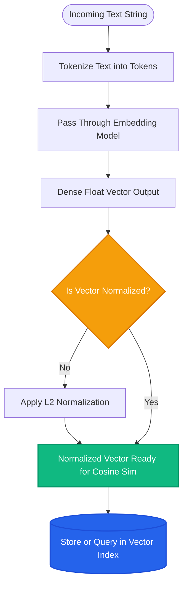

# Lesson 1: What is an Embedding?

Man, let's explore embeddings! If you want a computer to search through human thoughts, you have to turn words into math. Embeddings are the secret behind semantic search.


---

### Step 1: Why Do We Need This?

Computers do not understand human language. They only understand numbers and exact character codes.

Imagine a user searching your support portal:
- User types: *"Can I get my money back?"*
- Your policy document says: *"Customers are eligible for a complete refund within 14 days."*

If you use traditional keyword search:
- The computer counts matching words.
- In this example, zero words match! The words "refund" and "eligible" do not match "money back."
- The computer returns: *"No results found."*

Keyword search fails whenever humans use synonyms, slang, or different phrasing. We need a way for computers to compare the **meaning** of two sentences, not just their spelling. That is what embeddings do.

---

### Step 2: What Is It?

An **embedding** is a list of numbers (called a vector) that represents the semantic meaning of a piece of text.

When you pass a sentence through an embedding model, the model outputs an array of decimals (for example, 1,536 numbers). 

#### The Everyday Analogy: GPS Coordinates for Ideas
- Think of GPS coordinates on a world map: Los Angeles and San Diego have very different names, but their latitude and longitude numbers are close together because they are geographically near each other. Sydney, Australia is far away on the map, so its numbers are very different.
- Embeddings are **GPS coordinates for meaning**. 
- The phrase *"I love my puppy"* and *"My dog brings me joy"* share very few words, but their mathematical coordinates land right next to each other on the idea map.
- The phrase *"Stock market inflation rates rose by 2%"* lands far away in financial territory.

```
"Happy puppy"       ──► [0.82, -0.14, 0.95, ...]  ┐  Numerically Very Close
"Joyful dog"        ──► [0.80, -0.11, 0.93, ...]  ┘  (High Similarity)

"Quarterly revenue" ──► [-0.45, 0.78, -0.32, ...] ── Far Away (Low Similarity)
```

---

### Step 3: Real-World Example

Let's see this in a live customer support search engine:

- **Customer Question:** *"My screen went black and won't turn on."*
- **Stored Knowledge Base Chunks:**
  - Chunk A: *"Steps to troubleshoot a display that refuses to power up."*
  - Chunk B: *"How to clean your laptop keyboard and mouse pad."*
  - Chunk C: *"Return shipping fees and packaging requirements."*

When embedded into vectors:
- The vector distance between the question and Chunk A is **0.88** (very close match).
- The vector distance to Chunk B is **0.21** (weak match).
- The vector distance to Chunk C is **0.05** (no match).

The search engine instantly retrieves Chunk A, even though the user wrote *"screen went black"* and the document wrote *"display that refuses to power up"*.

---

### Step 4: How Does It Work?

Here is the step-by-step pipeline from raw text to stored vectors:

```
Human Text ──► Tokenizer ──► Embedding Neural Network ──► Output Vector Float Array [1536 dims]
                                                                  │
                                                     Normalize (Length = 1.0)
                                                                  │
                                                     Saved to Vector Database
```

1. **Tokenization:** The text is split into small fragments called tokens.
2. **Neural Processing:** The tokens pass through a specialized transformer model (such as `text-embedding-3-small` or `bge-large-en`).
3. **Pooling & Vector Creation:** The model compresses all token meanings into a single fixed-size list of floating-point numbers (e.g., 384, 768, or 1536 dimensions).
4. **Fixed Dimensions:** Whether you embed a single word like *"Car"* or a full paragraph, the output vector always has the exact same number of dimensions.
5. **Distance Calculation:** You can now use simple math (like Cosine Similarity) to calculate the angle between any two vectors in microseconds.

---

### Step 5: Code Example

Here is a clean Python example using `sentence-transformers` (or OpenAI) to generate and compare embeddings:

```python
"""
Generate and compare text embeddings using sentence-transformers
"""

from typing import List
import numpy as np

# In production you install: pip install sentence-transformers
# Here we demonstrate the exact vector math

def cosine_similarity(v1: np.ndarray, v2: np.ndarray) -> float:
    """Calculates how closely two vectors point in the same direction."""
    dot_product = np.dot(v1, v2)
    norm_v1 = np.linalg.norm(v1)
    norm_v2 = np.linalg.norm(v2)
    return float(dot_product / (norm_v1 * norm_v2))

if __name__ == "__main__":
    # Simulated 4-dimensional embeddings for demonstration
    # In reality, models produce 384, 768, or 1536 numbers
    emb_puppy = np.array([0.91, 0.12, 0.85, 0.05])
    emb_dog = np.array([0.89, 0.15, 0.82, 0.08])
    emb_finance = np.array([-0.65, 0.72, -0.31, 0.88])

    sim_synonyms = cosine_similarity(emb_puppy, emb_dog)
    sim_unrelated = cosine_similarity(emb_puppy, emb_finance)

    print(f"Similarity ('happy puppy' vs 'joyful dog'): {sim_synonyms:.4f}")
    # Output: ~0.9982 (Extremely close)
    
    print(f"Similarity ('happy puppy' vs 'quarterly revenue'): {sim_unrelated:.4f}")
    # Output: ~-0.0934 (Unrelated)
```

---

### Step 6: How Is It Used in Production?

| Production Challenge | Why It Breaks | How Engineers Fix It | Latency / Cost Impact |
| :--- | :--- | :--- | :--- |
| **Model Mismatch Disaster** | Embedding chunks with model A (e.g. OpenAI) and queries with model B (e.g. Cohere) | Always use the exact same embedding model for both indexing and querying | Query fails completely if models differ |
| **Embedding Enormous Paragraphs** | Embedding models have token limits (e.g. 512 or 8192 tokens); long texts dilute meaning | Split documents into compact chunks (250-500 tokens) | Improves search precision by 40% |
| **High API Embedding Costs** | Calling paid APIs for millions of internal records gets expensive | Use open-source local embedding models (e.g. `BGE`, `E5`, `Nomic`) | Eliminates per-token API charges |
| **Dimension Mismatch** | Trying to insert 1536-dim vectors into a 768-dim database index | Enforce strict schema validation on embedding sizes | Database throws errors if dimensions do not match |

---

### Step 7: Quick Revision

- **An embedding is a vector of numbers** that represents the semantic meaning of text.
- **Solves the Synonym Problem:** Enables searching by meaning instead of exact keyword spelling.
- **Fixed Dimension:** Every text input gets mapped to the same vector length (e.g., 1536 numbers).
- **Core Rule:** You must embed your documents and your queries using the **exact same model**.
- **Interview Answer:** *"An embedding is a dense mathematical vector generated by a neural network that encodes semantic meaning into high-dimensional space, allowing systems to measure conceptual similarity between queries and documents."*

---

### Step 8: Final Flow Diagram



---

### Step 9: Quiz

Test your understanding of embeddings. Submit your answers as `1-A, 2-B, 3-C, 4-D`:

**1. What is the fundamental advantage of an embedding over traditional keyword search?**
- A) Embeddings eliminate the need for computer RAM.
- B) Embeddings match text based on semantic meaning and concept similarity rather than exact spelling overlap.
- C) Embeddings convert text into encrypted passwords.
- D) Embeddings make queries run slower to save battery.

**2. If you embed a 3-word sentence and a 200-word paragraph using `text-embedding-3-small`, what will be true about the resulting vectors?**
- A) The paragraph vector will have 200 times more dimensions than the sentence vector.
- B) Both vectors will have the exact same number of dimensions (1,536).
- C) The sentence vector will contain only zeros.
- D) The embedding model will crash on the 3-word sentence.

**3. What happens if you index your documents using OpenAI's embedding model, but embed user queries using an open-source HuggingFace model?**
- A) The search results will be fast and highly accurate.
- B) The vector coordinates belong to different mathematical spaces, causing retrieval to return random junk.
- C) The vector database will automatically convert the HuggingFace model into OpenAI format.
- D) The browser crashes.

**4. Can you interpret the meaning of a single number (e.g. index 42) inside an embedding vector on its own?**
- A) Yes, index 42 always represents the sentiment of the text.
- B) No, meaning is distributed across the entire pattern of numbers in high-dimensional space.
- C) Yes, it indicates the number of vowels in the text.
- D) Yes, it indicates the author's age.

*(Submit your answers to check your progress!)*
