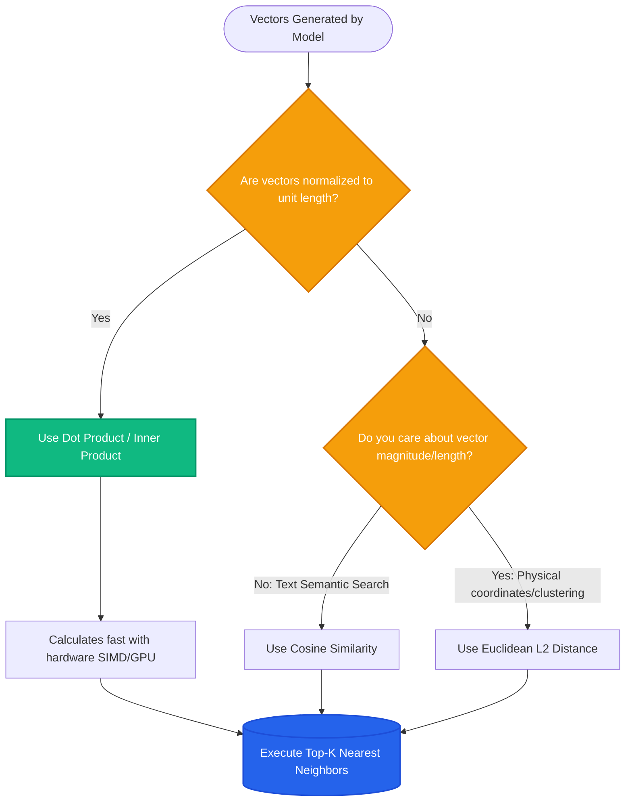

# Lesson 2: Vector Similarity and Distance Metrics

Man, in Lesson 1 we saw how text turns into lists of numbers. Now the question is: when you have millions of vectors, how does a vector database calculate which one is closest to the user's question?

Let's understand the mathematical distance metrics used in production RAG systems.

---

### Step 1: Why Do We Need This?

You converted 100,000 document chunks into vectors and stored them. Now a user asks a question, and you convert that question into a vector too.

How do you decide which chunks match?
- You need a mathematical rule to compare two vectors.
- If you pick the wrong metric, your search results will be corrupted. For example, comparing non-normalized vectors with simple Euclidean distance can make a long paragraph look completely different from a short sentence, even when they say the exact same thing!
- If you pick a metric that is slow to compute, your search latency will spike from 10 milliseconds to 500 milliseconds across a million records.

Understanding distance metrics ensures your search is accurate, fast, and mathematically sound.

---

### Step 2: What Is It?

A **similarity metric** is a mathematical formula that takes two vectors and outputs a single score showing how close or related they are.

There are three primary metrics used in RAG:

1. **Cosine Similarity (The Standard for Text):**
   - Measures the **angle** between two vectors in space, ignoring their length (magnitude).
   - If two vectors point in the exact same direction, cosine similarity is **1.0** (perfect match).
   - If they point at right angles (orthogonal), similarity is **0.0** (unrelated).
   - If they point in opposite directions, similarity is **-1.0**.

2. **Dot Product (Inner Product):**
   - Multiplies corresponding numbers of two vectors and adds them up.
   - Measures both angle and magnitude.
   - *Key Production Secret:* If your vectors are **normalized** (length = 1), Dot Product gives the exact same result as Cosine Similarity, but computes twice as fast!

3. **Euclidean Distance (L2 Distance):**
   - Measures the straight-line ruler distance between the tips of two vectors.
   - A distance of **0.0** means identical vectors. Larger numbers mean farther apart.

#### The Everyday Analogy: Flashlights in a Dark Room
- Imagine two people holding flashlights in a dark room.
- **Cosine similarity** checks if both flashlights are pointing at the exact same spot on the wall, even if one flashlight is bright and one is dim.
- **Euclidean distance** measures the physical distance in meters between the flashlight heads.
- In text search, we care about *what idea the text points to* (the direction), not how long or wordy the text was (the brightness). That is why Cosine Similarity is king.

---

### Step 3: Real-World Example

Imagine searching an employee knowledge base:

- **Query Vector ($Q$):** *"Remote work expenses"*
- **Doc 1 Vector ($D_1$):** *"Company reimburses home office desk, chair, and internet."*
- **Doc 2 Vector ($D_2$):** *"Quarterly server rack maintenance schedules."*

Metric outputs:
- **Cosine Similarity($Q, D_1$):** `0.89` (Strong angle alignment -> Match!)
- **Cosine Similarity($Q, D_2$):** `0.11` (Nearly perpendicular -> Discard!)
- **Euclidean Distance($Q, D_1$):** `0.42` (Small distance -> Match!)
- **Euclidean Distance($Q, D_2$):** `1.85` (Large distance -> Discard!)

Both metrics identify $D_1$ as the winner, but Cosine Similarity stays nicely bounded between 0 and 1, making it easy to set confidence thresholds (like *"only keep results with score > 0.75"*).

---

### Step 4: How Does It Work?

Here is the mathematical comparison:

```
Cosine Similarity:
               A · B             dot_product(A, B)
cos(θ) = ───────────────── = ─────────────────────────
          ||A|| * ||B||       length(A) * length(B)

Normalized Dot Product (When ||A|| = 1 and ||B|| = 1):
cos(θ) = A · B               (Only requires simple multiplications and additions!)

Euclidean Distance:
d(A, B) = √ [ (A₁ - B₁)² + (A₂ - B₂)² + ... + (Aₙ - Bₙ)² ]
```

#### Why Normalized Dot Product Wins in Production
Vector databases (like Pinecone, Qdrant, Chroma, and pgvector) can calculate dot products using low-level CPU instructions (AVX-512) and GPU kernels at extreme speeds. 
By normalizing all vectors upon ingestion, you get the semantic accuracy of Cosine Similarity with the lightning speed of Dot Product.

---

### Step 5: Code Example

Here is a Python script implementing and comparing all three metrics using standard `numpy`:

```python
"""
Comparing Cosine Similarity, Dot Product, and Euclidean Distance
"""

import numpy as np

def cosine_similarity(a: np.ndarray, b: np.ndarray) -> float:
    return float(np.dot(a, b) / (np.linalg.norm(a) * np.linalg.norm(b)))

def dot_product(a: np.ndarray, b: np.ndarray) -> float:
    return float(np.dot(a, b))

def euclidean_distance(a: np.ndarray, b: np.ndarray) -> float:
    return float(np.linalg.norm(a - b))

def normalize_vector(v: np.ndarray) -> np.ndarray:
    norm = np.linalg.norm(v)
    return v if norm == 0 else v / norm

if __name__ == "__main__":
    # Two similar vectors with different lengths (e.g. short query vs longer doc)
    vec_query = np.array([1.0, 2.0, 3.0])
    vec_doc_similar = np.array([2.0, 4.0, 6.0])  # Points in identical direction!
    vec_doc_different = np.array([3.0, -1.0, 0.0])

    print("--- 1. Raw Vectors ---")
    print(f"Cosine Sim (Query vs Similar Doc): {cosine_similarity(vec_query, vec_doc_similar):.4f}")
    # Output: 1.0000 (Identical direction!)
    print(f"Euclidean Dist (Query vs Similar Doc): {euclidean_distance(vec_query, vec_doc_similar):.4f}")
    # Output: 3.7417 (Misleadingly far because lengths differed!)

    print("\n--- 2. Normalized Vectors ---")
    norm_q = normalize_vector(vec_query)
    norm_d = normalize_vector(vec_doc_similar)

    print(f"Normalized Dot Product: {dot_product(norm_q, norm_d):.4f}")
    # Output: 1.0000 (Matches Cosine Similarity perfectly, but runs much faster!)
```

---

### Step 6: How Is It Used in Production?

| Production Metric | Common Mistake | How Engineers Fix It | Latency / Throughput Impact |
| :--- | :--- | :--- | :--- |
| **Cosine Similarity** | Computing division by vector magnitudes on every single query | Normalize all vectors once when inserting into database; then use Dot Product | 2x faster query throughput |
| **Euclidean Distance** | Using Euclidean on unnormalized embeddings with varying chunk lengths | Use Cosine or normalize vectors before indexing | Prevents short chunks from falsely dominating results |
| **Score Thresholding** | Hardcoding a cutoff score like `similarity > 0.9` across different embedding models | Benchmark model score distributions; OpenAI scores cluster higher (0.7-0.9) than Cohere or BGE | Prevents dropping valid answers |
| **Database Index Selection** | Building an HNSW index using L2 distance when the app queries with Cosine | Ensure the database index metric matches your query calculation exactly | Eliminates silent retrieval degradation |

---

### Step 7: Quick Revision

- **Cosine Similarity:** Measures vector direction/angle. Best metric for natural language text search.
- **Dot Product:** Measures angle and magnitude. If vectors are unit-normalized ($||v|| = 1$), Dot Product equals Cosine Similarity.
- **Euclidean (L2):** Measures straight-line point distance. Sensitive to text length unless vectors are normalized.
- **Production Standard:** Pre-normalize all vectors at ingestion time and use **Dot Product** for lightning-fast search.
- **Interview Answer:** *"In text retrieval, we prioritize semantic orientation over text length, making Cosine Similarity the primary metric. In production, we normalize vectors to unit length at ingestion time so we can execute fast dot products with identical mathematical results."*

---

### Step 8: Final Flow Diagram



---

### Step 9: Quiz

Test your understanding of similarity metrics. Submit your answers as `1-A, 2-B, 3-C, 4-D`:

**1. Why is Cosine Similarity generally preferred over Euclidean Distance for text embeddings?**
- A) Cosine Similarity only works with numbers between 1 and 10.
- B) Cosine Similarity focuses on the angle (direction of meaning) rather than the vector length (which can vary with word count).
- C) Euclidean Distance requires specialized graphics cards to run.
- D) Cosine Similarity was invented specifically for Python.

**2. If vector $A$ and vector $B$ are both normalized to length 1.0, what is the relationship between their Dot Product and their Cosine Similarity?**
- A) The Dot Product is exactly equal to the Cosine Similarity.
- B) The Dot Product is always zero.
- C) The Dot Product is twice the Euclidean Distance.
- D) They cannot be compared.

**3. What does a Cosine Similarity score of 1.0 between a user question and a document chunk signify?**
- A) Both vectors point in the exact same direction in high-dimensional space.
- B) The document contains exactly 1 word.
- C) The user query was written in French.
- D) The vector database has run out of memory.

**4. What production optimization allows vector databases to execute nearest-neighbor queries at maximum speed?**
- A) Normalizing vectors upon insertion and running dot products via hardware acceleration.
- B) Deleting all odd-numbered dimensions from vectors.
- C) Translating queries into Latin before searching.
- D) Rounding all floating-point numbers to whole integers.

*(Submit your answers to check your progress!)*
