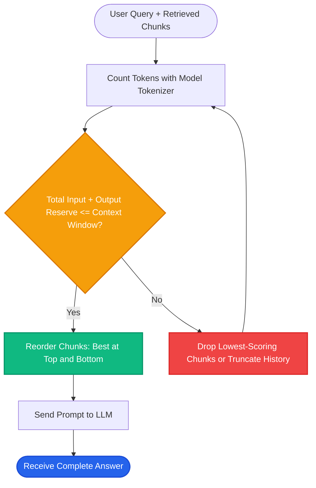

# Lesson 3: Tokenization and Context Windows

Man, in Lessons 1 and 2 we saw how words turn into vectors and how to calculate similarity. But LLMs don't read words or characters directly either — they read **tokens**. 

Understanding tokenization and context windows is essential for sizing your document chunks, controlling API bills, and preventing models from forgetting retrieved facts.

---

### Step 1: Why Do We Need This?

When building a RAG application, you must calculate budgets for every request:
1. **Context Window Overflow:** If your model has an 8,192-token limit, and you retrieve 10 long document chunks totaling 10,000 tokens, the API throws a fatal error: `RateLimitError: maximum context length exceeded`.
2. **Hidden Token Costs:** In English, 1,000 words is roughly 1,300 tokens. But in code or languages like Japanese or Hindi, 1,000 words can be 3,000+ tokens! If you estimate budgets using word counts, your API bills will surprise you.
3. **The "Lost in the Middle" Effect:** Even if a model supports a massive 128k context window, transformer attention mechanisms pay closer attention to the start and end of the prompt. Important facts stuffed into the middle often get completely ignored.

Mastering tokens and context windows allows you to build reliable, cost-effective RAG pipelines.

---

### Step 2: What Is It?

- **Tokenization:** The process of breaking raw text into smaller pieces called **tokens**. Tokens can be whole words, parts of words (subwords), or individual characters and punctuation marks.
- **Context Window:** The maximum number of tokens an LLM can process in a single request. This includes both the input prompt (system prompt + retrieved context + user query) AND the generated output answer.

#### The Everyday Analogy: Luggage Weight Limits on an Airplane
- Think of the context window as the maximum weight allowance for an airline suitcase (e.g. 50 pounds).
- Every document chunk you retrieve is like an item you pack into that suitcase.
- Words are not standard weights: a heavy winter coat (a non-English word or complex code block) takes up 4 times more weight (tokens) than a light t-shirt (a simple English word).
- If your total weight exceeds the limit, the airline rejects your bag at the gate (your API call crashes).

```
1 English Word ≈ 1.3 Tokens
1,000 Tokens   ≈ 750 English Words
Context Limit  = Input Tokens (Prompt + Retrieved Chunks) + Output Tokens (Generated Answer)
```

---

### Step 3: Real-World Example

Imagine building a legal contract analyzer:

- **User asks:** *"Are there any non-compete clauses for contractors?"*
- **Available text:** A 40-page employment agreement (~25,000 words ≈ 33,000 tokens).
- **Target model:** GPT-4o-mini (128k context window).

Can you just stuff the entire contract into the prompt?
- **Technically yes**, but sending 33,000 tokens for every query costs 10x more and adds 4 seconds of latency.
- Worse, the specific 2-sentence non-compete clause buried on page 24 might get overlooked because of the "Lost in the Middle" phenomenon.
- **The RAG Solution:** Retrieve only the 2 relevant paragraphs (400 tokens), prepend a system prompt (100 tokens), and pass the user question (20 tokens). Total cost: 520 tokens. Latency: 0.8 seconds. Accuracy: 100%.

---

### Step 4: How Does It Work?

Here is how text turns into tokens before passing to the model:

```
Raw Text: "Unbelievable, right?"
                     │
         [Byte-Pair Encoding (BPE)]
                     │
Tokens:   ["Un", "believ", "able", ",", " right", "?"]
Token IDs: [2845,   4129,   1204,   11,    1258,   30]
                     │
Passed to LLM Embedding Layers inside Context Window
```

#### Token Budget Breakdown in RAG:
In a 4,000-token budget:
1. **System Prompt:** ~150 tokens (rules and safety guidelines).
2. **Retrieved Context:** ~2,500 tokens (e.g. 5 chunks of 500 tokens each).
3. **User Query + Chat History:** ~350 tokens.
4. **Reserved for Output Generation:** ~1,000 tokens (the LLM's answer).

Total = 4,000 tokens. Always reserve enough space for the LLM's completion!

---

### Step 5: Code Example

Here is a Python script using OpenAI's `tiktoken` library to calculate exact token counts and budget context space:

```python
"""
Token counting and context budget manager
"""

from typing import List
import tiktoken

def calculate_rag_budget(
    system_prompt: str,
    user_query: str,
    chunks: List[str],
    max_context_limit: int = 4096,
    max_output_tokens: int = 800,
    model_name: str = "gpt-4o"
) -> dict:
    """Calculates token counts and verifies that the RAG prompt fits."""
    try:
        encoding = tiktoken.encoding_for_model(model_name)
    except KeyError:
        encoding = tiktoken.get_encoding("cl100k_base")

    sys_tokens = len(encoding.encode(system_prompt))
    query_tokens = len(encoding.encode(user_query))
    
    # Calculate chunk tokens individually
    chunk_token_counts = [len(encoding.encode(c)) for c in chunks]
    total_chunks_tokens = sum(chunk_token_counts)

    total_input = sys_tokens + query_tokens + total_chunks_tokens
    total_projected = total_input + max_output_tokens

    fits_in_window = total_projected <= max_context_limit

    return {
        "system_tokens": sys_tokens,
        "query_tokens": query_tokens,
        "chunks_tokens": total_chunks_tokens,
        "total_input_tokens": total_input,
        "reserved_output_tokens": max_output_tokens,
        "fits_in_context": fits_in_window,
        "tokens_remaining": max_context_limit - total_projected
    }

if __name__ == "__main__":
    system_prompt = "You are an AI assistant answering questions using provided documentation."
    query = "What is the return window for international orders?"
    sample_chunks = [
        "Domestic orders have a 30-day return policy.",
        "International shipping takes 10-15 business days. Returns must be requested within 14 days of delivery."
    ]

    budget = calculate_rag_budget(system_prompt, query, sample_chunks)
    print("Token Budget Report:")
    for k, v in budget.items():
        print(f"  {k}: {v}")
```

---

### Step 6: How Is It Used in Production?

| Production Challenge | Why It Breaks | How Engineers Fix It | Latency / Cost Impact |
| :--- | :--- | :--- | :--- |
| **Max Context Crash** | A user pastes a huge question, pushing total tokens past the model limit | Measure token length before calling API; truncate chat history or drop lowest-ranked chunks | Eliminates 400 Bad Request errors |
| **The "Lost in the Middle" Blindspot** | Critical evidence in chunk #3 of 5 is ignored by LLM attention | Place the most relevant chunks at the very top and very bottom of the context block | 15% increase in factual recall |
| **Zero Output Token Space** | Prompt uses 4,000 of a 4,096 window; model truncates answer mid-sentence | Always reserve 500-1,000 tokens specifically for generation | Prevents cut-off responses |
| **Non-English Token Inflation** | Tokenizing languages like Telugu, Arabic, or Korean produces 3-5x more tokens per word | Select multilingual tokenizers and adjust chunk character limits accordingly | Avoids unexpected token budget exhaustion |

---

### Step 7: Quick Revision

- **Tokens Are Subwords:** 1 word in English is roughly 1.3 tokens.
- **Context Window Covers Both Ends:** Total tokens = Input Prompt + Generated Output.
- **Lost in the Middle:** Models pay strongest attention to the beginning and end of the context; order retrieved chunks strategically.
- **Reserve Room for Output:** Never fill 100% of the context window with input context, or the LLM cannot write a complete response.
- **Interview Answer:** *"Tokenization converts text into discrete subword IDs. In RAG pipelines, managing token budgets across system prompts, retrieved chunks, and reserved generation space is critical to avoid context window truncation and minimize latency and cost."*

---

### Step 8: Final Flow Diagram



---

### Step 9: Quiz

Test your understanding of tokens and context windows. Submit your answers as `1-A, 2-B, 3-C, 4-D`:

**1. If an LLM has a total context window of 8,192 tokens, what must fit within this limit?**
- A) Only the system prompt and user question.
- B) Only the retrieved chunks from the vector database.
- C) Both the entire input prompt (system prompt, context, question) AND the generated output tokens.
- D) Only the Python code running the server.

**2. What is the 'Lost in the Middle' effect observed in transformer models?**
- A) The model loses network connection halfway through generation.
- B) LLMs attend more strongly to information placed at the very beginning and very end of a long prompt than to facts in the middle.
- C) The database deletes middle vectors automatically.
- D) Middle tokens are converted into numbers twice.

**3. Roughly how many tokens does a standard English sentence of 100 words represent?**
- A) Exactly 10 tokens.
- B) Approximately 130 to 140 tokens.
- C) Over 5,000 tokens.
- D) Exactly 100 characters.

**4. What happens if a RAG prompt uses 8,150 tokens on an 8,192-token context window model with `max_tokens=500` requested for output?**
- A) The API will throw an error or truncate the output answer after 42 tokens because the total exceeds the window.
- B) The model expands its context window automatically.
- C) The model runs for free.
- D) The vector database reboots.

*(Submit your answers to check your progress!)*
