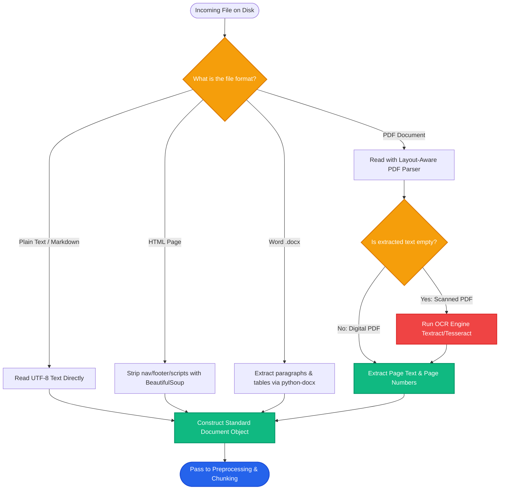

# Lesson 1: Loading Documents

Man, welcome to Phase 3! In previous lessons, we assumed documents were already clean Python strings. In the real world, enterprise knowledge is trapped inside PDFs, web pages, Word files, and spreadsheets.

Let's learn how document loaders turn messy files into clean, structured data for your RAG pipeline.

---

### Step 1: Why Do We Need This?

You cannot feed raw file bytes directly to an embedding model or LLM.

Consider what happens if you try to read documents naively:
1. **Raw PDFs are layout instructions:** A PDF is not plain text. It is a set of drawing commands (*"draw character 'A' at coordinate (150, 420)"*). If you open a PDF with `open('file.pdf').read()`, you get unreadable binary garbage.
2. **HTML contains website clutter:** Scraping web pages naively brings along navigation bars, cookie banners, footer links, and JavaScript scripts. If you embed this clutter, your retriever will match cookie policies instead of real content.
3. **Scanned Documents are Images:** A scanned contract or invoice contains zero selectable text. It is just pixels. Without OCR (Optical Character Recognition), the loader extracts an empty string.

Document loaders bridge the gap between raw files on disk and readable text in memory.

---

### Step 2: What Is It?

A **Document Loader** is a software component that reads a specific file format and outputs standardized **Document objects**.

Each standard Document object contains two fields:
- `page_content`: The extracted string of human-readable text.
- `metadata`: A dictionary holding context about the source (e.g., `{"source": "annual_report.pdf", "page": 4, "author": "Finance Team"}`).

#### The Everyday Analogy: The Corporate Mailroom
- The mailroom receives deliveries in all shapes: cardboard boxes, envelopes, wooden crates, and metal tubes.
- The mailroom worker knows how to open each package: a box cutter for boxes, a letter opener for envelopes, a screwdriver for crates.
- Once opened, the worker places only the actual contents into a standardized plastic delivery tray.
- Downstream workers (cleaners, chunkers, embedders) only ever handle that clean, standard tray, without needing to know what the original container looked like.

---

### Step 3: Real-World Example

Imagine building an internal Q&A bot for a software company:

- **Sources:**
  1. Technical documentation hosted on an internal website (`docs.internal.net`).
  2. Architecture decision records stored in Markdown (`/specs/*.md`).
  3. Product requirement specifications written in Microsoft Word (`*.docx`).
  4. Vendor contracts stored in multi-page PDFs (`contracts/*.pdf`).

The document loading layer runs specialized parsers across each source:
- An HTML loader strips navigation headers and extracts the main `<article>` body.
- A Markdown loader preserves headings (`#`, `##`) to identify topics.
- A Word loader extracts bulleted lists and tables.
- A PDF loader reads page by page and records page numbers in the metadata.

Every file ends up in the same unified format: `Document(page_content="...", metadata={...})`.

---

### Step 4: How Does It Work?

Here is the document loading pipeline:

```
[Raw Sources]            [Specialized Parsers]             [Standard Document Output]
PDF Files        ──►  pypdf / pdfplumber / PyMuPDF  ┐
HTML Webpages    ──►  BeautifulSoup / Trafilatura   ├──►  Document(
Word (.docx)     ──►  python-docx                   │       page_content="Clean text...",
Plain / Markdown ──►  Path.read_text()              ┘       metadata={"source": "...", "page": 1}
                                                          )
```

1. **Format Identification:** The loader checks the file extension or MIME type.
2. **Extraction Engine:** The loader invokes a format-specific library:
   - For PDFs: `pdfplumber` or `pypdf` extracts text layer glyphs.
   - For HTML: `BeautifulSoup4` extracts text inside targeted semantic tags (like `<main>` or `<article>`).
   - For Scanned PDFs: `pytesseract` or cloud OCR converts pixels into letters.
3. **Metadata Enrichment:** The loader attaches origin data (file path, creation date, page number) so retrieved chunks can cite their sources later.

---

### Step 5: Code Example

Here is a clean Python script showing loaders for Markdown, HTML, and PDF files:

```python
"""
Document Loaders for PDF, HTML, and Plain Text
"""

from dataclasses import dataclass
from typing import Dict, Any, List
from pathlib import Path
from bs4 import BeautifulSoup
import pypdf

@dataclass
class Document:
    page_content: str
    metadata: Dict[str, Any]

class SimpleDocLoader:
    @staticmethod
    def load_text_or_markdown(file_path: Path) -> Document:
        """Loads plain text or markdown files."""
        content = file_path.read_text(encoding="utf-8")
        return Document(
            page_content=content,
            metadata={"source": str(file_path), "format": file_path.suffix}
        )

    @staticmethod
    def load_html(html_content: str, source_url: str) -> Document:
        """Strips HTML clutter (scripts, nav, styles) and extracts clean text."""
        soup = BeautifulSoup(html_content, "html.parser")
        
        # Remove noisy elements
        for element in soup(["script", "style", "nav", "footer", "header"]):
            element.extract()
            
        clean_text = soup.get_text(separator="\n").strip()
        return Document(
            page_content=clean_text,
            metadata={"source": source_url, "format": "html"}
        )

    @staticmethod
    def load_pdf(pdf_path: Path) -> List[Document]:
        """Loads a PDF page by page with page number metadata."""
        docs = []
        reader = pypdf.PdfReader(str(pdf_path))
        for page_idx, page in enumerate(reader.pages):
            text = page.extract_text() or ""
            docs.append(
                Document(
                    page_content=text.strip(),
                    metadata={"source": str(pdf_path), "page": page_idx + 1}
                )
            )
        return docs

if __name__ == "__main__":
    # Example HTML loading
    raw_html = """
    <html>
      <head><title>SkillVault Docs</title></head>
      <body>
        <nav><a href="/home">Home</a></nav>
        <main>
          <h1>API Authentication</h1>
          <p>Pass your API key in the Authorization header as Bearer token.</p>
        </main>
        <footer>Copyright 2026</footer>
      </body>
    </html>
    """
    doc = SimpleDocLoader.load_html(raw_html, "https://docs.skillvault.com/auth")
    print(f"Loaded Metadata: {doc.metadata}")
    print(f"Loaded Content:\n{doc.page_content}")
```

---

### Step 6: How Is It Used in Production?

| Loader Type | Common Production Bug | How Engineers Fix It | Impact |
| :--- | :--- | :--- | :--- |
| **PDF: Multi-Column Layouts** | Naive readers read horizontally across columns, scrambling sentences | Use layout-aware parsers like `pdfplumber`, `PyMuPDF`, or `LlamaParse` | Preserves correct sentence reading order |
| **PDF: Scanned Images** | Loader returns empty strings for scanned receipts or signed contracts | Route empty text pages through an OCR fallback (e.g. AWS Textract, Tesseract) | Enables search over scanned documents |
| **HTML: Boilerplate Pollution** | Navbars, headers, and disclaimers dominate the top vector matches | Use extraction libraries like `Trafilatura` or target CSS selectors (`article`, `main`) | 35% higher search relevance |
| **Large File OOM (Out Of Memory)** | Loading a 2GB log file into RAM at once crashes the container | Use generator streams (`lazy_load()`) to process documents page by page | Stable memory usage under 100MB |

---

### Step 7: Quick Revision

- **Loaders Standardize Data:** They turn various file formats into standard `Document(page_content, metadata)` objects.
- **Always Keep Metadata:** Store file name, URL, and page number so users can verify the source of generated answers.
- **Watch Out for Noisy HTML:** Strip navigation bars, scripts, and footer links before embedding.
- **Handle Scanned PDFs:** If `extract_text()` returns empty or whitespace, trigger OCR.
- **Interview Answer:** *"Document loaders parse diverse file formats into standardized document objects containing raw text and metadata. In production, layout-aware PDF parsers and HTML cleaners ensure the extracted text preserves logical reading order without UI noise."*

---

### Step 8: Final Flow Diagram



---

### Step 9: Quiz

Test your understanding of document loading. Submit your answers as `1-A, 2-B, 3-C, 4-D`:

**1. What are the two core fields of a standardized Document object in modern RAG frameworks?**
- A) `file_size` and `encryption_key`.
- B) `page_content` (the extracted text) and `metadata` (source, page number, etc.).
- C) `username` and `ip_address`.
- D) `gpu_id` and `driver_version`.

**2. Why does loading an HTML page using raw text reading result in poor RAG performance?**
- A) HTML files cannot be opened in Python.
- B) Raw HTML contains navigation links, CSS styles, and scripts that pollute vector embeddings with irrelevant noise.
- C) HTML files automatically delete the vector database.
- D) Embedding models only read English, but HTML is in Spanish.

**3. What should a production PDF loading pipeline do when a PDF page returns zero text characters?**
- A) Delete the entire file permanently.
- B) Trigger an Optical Character Recognition (OCR) engine to extract text from the scanned image.
- C) Crash the ingestion server.
- D) Replace the missing text with random Wikipedia articles.

**4. Why is metadata (such as page number and file name) critical to preserve during document loading?**
- A) It allows the final answer to provide verifiable citations and links back to the original source.
- B) Metadata is required to turn on the computer monitor.
- C) Metadata makes the vector embedding smaller in memory.
- D) Metadata is only used to send marketing emails.

*(Submit your answers to check your progress!)*
