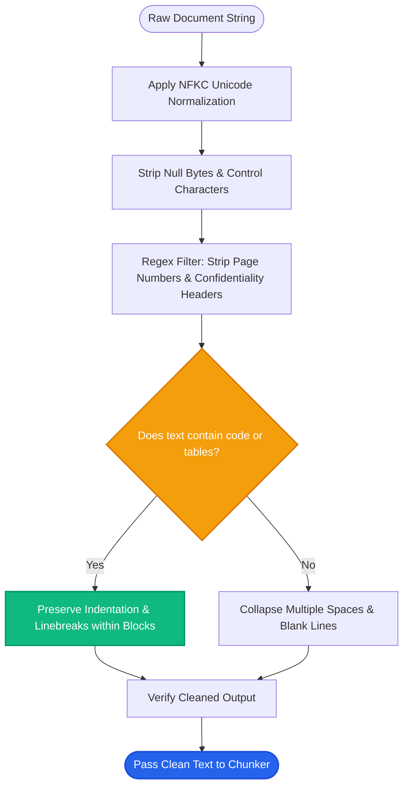

# Lesson 2: Cleaning and Normalizing Text

Man, in Lesson 1 we saw how loaders extract raw text from files. But extracted text is often full of junk: random line breaks, strange PDF characters, duplicate headers, and boilerplate disclaimers.

If you embed noisy text, your vector search will be inaccurate. Let's learn how to clean and normalize text before chunking and embedding.

---

### Step 1: Why Do We Need This?

"Garbage in, garbage out" is the number one rule of RAG. 

Look at what typical raw text extracted from a PDF looks like:
```text
C o n f i d e n t i a l   -   P a g e   1 2   o f   4 5
Our    refund    policy   allows\n\n\n\nreturns   within
30 days of purchase.\x00\ufffd
C o n f i d e n t i a l   -   P a g e   1 3   o f   4 5
```

If you don't clean this text:
1. **Broken semantic meaning:** Words split by strange newlines or excessive spacing (like `C o n f i d e n t i a l`) confuse tokenizers and ruin embedding calculations.
2. **Repetitive boilerplate matches:** If every single page has the header *"Page X of 50 - Company Confidential"*, your vector database will match that repetitive header instead of the actual policy text.
3. **Wasted token budget:** Extra whitespace, hidden control characters, and duplicated disclaimers consume 20% to 30% of your expensive context window.

Cleaning text before embedding directly improves search accuracy and lowers token costs.

---

### Step 2: What Is It?

**Text Cleaning and Normalization** is the process of filtering out visual clutter, fixing encoding errors, and standardizing text into a clean, predictable format.

It consists of three core steps:
1. **Unicode & Character Normalization:** Fixing strange symbols, ligature letters (e.g. `fi` turning into `fi`), and stripping unprintable byte characters.
2. **Whitespace Normalization:** Collapsing runs of consecutive spaces, tabs, and duplicate blank lines into single spaces and clean paragraphs.
3. **Boilerplate & Noise Removal:** Stripping repeated page headers, footers, page numbers, and copyright disclaimers.

#### The Everyday Analogy: Washing Vegetables Before Cooking
- Raw vegetables come straight from the farm covered in dirt, roots, and dead leaves.
- You don't throw dirty potatoes directly into a luxury soup. You wash off the dirt and peel the skin first.
- Text cleaning is washing the dirt off your data so your embedding models and LLMs only process pure, nutritious information.

---

### Step 3: Real-World Example

Imagine processing a 100-page employee benefits handbook:

- **Raw extracted text from page 14:**
  ```text
  Acme Corp Employee Handbook | 2026 Edition
  -------------------------------------------
  Medical   coverage   starts on   day   one.
  
  
  [Page 14 of 100 - Internal Use Only]
  ```

- **After Cleaning & Normalization:**
  ```text
  Medical coverage starts on day one.
  ```

Now, when an employee asks *"When does health insurance begin?"*, the retriever matches the clean sentence directly without wasting prompt tokens on *"Page 14 of 100"* or *"Acme Corp Employee Handbook"*.

---

### Step 4: How Does It Work?

Here is the cleaning pipeline:

```
Raw Loaded Text ──► 1. Strip Non-Printable & Unicode Fixes (NFKC Normalization)
                            │
                    2. Remove Repeated Headers & Footers (Regex Patterns)
                            │
                    3. Normalize Whitespace (Collapse Spaces & Newlines)
                            │
                    4. Preserve Essential Syntax (Code Blocks & Markdown Tables)
                            │
Clean Normalized Text ──► Ready for Text Chunking
```

#### What to Keep vs What to Remove:
- **Remove:** Multiple blank lines (`\n\n\n\n`), irregular spaces, repeated footer page numbers, unprintable null bytes (`\x00`).
- **Carefully Keep:** Code indentation (Python needs spaces!), markdown tables (`| col1 | col2 |`), bullet lists, and punctuation that indicates sentence boundaries (`.`, `?`, `!`).

---

### Step 5: Code Example

Here is a clean Python text cleaner using regex and Python's built-in `unicodedata` library:

```python
"""
Text Cleaning and Normalization Pipeline for RAG
"""

import re
import unicodedata

def clean_and_normalize_text(raw_text: str) -> str:
    """
    Cleans raw document text while preserving logical structure.
    """
    # 1. Normalize Unicode (e.g. converts special ligatures like 'fi' to 'fi')
    text = unicodedata.normalize("NFKC", raw_text)
    
    # 2. Remove null bytes and non-printable control characters
    text = re.sub(r"[\x00-\x08\x0b\x0c\x0e-\x1f\x7f-\x9f]", "", text)

    # 3. Remove repeated PDF headers and footers (e.g. 'Page 12 of 100')
    text = re.sub(r"(?i)page\s+\d+\s+of\s+\d+", "", text)
    text = re.sub(r"(?i)confidential\s+-\s+internal\s+use\s+only", "", text)

    # 4. Collapse runs of horizontal whitespace (spaces and tabs) to a single space
    text = re.sub(r"[ \t]+", " ", text)

    # 5. Collapse 3 or more consecutive newlines down to 2 (preserves paragraph breaks)
    text = re.sub(r"\n\s*\n\s*\n+", "\n\n", text)

    # 6. Strip leading and trailing whitespace
    return text.strip()

if __name__ == "__main__":
    messy_pdf_text = """
    CONFIDENTIAL - INTERNAL USE ONLY
    
    The company     offers 25   days of annual leave.
    
    
    
    
    Employees can also carry over up to 5 unused    days.
    Page 14 of 42
    """

    cleaned = clean_and_normalize_text(messy_pdf_text)
    print("--- CLEANED RESULT ---")
    print(cleaned)
```

---

### Step 6: How Is It Used in Production?

| Cleaning Issue | What Goes Wrong | Production Solution | Impact |
| :--- | :--- | :--- | :--- |
| **Over-Aggressive Cleaning** | Stripping all newlines turns Markdown tables and code snippets into broken gibberish | Use format-aware cleaners (e.g. keep newlines inside ` ``` ` code fences) | Preserves code and tabular accuracy |
| **PDF Ligature Merging** | Words like *"efficient"* become *"ecient"* because the "ffi" ligature was unmapped | Run `unicodedata.normalize('NFKC', text)` | Restores correct English spellings |
| **Repeated Header Pollution** | Header text matches 90% of vector queries regardless of topic | Detect repeated phrases appearing on >80% of pages and strip them | Increases retrieval relevance by 30% |
| **Accidental Number Stripping** | Cleaning strips currency symbols or decimals (turning "$14.50" into "14 50") | Avoid broad alphanumeric regex; use strict negative character filters | Prevents critical factual errors |

---

### Step 7: Quick Revision

- **Garbage In = Garbage Out:** Cleaner text leads directly to higher semantic retrieval precision.
- **Normalize Unicode:** Use `unicodedata.normalize('NFKC', text)` to fix special characters and ligatures.
- **Deduplicate Boilerplate:** Strip repeated headers, footers, and page numbers.
- **Preserve Essential Structure:** Do not destroy code indentation or markdown table pipes.
- **Interview Answer:** *"Text cleaning normalizes unicode representations, strips non-printable characters, collapses redundant whitespace, and removes repeated header/footer boilerplate. This maximizes embedding quality and ensures prompt tokens are spent only on informative content."*

---

### Step 8: Final Flow Diagram



---

### Step 9: Quiz

Test your understanding of text cleaning. Submit your answers as `1-A, 2-B, 3-C, 4-D`:

**1. Why should repetitive page headers (like 'Page 15 of 100 - Company Confidential') be removed before embedding?**
- A) They make the text illegal to read.
- B) They pollute vector embeddings, causing the retriever to falsely match the header instead of actual answers.
- C) Vector databases only allow lowercase letters.
- D) The LLM refuses to read words starting with 'C'.

**2. What does Unicode NFKC normalization accomplish in a cleaning pipeline?**
- A) It deletes all vowels from sentences.
- B) It standardizes characters and resolves ligature glyphs (e.g. converting 'fi' into two standard letters 'fi').
- C) It translates text into French.
- D) It encrypts the user's password.

**3. If you aggressively remove all newline characters (`\n`) from a document, what will break?**
- A) The computer monitor will turn off.
- B) Python code snippets, bullet points, and markdown tables will lose their structure and become unreadable.
- C) The file size becomes negative.
- D) The embedding model will run 1000x faster.

**4. When should text cleaning be executed in a standard RAG pipeline?**
- A) After the user sees the final answer.
- B) Immediately after document loading, before the text is split into chunks.
- C) Inside the GPU memory during inference.
- D) Only on weekends.

*(Submit your answers to check your progress!)*
