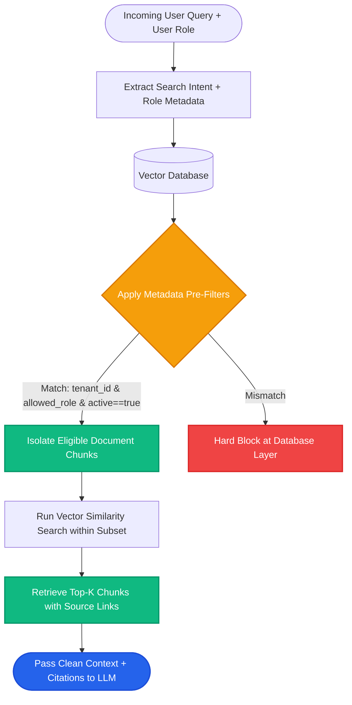

# Lesson 3: Metadata and Structured Content

Man, text alone is only half the story. If your RAG system only knows *what* the text says, but has no idea *who wrote it, when it was published, or which security level can read it*, you cannot build a secure production system.

Let's explore document metadata and how it powers accurate, permission-safe retrieval.

---

### Step 1: Why Do We Need This?

Imagine an enterprise RAG assistant with 500,000 documents across finance, engineering, and HR.

Without metadata, three critical failures happen:
1. **Outdated Version Conflicts:** A user asks *"What is the current sick leave policy?"* The system retrieves chunks from both the 2021 handbook (10 days) and the 2026 handbook (15 days). The LLM gets confused and invents a hybrid answer.
2. **Security Leaks:** An intern asks *"What are the executive salaries?"* Because the vector search matches words alone, the system retrieves confidential payroll documents and leaks them.
3. **No Source Proof:** The AI tells a user *"You are owed a $500 bonus"*, but cannot provide a document link or page number so the user can verify it with their manager.

Attaching rich metadata to every chunk prevents security leaks, filters out stale documents, and provides verifiable citations.

---

### Step 2: What Is It?

**Metadata** is structured key-value information stored alongside the text chunk in the vector database.

While the embedding captures the *meaning* of the text, metadata captures the *context and origin* of the text.

```json
{
  "text": "Employees receive 15 days of paid sick leave annually.",
  "metadata": {
    "source": "handbook_2026.pdf",
    "page": 24,
    "section": "Benefits > Paid Leave",
    "department": "HR",
    "year": 2026,
    "access_tier": "public_internal"
  }
}
```

#### The Everyday Analogy: Product Labels in a Supermarket
- The text chunk is the cereal inside the box.
- The metadata is the nutrition label printed on the side: expiration date, ingredients, manufacturer, allergy warnings.
- If you have a peanut allergy, you don't taste every cereal in the aisle to see if it makes you sick. You **filter by the label first**.
- Metadata filtering allows the system to check the label *before* running vector search.

---

### Step 3: Real-World Example

Imagine an engineering knowledge base covering multiple programming languages and software versions:

- **User Query:** *"How do I configure database connection pooling in Python for v2.4?"*
- **Vector search alone:** Retrieves 5 chunks: 2 about Java connection pools, 1 about Python v1.0, and 2 about Python v2.4.
- **Vector search WITH metadata filtering:**
  ```python
  filter = {
      "language": "python",
      "version": "2.4"
  }
  ```
- **Result:** The system instantly excludes the Java and v1.0 docs. It searches *only* within verified Python 2.4 documentation. Search is 100% accurate and takes half the time.

---

### Step 4: How Does It Work?

There are two primary ways to search with metadata:

```
Approach A: Pre-Filtering (Recommended)
User Query ──► Filter Database by Metadata (e.g. year == 2026) ──► Semantic Vector Search on Filtered Subset ──► Top Chunks

Approach B: Post-Filtering (Risky)
User Query ──► Search Whole Database (Top 100) ──► Discard items where year != 2026 ──► Remaining Chunks
```

#### Pre-Filtering vs Post-Filtering:
- **Pre-Filtering (Production Standard):** The database first restricts the search pool to matching metadata tags (e.g., `department == "engineering"`), then executes vector similarity only on those records. It is fast and guarantees you get `k` valid results.
- **Post-Filtering:** The system retrieves top candidates globally, then filters out disallowed items in Python code. If the top 10 results are all from the wrong department, post-filtering leaves you with zero results!

---

### Step 5: Code Example

Here is a Python example showing how to attach metadata to chunks and execute filtered retrieval:

```python
"""
Document Metadata Tagging and Filtered Retrieval
"""

from typing import List, Dict, Any

class Chunk:
    def __init__(self, text: str, metadata: Dict[str, Any]):
        self.text = text
        self.metadata = metadata

class FilteredRetriever:
    def __init__(self, chunks: List[Chunk]):
        self.chunks = chunks

    def retrieve(self, query: str, filters: Dict[str, Any], top_k: int = 2) -> List[Chunk]:
        """Performs pre-filtering on metadata before ranking by keyword score."""
        # Step 1: Pre-Filter
        candidates = []
        for chunk in self.chunks:
            match = True
            for key, val in filters.items():
                if chunk.metadata.get(key) != val:
                    match = False
                    break
            if match:
                candidates.append(chunk)

        # Step 2: Search within filtered candidates
        query_words = set(query.lower().split())
        scored = []
        for c in candidates:
            score = len(query_words.intersection(set(c.text.lower().split())))
            scored.append((score, c))

        scored.sort(key=lambda x: x[0], reverse=True)
        return [c for score, c in scored[:top_k]]

if __name__ == "__main__":
    knowledge_store = [
        Chunk("Refunds are given within 7 days.", {"dept": "support", "year": 2023, "active": False}),
        Chunk("Refunds are processed within 14 days.", {"dept": "support", "year": 2026, "active": True}),
        Chunk("Employee bonus payout dates.", {"dept": "hr", "year": 2026, "active": True}),
    ]

    retriever = FilteredRetriever(knowledge_store)
    
    # Query with metadata filter for active 2026 support docs only
    results = retriever.retrieve(
        query="What is the refund timeline?",
        filters={"dept": "support", "active": True}
    )

    print(f"Retrieved {len(results)} valid chunk(s):")
    for r in results:
        print(f"Content: '{r.text}' | Metadata: {r.metadata}")
```

---

### Step 6: How Is It Used in Production?

| Production Requirement | Bad Implementation | Production Solution | Real Impact |
| :--- | :--- | :--- | :--- |
| **Role-Based Access Control (RBAC)** | Filtering permissions inside the LLM prompt (*"Don't show intern salaries"*) | Store `user_roles: ["admin", "finance"]` in metadata; enforce hard SQL/vector pre-filter | Guarantees zero data leaks |
| **Multi-Tenant SaaS Isolation** | Mixing all client vectors in one index without filters | Store `tenant_id: "org_123"` in metadata on every single chunk | Absolute tenant data isolation |
| **Stale Document Elimination** | Relying on semantic embeddings to figure out which policy is newer | Attach `is_current: true` and `effective_year: 2026` tags; filter out deprecated docs | Eliminates outdated advice |
| **Document Updates & Idempotency** | Re-ingesting modified documents creates duplicate chunks | Compute stable chunk ID or content hash (SHA-256); execute database upserts (`ON CONFLICT DO UPDATE`) | Prevents index bloat and stale duplicate results |
| **Missing Section Context** | Chunk contains: *"It costs $50"*, but doesn't mention which product | Inject `breadcrumbs: "Pricing > Enterprise Tier"` into chunk metadata | Restores missing subject context |

---

### Step 7: Quick Revision

- **Metadata Stores Origin & Context:** Includes source file, page, author, department, date, and security tags.
- **Pre-Filtering Is Essential:** Always filter by metadata before calculating vector similarity to ensure high speed and security.
- **RBAC Security:** Never rely on the LLM to hide private data; enforce access rules at the database query level with metadata.
- **Breadcrumbs Context:** Store document headings (e.g. `Section 3 > Subheading B`) in metadata to keep context alive in small chunks.
- **Interview Answer:** *"Metadata attaches structured attributes like timestamps, access permissions, and document hierarchy to unstructured text chunks. In production, pre-filtering on metadata ensures role-based access control, eliminates outdated data, and provides verified source citations."*

---

### Step 8: Final Flow Diagram



---

### Step 9: Quiz

Test your understanding of metadata in RAG. Submit your answers as `1-A, 2-B, 3-C, 4-D`:

**1. Why should multi-tenant RAG systems enforce access control using metadata pre-filters instead of LLM system prompts?**
- A) LLMs cannot understand security and can be easily jailbroken, while database pre-filters physically block unauthorized records.
- B) Metadata filters make LLMs run out of disk space.
- C) Database filters only work with numbers, not words.
- D) System prompts can only be written in Latin.

**2. What is the danger of using 'Post-Filtering' (filtering metadata after vector search returns the top 5 results)?**
- A) The vector database will crash permanently.
- B) If all top 5 results fail the metadata filter, the system is left with zero chunks to send to the LLM.
- C) Post-filtering deletes the user's account.
- D) Post-filtering converts the text into audio.

**3. If an organization has three different editions of a policy document (2022, 2024, 2026), how does metadata help?**
- A) It deletes the 2026 edition to save space.
- B) It allows the retriever to query only chunks where `year == 2026` or `is_active == True`.
- C) It translates the older policies into German.
- D) It rewrites the model's neural weights.

**4. What is a 'breadcrumb' in document chunk metadata?**
- A) A literal piece of food left inside the computer.
- B) The hierarchical heading path (e.g. 'Chapter 4 > Section 2 > Pricing') that preserves the topic context for small chunks.
- C) An encrypted password key.
- D) A temporary browser cookie.

*(Submit your answers to check your progress!)*
