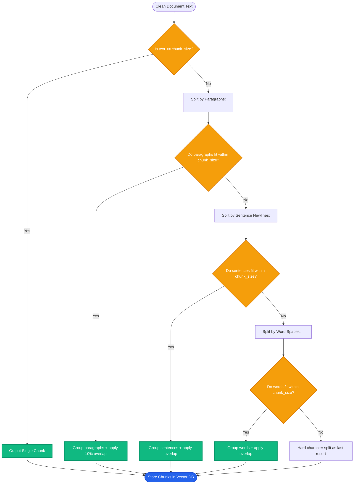

# Lesson 1: Fixed-Size and Recursive Chunking

Man, welcome to Phase 4! You cleaned your document text in Phase 3. Now comes the single most critical engineering decision in your RAG pipeline: **how to break that long text into pieces (chunks)**.

If your chunks are too big, search gets blurry and expensive. If your chunks are too small, sentences get cut in half and lose their meaning. Let's learn how fixed-size and recursive chunking solve this.

---

### Step 1: Why Do We Need This?

Why can't we just embed an entire 50-page PDF document as one single vector?

1. **Averaged-Out Blurry Vectors:** When an embedding model compresses 50 pages into 1,536 numbers, specific details get diluted away. If a user asks about *"warranty shipping fees"*, that tiny detail gets drowned out by the other 49 pages.
2. **Context Window Limits:** Models have token limits. You cannot fit twenty 50-page documents into a single prompt.
3. **The Sawn-in-Half Sentence Disaster:** If you slice text blindly by counting 500 characters, you will cut sentences in half:
   - Chunk 1: *"...all customers are entitled to a full ref"*
   - Chunk 2: *"und if requested within 14 days of purchase."*
   - Neither chunk has the complete idea! Chunk 1 does not mention 14 days, and Chunk 2 does not say what happens within 14 days.

Chunking breaks documents into focused, digestible units that capture a single complete thought.

---

### Step 2: What Is It?

There are two primary ways to split text:

1. **Fixed-Size Chunking:**
   - Cuts text strictly by counting characters or tokens (e.g. exactly 500 characters per chunk).
   - Usually adds an **overlap** (e.g. 50 characters) so each chunk shares a little text with the previous chunk.
   - *Problem:* It cuts blindly, often slicing right through words or middle of sentences.

2. **Recursive Character Chunking (The Production Industry Standard):**
   - Tries to split text along **natural human writing boundaries** first:
     1. Double newlines (`\n\n`) -> splits between paragraphs.
     2. Single newline (`\n`) -> splits between lines or sentences.
     3. Spaces (` `) -> splits between words.
     4. Empty string (`""`) -> splits characters as an absolute last resort.
   - Keeps paragraphs and sentences intact while guaranteeing no chunk exceeds the maximum size limit.

#### The Everyday Analogy: Slicing a Loaf of Bread
- **Fixed-size chunking is a robotic knife with a ruler:** It slices down exactly every 2 centimeters, even if it cuts right through a walnut in the middle.
- **Recursive chunking is a skilled baker:** It slices along the natural seams and score lines of the bread, keeping the crust and ingredients whole while making even slices.

---

### Step 3: Real-World Example

Look at how both splitters handle this policy paragraph:

```text
Return Policy: Customers can return items within 30 days. However, opened electronics have a 14-day limit and require a 15% restocking fee.
```

- **Fixed-Size Split (size = 65 chars):**
  - Chunk 1: `"Return Policy: Customers can return items within 30 days. However,"`
  - Chunk 2: `" opened electronics have a 14-day limit and require a 15% restock"`
  - *Failure:* If someone asks about opened electronics fees, Chunk 1 gives wrong 30-day hope, and Chunk 2 is missing the word "fee"!

- **Recursive Split (size = 120 chars, separator `.` or `\n`):**
  - Chunk 1: `"Return Policy: Customers can return items within 30 days."`
  - Chunk 2: `"However, opened electronics have a 14-day limit and require a 15% restocking fee."`
  - *Success:* Both sentences remain complete, coherent, and mathematically clear.

---

### Step 4: How Does It Work?

Here is how the Recursive Splitting algorithm works internally:

```
[Start Document Text]
         │
Is text size <= chunk_size (e.g. 500 chars)?
   ├── Yes ──► Save as Chunk!
   └── No  ──► Try splitting by 1st separator: "\n\n" (Paragraphs)
                 │
           Did pieces fit within chunk_size?
             ├── Yes ──► Merge pieces up to chunk_size (with overlap)
             └── No  ──► Recursively try 2nd separator: "\n" (Sentences)
                           │
                     Did pieces fit?
                       ├── Yes ──► Merge pieces
                       └── No  ──► Recursively try 3rd separator: " " (Words)
```

#### Why Chunk Overlap Matters:
- Typical overlap is **10% to 15%** of chunk size (e.g., 500-token chunk with 50-token overlap).
- Overlap creates a sliding window: the last 50 tokens of Chunk 1 become the first 50 tokens of Chunk 2.
- This ensures that if an idea spans across the boundary of two chunks, the full context is preserved in at least one chunk.

---

### Step 5: Code Example

Here is a Python demonstration showing how recursive character splitting works compared to fixed-size:

```python
"""
Comparing Fixed-Size vs Recursive Text Splitting
"""

from typing import List

def naive_fixed_chunker(text: str, chunk_size: int, overlap: int) -> List[str]:
    """Slices text strictly by character count."""
    chunks = []
    start = 0
    while start < len(text):
        end = start + chunk_size
        chunks.append(text[start:end])
        start += chunk_size - overlap
    return chunks

def simple_recursive_chunker(text: str, chunk_size: int = 100, separators: List[str] = None) -> List[str]:
    """Splits along natural boundaries (paragraphs, then newlines, then spaces)."""
    if separators is None:
        separators = ["\n\n", "\n", " "]

    # Base case: text is already small enough
    if len(text) <= chunk_size:
        return [text]

    # Find the highest priority separator present in the text
    chosen_sep = ""
    for sep in separators:
        if sep in text:
            chosen_sep = sep
            break

    if not chosen_sep:
        # No separator found, must slice by character
        return [text[:chunk_size]] + simple_recursive_chunker(text[chunk_size:], chunk_size, separators)

    # Split by the chosen separator and merge small pieces together
    parts = text.split(chosen_sep)
    chunks = []
    current_chunk = ""

    for part in parts:
        candidate = f"{current_chunk}{chosen_sep}{part}".strip() if current_chunk else part
        if len(candidate) <= chunk_size:
            current_chunk = candidate
        else:
            if current_chunk:
                chunks.append(current_chunk)
            # If a single part is still too big, recursively split it with remaining separators
            if len(part) > chunk_size:
                next_separators = separators[separators.index(chosen_sep) + 1:]
                chunks.extend(simple_recursive_chunker(part, chunk_size, next_separators))
                current_chunk = ""
            else:
                current_chunk = part

    if current_chunk:
        chunks.append(current_chunk)

    return chunks

if __name__ == "__main__":
    sample_text = (
        "Refund Policy Overview.\n\n"
        "Customers can return physical products within 30 days of purchase.\n"
        "Items must be unused and in original retail packaging.\n\n"
        "Digital downloads and gift cards are strictly non-refundable."
    )

    print("--- 1. FIXED-SIZE SLICES (Blind Cuts) ---")
    fixed_chunks = naive_fixed_chunker(sample_text, chunk_size=80, overlap=10)
    for i, c in enumerate(fixed_chunks):
        print(f"Chunk {i+1}: {repr(c)}")

    print("\n--- 2. RECURSIVE CHUNKS (Preserves Paragraphs & Lines) ---")
    rec_chunks = simple_recursive_chunker(sample_text, chunk_size=120)
    for i, c in enumerate(rec_chunks):
        print(f"Chunk {i+1}: {repr(c)}")
```

---

### Step 6: How Is It Used in Production?

| Chunk Parameter | Trade-off / Risk | Production Best Practice | Impact |
| :--- | :--- | :--- | :--- |
| **Chunk Size Too Small (< 100 tokens)** | Sentences lack surrounding context; retriever misses the bigger picture | Use 300 to 500 tokens for general text | Balanced semantic focus and context |
| **Chunk Size Too Large (> 1,500 tokens)** | Specific answers get buried in irrelevant text; prompt tokens wasted | Keep chunks <= 600 tokens; use Parent Document Retrieval if broad context is needed | Higher retrieval precision |
| **Zero Overlap (`overlap = 0`)** | Facts that span the cut boundary are cut off and lost | Set overlap to 10-15% (e.g. 50 tokens for 500-token chunk) | Eliminates edge boundary information loss |
| **Splitting Code & Tables** | Standard character splitters cut right through SQL tables or Python functions | Use specialized Markdown / Code splitters with language-aware syntax | Preserves executable code and tabular logic |

---

### Step 7: Quick Revision

- **Why Chunk?** Embeddings of huge documents become blurry; models have token limits; smaller chunks provide high-precision answers.
- **Fixed-Size Slices:** Cuts strictly by numbers; fast but cuts words and sentences in half.
- **Recursive Splitting:** Slices by paragraphs (`\n\n`), then sentences (`\n`), then words (` `); keeps thoughts whole.
- **Standard Sizing:** 300–600 tokens per chunk with 10–15% overlap is the recommended starting point for text.
- **Interview Answer:** *"Recursive chunking attempts to split text hierarchically using natural document boundaries—paragraphs, lines, and words—before falling back to raw character counts. This preserves semantic coherence while ensuring each chunk fits comfortably inside the embedding model's context window."*

---

### Step 8: Final Flow Diagram



---

### Step 9: Quiz

Test your understanding of chunking strategies. Submit your answers as `1-A, 2-B, 3-C, 4-D`:

**1. What is the primary drawback of using naive fixed-size chunking without looking at text structure?**
- A) It makes the file size negative.
- B) It can slice words and critical sentences in half mid-thought, destroying semantic meaning.
- C) It requires an internet connection to run.
- D) It only works on Linux.

**2. In recursive character splitting, what separator is checked first by default?**
- A) A single character `""`.
- B) A single space `" "`.
- C) Double newlines `"\n\n"` to keep complete paragraphs together.
- D) A comma `","`.

**3. Why do production RAG systems include an overlap (e.g. 10-15%) between consecutive chunks?**
- A) To make the database run out of storage twice as fast.
- B) To ensure that facts and sentences straddling the boundary of two chunks remain intact in at least one chunk.
- C) To translate the text into multiple languages.
- D) To encrypt the chunks against hackers.

**4. What is a typical recommended chunk size for general English technical documentation?**
- A) 1 to 5 tokens.
- B) 300 to 600 tokens.
- C) 50,000 to 100,000 tokens.
- D) Exactly 1 character.

*(Submit your answers to check your progress!)*
