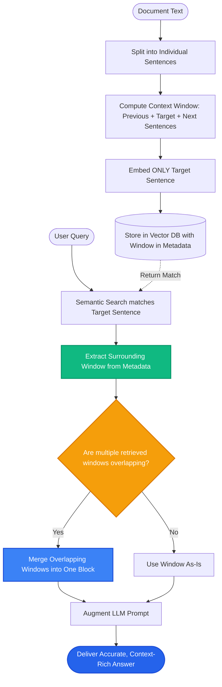

# Lesson 2: Semantic and Sentence-Window Chunking

Man, in Lesson 1 we saw how recursive chunking splits text using punctuation and newlines. But what if a single paragraph shifts topics halfway through? Or what if an answer is contained in a single short sentence, but the LLM needs the entire surrounding paragraph to understand it?

Let's explore two advanced chunking strategies: **Semantic Chunking** and **Sentence-Window Retrieval**.

---

### Step 1: Why Do We Need This?

Standard chunking counts characters or splits at newlines. But human writing doesn't always place neat headings or paragraph breaks between different ideas:

1. **The Topic Shift Blindspot:** In transcripts, interviews, or continuous essays, the speaker changes topics without starting a new paragraph. If you chunk by 500 characters, you bundle the end of topic A with the start of topic B. The resulting embedding is a confusing hybrid that matches neither topic well.
2. **The Retrieval vs Generation Dilemma:**
   - For **Search / Retrieval**, small chunks (e.g. 1-2 sentences) are best because their embeddings are laser-focused on specific facts.
   - For **LLM Generation**, large chunks (e.g. 300 words) are best because the LLM needs surrounding context to avoid misinterpreting pronouns like *"it"*, *"they"*, or *"the aforementioned rule"*.

If you only use standard chunking, you are forced to make a painful compromise between retrieval precision and generation context.

---

### Step 2: What Is It?

1. **Semantic Chunking:**
   - Instead of looking at character counts, it looks at **meaning**.
   - It breaks text into individual sentences and measures the vector embedding distance between neighboring sentences.
   - When the semantic distance spikes (meaning the author changed the topic), it creates a new chunk boundary.

2. **Sentence-Window Retrieval:**
   - During indexing, you embed and store **individual sentences** (giving you extreme search precision).
   - In metadata, you store a pointer to the **window** of surrounding sentences (e.g. 3 sentences before and 3 sentences after).
   - When a sentence matches the user query, you don't send just that single sentence to the LLM; you swap it for the whole surrounding window!

#### The Everyday Analogy: The Magnifying Glass and the Spotlight
- **Semantic Chunking is like chapters in a book:** It starts a new chapter only when the plot genuinely moves to a new location, rather than every 5 pages on a timer.
- **Sentence-Window is like a search spotlight:** You search for a tiny needle with a laser pointer (the exact matching sentence). Once you find it, you switch on a warm floodlight (surrounding sentences) so the reader can see the entire table.

---

### Step 3: Real-World Example

Imagine searching clinical medical trials:

- **Document Text:**
  *"Patient 402 was prescribed 50mg of Drug X. She reported severe nausea and dizziness within 2 hours. The medical team discontinued the medication immediately. In trial group B, patients received 10mg of Drug Y. No adverse effects were observed over 30 days."*

- **With Sentence-Window Retrieval:**
  1. User asks: *"Did anyone experience nausea on Drug X?"*
  2. The system embeds individual sentences. The sentence *"She reported severe nausea and dizziness within 2 hours"* gets a 0.94 similarity score.
  3. Instead of sending just that sentence (which lacks the drug name and patient ID!), the system retrieves the surrounding window (1 sentence before + 1 sentence after):
     > *"Patient 402 was prescribed 50mg of Drug X. She reported severe nausea and dizziness within 2 hours. The medical team discontinued the medication immediately."*
  4. The LLM has the complete picture and provides a safe, fully grounded answer.

---

### Step 4: How Does It Work?

Here is the Sentence-Window workflow:

```
[INGESTION]
Original Text ──► Split into Sentences [S₁, S₂, S₃, S₄, S₅]
                           │
             Embed ONLY S₃ (Laser Focus)
             Attach Window [S₁, S₂, S₃, S₄, S₅] in Metadata
                           │
                     Stored in Vector DB

[RETRIEVAL]
User Question ──► Vector Search matches S₃
                           │
             Swap S₃ with full Window [S₁ through S₅]
                           │
             Pass Window to LLM Prompt ──► Accurate Answer
```

#### How Semantic Chunking Calculates Topic Shifts:
1. Break text into sentences $[S_1, S_2, S_3, S_4]$.
2. Calculate embedding distance between $S_1$ and $S_2$, between $S_2$ and $S_3$, etc.
3. Compute a similarity threshold (e.g., 90th percentile of distance).
4. If distance between $S_2$ and $S_3$ is higher than the threshold, cut the chunk between $S_2$ and $S_3$!

---

### Step 5: Code Example

Here is a Python implementation of the Sentence-Window retrieval concept:

```python
"""
Sentence-Window Chunking and Retrieval Pattern
"""

from dataclasses import dataclass
from typing import List, Dict

@dataclass
class SentenceNode:
    sentence: str
    window_context: str
    sentence_idx: int

def build_sentence_windows(text: str, window_size: int = 1) -> List[SentenceNode]:
    """
    Splits text into sentences. Embeds each sentence with surrounding window context.
    """
    # Simple sentence splitter on punctuation
    import re
    raw_sentences = [s.strip() for s in re.split(r"(?<=[.!?])\s+", text) if s.strip()]
    
    nodes = []
    for idx, sentence in enumerate(raw_sentences):
        # Calculate start and end indices for the window
        start = max(0, idx - window_size)
        end = min(len(raw_sentences), idx + window_size + 1)
        
        # Surrounding context window
        window = " ".join(raw_sentences[start:end])
        
        nodes.append(SentenceNode(
            sentence=sentence,
            window_context=window,
            sentence_idx=idx
        ))
    return nodes

def simulate_sentence_window_search(query: str, nodes: List[SentenceNode]) -> str:
    """Finds the best sentence and returns its surrounding window context."""
    query_words = set(query.lower().split())
    
    # Score individual sentences (in production, use cosine similarity)
    scored_nodes = []
    for n in nodes:
        score = len(query_words.intersection(set(n.sentence.lower().split())))
        scored_nodes.append((score, n))
    
    scored_nodes.sort(key=lambda x: x[0], reverse=True)
    best_node = scored_nodes[0][1]
    
    # Return the expanded window, NOT just the single sentence!
    return best_node.window_context

if __name__ == "__main__":
    transcript = (
        "Project Apollo was initiated in 2024 to modernize legacy billing. "
        "The migration encountered severe database deadlocks during month three. "
        "Engineers solved the issue by introducing Redis caching for session locks. "
        "Project Zeus started six months later to redesign the mobile application."
    )

    nodes = build_sentence_windows(transcript, window_size=1)
    
    user_query = "What caused deadlocks in Apollo?"
    expanded_context = simulate_sentence_window_search(user_query, nodes)
    
    print("--- EXPANDED CONTEXT RETRIEVED FOR LLM ---")
    print(expanded_context)
```

---

### Step 6: How Is It Used in Production?

| Strategy | When Engineers Get It Wrong | Production Solution | Impact |
| :--- | :--- | :--- | :--- |
| **Sentence-Window Overlap Bloat** | Retrieving 5 adjacent sentences that each return the same overlapping window | Deduplicate windows before building the final LLM prompt | Cuts prompt tokens by 50% |
| **Semantic Chunking Ingestion Speed** | Embedding every sentence pair individually makes ingestion 10x slower | Use small local embedding models (e.g. `all-MiniLM-L6-v2`) for split thresholding | Ingestion completes in seconds |
| **Fixed Threshold in Semantic Splitting** | Hardcoding a 0.8 distance threshold fails when text writing style changes | Use percentile-based thresholds (e.g. cut at the top 15% distance spikes) | Adapts dynamically to any document |
| **Window Size Too Large** | Setting window size to 10 sentences turns the prompt into a giant noisy wall of text | Keep window size to 2-3 sentences before and after | Perfect balance of focus and context |

---

### Step 7: Quick Revision

- **Semantic Chunking:** Cuts text based on meaning shifts rather than character counts.
- **Sentence-Window Retrieval:** Embeds single sentences for search precision, but passes the surrounding window (2-3 sentences) to the LLM for generation context.
- **Solves the Pronoun Problem:** Ensures sentences with words like *"it"* or *"they"* include the nouns they reference.
- **Percentile Thresholds:** In semantic chunking, dynamic percentile-based distance thresholds adapt better than fixed numbers.
- **Interview Answer:** *"Sentence-Window retrieval decouples the unit of retrieval from the unit of generation. By indexing narrow, highly specific sentences but expanding to surrounding context at query time, it maximizes both retrieval precision and LLM comprehension."*

---

### Step 8: Final Flow Diagram



---

### Step 9: Quiz

Test your understanding of semantic and sentence-window chunking. Submit your answers as `1-A, 2-B, 3-C, 4-D`:

**1. What is the fundamental dilemma that Sentence-Window Retrieval solves?**
- A) Computers can only store text in alphabetical order.
- B) Small chunks are best for search precision, but the LLM needs larger surrounding context to understand pronouns and context.
- C) Large chunks take less space on hard drives than small chunks.
- D) Embedding models cannot read punctuation marks.

**2. How does Semantic Chunking determine where to split a document?**
- A) It randomly splits every 42 words.
- B) It calculates the embedding distance between consecutive sentences and places a boundary where semantic distance spikes.
- C) It counts the number of letters in each word.
- D) It only splits text when the word 'stop' appears.

**3. In Sentence-Window Retrieval, what is actually converted into a vector and stored in the similarity index?**
- A) The entire document library.
- B) The narrow, individual sentence (with the surrounding window stored in metadata).
- C) Only the file name.
- D) The author's email address.

**4. Why is a percentile-based threshold preferred over a hardcoded threshold in Semantic Chunking?**
- A) It adapts dynamically to varying writing styles and document density instead of failing on different datasets.
- B) It requires zero CPU to compute.
- C) It guarantees all chunks will have exactly 100 characters.
- D) It prevents models from using memory.

*(Submit your answers to check your progress!)*
