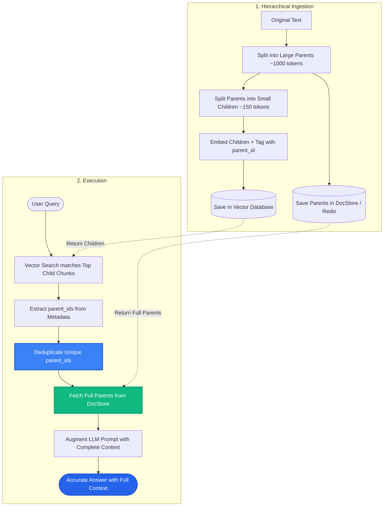

# Lesson 3: Parent-Document Retrieval and Choosing Chunk Size

Man, in Lessons 1 and 2 we saw how small chunks give high search precision, while large chunks give deep context. Now let's explore **Parent-Document Retrieval**—the industry standard architecture for combining both worlds—and a clear framework for choosing the perfect chunk size.

---

### Step 1: Why Do We Need This?

In enterprise RAG systems, you face a constant tug-of-war:
- **Small chunks (e.g. 100 tokens):** Great for vector search. The vector embedding points directly to a single specific fact. But when passed to the LLM, the model misses the broader context, surrounding qualifications, and definitions.
- **Large chunks (e.g. 1,500 tokens):** Great for LLM comprehension. The model has the complete background. But the vector embedding is blurry and often fails to rank high during search.

If you are forced to pick just one chunk size, your RAG system will always be compromised. We need an architecture where **search runs on small chunks, but the LLM receives the full parent section**.

---

### Step 2: What Is It?

**Parent-Document Retrieval** (also called Hierarchical Chunking) splits documents into two levels:
1. **Parent Documents (Large):** Clean, broad sections (e.g., 1,000 to 2,000 tokens) stored in a fast document store (like Redis, PostgreSQL, or a key-value store).
2. **Child Chunks (Small):** Each parent document is further split into small, focused sub-chunks (e.g., 100 to 200 tokens). These small child chunks are embedded and stored in the vector database.

When a user asks a question:
- The vector database searches among the small **child chunks**.
- Once a child chunk matches, the system looks up its `parent_id` and fetches the **full parent document**.
- The LLM receives the parent document, getting complete context without search compromises!

#### The Everyday Analogy: The Index Cards and the Bookshelf
- Think of child chunks as index cards inside a library catalog drawer. You flip through them quickly to find the exact topic.
- On each index card is a sticker with a shelf number pointing to the full textbook on the shelf (the parent document).
- You don't hand the tiny index card to the researcher; you walk to the shelf, pull down the full book, and place it on their desk.

---

### Step 3: Real-World Example

Imagine searching an enterprise IT infrastructure runbook:

- **Parent Section (1,200 tokens):** Describes the architecture of the Kubernetes cluster, ingress controllers, certificate managers, and emergency pod restart procedures.
- **Child Chunks (150 tokens each):**
  - Child 1: Cluster IP ranges and CIDR blocks.
  - Child 2: Command to restart failing ingress pods: `kubectl rollout restart deployment/ingress-nginx`.
  - Child 3: How to check SSL renewal logs.

A DevOps engineer queries: *"How do I restart the ingress pods when traffic fails?"*
- Vector search matches **Child 2** with a 0.96 similarity score.
- Instead of sending just that isolated command, the system fetches the **Parent Section**.
- The LLM sees the command, plus the surrounding warnings about traffic drain and maintenance windows.
- The engineer gets the exact command plus the critical safety warnings!

---

### Step 4: How Does It Work?

Here is the data flow during ingestion and retrieval:

```
[INGESTION]
Original Document ──► Split into Large Parent Chunks (1000 tokens)
                              │
                    Save to DocStore (Key: parent_id)
                              │
                    Split Parent into Small Child Chunks (150 tokens)
                              │
                    Embed Child Chunks + Attach metadata: {"parent_id": "P1"}
                              │
                    Store in Vector Database

[QUERY]
User Question ──► Vector Search matches Child Chunk C₂
                              │
                  Lookup parent_id "P1" in DocStore
                              │
                  Retrieve Full Parent Document P1
                              │
                  Augment LLM Prompt with P1 ──► Verified, Complete Answer
```

#### How to Deduplicate Parents:
If three child chunks from the same parent document ($C_1, C_2, C_3$) all match the user question, the system deduplicates them so the parent document is only fetched **once**.

---

### Step 5: Code Example

Here is a clean Python demonstration of the Parent-Document Retrieval pattern:

```python
"""
Parent-Document Retrieval Architecture Pattern
"""

from typing import List, Dict
import uuid

class ParentDocumentRetriever:
    def __init__(self):
        self.doc_store: Dict[str, str] = {}      # Stores large parent documents
        self.vector_store: List[Dict] = []       # Stores small child vectors

    def add_document(self, text: str, parent_size: int = 300, child_size: int = 80) -> None:
        """Splits text into parents, then into children with parent_id linkage."""
        words = text.split()
        
        # 1. Create Parents
        for i in range(0, len(words), parent_size):
            parent_words = words[i:i + parent_size]
            parent_id = str(uuid.uuid4())
            parent_text = " ".join(parent_words)
            self.doc_store[parent_id] = parent_text

            # 2. Split Parent into Children
            for j in range(0, len(parent_words), child_size):
                child_text = " ".join(parent_words[j:j + child_size])
                self.vector_store.append({
                    "child_text": child_text,
                    "parent_id": parent_id
                })

    def retrieve_parents(self, query: str, top_k: int = 1) -> List[str]:
        """Searches small children, then returns deduplicated parents."""
        query_words = set(query.lower().split())
        
        # Score children
        scored_children = []
        for item in self.vector_store:
            score = len(query_words.intersection(set(item["child_text"].lower().split())))
            scored_children.append((score, item["parent_id"]))
            
        scored_children.sort(key=lambda x: x[0], reverse=True)
        
        # Deduplicate parent IDs
        seen_parents = set()
        retrieved_parents = []
        for score, parent_id in scored_children:
            if parent_id not in seen_parents and score > 0:
                seen_parents.add(parent_id)
                retrieved_parents.append(self.doc_store[parent_id])
                if len(retrieved_parents) >= top_k:
                    break
                    
        return retrieved_parents

if __name__ == "__main__":
    retriever = ParentDocumentRetriever()
    
    long_doc = (
        "PostgreSQL performance tuning requires monitoring buffer caches and connection pools. "
        "When connections exceed max_connections, queries will hang and fail. "
        "To mitigate connection exhaustion, install PgBouncer in transaction pooling mode. "
        "PgBouncer reduces memory usage by keeping a small pool of actual database connections open."
    )
    
    retriever.add_document(long_doc, parent_size=50, child_size=15)
    
    results = retriever.retrieve_parents("How to solve connection exhaustion with PgBouncer?")
    print("--- PARENT DOCUMENT RETURNED TO LLM ---")
    for r in results:
        print(f"Context:\n{r}\n")
```

---

### Step 6: How Is It Used in Production?

| Architecture Aspect | Failure Mode | Production Solution | Impact |
| :--- | :--- | :--- | :--- |
| **Parent Duplication** | 5 child chunks match, sending the same parent 5 times into the prompt | Deduplicate parent IDs using a `Set` before fetching from DocStore | Cuts prompt token cost by up to 80% |
| **DocStore Latency** | Using a slow relational database to fetch parent texts on every query | Store parent documents in an in-memory key-value cache (e.g. Redis) | Sub-millisecond lookup latency |
| **Chunk Sizing by Document Type** | Using 500-token chunks for FAQ tables destroys 1-question-1-answer pairs | Adjust chunk size by content type: 100 tokens for FAQs, 500 for articles | 40% increase in retrieval accuracy |
| **Parent Too Big for Context** | Parent sections are 5,000 words, overflowing LLM context limits | Cap parent documents at 1,000–1,500 tokens | Fits safely within standard prompt budgets |

---

### Step 7: Quick Revision

- **Parent-Document Architecture:** Embeds small child chunks (for search accuracy), but passes large parent documents (for rich context) to the LLM.
- **Two Storage Systems:** A vector store holds child embeddings; a document store (like Redis or Postgres) holds parent texts.
- **Parent Deduplication:** Always deduplicate parent IDs when multiple children from the same parent match.
- **Chunk Sizing Rule of Thumb:** 
  - FAQs / Tables: 50–150 tokens.
  - General Knowledge Base: 300–600 tokens.
  - Deep Technical Articles: 800–1,200 tokens (or use Parent-Document pattern).
- **Interview Answer:** *"Parent-Document Retrieval separates the unit of semantic search from the unit of generation context. Small child chunks are indexed in the vector store for granular matching, and their corresponding parent documents are retrieved from a key-value store to give the LLM comprehensive context."*

---

### Step 8: Final Flow Diagram



---

### Step 9: Quiz

Test your understanding of Parent-Document Retrieval and chunk sizing. Submit your answers as `1-A, 2-B, 3-C, 4-D`:

**1. What is the main problem that Parent-Document Retrieval solves?**
- A) It prevents the computer from overheating.
- B) It resolves the conflict between needing small chunks for high search accuracy and large chunks for comprehensive LLM context.
- C) It eliminates the need for prompt templates.
- D) It translates documents into binary machine code.

**2. Where are parent documents typically stored in this architecture?**
- A) In the computer's audio card.
- B) In a fast document/key-value store (like Redis, Postgres, or an in-memory map), keyed by `parent_id`.
- C) Inside the user's browser history.
- D) Only on printed paper.

**3. What critical step must happen if four matching child chunks share the exact same `parent_id`?**
- A) The system must crash.
- B) The system deduplicates the IDs so the parent document is only fetched and injected into the prompt once.
- C) The system deletes the parent document.
- D) The LLM writes four duplicate answers.

**4. Which chunk size is generally best suited for short Customer Support FAQ entries?**
- A) 10,000 tokens.
- B) 50 to 150 tokens (focused on single question-and-answer pairs).
- C) 5,000 tokens.
- D) 0 tokens.

*(Submit your answers to check your progress!)*
