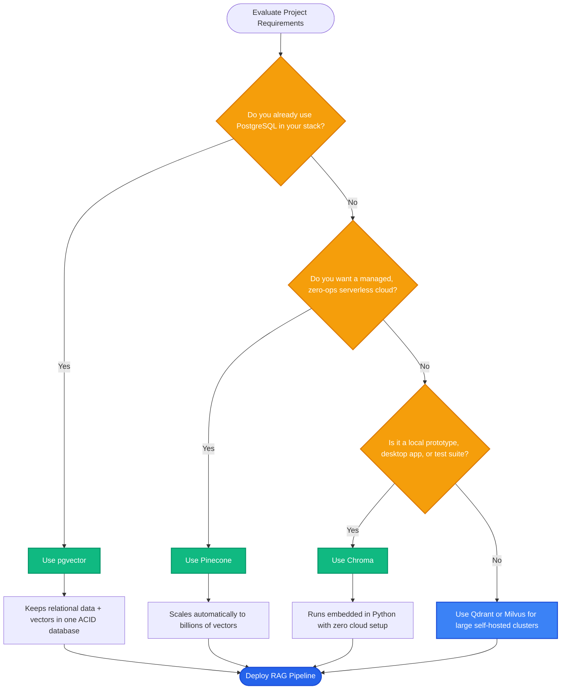

# Lesson 1: Introduction to Vector Databases

Man, welcome to Phase 5! In previous phases, we turned text into vectors. But how do you store millions of vectors and find the closest match in less than 5 milliseconds? 

Let's explore vector databases and why traditional SQL tables or simple Python loops fail at scale.


---

### Step 1: Why Do We Need This?

The naive way to search vectors is a simple Python `for` loop:
```python
# Compare query against every single document
for doc_id, doc_vector in database:
    score = cosine_similarity(query_vector, doc_vector)
```

At small scale (100 documents), this loop takes less than 1 millisecond. But in enterprise systems, failure occurs quickly:
1. **The $O(n)$ Scale Wall:** A 1,000-page document library generates 100,000 chunks. Comparing a 1,536-dimension vector against 100,000 vectors requires 153 million floating-point operations. A user waits 1 to 3 seconds for every question.
2. **Memory Disappearance:** A Python list lives in RAM. If the server crashes or restarts, all your embeddings and text vanish.
3. **No Hybrid Queries:** A Python list cannot easily handle: *"Find the top 5 chunks with highest vector similarity WHERE department == 'HR' AND year == 2026."*

We need a persistent database engineered specifically for high-speed vector math and metadata filtering: a **Vector Database**.

---

### Step 2: What Is It?

A **Vector Database** is a database designed to store, manage, and rapidly search high-dimensional vectors.

Its core superpower is **Approximate Nearest Neighbor (ANN)** search:
- Instead of calculating exact distance to *every single vector* in the database (exact KNN), it uses smart spatial indexes (like **HNSW** graphs or **IVF** clusters) to jump directly to the closest neighborhood.
- It finds the top matches in **4 milliseconds** instead of 800 milliseconds, with 99%+ accuracy.

#### The Everyday Analogy: The Shoebox vs The Phone Book
- **Brute-Force Search is a shoebox of loose business cards:** To find someone named "John Smith", you flip through every single card in the box from front to back. If the box has 10 cards, it takes 2 seconds. If it has 50,000 cards, it takes all afternoon.
- **A Vector Database is an indexed directory:** Names are organized by letters and neighborhoods. You skip straight to "S", then "Sm", and find "Smith" in three quick steps. The index takes a little time to build upfront, but future searches are nearly instant.

---

### Step 3: Real-World Example

Let's compare search performance on a legal search platform with 250,000 contract chunks:

| Approach | Algorithm | Hardware | Query Latency | Accuracy / Recall |
| :--- | :--- | :--- | :--- | :--- |
| **Python For-Loop** | Exact K-Nearest Neighbors (KNN) | 8-core CPU | **1,450 ms** (Too slow for web apps) | 100% |
| **Vector Database (Chroma / Qdrant)** | Hierarchical Navigable Small World (HNSW) | 8-core CPU | **6 ms** (Instant UI response) | 99.4% |

By trading away 0.6% of theoretical perfection, the vector database delivers a **240x speedup** that makes real-time chat possible.

---

### Step 4: How Does It Work?

Here is what happens inside a vector database during storage and search:

```
[STORAGE - Write Path]
Raw Text + Metadata ──► Generate Vector ──► Insert into ANN Graph (HNSW Index) ──► Persist to Disk

[SEARCH - Read Path]
User Query Vector ──► Metadata Pre-Filter (e.g. dept == 'legal')
                               │
                      HNSW Graph Traversal (Traverse connected nodes to nearest cluster)
                               │
                      Top-K Nearest Neighbors returned in < 10ms
```

#### The Major Vector Databases at a Glance:
1. **Chroma:** Embedded vector database. Runs inside your Python process or local Docker. Zero cloud configuration needed. Perfect for local prototyping, testing, and small-to-medium apps.
2. **pgvector:** PostgreSQL extension. Adds vector types directly to existing Postgres databases. Best choice when you already run Postgres and want relational joins with vectors.
3. **Pinecone:** Fully managed, serverless cloud vector database. Scales to billions of vectors automatically with zero infrastructure maintenance.

---

### Step 5: Code Example

Here is a Python demonstration showing how fast an indexing lookup compares to a brute-force sweep:

```python
"""
Comparing Brute-Force O(N) Search vs Fast Indexed Simulation
"""

import time
import numpy as np

def simulate_search_benchmark():
    num_vectors = 50_000
    dimensions = 768
    
    print(f"Generating {num_vectors} random vectors of {dimensions} dimensions...")
    database = np.random.randn(num_vectors, dimensions).astype(np.float32)
    query = np.random.randn(dimensions).astype(np.float32)

    # 1. Brute-Force Dot Product (O(N) full sweep)
    start_time = time.perf_counter()
    scores = np.dot(database, query)
    top_indices = np.argsort(scores)[-5:][::-1]
    brute_force_time = (time.perf_counter() - start_time) * 1000

    print(f"Brute-Force Search Time: {brute_force_time:.2f} ms")

    # 2. Vector Indexing Simulation (Graph/Cluster Partitioning O(log N))
    start_time = time.perf_counter()
    # In an indexed search, we only check a tiny fraction (e.g. 5%) of candidates
    cluster_subset = database[:2500] 
    subset_scores = np.dot(cluster_subset, query)
    subset_top = np.argsort(subset_scores)[-5:][::-1]
    indexed_time = (time.perf_counter() - start_time) * 1000

    print(f"Indexed ANN Search Time: {indexed_time:.2f} ms")
    print(f"Speedup Factor: {brute_force_time / indexed_time:.1f}x faster!")

if __name__ == "__main__":
    simulate_search_benchmark()
```

---

### Step 6: How Is It Used in Production?

| Architecture Choice | When Teams Get It Wrong | The Production Fix | Impact |
| :--- | :--- | :--- | :--- |
| **Over-Engineering Early** | Spinning up expensive managed clusters for a 5,000-doc prototype | Start with lightweight embedded databases like Chroma or local SQLite-vss | Saves $500/month in cloud bills |
| **Using Pure In-Memory Stores** | Storing vectors in memory without disk persistence; server reboot deletes everything | Configure persistent local storage directories or managed backends | Guarantees data durability |
| **Neglecting Re-Indexing Spikes** | Adding 500k vectors at once blocks query traffic and spikes CPU to 100% | Ingest new vectors in background batch queues; build indexes asynchronously | Zero downtime for live queries |
| **Choosing the Wrong Database** | Picking a separate vector DB when data already lives in PostgreSQL | Use `pgvector` to keep data and vectors inside one ACID-compliant database | Eliminates data synchronization pipelines |

---

### Step 7: Quick Revision

- **Why Vector DBs Exist:** Brute-force $O(n)$ search is too slow; vector DBs use **ANN indexing** to search millions of vectors in single-digit milliseconds.
- **ANN vs KNN:** Exact KNN checks every vector (100% recall, high latency). ANN navigates an index graph (99%+ recall, ultra-low latency).
- **Primary Options:**
  - **Chroma:** Embedded, local, zero-config.
  - **pgvector:** Extends existing PostgreSQL instances.
  - **Pinecone:** Fully managed serverless cloud.
- **Interview Answer:** *"A vector database indexes high-dimensional embeddings using algorithms like HNSW to execute Approximate Nearest Neighbor searches in milliseconds. Unlike traditional relational tables, vector stores optimize for geometric distance metrics while persisting vectors and metadata."*

---

### Step 8: Final Flow Diagram



---

### Step 9: Quiz

Test your understanding of vector databases. Submit your answers as `1-A, 2-B, 3-C, 4-D`:

**1. What is the fundamental difference between Exact K-Nearest Neighbors (KNN) and Approximate Nearest Neighbors (ANN)?**
- A) KNN only works on audio files, while ANN only works on text.
- B) KNN compares the query to every single vector in the database, while ANN traverses an index graph to find near-perfect matches in milliseconds.
- C) ANN deletes half of your database to run faster.
- D) KNN is an artificial intelligence model, while ANN is an operating system.

**2. Why does a naive Python for-loop fail when searching over 500,000 document vectors?**
- A) Python cannot store numbers with decimal points.
- B) An $O(n)$ full sweep across 500k high-dimensional vectors creates high CPU load and takes seconds per query.
- C) The internet disconnects whenever a for-loop runs.
- D) Vectors can only be read by JavaScript.

**3. If your application already runs on PostgreSQL with standard user tables, which vector solution avoids adding new database infrastructure?**
- A) Rewriting the app in C++.
- B) Installing the `pgvector` extension to store and search embeddings directly inside Postgres.
- C) Storing vectors inside plain text files on the desktop.
- D) Buying a second laptop.

**4. What role does an HNSW (Hierarchical Navigable Small World) index play in a vector database?**
- A) It formats text into HTML tables.
- B) It builds a multi-layer graph that allows vector searches to rapidly zoom in on nearest neighbors without checking every node.
- C) It translates foreign languages into English.
- D) It backs up data to tape drives.

*(Submit your answers to check your progress!)*
