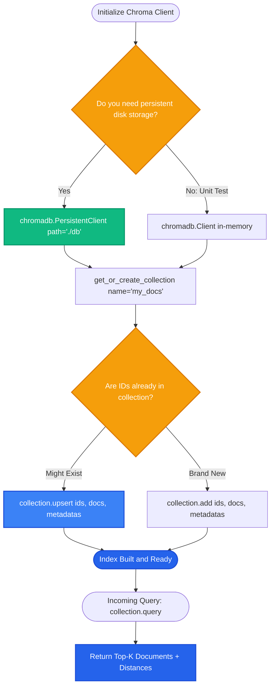

# Lesson 2: Chroma Fundamentals

Man, in Lesson 1 we saw why vector databases are essential. Now let's get our hands dirty with **Chroma**—the most popular, developer-friendly open-source embedded vector database.

Let's learn how Chroma organizes data and how to run your first vector insertions and semantic searches.

---

### Step 1: Why Do We Need This?

When developers start building RAG prototypes, cloud-managed vector databases can be frustrating:
- You have to sign up for an API key.
- You have to enter credit card details.
- You have to configure network VPCs, firewalls, and cloud regions.
- If your internet drops or an API key expires, your local development breaks.

Chroma solves this completely:
- It installs with a single command: `pip install chromadb`.
- It runs right inside your Python script (like SQLite).
- It embeds text automatically out of the box without requiring paid OpenAI API keys.

It is the fastest way to build, test, and iterate on a working RAG application.

---

### Step 2: What Is It?

**Chroma** is an AI-native open-source vector database designed for simplicity.

It is built around three core concepts:
1. **Client:** The connection to Chroma (either in-memory or saved to a local folder on your disk).
2. **Collection:** A bucket or table that groups related vectors together (e.g. `customer_support_docs`, `engineering_specs`).
3. **Documents & Metadata:** The raw text strings, their vector embeddings, and their associated key-value metadata tags.

#### The Everyday Analogy: The Filing Cabinet
- The **Client** is the entire filing cabinet in your office.
- Each drawer in that cabinet is a **Collection** (one drawer for "Tax Receipts", one drawer for "Product Manuals").
- Inside each drawer are folders containing the actual document page, a barcode (the embedding), and sticky notes (the metadata).

---

### Step 3: Real-World Example

Imagine building a local desktop assistant that searches personal meeting notes:

- You initialize Chroma with a local folder: `path="./my_notes_db"`.
- You create a collection named `"meeting_notes"`.
- You add notes:
  - Doc 1: *"Q3 marketing planning meeting: decided on a $10,000 budget for YouTube ads."*
  - Doc 2: *"Engineering 1-on-1 with Alice: discussed upgrading database from Postgres 14 to 16."*
- A week later, you ask: *"How much money did we allocate for video advertising?"*
- Chroma embeds the query, searches the collection, and returns Doc 1 with its metadata in **3 milliseconds**!

---

### Step 4: How Does It Work?

Here is the operational lifecycle of a Chroma collection:

```
[INITIALIZATION]
client = chromadb.PersistentClient(path="./chroma_data")
collection = client.get_or_create_collection(name="support_kb")

[INSERTION]
collection.add(
    ids=["doc_1", "doc_2"],
    documents=["Text 1...", "Text 2..."],
    metadatas=[{"dept": "hr"}, {"dept": "eng"}]
)
      │
(Chroma generates embeddings automatically using built-in MiniLM model, or uses your custom embeddings)
      │
(Vectors and text saved to local SQLite + HNSW index files)

[QUERYING]
results = collection.query(
    query_texts=["How do I reset password?"],
    n_results=2,
    where={"dept": "hr"}  # Metadata filter
)
```

#### Automatic vs Custom Embeddings:
By default, Chroma uses a lightweight, free local model (`all-MiniLM-L6-v2`) running on your CPU. If you prefer OpenAI or Cohere embeddings, you simply pass an `embedding_function` parameter when creating the collection.

---

### Step 5: Code Example

Here is a complete, runnable Python script showing Chroma in action:

```python
"""
Chroma Fundamentals: Adding, Querying, and Filtering
Requires: pip install chromadb
"""

import chromadb
from chromadb.utils import embedding_functions

def run_chroma_demo():
    # 1. Initialize an In-Memory Chroma Client (great for unit tests)
    # For persistence to disk, use: chromadb.PersistentClient(path="./chroma_db")
    client = chromadb.Client()

    # 2. Create or load a Collection
    collection = client.get_or_create_collection(name="policies")

    # 3. Add documents (Chroma embeds them automatically!)
    collection.add(
        ids=["id_01", "id_02", "id_03"],
        documents=[
            "Employees are entitled to 20 days of paid vacation per year.",
            "Health insurance benefits kick in on the first day of employment.",
            "Hardware reimbursement covers up to $1,000 for home office setups."
        ],
        metadatas=[
            {"category": "leave", "year": 2026},
            {"category": "health", "year": 2026},
            {"category": "equipment", "year": 2026}
        ]
    )
    print("Documents successfully added to collection.")

    # 4. Query the collection using natural language
    query = "How much can I spend on a home monitor and desk?"
    
    results = collection.query(
        query_texts=[query],
        n_results=1,
        # Optional metadata filter:
        where={"category": "equipment"}
    )

    print("\n--- QUERY RESULT ---")
    print(f"User Query: {query}")
    print(f"Matched ID: {results['ids'][0][0]}")
    print(f"Matched Document: {results['documents'][0][0]}")
    print(f"Metadata: {results['metadatas'][0][0]}")
    print(f"Distance Score: {results['distances'][0][0]:.4f}")

if __name__ == "__main__":
    run_chroma_demo()
```

---

### Step 6: How Is It Used in Production?

| Chroma Feature | Common Mistake | Production Best Practice | Impact |
| :--- | :--- | :--- | :--- |
| **Persistence Mode** | Using `chromadb.Client()` in production; all data disappears when web server reboots | Always use `chromadb.PersistentClient(path=...)` or Chroma Client/Server mode | Keeps vector data safe across restarts |
| **Embedding Consistency** | Using Chroma's default MiniLM during testing, then querying with OpenAI embeddings in production | Explicitly pass the desired `embedding_function` into collection creation | Prevents silent search failure |
| **Duplicate IDs** | Calling `collection.add()` with an ID that already exists throws an error | Use `collection.upsert()` instead of `add()` to safely update existing documents | Eliminates duplicate key crashes |
| **Heavy Filtering** | Filtering on unindexed metadata fields over 100k records | Keep metadata schemas flat and concise (strings, numbers, booleans) | Fast pre-filtering performance |

---

### Step 7: Quick Revision

- **Chroma Is AI-Native & Embedded:** Runs inside Python without needing cloud accounts.
- **Core Abstractions:** Client -> Collection -> Documents + Metadata + Embeddings.
- **Persistent vs Ephemeral:** Use `Client()` for testing; use `PersistentClient(path="./path")` for permanent storage.
- **Upsert Over Add:** Use `collection.upsert()` in production to avoid crashing on duplicate IDs.
- **Interview Answer:** *"Chroma is an open-source embedded vector database that stores text, vectors, and metadata locally using SQLite and HNSW. It handles automatic text embedding generation out of the box and supports fast nearest-neighbor search with metadata pre-filtering."*

---

### Step 8: Final Flow Diagram



---

### Step 9: Quiz

Test your understanding of Chroma fundamentals. Submit your answers as `1-A, 2-B, 3-C, 4-D`:

**1. What is the difference between `chromadb.Client()` and `chromadb.PersistentClient(path="./data")`?**
- A) `Client()` stores data only in temporary RAM, while `PersistentClient()` saves vectors and documents to disk.
- B) `Client()` requires a paid monthly subscription.
- C) `PersistentClient()` only works on Android phones.
- D) `Client()` can only store images.

**2. What method should you call to insert documents when you want to update them if their ID already exists without throwing an error?**
- A) `collection.delete_all()`
- B) `collection.upsert()`
- C) `collection.format()`
- D) `collection.restart()`

**3. What happens if you do not provide pre-computed vector embeddings when calling `collection.add()` in Chroma?**
- A) The program crashes immediately.
- B) Chroma automatically generates embeddings using its built-in local embedding model.
- C) Chroma converts the text into a zip file.
- D) Chroma sends the text to Google via email.

**4. In Chroma, what is the equivalent of a SQL table?**
- A) A Client.
- B) A Collection.
- C) A Metadata key.
- D) An ID.

*(Submit your answers to check your progress!)*
