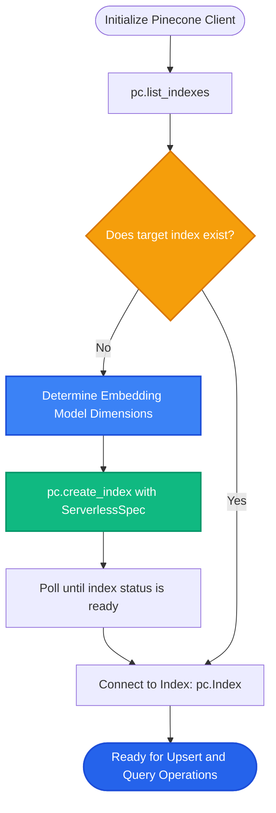

# Lesson 1: Pinecone Fundamentals

Man, welcome to Phase 6! In Phase 5 we mastered Chroma for local development. But what happens when your application goes live and must serve millions of users across the globe with zero server maintenance?

Let's explore **Pinecone**—the leading fully managed, cloud-native serverless vector database.

---

### Step 1: Why Do We Need This?

Running an embedded database on a single server works until your company scales:
1. **The Multi-Server Deployment Problem:** If your app runs across 10 Kubernetes pods or AWS Lambda functions, an embedded database on one server cannot be accessed by the others without building complex networking.
2. **Infrastructure Maintenance Overhead:** Managing your own database cluster means handling backups, OS security patches, disk resizes, and 3 AM pager duty when a server node crashes.
3. **Scaling from 10k to 50M Vectors:** As your vector collection grows, you have to shard data across multiple machines and balance memory loads yourself.

Pinecone eliminates all infrastructure overhead. You get an API endpoint that handles high availability, replication, and automatic scaling to billions of vectors.

---

### Step 2: What Is It?

**Pinecone** is a managed cloud vector database service.

Instead of running database software on your own hardware, you interact with Pinecone over an HTTPS API:
- **Serverless Architecture:** You only pay for the storage you use and the queries you run. No idle server fees.
- **Index:** The top-level container for your vectors (equivalent to a database table).
- **Dimension:** The fixed vector length (e.g. 1536 for OpenAI `text-embedding-3-small`). Once set, it cannot be changed.
- **Metric:** The similarity distance formula (`cosine`, `dotproduct`, or `euclidean`).

#### The Everyday Analogy: Owning a Generator vs Plugging into the Electric Grid
- **Running Chroma on your own VM** is like buying and maintaining a diesel generator in your backyard. You have to buy fuel, change the oil, and fix the engine when it breaks.
- **Pinecone** is the municipal electrical grid. You just plug your cord into the wall socket. Power is always there, and you pay only for the kilowatt-hours you consume.

---

### Step 3: Real-World Example

Imagine an enterprise HR knowledge portal with 200,000 global employees:

- **Traffic Pattern:** 50,000 queries per hour during 9 AM business hours; almost zero queries at 2 AM.
- **Self-Hosted Setup:** You would have to pay for 8 large GPU/RAM servers 24/7 to handle peak spikes, costing $3,000/month even when employees are asleep.
- **Pinecone Serverless Setup:**
  - An index is created in the `us-east-1` AWS region with `ServerlessSpec(cloud="aws", region="us-east-1")`.
  - During peak hours, Pinecone automatically scales search throughput to handle 50,000 queries.
  - At night, compute scales down to zero.
  - Total monthly cost drops by 70%, with zero server patching required.

---

### Step 4: How Does It Work?

Here is the lifecycle of interacting with Pinecone using the modern v5+ Python SDK:

```
[1. SETUP]
from pinecone import Pinecone, ServerlessSpec
pc = Pinecone(api_key="PINECONE_API_KEY")

[2. CREATE INDEX (One-Time)]
pc.create_index(
    name="company-policies",
    dimension=1536,                 # Must match embedding model!
    metric="cosine",                # Cosine similarity
    spec=ServerlessSpec(cloud="aws", region="us-east-1")
)

[3. CONNECT & QUERY]
index = pc.Index("company-policies")
index.upsert(vectors=[...])
results = index.query(vector=query_vector, top_k=5)
```

#### Crucial Index Parameters:
1. **Dimension (Immutable):** If you embed text with OpenAI (1536 dimensions), your index must have `dimension=1536`. Inserting a 768-dim vector will be rejected with an error.
2. **Metric:** Choose `"cosine"` for general text embeddings. Choose `"dotproduct"` if your embeddings are already normalized.

---

### Step 5: Code Example

Here is a clean Python script using the modern Pinecone v5 SDK:

```python
"""
Pinecone Fundamentals: Creating an Index and Connecting
Requires: pip install pinecone
"""

import os
import time
from pinecone import Pinecone, ServerlessSpec

def setup_pinecone_index():
    # 1. Initialize client using environment variable
    api_key = os.getenv("PINECONE_API_KEY", "your-api-key-here")
    pc = Pinecone(api_key=api_key)

    index_name = "knowledge-base"
    dimension = 1536  # Standard for OpenAI text-embedding-3-small

    # 2. Check if index already exists
    existing_indexes = [i.name for i in pc.list_indexes()]
    
    if index_name not in existing_indexes:
        print(f"Creating serverless index: {index_name}...")
        pc.create_index(
            name=index_name,
            dimension=dimension,
            metric="cosine",
            spec=ServerlessSpec(
                cloud="aws",
                region="us-east-1"
            )
        )
        # Wait for index initialization
        while not pc.describe_index(index_name).status["ready"]:
            time.sleep(1)
        print("Index is ready!")
    else:
        print(f"Index '{index_name}' already exists.")

    # 3. Connect to the active index
    index = pc.Index(index_name)
    stats = index.describe_index_stats()
    print(f"Index connected successfully. Total vector count: {stats.total_vector_count}")

if __name__ == "__main__":
    setup_pinecone_index()
```

---

### Step 6: How Is It Used in Production?

| Production Challenge | Why It Breaks | The Production Fix | Impact |
| :--- | :--- | :--- | :--- |
| **Dimension Mismatch** | Embedding model outputs 768 numbers, but index was created with 1,536 | Always verify embedding output shape before creating an index | Prevents insertion rejection errors |
| **Cross-Region Latency** | Running application backend in AWS `eu-west-1` while Pinecone index is in `us-east-1` | Always deploy Pinecone serverless indexes in the same cloud region as your backend | Drops network latency from 120ms to 8ms |
| **Hardcoding API Keys** | Committing Pinecone API keys into GitHub repositories | Load credentials strictly from environment variables or AWS Secrets Manager | Prevents credential leaks and unauthorized bills |
| **Metric Inconsistency** | Using Euclidean metric on cosine-optimized text models | Set `metric="cosine"` on index creation | Preserves semantic search accuracy |

---

### Step 7: Quick Revision

- **Pinecone Is Fully Managed:** Zero servers, zero disk management, zero manual sharding.
- **Serverless Pricing:** Pay only for the vectors stored and the search operations executed.
- **Immutable Dimensions:** The `dimension` setting must match your embedding model exactly and cannot be modified after creation.
- **Region Co-location:** Always create your Pinecone index in the same cloud region as your application servers.
- **Interview Answer:** *"Pinecone is a cloud-native, serverless vector database that abstracts infrastructure management. It provides managed indexes with sub-50ms search latency, elastic auto-scaling, and metadata filtering, making it an industry standard for production enterprise RAG systems."*

---

### Step 8: Final Flow Diagram



---

### Step 9: Quiz

Test your understanding of Pinecone fundamentals. Submit your answers as `1-A, 2-B, 3-C, 4-D`:

**1. What is the primary operational benefit of using a managed vector database like Pinecone over self-hosting?**
- A) Pinecone does not require vector embeddings.
- B) You do not have to manage servers, replication, sharding, backups, or scaling infrastructure.
- C) Pinecone allows you to run Python code for free.
- D) Pinecone eliminates the need for an internet connection.

**2. Can you change the `dimension` setting of an existing Pinecone index after it has been created?**
- A) Yes, by calling `index.resize()`.
- B) No, dimensions are immutable; if your embedding model changes dimensions, you must create a new index.
- C) Yes, Pinecone automatically adjusts dimensions every night.
- D) Only on Tuesdays.

**3. Why should your Pinecone index be provisioned in the same cloud provider and region as your application backend?**
- A) To prevent cross-region network latency from slowing down search queries.
- B) Because Pinecone only works in one city.
- C) To make your code shorter.
- D) To prevent the LLM from speaking Spanish.

**4. What distance metric is standard for semantic text retrieval in Pinecone?**
- A) Manhattan distance.
- B) Cosine similarity (`"cosine"`).
- C) Hamming distance.
- D) Jaccard index.

*(Submit your answers to check your progress!)*
