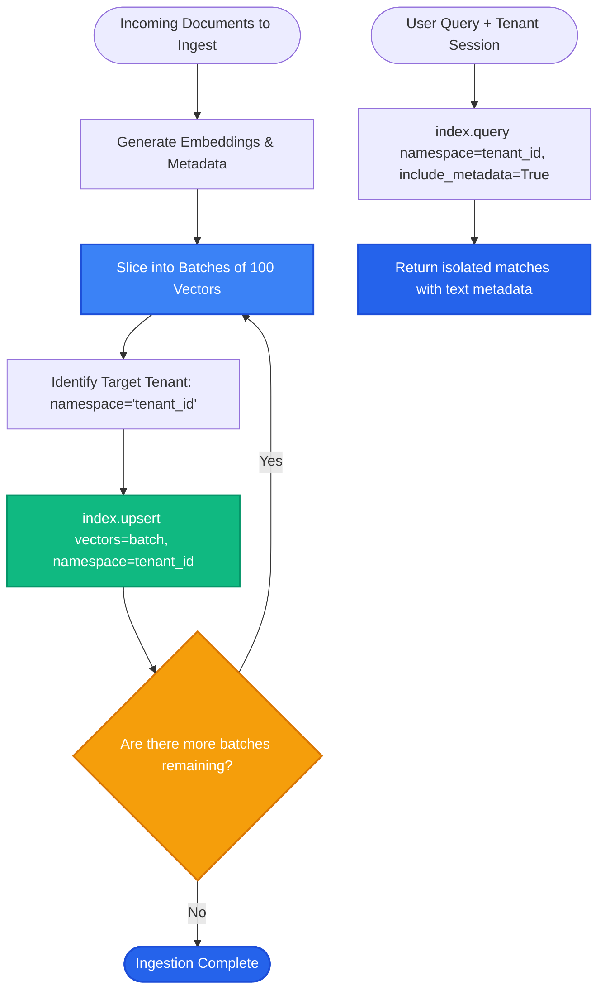

# Lesson 2: Pinecone Indexes, Namespaces, and Upserts

Man, in Lesson 1 we created a Pinecone index. Now let's explore how to safely insert millions of vectors using batch **upserts**, and how to use **namespaces** for multi-tenant data isolation without paying for separate indexes.

---

### Step 1: Why Do We Need This?

When inserting data into a cloud vector database, two common production pitfalls cause failures:
1. **The Single-Insert Latency Trap:** If you upload 10,000 vectors one by one with individual API calls, network round-trip latency will make the script take 45 minutes to finish.
2. **The Multi-Tenant Cost Trap:** In a SaaS application with 500 business customers, you cannot afford to spin up 500 separate Pinecone indexes. That would cost thousands of dollars a month.
3. **Payload Limit Exceeded Errors:** If you try to send all 10,000 vectors in a single giant JSON payload, the HTTP request exceeds Pinecone's 2MB payload ceiling and crashes with `413 Payload Too Large`.

Understanding batching and namespaces enables fast, cost-effective, and secure ingestion.

---

### Step 2: What Is It?

1. **Upsert (Update or Insert):**
   - The primary write operation in Pinecone.
   - If a vector with the given ID does not exist, it inserts it.
   - If a vector with that ID already exists, it overwrites it with the new embedding and metadata.

2. **Namespaces:**
   - Logical partitions *inside* a single Pinecone index.
   - Every search query can be scoped to a single namespace. Queries scoped to namespace `"tenant_A"` will never see or leak vectors from `"tenant_B"`.
   - Namespaces require zero extra index cost!

#### The Everyday Analogy: The Multi-Unit Storage Facility
- The **Index** is the entire commercial storage building.
- A **Namespace** is an individual private storage locker with a personalized padlock.
- Each locker belongs to a different customer.
- When Customer B opens their locker, they can only see and search their own boxes, completely separated from Customer A, while sharing the same building security and roof.

---

### Step 3: Real-World Example

Imagine building a multi-tenant B2B customer support assistant for 100 client companies:

- **Single Shared Index:** `enterprise-support-kb`.
- **Client Company 1 (Nike):** Ingests 5,000 document chunks into `namespace="nike"`.
- **Client Company 2 (Adidas):** Ingests 4,000 document chunks into `namespace="adidas"`.

When an employee from Nike asks *"What is our holiday return window?"*:
```python
index.query(
    vector=query_vector,
    top_k=3,
    namespace="nike"   # <--- Guaranteed isolation!
)
```
The query searches only within Nike's 5,000 vectors. It is impossible for Adidas policy documents to leak into Nike's responses.

---

### Step 4: How Does It Work?

Here is the batch upsert flow with payload chunking:

```
[10,000 Prepared Vectors]
           │
  [Chunk into Batches of 100 Vectors (~150KB each)]
           │
  Batch 1 (Vectors 0 - 99)    ──► index.upsert(vectors=batch_1, namespace="tenant_1")
  Batch 2 (Vectors 100 - 199) ──► index.upsert(vectors=batch_2, namespace="tenant_1")
  Batch 3 (Vectors 200 - 299) ──► index.upsert(vectors=batch_3, namespace="tenant_1")
           │
  [All Batches Ingested in < 5 Seconds via Async/Pipelines]
```

#### Vector Record Structure:
Every record passed to `upsert()` is a dictionary with three fields:
```python
{
    "id": "contract_124_chunk_3",
    "values": [0.014, -0.082, 0.941, ...],  # 1536 float numbers
    "metadata": {
        "text": "The subscription fee is $50/month.",
        "author": "Legal Team",
        "doc_id": "contract_124"
    }
}
```

---

### Step 5: Code Example

Here is a Python script showing how to batch upsert vectors into a specific namespace and query them:

```python
"""
Pinecone Batch Upserts and Namespace Querying
"""

from typing import List, Dict, Any
from pinecone import Pinecone

def batch_upsert_vectors(
    index,
    records: List[Dict[str, Any]],
    namespace: str,
    batch_size: int = 100
) -> None:
    """Safely uploads vectors in batches to respect payload limits."""
    for i in range(0, len(records), batch_size):
        batch = records[i:i + batch_size]
        index.upsert(vectors=batch, namespace=namespace)
        print(f"Upserted batch {i // batch_size + 1} ({len(batch)} vectors) to namespace '{namespace}'.")

if __name__ == "__main__":
    # Simulated connection
    pc = Pinecone(api_key="your-api-key")
    index = pc.Index("knowledge-base")

    # Prepare sample records (normally generated from embedding model)
    sample_records = [
        {
            "id": "doc_01",
            "values": [0.12] * 1536,  # 1536 dummy floats
            "metadata": {"text": "Acme Corp remote work policy allows 2 days WFH.", "dept": "HR"}
        },
        {
            "id": "doc_02",
            "values": [0.85] * 1536,
            "metadata": {"text": "Expense reimbursement claims must be submitted in 30 days.", "dept": "Finance"}
        }
    ]

    # Step 1: Batch Upsert into a specific tenant namespace
    batch_upsert_vectors(index, sample_records, namespace="tenant_acme", batch_size=100)

    # Step 2: Query strictly inside that namespace
    query_vector = [0.11] * 1536
    results = index.query(
        vector=query_vector,
        top_k=1,
        namespace="tenant_acme",
        include_metadata=True
    )

    print("\n--- QUERY RESULT ---")
    for match in results["matches"]:
        print(f"Matched ID: {match['id']} (Score: {match['score']:.4f})")
        print(f"Text: {match['metadata']['text']}")
```

---

### Step 6: How Is It Used in Production?

| Architecture Aspect | What Fails | Production Solution | Impact |
| :--- | :--- | :--- | :--- |
| **Payload Size Exceeded** | Sending a 5,000-vector batch crashes with HTTP 413 | Batch vectors in groups of 100 to 200 items (staying well under 2MB limit) | Smooth, reliable ingestion |
| **Cross-Tenant Data Leak** | Forgetting to specify `namespace` runs the query against the default namespace | Wrap the Pinecone client in an internal service layer that enforces mandatory `tenant_id` | Guarantees multi-tenant isolation |
| **Missing Metadata in Response** | Results contain IDs and similarity scores, but no text | Always pass `include_metadata=True` in `index.query()` | Returns text chunks for prompt assembly |
| **Cleaning Tenant Data on Account Cancel** | Deleting 50,000 vectors one by one with a slow loop | Call `index.delete(delete_all=True, namespace="tenant_id")` | Wipes tenant data in a single API call |

---

### Step 7: Quick Revision

- **Upsert = Insert or Update:** Modifies existing vector IDs or creates new ones.
- **Batch Your Upserts:** Always group vectors into batches of 100 to 200 to maximize throughput and avoid payload limits.
- **Namespaces for Multi-Tenancy:** Partition a single index into isolated namespaces at zero extra cost.
- **Always Include Metadata:** Pass `include_metadata=True` during queries so the original text chunk is returned for prompt assembly.
- **Interview Answer:** *"In Pinecone, upserts are batched into groups of 100-200 vectors to maximize write throughput within payload limits. Namespaces provide lightweight, zero-cost logical partitioning within a single index, ensuring strict multi-tenant isolation."*

---

### Step 8: Final Flow Diagram



---

### Step 9: Quiz

Test your understanding of Pinecone namespaces and upserts. Submit your answers as `1-A, 2-B, 3-C, 4-D`:

**1. What happens if you call `index.upsert()` with a vector ID that already exists in the target namespace?**
- A) Pinecone throws an error and deletes the index.
- B) The existing vector is updated and overwritten with the new values and metadata.
- C) Pinecone creates a duplicate copy of the vector with a random suffix.
- D) Pinecone ignores the new data and keeps the old version.

**2. Why should large document collections be uploaded in batches of 100 to 200 vectors rather than in a single giant API call?**
- A) Pinecone will ban your credit card if you send large files.
- B) Oversized requests exceed the 2MB HTTP payload limit and result in `413 Payload Too Large` errors.
- C) Batching causes embeddings to lose their precision.
- D) Vectors can only be counted up to 200 in Python.

**3. What is the primary benefit of using Pinecone Namespaces in a multi-tenant SaaS application?**
- A) It allows you to run Python scripts inside the database.
- B) It provides logical data isolation for each client inside a single index without needing to pay for hundreds of separate indexes.
- C) It translates documents into foreign languages.
- D) It automatically rewrites the client's documents.

**4. Why is `include_metadata=True` typically required when calling `index.query()` in a RAG pipeline?**
- A) To make the query run 10x slower.
- B) To return the stored text chunk and source attributes needed to augment the LLM's prompt.
- C) To turn on SSL encryption.
- D) To verify the user's password.

*(Submit your answers to check your progress!)*
