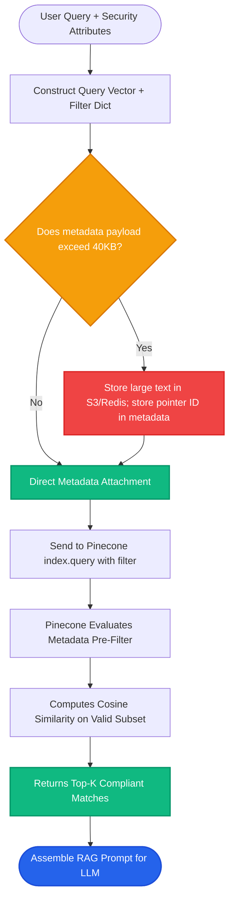

# Lesson 3: Pinecone Metadata Filtering and Scaling

Man, in Lesson 2 we learned how to batch upsert vectors and use namespaces. Now let's explore **advanced metadata filtering** and how Pinecone scales under heavy production workloads.

---

### Step 1: Why Do We Need This?

In enterprise search, pure semantic similarity is rarely enough on its own:
- A user asks: *"What was our Q3 marketing spend?"*
- Semantic search finds documents about marketing spend, but half of them are from 2021 and 2022.
- A user asks: *"How do I restart the staging cluster?"*
- Semantic search finds production cluster runbooks, which could cause a catastrophic accidental outage if applied to staging!
- Another trap: storing a full 5-page PDF inside a vector's metadata crashes with `Metadata size exceeds 40KB limit`.

To build robust, accurate systems, you need expressive metadata filtering and an understanding of Pinecone's size limits and scaling rules.

---

### Step 2: What Is It?

1. **Metadata Filtering:**
   - Applying structured Boolean conditions alongside semantic vector search.
   - Pinecone executes **pre-filtering**: it restricts the search pool to vectors matching your metadata filters *before* ranking by cosine similarity.
   - Supports MongoDB-style filter operators: `$eq`, `$in`, `$gt`, `$gte`, `$lt`, `$lte`, `$and`, `$or`.

2. **Metadata Size Limit (40KB):**
   - Each vector record in Pinecone can store up to **40KB** of metadata.
   - This is plenty of space for chunk text, author, tags, and URLs, but not for raw PDF files or high-res images.

#### The Everyday Analogy: Online Shoe Shopping
- **Pure Semantic Search:** Searching for *"comfortable running sneakers"* brings back 500 shoes across all brands, sizes, and price tags.
- **Semantic Search + Metadata Filter:** You search for *"comfortable running sneakers"* with filters: `brand == "Nike" AND size == 10.5 AND price <= 150`.
- The website filters out everything that doesn't fit your foot and budget *before* showing you the most relevant shoes.

---

### Step 3: Real-World Example

Imagine building a compliance search tool for a healthcare network:

- **User Query:** *"Clinical protocol for severe pediatric asthma reactions"*
- **Search Constraints:**
  - Must be an approved guideline (`status: "approved"`).
  - Must apply to pediatrics (`department: "pediatrics"`).
  - Must be published in or after 2024 (`effective_year: {"$gte": 2024}`).
- **Pinecone Filter Query:**
  ```python
  filter_dict = {
      "status": {"$eq": "approved"},
      "department": {"$in": ["pediatrics", "emergency"]},
      "effective_year": {"$gte": 2024}
  }
  ```
- **Result:** Outdated or draft protocols are physically excluded. The doctor receives only current, legally approved pediatric medical procedures.

---

### Step 4: How Does It Work?

Here is how Pinecone's query engine processes filtered requests:

```
User Query Vector + Filter Object
               │
   [Pinecone Metadata Index]
Filters evaluated: status == 'approved' AND year >= 2024
               │
   Eligible Subset of Vectors
               │
   [HNSW Vector Distance Ranking]
Cosine similarity calculated ONLY on eligible subset
               │
   Top-K Results Returned with Source Metadata in < 30ms
```

#### Pinecone Filter Operator Cheat Sheet:
- `$eq` / `$ne`: Equal to / Not equal to.
- `$gt` / `$gte`: Greater than / Greater than or equal to (numbers).
- `$lt` / `$lte`: Less than / Less than or equal to.
- `$in` / `$nin`: Value exists / does not exist within a list.
- `$and` / `$or`: Logical combinations of multiple rules.

---

### Step 5: Code Example

Here is a Python script demonstrating complex metadata filtering in Pinecone:

```python
"""
Advanced Metadata Filtering with Pinecone
"""

from pinecone import Pinecone

def run_filtered_query():
    pc = Pinecone(api_key="your-api-key")
    index = pc.Index("enterprise-kb")

    query_embedding = [0.05] * 1536  # Replace with real embedding

    # Build advanced MongoDB-style filter
    search_filter = {
        "$and": [
            {"department": {"$in": ["engineering", "security"]}},
            {"year": {"$gte": 2025}},
            {"is_confidential": {"$eq": False}}
        ]
    }

    # Execute search
    results = index.query(
        vector=query_embedding,
        top_k=3,
        filter=search_filter,
        include_metadata=True
    )

    print("--- FILTERED SEARCH RESULTS ---")
    for match in results["matches"]:
        meta = match["metadata"]
        print(f"ID: {match['id']} | Score: {match['score']:.4f}")
        print(f"  Dept: {meta.get('department')} | Year: {meta.get('year')}")
        print(f"  Text: {meta.get('text')}\n")

if __name__ == "__main__":
    run_filtered_query()
```

---

### Step 6: How Is It Used in Production?

| Production Challenge | Why It Breaks | The Production Fix | Impact |
| :--- | :--- | :--- | :--- |
| **Exceeding 40KB Metadata Limit** | Storing entire document chapters inside vector metadata | Store only chunk text and chunk ID in Pinecone; store full documents in Amazon S3 or Redis | Eliminates 400 Bad Request payload errors |
| **High Selectivity Filter Stall** | Filtering on a rare tag (e.g. `tag == "rare_bug"`) matching only 2 vectors in 10M | Ensure metadata values have balanced distribution; index frequently filtered fields | Keeps query latency under 40ms |
| **Serverless Read Units (RUs) Cost** | Over-fetching `top_k=100` and scanning giant metadata payloads consumes RUs | Request only `top_k=5` with necessary fields to conserve Read Units | Lowers monthly cloud billing by 50% |
| **Type Mismatch in Filters** | Storing year as a string `"2025"` and filtering with `{"$gte": 2025}` (integer) | Enforce strict data types during ingestion (integers for dates, booleans for flags) | Eliminates silent zero-result bugs |

---

### Step 7: Quick Revision

- **Pre-Filtering Guaranteed:** Pinecone evaluates metadata filters before calculating vector distance, ensuring all returned matches satisfy constraints.
- **MongoDB-Style Syntax:** Use `$eq`, `$in`, `$gte`, `$lte`, `$and`, and `$or`.
- **40KB Metadata Limit:** Store chunk text and key attributes; keep large assets in cloud object storage (S3/GCS).
- **Conserve Read Units:** Only fetch the `top_k` results and metadata fields you actually need for your prompt.
- **Interview Answer:** *"Pinecone executes pre-filtering on indexed metadata attributes using operators like `$in`, `$gte`, and `$and` before computing vector distances. In production, observing the 40KB per-record metadata limit and keeping indexes co-located with application compute ensures sub-50ms query latency."*

---

### Step 8: Final Flow Diagram



---

### Step 9: Quiz

Test your understanding of Pinecone metadata filtering and scaling. Submit your answers as `1-A, 2-B, 3-C, 4-D`:

**1. What is the maximum metadata payload size permitted for a single vector in Pinecone?**
- A) 10 Gigabytes.
- B) 40 Kilobytes (40KB).
- C) 500 Megabytes.
- D) Exactly 10 characters.

**2. Which filter operator would you use in Pinecone to check if a document's `year` is 2024 or later?**
- A) `{"year": {"$gte": 2024}}`
- B) `{"year": ">= 2024"}`
- C) `{"year": {"$like": 2024}}`
- D) `{"year": "next"}`

**3. What does 'Pre-Filtering' mean in Pinecone search execution?**
- A) The database deletes all vectors before searching.
- B) Metadata filter criteria are applied first to narrow the candidate pool before vector similarity scores are computed.
- C) The user must answer a questionnaire before searching.
- D) Vectors are filtered only after the LLM generates an answer.

**4. If an employee tries to search internal company documents, how can metadata filtering enforce security?**
- A) By passing `filter={"access_level": {"$in": user_permissions}}` to exclude confidential documents at the database query level.
- B) By asking the user nicely not to read secret files.
- C) By encrypting the user's monitor screen.
- D) By shutting down the server after each query.

*(Submit your answers to check your progress!)*
