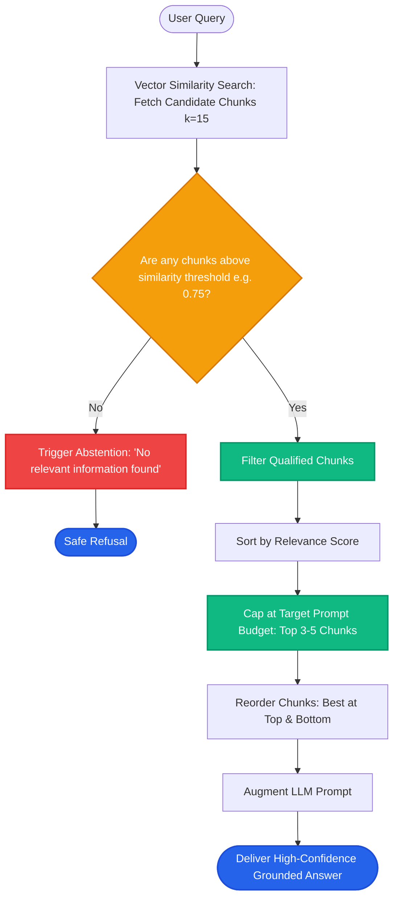

# Lesson 1: Similarity Search and Top-K Tuning

Man, welcome to Phase 8! In previous phases, we set up our vector databases. Now let's explore **retrieval strategies**—how to search intelligently so the LLM gets the exact facts it needs without drowning in noise.

The first and most critical tuning knob in any RAG system is **Top-K**. Let's learn how to choose and tune $k$ scientifically instead of guessing.


---

### Step 1: Why Do We Need This?

Every retrieval request ends with the same question: *How many chunks ($k$) should we return to the LLM?*

Beginners treat $k$ as an afterthought and leave it at a default like 3 or 10. In production, getting $k$ wrong breaks your application in two distinct ways:

1. **If $k$ is too small (e.g. $k=1$):** You suffer from **Low Recall**. If the answer to a question spans across two sections, or if the top-ranked chunk is merely introductory text, the LLM misses the actual answer and hallucinates.
2. **If $k$ is too large (e.g. $k=25$):** You suffer from **Context Dilution & Token Waste**.
   - Input token costs multiply by 5x.
   - Response latency spikes from 1 second to 4 seconds.
   - **The "Lost in the Middle" Effect:** Research proves LLMs pay close attention to the beginning and end of long prompts, but overlook critical facts buried in the middle chunks.

You need a systematic way to tune $k$ to maximize answer accuracy while keeping latency and costs low.

---

### Step 2: What Is It?

**Top-K** is the parameter that determines the maximum number of most similar document chunks returned from the vector store for a given query.

- **Precision vs Recall Trade-Off:**
  - As $k$ increases, **Recall** goes up (higher chance of including the right fact somewhere).
  - As $k$ increases, **Precision** drops (chunks #8, #9, and #10 are inherently less relevant than chunk #1).

#### The Everyday Analogy: The Research Assistant
- You ask an assistant: *"Find me the proof that our competitor launched a feature in July."*
- If the assistant brings back **1 single sticky note** ($k=1$), it might just be the cover page of the report, missing the date.
- If the assistant dumps **50 heavy binders** onto your desk ($k=50$), you will waste hours reading filler text, miss the key date in the middle, and be late for your meeting.
- What you actually need is **3 to 5 curated pages** ($k=4$) containing the exact announcement and press release.

---

### Step 3: Real-World Example

Imagine an internal HR knowledge assistant:

- **User asks:** *"Can I carry over unused vacation days into next year?"*
- **Policy facts:** 
  - Fact A (Chunk 1): *"Employees receive 20 days of annual leave."* (High vector match to 'vacation days')
  - Fact B (Chunk 4): *"A maximum of 5 unused days may be carried over into the following calendar year with manager approval."*

Results across different $k$ settings:
- **At $k=2$:** The retriever returns Chunks 1 and 2. It misses Chunk 4! The LLM answers: *"I don't have information about carrying over vacation days."* (Recall failure!)
- **At $k=5$:** The retriever returns Chunks 1 through 5. Chunk 4 is included. The LLM answers: *"Yes, you can carry over up to 5 days with manager approval."* (Perfect!)
- **At $k=30$:** The retriever includes 25 irrelevant chunks about parental leave, sick leave, and bereavement. The LLM hallucinates and blends rules together.

---

### Step 4: How Does It Work?

Here is the precision-recall curve that governs Top-K tuning:

```
Accuracy / Recall %
 100% ┼                     ╭───────────── Safe Plateau (k = 3 to 6)
      │                   ╭─╯
  70% ┼               ╭───╯
      │           ╭───╯
  30% ┼       ╭───╯
      │   ╭───╯
   0% ┴───┴───────┴───────┴───────┴───────┴───────►
         k=1     k=3     k=5     k=10    k=25     Number of Chunks (k)

Latency / Cost:
         $       $$      $$$     $$$$    $$$$$$$
```

#### How to Pick the Ideal $k$:
1. **Correlate with Chunk Size:**
   - Small chunks (100–200 tokens) -> Higher $k$ (e.g. $k=5$ to $8$).
   - Large chunks (500–800 tokens) -> Lower $k$ (e.g. $k=2$ to $4$).
2. **Score Thresholding:** Combine Top-K with a minimum similarity cutoff (e.g. *"take up to 5 chunks, but only if similarity > 0.70"*). This prevents padding the prompt with irrelevant noise when only 1 good chunk exists.

---

### Step 5: Code Example

Here is a Python script showing how to implement dynamic score thresholding on top of Top-K:

```python
"""
Dynamic Top-K with Similarity Score Thresholding
"""

from typing import List, Dict, Any

def dynamic_threshold_retrieval(
    scored_candidates: List[Dict[str, Any]],
    max_k: int = 5,
    min_similarity_threshold: float = 0.75
) -> List[Dict[str, Any]]:
    """
    Returns up to max_k chunks, but strictly filters out low-confidence noise.
    """
    # 1. Sort by highest similarity score
    sorted_chunks = sorted(scored_candidates, key=lambda x: x["score"], reverse=True)
    
    # 2. Filter by threshold
    qualified_chunks = [c for c in sorted_chunks if c["score"] >= min_similarity_threshold]
    
    # 3. Cap at max_k
    final_selection = qualified_chunks[:max_k]
    
    # Fallback: if nothing passed threshold, return top 1 with warning or empty
    return final_selection

if __name__ == "__main__":
    # Simulated search results with similarity scores (0.0 to 1.0)
    mock_search_results = [
        {"id": "doc_1", "text": "Annual carry-over limit is 5 days.", "score": 0.92},
        {"id": "doc_2", "text": "Manager approval required for carry-over.", "score": 0.88},
        {"id": "doc_3", "text": "Unused days beyond 5 will expire on Dec 31.", "score": 0.81},
        {"id": "doc_4", "text": "Office is closed on Christmas Day.", "score": 0.52},
        {"id": "doc_5", "text": "Catering options for corporate events.", "score": 0.31}
    ]

    # Without threshold: top 5 pulls doc_4 and doc_5 (useless noise!)
    # With threshold:
    clean_results = dynamic_threshold_retrieval(
        mock_search_results,
        max_k=5,
        min_similarity_threshold=0.75
    )

    print(f"Retrieved {len(clean_results)} high-confidence chunks:")
    for c in clean_results:
        print(f"  [{c['score']:.2f}] {c['text']}")
```

---

### Step 6: How Is It Used in Production?

| Strategy Knob | Common Failure Mode | The Production Fix | Real Impact |
| :--- | :--- | :--- | :--- |
| **Fixed $k$ without Threshold** | Asking *"What is the capital of France?"* on an HR database still returns 5 random chunks | Apply a minimum similarity threshold (e.g. `score > 0.70`); decline if empty | Prevents answering nonsense |
| **Ignoring Chunk Size Ratio** | Setting $k=10$ on 1,000-token chunks consumes 10,000 prompt tokens per query | Set total context token budgets (e.g. max 2,500 tokens) rather than raw chunk counts | Stabilizes API billing |
| **Lost-in-the-Middle Neglect** | Important chunk #3 is ignored by the LLM in a 10-chunk prompt | Place highest-scoring chunks at the top and bottom of the context window | 20% higher factual recall |
| **Two-Stage Retrieval (Rerank)** | Forcing initial vector search to be exact with tiny $k$ | Retrieve top 20 candidate chunks with vector search, then rerank down to top 3 | Best of both recall and precision |

---

### Step 7: Quick Revision

- **Top-K Is a Balancing Act:** Too small = missed answers; too large = context dilution, high latency, and high costs.
- **Rule of Thumb Sizing:**
  - 500-token chunks: $k = 3$ to $5$.
  - 150-token chunks: $k = 6$ to $10$.
- **Score Thresholding:** Always filter out chunks with similarity scores below your quality threshold (e.g. $< 0.70$).
- **Context Budgeting:** Limit your retrieved context by total tokens (e.g., max 2,000 tokens) rather than just chunk count.
- **Interview Answer:** *"Tuning Top-K balances retrieval recall against context precision. In production, we combine dynamic score thresholding with a two-stage pipeline: retrieve a wider candidate pool ($k=20$) to ensure high recall, then rerank down to the top 3-5 chunks to prevent context dilution and LLM attention degradation."*

---

### Step 8: Final Flow Diagram



---

### Step 9: Quiz

Test your understanding of similarity search and Top-K tuning. Submit your answers as `1-A, 2-B, 3-C, 4-D`:

**1. What is the danger of setting $k=1$ (retrieving only a single chunk) in a production RAG system?**
- A) The vector database will run out of disk space.
- B) If the answer spans multiple chunks, or if the top chunk is merely introductory text, the system fails to answer correctly.
- C) It makes the API call 100x more expensive.
- D) The embedding model will delete itself.

**2. What happens to LLM generation quality if you retrieve 40 chunks ($k=40$) for a simple question?**
- A) Generation speed becomes 10x faster.
- B) Token costs multiply, latency spikes, and the model can suffer from 'Lost in the Middle', missing the true answer amid irrelevant noise.
- C) The LLM's parameter count increases.
- D) The vector database automatically deletes the extra 35 chunks.

**3. What does 'Score Thresholding' do when added to Top-K retrieval?**
- A) It guarantees that at least 1,000 chunks are returned every time.
- B) It discards chunks whose similarity score falls below a minimum quality threshold (e.g. 0.75), preventing irrelevant noise from entering the prompt.
- C) It translates chunks into HTML tables.
- D) It changes the temperature of the model.

**4. How does chunk size influence your choice of $k$?**
- A) Smaller chunks contain narrower facts, requiring a higher $k$ (e.g. 6-10), while large chunks contain more context and require a smaller $k$ (e.g. 2-4).
- B) Chunk size has zero relation to $k$.
- C) Large chunks always require $k=100$.
- D) Small chunks cannot be used with Top-K.

*(Submit your answers to check your progress!)*
