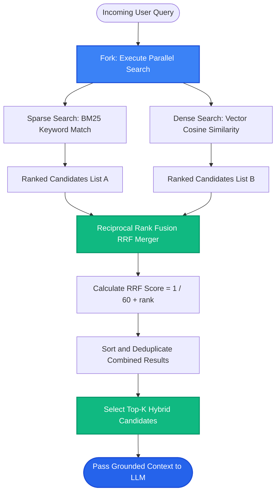

# Lesson 2: Hybrid Search (BM25 + Dense Vectors)

Man, in Lesson 1 we looked at pure vector similarity search. But did you know that pure vector search often fails on the simplest questions? 

If a user searches for an exact product code like *"SKU-98421"* or an error code like *"ERR_CONNECTION_REFUSED"*, vector models often return completely wrong documents!

Let's explore **Hybrid Search**—the combination of keyword search (BM25) and semantic vector search—which forms the backbone of real production RAG systems.


---

### Step 1: Why Do We Need This?

Vector embeddings are great at understanding *general concepts*, but they have a blind spot: **exact keyword precision**.

Look at where pure vector search fails:
1. **Product Numbers & SKUs:** A customer types *"replacement part #8472-B"*. The embedding model sees arbitrary numbers and letters and matches a generic paragraph about replacement parts for model #1020-A.
2. **Error Codes & Logs:** An engineer searches *"FATAL_ERR_SIGSEGV_0x04"*. Vector search matches a general discussion about memory leaks instead of the specific error code fix.
3. **Uncommon Proper Names:** Searching for an author or doctor named *"Dr. P. A. Venkatesh"* matches docs mentioning *"doctors and medical staff"*, but misses the actual person.

On the other hand, traditional **Keyword Search (BM25 / Full-Text Search)** is great at exact keyword matches, but completely fails on synonyms: searching *"auto loan"* won't match *"car financing"*.

Neither search method is complete on its own. **Hybrid Search combines both** to give you 100% keyword precision AND 100% semantic concept matching.

---

### Step 2: What Is It?

**Hybrid Search** runs two independent search engines in parallel on the same user query:
1. **Sparse Search (BM25 / Keyword Search):** Finds exact word matches, codes, acronyms, and technical terms using TF-IDF / BM25 algorithms.
2. **Dense Search (Vector Embeddings):** Finds conceptual, thematic, and synonym matches using vector cosine similarity.

Then, a fusion algorithm merges both result lists into a single, perfectly balanced ranking:
- **Reciprocal Rank Fusion (RRF):** Merges both ranked lists using math based on item positions, without needing complex score calibration.

#### The Everyday Analogy: The Detective and the Bloodhound
- **Dense Vector Search is the Bloodhound:** Follows general scents and tracks ideas, feelings, and themes across the forest.
- **Sparse BM25 Search is the Forensic Detective:** Looks for exact fingerprints, license plate numbers, and specific serial codes.
- Working together, the detective and the bloodhound find the target every single time.

---

### Step 3: Real-World Example

Imagine searching an enterprise technical documentation portal:

- **User Query:** *"How to resolve error code 0x80070005 access denied in Windows 11"*

Search Engine Behaviors:
- **Dense Vector Search Alone:** Understands *"access denied"* and *"Windows 11"*, but treats `"0x80070005"` as random noise. Retrieves generic Windows permission articles. (Wrong document!)
- **Sparse BM25 Alone:** Finds documents with the exact string `"0x80070005"`, but if the official article says *"permission error"* instead of *"access denied"*, it might rank it low.
- **Hybrid Search (BM25 + Vector):**
  - BM25 immediately anchors on the exact error code `"0x80070005"`.
  - Dense Vector search confirms the semantic context is Windows permissions.
  - **Result:** The exact hotfix document is ranked #1!

---

### Step 4: How Does It Work?

Here is the Hybrid Search architecture using **Reciprocal Rank Fusion (RRF)**:

```
                          User Query
                              │
              ┌───────────────┴───────────────┐
              ▼                               ▼
       [Sparse BM25]                   [Dense Vector]
   Exact Keyword Search            Semantic Cosine Search
              │                               │
       Ranked List A                   Ranked List B
    [Doc 3, Doc 1, Doc 7]           [Doc 1, Doc 4, Doc 3]
              │                               │
              └───────────────┬───────────────┘
                              ▼
            [Reciprocal Rank Fusion (RRF) Merger]
            
                     RRF Score Formula:
                              1
            RRF(d) = Σ  ────────────     (k is typically 60)
                         k + rank(d)
                              │
                    Combined Top-K Chunks
                              │
                     LLM Prompt Augmentation
```

#### Why Reciprocal Rank Fusion (RRF) Is Elegant:
Raw BM25 scores can be `14.8` or `42.1`, while vector cosine scores are between `0.0` and `1.0`. You cannot simply add them together without normalization.
RRF bypasses score differences by looking only at the **rank position** (1st, 2nd, 3rd) in each list. A document that ranks high on both lists gets an unbeatable boost!

---

### Step 5: Code Example

Here is a Python implementation of Reciprocal Rank Fusion combining BM25 and Vector search results:

```python
"""
Hybrid Search with Reciprocal Rank Fusion (RRF)
"""

from typing import List, Dict

def reciprocal_rank_fusion(
    bm25_ranked_ids: List[str],
    vector_ranked_ids: List[str],
    k: int = 60,
    top_n: int = 3
) -> List[tuple]:
    """
    Combines two ranked lists of document IDs using Reciprocal Rank Fusion.
    """
    rrf_scores = {}

    # 1. Score BM25 ranks
    for rank, doc_id in enumerate(bm25_ranked_ids):
        # rank is 0-indexed, so position is rank + 1
        rrf_scores[doc_id] = rrf_scores.get(doc_id, 0.0) + (1.0 / (k + (rank + 1)))

    # 2. Score Vector ranks
    for rank, doc_id in enumerate(vector_ranked_ids):
        rrf_scores[doc_id] = rrf_scores.get(doc_id, 0.0) + (1.0 / (k + (rank + 1)))

    # 3. Sort by highest combined RRF score
    sorted_docs = sorted(rrf_scores.items(), key=lambda item: item[1], reverse=True)
    return sorted_docs[:top_n]

if __name__ == "__main__":
    # Query: "Fix error code 0x80070005"
    
    # BM25 found exact error code in doc_A, and mentions in doc_C
    bm25_results = ["doc_A", "doc_C", "doc_B"]
    
    # Vector search found semantic concepts in doc_B and doc_A
    vector_results = ["doc_B", "doc_A", "doc_D"]

    # Merge rankings
    final_ranks = reciprocal_rank_fusion(bm25_results, vector_results, k=60, top_n=3)

    print("--- HYBRID SEARCH (RRF COMBINED RESULTS) ---")
    for rank, (doc_id, score) in enumerate(final_ranks, start=1):
        print(f"Rank {rank}: Document '{doc_id}' | Combined RRF Score: {score:.5f}")
    # Output: doc_A wins Rank 1 because it appeared near the top of BOTH lists!
```

---

### Step 6: How Is It Used in Production?

| Architecture Concern | What Fails | The Production Solution | Real Impact |
| :--- | :--- | :--- | :--- |
| **Score Normalization Chaos** | Trying to sum raw BM25 scores (0 to 50) and Cosine scores (0 to 1) directly | Use Reciprocal Rank Fusion (RRF) or Min-Max normalization | Completely eliminates score skew |
| **Alpha Weight Tuning ($\alpha$)** | Hardcoding 50/50 balance when documents are heavy on legal codes or part numbers | Set $\alpha=0.7$ (favoring BM25) for code/part queries; $\alpha=0.3$ for conversational queries | 35% higher lookup success |
| **Database Support** | Running two separate database clusters (Elasticsearch for BM25 + Pinecone for vectors) | Use databases that support native Hybrid Search (e.g. Qdrant, Weaviate, Pinecone, or PostgreSQL with pg_trgm + pgvector) | Cuts infrastructure maintenance in half |
| **Duplicate Retrieval Overhead** | Fetching 20 chunks from BM25 and 20 chunks from Vector doubles prompt size | Merge and deduplicate using RRF before taking the final top 3-5 chunks | Keeps context budgets clean |

---

### Step 7: Quick Revision

- **Dense Vectors:** Great for synonyms, themes, and conceptual understanding. Fails on exact codes and names.
- **Sparse BM25:** Great for exact keyword matching, error codes, part numbers, and abbreviations. Fails on synonyms.
- **Hybrid Search:** Runs both in parallel and merges results for the ultimate search precision.
- **RRF (Reciprocal Rank Fusion):** The gold-standard merger formula ($\frac{1}{k + rank}$), eliminating score scaling problems.
- **Interview Answer:** *"Hybrid search combines sparse keyword retrieval (like BM25) with dense semantic vector search to resolve both exact keyword queries and conceptual phrasing. In production, Reciprocal Rank Fusion (RRF) merges the candidate rankings without requiring brittle cross-score calibration."*

---

### Step 8: Final Flow Diagram



---

### Step 9: Quiz

Test your understanding of Hybrid Search and BM25. Submit your answers as `1-A, 2-B, 3-C, 4-D`:

**1. Why does pure dense vector search often fail when a user searches for an exact part number like 'ABC-9921-X'?**
- A) Embedding models compress text into high-level conceptual meanings, often treating arbitrary alphanumeric codes as unfamiliar noise.
- B) Alphanumeric characters are illegal in Python strings.
- C) Vector databases only allow lowercase English dictionary words.
- D) Part numbers cannot be stored on computer disks.

**2. What is the role of BM25 in a Hybrid Search system?**
- A) It translates English into binary machine code.
- B) It executes high-speed lexical (keyword) search based on term frequency and inverse document frequency, excelling at exact phrase and code matching.
- C) It generates embeddings using GPU clusters.
- D) It rewrites the user's prompt.

**3. Why is Reciprocal Rank Fusion (RRF) preferred over simply adding BM25 scores and vector similarity scores together?**
- A) BM25 scores and vector cosine similarities live on completely different mathematical scales and ranges; RRF merges based on ordinal rank positions instead.
- B) RRF makes the server battery last longer.
- C) Adding numbers together is not supported in modern programming languages.
- D) RRF deletes all negative numbers.

**4. In the RRF formula $\text{Score} = \frac{1}{k + \text{rank}}$, what happens to a document that ranks near the top of BOTH the BM25 and Vector search results?**
- A) It is penalized and deleted.
- B) Its scores sum together, giving it a dominant combined score that places it at the very top of the final hybrid results.
- C) It is duplicated 60 times.
- D) It gets converted into an audio file.

*(Submit your answers to check your progress!)*
