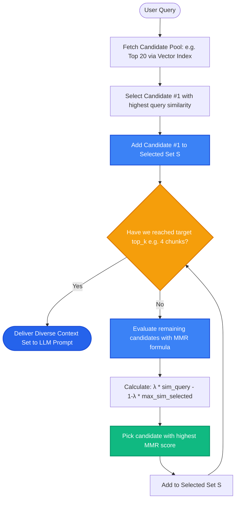

# Lesson 3: Maximal Marginal Relevance (MMR) and Diversity

Man, in Lessons 1 and 2 we learned how to retrieve and merge relevant chunks. But there is a silent trap in pure similarity search: **retrieving 5 identical chunks that repeat the exact same sentence**.

When all retrieved chunks say the same thing, you waste your prompt budget and crowd out other important perspectives. Let's learn how **Maximal Marginal Relevance (MMR)** guarantees both high relevance and rich diversity in your search results.

---

### Step 1: Why Do We Need This?

Imagine an employee searching a large company handbook:
- **User Question:** *"How do I cancel my health insurance coverage?"*

Pure vector similarity search runs and returns the top 4 chunks:
- Chunk 1 (Score 0.94): *"To cancel health insurance, submit Form 104 in the HR portal."*
- Chunk 2 (Score 0.93): *"To cancel health insurance, go to the HR portal and submit Form 104."* (From the onboarding guide)
- Chunk 3 (Score 0.92): *"Health insurance can be canceled via Form 104 in the HR portal."* (From the FAQ summary)
- Chunk 4 (Score 0.91): *"Submitting Form 104 in the HR portal cancels health insurance."* (From the policy update email)

Look at what happened:
- All 4 chunks are 100% relevant, but they all repeat the **exact same single fact**!
- Meanwhile, Chunk 7 (Score 0.81) explained: *"Cancellations take effect on the 1st of the following month, and dental coverage is cancelled automatically alongside it."*
- Because Chunks 2, 3, and 4 hogged all the prompt slots, the user misses the critical information about effective dates and dental cancellation!

We need a search algorithm that asks: *"Is this next chunk both relevant to the question AND adding new information that wasn't already covered?"* That is what MMR does.

---

### Step 2: What Is It?

**Maximal Marginal Relevance (MMR)** is an algorithm that balances **relevance to the query** with **diversity among the selected chunks**.

Instead of picking the top chunks based purely on similarity to the user question, MMR iteratively selects chunks using a dual goal:
1. It rewards chunks that are similar to the **query**.
2. It penalizes chunks that are too similar to **chunks already selected**.

#### The Everyday Analogy: Hiring a Committee
- Imagine you need to hire a 3-person advisory committee for a startup.
- If you only look at test scores, you might hire 3 people who all have identical PhDs in theoretical physics. They are all brilliant, but they all think the exact same way.
- With MMR, you hire the top theoretical physicist first. Then, for the second and third seats, you look for people who are still very smart, but bring different skills—like a software engineer and a marketing director. Your committee is now well-rounded and diverse.

---

### Step 3: Real-World Example

Imagine searching an investment research repository covering a major tech company:

- **User Query:** *"What are the risks and opportunities for Apple in 2026?"*

Search Results Comparison:
- **Standard Similarity Search ($k=3$):**
  - Chunk 1: *"iPhone supply chain constraints in Asia."* (Risk)
  - Chunk 2: *"Component shortages impact iPhone assembly."* (Duplicate Risk)
  - Chunk 3: *"Factory delays slow down iPhone hardware production."* (Duplicate Risk)
  - *Failure:* The LLM only answers about supply chain issues, missing all business opportunities!

- **MMR Search ($\lambda = 0.5, k=3$):**
  - Chunk 1: *"iPhone supply chain constraints in Asia."* (Selected for top query similarity)
  - Chunk 2: *"Services revenue (iCloud, Apple Pay) projected to grow 15%."* (Selected because it is different from Chunk 1)
  - Chunk 3: *"Regulatory antitrust investigations in Europe."* (Selected for novel risk perspective)
  - *Success:* The LLM provides a comprehensive, balanced answer covering both hardware, services, and regulatory risks!

---

### Step 4: How Does It Work?

Here is the MMR selection loop:

```
[Candidate Pool: Top 20 Vector Matches]
                    │
1. Pick Candidate with highest similarity to query ──► Add to Selected Set S
                    │
2. For each remaining Candidate C:
   Calculate MMR Score:
   
   MMR Score = λ * Sim(C, Query) - (1 - λ) * Max_Sim(C, already_selected_in_S)
                    │
3. Pick Candidate with highest MMR Score ──► Add to Selected Set S
                    │
4. Repeat until target k chunks are selected!
```

#### Understanding the Lambda ($\lambda$) Diversity Slider:
The $\lambda$ parameter (between 0.0 and 1.0) controls the trade-off:
- **$\lambda = 1.0$:** 100% relevance, 0% diversity. Identical to standard Top-K search.
- **$\lambda = 0.0$:** 0% relevance, 100% diversity. Returns totally random, disjoint topics.
- **$\lambda = 0.5$ (Production Standard):** Balanced. Rewards relevant chunks, but penalizes near-duplicate content.

---

### Step 5: Code Example

Here is a Python implementation showing how MMR selects diverse, non-redundant chunks:

```python
"""
Maximal Marginal Relevance (MMR) Implementation
"""

import numpy as np
from typing import List, Dict

def cosine_similarity(a: np.ndarray, b: np.ndarray) -> float:
    return float(np.dot(a, b) / (np.linalg.norm(a) * np.linalg.norm(b)))

def maximal_marginal_relevance(
    query_vector: np.ndarray,
    candidate_vectors: List[np.ndarray],
    candidate_docs: List[str],
    lambda_param: float = 0.5,
    top_k: int = 2
) -> List[str]:
    """
    Selects top_k chunks balancing query relevance and inter-chunk diversity.
    """
    selected_indices = []
    remaining_indices = list(range(len(candidate_docs)))

    # Step 1: Select the single chunk most similar to the query
    first_choice = max(
        remaining_indices,
        key=lambda idx: cosine_similarity(query_vector, candidate_vectors[idx])
    )
    selected_indices.append(first_choice)
    remaining_indices.remove(first_choice)

    # Step 2: Iteratively select remaining chunks using MMR formula
    while len(selected_indices) < top_k and remaining_indices:
        best_score = -float("inf")
        best_candidate = None

        for idx in remaining_indices:
            # Query relevance term
            sim_to_query = cosine_similarity(query_vector, candidate_vectors[idx])
            
            # Redundancy penalty term (max similarity to any already selected chunk)
            max_sim_to_selected = max(
                cosine_similarity(candidate_vectors[idx], candidate_vectors[s_idx])
                for s_idx in selected_indices
            )

            # MMR formula
            mmr_score = (lambda_param * sim_to_query) - ((1.0 - lambda_param) * max_sim_to_selected)

            if mmr_score > best_score:
                best_score = mmr_score
                best_candidate = idx

        selected_indices.append(best_candidate)
        remaining_indices.remove(best_candidate)

    return [candidate_docs[i] for i in selected_indices]

if __name__ == "__main__":
    # Query vector pointing towards customer support cancellation
    q_vec = np.array([1.0, 0.0, 0.0])

    # Three candidates: Doc 0 and Doc 1 are nearly identical; Doc 2 has different facts
    docs = [
        "Cancel insurance using Form 104 in the HR portal.",
        "Submit Form 104 in HR portal to cancel insurance.",   # Duplicate idea!
        "Cancellations take effect on the 1st of the next month." # New distinct fact!
    ]
    vectors = [
        np.array([0.98, 0.02, 0.0]),  # Very close to query
        np.array([0.97, 0.03, 0.0]),  # Very close to query AND very close to Doc 0
        np.array([0.80, 0.50, 0.0]),  # Good match to query, but very different from Doc 0
    ]

    # Standard Top-K would pick Doc 0 and Doc 1 (duplicates)
    # MMR with lambda=0.5 picks Doc 0 and Doc 2:
    selected = maximal_marginal_relevance(q_vec, vectors, docs, lambda_param=0.5, top_k=2)
    
    print("--- MMR DIVERSIFIED SELECTION ---")
    for idx, doc in enumerate(selected, start=1):
        print(f"Selection {idx}: {doc}")
```

---

### Step 6: How Is It Used in Production?

| Architecture Knob | Common Mistake | The Production Fix | Impact |
| :--- | :--- | :--- | :--- |
| **Over-Diversifying ($\lambda < 0.2$)** | Setting lambda too low returns chunks that are completely unrelated to the query | Keep $\lambda$ between 0.5 and 0.7 for standard RAG | Ensures relevance while removing duplicates |
| **Running MMR over 100k Vectors** | Calculating all-pairs vector similarity in Python for millions of records is too slow | Retrieve top 20 candidates using fast vector search, then run MMR *only* on those 20 | Sub-10ms diversity execution |
| **Ignoring Chunk Overlap** | Consecutive chunks generated with 20% overlap naturally repeat sentences | MMR automatically penalizes and skips the overlapping twin chunk | Eliminates boundary repetition |
| **Combining with Metadata** | Applying MMR without metadata filters can pull diverse chunks from wrong departments | Always execute metadata pre-filtering *before* running MMR | Guarantees compliance and diversity |

---

### Step 7: Quick Revision

- **The Duplicate Problem:** Standard similarity search often returns multiple chunks repeating the exact same sentence.
- **MMR = Relevance - Redundancy:** Maximizes query similarity while penalizing similarity to already chosen chunks.
- **Lambda ($\lambda$) Tuning:**
  - $\lambda = 1.0$: Pure similarity (duplicates allowed).
  - $\lambda = 0.5$: Balanced (the industry standard).
  - $\lambda = 0.0$: Pure diversity.
- **Two-Stage Execution:** Fetch candidate pool (e.g. 20 chunks) via database index, then apply MMR in-memory to select top 3-5 diverse chunks.
- **Interview Answer:** *"Maximal Marginal Relevance (MMR) prevents information redundancy in RAG prompts by penalizing chunks that are mathematically similar to documents already selected. It ensures the retrieved context contains diverse, complementary evidence rather than duplicate variations of a single passage."*

---

### Step 8: Final Flow Diagram



---

### Step 9: Quiz

Test your understanding of Maximal Marginal Relevance (MMR). Submit your answers as `1-A, 2-B, 3-C, 4-D`:

**1. What failure mode in pure vector similarity search does MMR eliminate?**
- A) Database network timeouts.
- B) Retrieving multiple redundant chunks that say the exact same thing, which wastes token space and crowds out other helpful facts.
- C) Accidental deletion of files from the server.
- D) Embedding dimension mismatches.

**2. What happens if you set the MMR parameter $\lambda = 1.0$?**
- A) The search becomes identical to standard Top-K similarity search with zero diversity penalty.
- B) The retriever returns completely random documents.
- C) The vector database crashes.
- D) All documents are deleted.

**3. In the MMR formula, what is the purpose of the term `(1 - λ) * max(similarity to already selected chunks)`?**
- A) It speeds up the computer processor.
- B) It penalizes candidates that are too similar to documents already picked, promoting novel and diverse information.
- C) It translates foreign text.
- D) It checks if the user is an admin.

**4. Why is MMR typically executed on a small candidate pool (e.g. 20 chunks) rather than across the entire database of 100,000 vectors?**
- A) Running the all-pairs similarity comparisons required by MMR across 100,000 vectors in memory would be far too slow, whereas running it on 20 candidates takes less than 2 milliseconds.
- B) Python can only count up to 20.
- C) Embeddings lose their values if compared to more than 20 items.
- D) Databases do not allow numbers higher than 20.

*(Submit your answers to check your progress!)*
