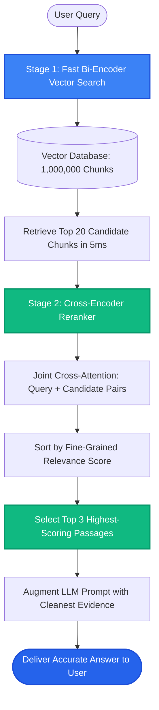

# Lesson 1: Cross-Encoder Reranking

Man, welcome to Phase 9! In Phase 8, we learned how to retrieve candidates using vector and hybrid search. But here is the hard truth about vector search: **the top-ranked vector match is rarely the best answer to your question**.

Vector search is fast, but it is shallow. To achieve maximum accuracy, production RAG systems use a two-stage pipeline: **fast retrieval with a Bi-Encoder, followed by high-precision reranking with a Cross-Encoder**.


---

### Step 1: Why Do We Need This?

Vector search compares two vectors that were created independently:
- The document chunk was converted into a vector last month.
- The user query was converted into a vector two seconds ago.
- The two texts never interact directly. The model merely checks if both vectors point in a roughly similar direction.

Because vector search is an approximation, the exact ranking of the top 10 results is often scrambled:
- Chunk #1 might be a general overview that shares similar vocabulary.
- Chunk #7 might contain the exact, perfect answer to the question!

If you only send the top 3 chunks to the LLM, you send Chunk #1 and miss Chunk #7. We need a way to carefully re-score that top candidate list so the truly relevant answers bubble up to the very top.

---

### Step 2: What Is It?

To understand reranking, you must know the difference between two model architectures:

1. **Bi-Encoder (What Vector Databases Use):**
   - Encodes text into a vector in isolation.
   - Fast enough to search through 10,000,000 documents in 5 milliseconds.
   - **Weakness:** Cannot perform full cross-attention between the words in the query and the words in the document.

2. **Cross-Encoder (The Reranker):**
   - Feeds the user question and the candidate document into the transformer neural network **together** at the same time: `[CLS] Query [SEP] Document [SEP]`.
   - Every word in the query directly attends to every word in the document.
   - Outputs a precise relevance score between 0.0 and 1.0.
   - **Strength:** Unmatched precision.
   - **Weakness:** Too slow to run across millions of documents, but fast enough to score 20 candidates!

#### The Everyday Analogy: The Resume Screener vs The Hiring Manager
- **Bi-Encoder (Vector Search) is the automated resume screener:** Scans 10,000 resumes in 10 seconds for general keywords and narrows the stack down to 20 candidates.
- **Cross-Encoder (Reranker) is the human hiring manager:** Carefully interviews each of those 20 candidates face-to-face, digs into specific project details, and picks the top 3 to hire.
- You would never ask the hiring manager to interview 10,000 people, but you definitely want them to make the final decision on the top 20!

---

### Step 3: Real-World Example

Imagine searching an internal corporate security knowledge base:

- **User asks:** *"Can contractors access production databases via VPN?"*
- **Vector Search (Bi-Encoder) Top 3 Results:**
  - Result 1 (Score 0.88): *"General VPN installation and setup guide for employees."* (Matches "VPN" and "access")
  - Result 2 (Score 0.87): *"Database password rotation guidelines."* (Matches "database")
  - Result 3 (Score 0.84): *"Third-party vendor access overview."*
- Notice that Result 6 was: *"Contractors are strictly prohibited from connecting to production database clusters via VPN without VP approval."* (The exact answer!)
- **When the Cross-Encoder Reranker runs on the top 10 candidates:**
  - It cross-attends *"contractors"*, *"access"*, and *"VPN"*.
  - It scores Result 6 at **0.97** and moves it to **Rank #1**!
  - It downgrades Result 1 to **0.25**!
  - The LLM receives the correct answer at the very top of the prompt.

---

### Step 4: How Does It Work?

Here is the two-stage production RAG pipeline:

```
[STAGE 1: HIGH RECALL - FAST]
User Query ──► Bi-Encoder Vector Search ──► Fetch Top 20 Candidates (< 10 ms)
                                                    │
                                             Top 20 Chunks
                                                    │
[STAGE 2: HIGH PRECISION - DEEP]
Cross-Encoder Model (e.g. BGE-Reranker / Cohere Rerank)
Takes (Query + Chunk) pairs simultaneously into full attention layers (< 40 ms)
                                                    │
                                             Re-Scored & Re-Sorted
                                                    │
                                             Top 3 Best Passages
                                                    │
                                      Pass to LLM Prompt Template
```

#### Why Two Stages Win:
- Trying to search 1,000,000 documents with a Cross-Encoder would take 30 minutes per query.
- Using a Bi-Encoder alone gives only 70% accuracy on complex queries.
- Combining both (Bi-Encoder for candidate fetch + Cross-Encoder for top 20 rerank) gives **95%+ accuracy in under 50 milliseconds**!

---

### Step 5: Code Example

Here is a Python script using `sentence-transformers` demonstrating how a Cross-Encoder reranks candidate chunks:

```python
"""
Two-Stage Retrieval: Bi-Encoder Candidate Search + Cross-Encoder Reranker
Requires: pip install sentence-transformers
"""

from typing import List
from sentence_transformers import CrossEncoder

def rerank_candidates(query: str, candidate_chunks: List[str], top_k: int = 2) -> List[tuple]:
    """
    Reranks candidate chunks using a transformer Cross-Encoder model.
    """
    # Load lightweight local cross-encoder model
    # (In production, use models like 'BAAI/bge-reranker-base' or Cohere Rerank API)
    reranker = CrossEncoder("cross-encoder/ms-marco-MiniLM-L-6-v2")

    # Build (query, document) pairs
    pairs = [[query, chunk] for chunk in candidate_chunks]

    # Predict relevance scores (higher = better)
    scores = reranker.predict(pairs)

    # Pair candidates with their new cross-encoder scores
    scored_candidates = list(zip(candidate_chunks, scores))

    # Sort descending by cross-encoder score
    scored_candidates.sort(key=lambda x: x[1], reverse=True)

    return scored_candidates[:top_k]

if __name__ == "__main__":
    user_query = "Can contractors connect to the production database via VPN?"

    # Initial candidate chunks retrieved by fast vector search
    # Notice the best answer was buried at the bottom (index 2)!
    initial_chunks = [
        "All employees must configure Cisco AnyConnect VPN for remote work.",
        "Production database credentials are rotated every 90 days by DevOps.",
        "Contractors are strictly prohibited from production database VPN access without VP approval."
    ]

    print("Running Cross-Encoder Reranker...")
    top_picks = rerank_candidates(user_query, initial_chunks, top_k=2)

    print("\n--- FINAL RERANKED PASSAGES ---")
    for rank, (chunk, score) in enumerate(top_picks, start=1):
        print(f"Rank {rank} (Score: {score:.4f}):\n  '{chunk}'\n")
```

---

### Step 6: How Is It Used in Production?

| Architecture Aspect | Common Mistake | The Production Solution | Real Impact |
| :--- | :--- | :--- | :--- |
| **Reranking Too Many Chunks** | Passing 100 chunks to a Cross-Encoder adds 500ms of latency | Pass only the top 15 to 25 candidates from initial vector search | Keeps reranker latency under 40ms |
| **Omitting Reranking Altogether** | Assuming vector search rankings are accurate enough | Benchmark retrieval accuracy; rerankers reliably boost recall by 20-30% | Massive reduction in hallucinations |
| **API Costs vs Local Inference** | Paying Cohere per-rerank API calls on millions of daily requests | Host an open-source reranker model (`bge-reranker-large`) on a local GPU | Cuts API expenses to zero |
| **Truncating Long Chunks** | Cross-encoders have input token limits (e.g. 512 tokens); long chunks get cut off | Keep chunks under 400 tokens so the query and chunk fit inside the reranker | Prevents loss of evidence |

---

### Step 7: Quick Revision

- **Bi-Encoder:** Embeds query and doc separately. Extremely fast ($O(1)$ index search); used for initial candidate retrieval.
- **Cross-Encoder:** Processes query and doc together. Full self-attention across all words. Extremely accurate; used for reranking.
- **The Two-Stage Rule:** Retrieve 20 candidates with Bi-Encoder; rerank down to the top 3-5 with Cross-Encoder.
- **Low Latency Budget:** Reranking 20 candidates adds only 20–40ms, making it a no-brainer for production systems.
- **Interview Answer:** *"Bi-encoders produce independent vectors for high-speed candidate retrieval, but lack cross-attention between query and document terms. Cross-encoder rerankers jointly attend over the query and candidate text to calculate true semantic relevance, elevating the highest-quality passages into the prompt."*

---

### Step 8: Final Flow Diagram



---

### Step 9: Quiz

Test your understanding of cross-encoder reranking. Submit your answers as `1-A, 2-B, 3-C, 4-D`:

**1. Why can't we use a Cross-Encoder to search directly across 1,000,000 documents instead of using a vector database?**
- A) Cross-encoders do not understand English.
- B) A cross-encoder must pass the query and document together through a transformer model; running that across 1M docs would take minutes per query.
- C) Cross-encoders can only run on iPhones.
- D) Databases do not allow cross-encoders.

**2. What is the fundamental architectural difference between a Bi-Encoder and a Cross-Encoder?**
- A) Bi-encoders only work with numbers, while cross-encoders only work with text.
- B) Bi-encoders embed query and document independently into vectors, whereas cross-encoders process query and document simultaneously with joint self-attention.
- C) Bi-encoders require an internet connection.
- D) Cross-encoders were invented in 1980.

**3. In a typical two-stage production RAG pipeline, how many candidate chunks should you send to the reranker?**
- A) 100,000 chunks.
- B) 15 to 25 chunks.
- C) Exactly 1 chunk.
- D) 0 chunks.

**4. What happens when a relevant document was ranked #8 by the initial vector search?**
- A) It is permanently deleted.
- B) The cross-encoder evaluates its exact contextual relevance and promotes it to Rank #1 or #2 so it reaches the LLM prompt.
- C) The vector database crashes.
- D) The user must retype their question.

*(Submit your answers to check your progress!)*
