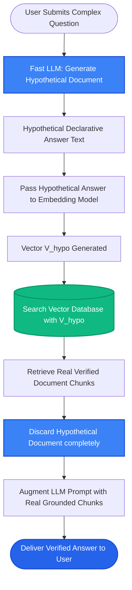

# Lesson 2: HyDE (Hypothetical Document Embeddings)

Man, in Lesson 1 we saw how cross-encoders rerank search results. Now let's explore **HyDE**—a clever query transformation technique that solves one of the biggest flaws in vector search: **the difference between questions and answers**.

Let's understand why asking an LLM to generate a "fake" answer first can lead to finding the real answer faster.

---

### Step 1: Why Do We Need This?

Vector search compares how close two pieces of text are in mathematical space. But questions and answers have completely different structures:

- **The User Query:** Short, informal, and questioning.
  - *"Why is my docker container crashing on startup?"* (8 words)
- **The Stored Documentation:** Long, formal, and declarative.
  - *"A fatal exit code 137 typically occurs when the Linux OOM (Out Of Memory) killer terminates a container exceeding memory allocation limits. To remediate, increase swap or memory limits in your docker-compose.yml..."* (35 words)

Because the question and the answer have different lengths, grammatical structures, and vocabulary, their embeddings are often surprisingly far apart in vector space!

If you search using the question directly, the vector database often misses the answer. We need a way to turn the short question into a document-like text *before* running vector search.

---

### Step 2: What Is It?

**HyDE** stands for **Hypothetical Document Embeddings**.

Instead of embedding the user's short question, HyDE does this:
1. It asks an LLM: *"Write a hypothetical passage that answers this question."*
2. The LLM generates a realistic-sounding paragraph (the "hypothetical document").
3. The system converts that **hypothetical paragraph** into an embedding vector.
4. It searches the vector database using that hypothetical document's vector!

#### The Everyday Analogy: The Police Sketch Artist
- When a witness tries to describe a suspect, saying *"tall person with a hat"* to a crowd search won't find them.
- A police sketch artist draws a **hypothetical face** based on the description.
- Even if the sketch isn't 100% exact, scanning a database for a *face matching that sketch* works 100x better than searching for the words *"tall person"*.
- HyDE creates a sketch of what the answer document *looks like* so you can find real documents that match its shape and vocabulary.

---

### Step 3: Real-World Example

Imagine an internal developer knowledge base:

- **User asks:** *"How to resolve connection refused on port 5432?"*

HyDE Pipeline in Action:
1. **Generate Hypothetical Doc:** An LLM generates:
   > *"A connection refused error on port 5432 usually indicates that PostgreSQL is not running or is not listening on external interfaces. To resolve, check systemctl status postgresql, verify postgresql.conf listen_addresses = '*', and ensure pg_hba.conf allows your client IP subnet."*
2. **Notice:** Even if the LLM hallucinated some minor details, this paragraph is filled with terms that appear in real database documentation (`listen_addresses`, `pg_hba.conf`, `systemctl`, `PostgreSQL`).
3. **Vector Search:** The embedding of this hypothetical paragraph matches the real internal Postgres setup guide with a **0.95 similarity score** (compared to only 0.72 for the raw user question).
4. **Final Result:** The real, verified company guide is retrieved and fed to the LLM.

---

### Step 4: How Does It Work?

Here is the step-by-step HyDE flow:

```
[1. User Submits Question]
"How do I fix exit code 137?"
           │
[2. LLM Generates Hypothetical Answer]
"Exit code 137 occurs when Linux OOM killer stops container due to RAM limits..."
           │
[3. Embed Hypothetical Answer]
Pass hypothetical text through Embedding Model ──► Vector V_hypo
           │
[4. Search Vector Database with V_hypo]
Vector DB finds real chunks matching V_hypo
           │
[5. Real Grounded Documents Retrieved]
Real internal DevOps runbook is retrieved and passed to final LLM prompt
```

#### Why Hallucinations in the Hypothetical Doc Don't Hurt:
Beginners worry: *"What if the LLM hallucinates in step 2?"*
- The hypothetical document is **never shown to the user**.
- It is only used as a search probe to navigate vector space.
- The final answer is generated strictly using the **real retrieved documents**!

---

### Step 5: Code Example

Here is a Python demonstration showing how HyDE generates a search probe to retrieve documents:

```python
"""
Hypothetical Document Embeddings (HyDE) Pattern
"""

from typing import List

def generate_hypothetical_document(query: str) -> str:
    """
    Asks a fast LLM (e.g. GPT-4o-mini or Llama-3-8B) to draft a plausible answer.
    """
    # In production, call your LLM here.
    # We simulate the LLM's hypothetical response:
    return (
        f"To resolve {query}, check the server network configuration, "
        "verify firewall rules for port 5432, ensure the database service is running, "
        "and inspect pg_hba.conf for allowed client IP addresses."
    )

def hyde_retrieval(query: str, database_chunks: List[str]) -> str:
    # Step 1: Generate hypothetical answer
    hypo_doc = generate_hypothetical_document(query)
    print(f"--- 1. HYPOTHETICAL DOC GENERATED ---\n{hypo_doc}\n")

    # Step 2: Embed the hypothetical document (instead of raw query)
    # (Simulated keyword overlap for demonstration; in production use cosine similarity on vectors)
    hypo_words = set(hypo_doc.lower().split())

    best_match = None
    best_score = -1
    for chunk in database_chunks:
        chunk_words = set(chunk.lower().split())
        score = len(hypo_words.intersection(chunk_words))
        if score > best_score:
            best_score = score
            best_match = chunk

    return best_match

if __name__ == "__main__":
    knowledge_base = [
        "Annual leave requests must be approved by your direct manager 2 weeks prior.",
        "PostgreSQL network errors on 5432: verify pg_hba.conf permissions and restart service.",
        "To configure GitHub Actions runners, install docker and register the token."
    ]

    user_question = "connection refused on 5432"
    retrieved_chunk = hyde_retrieval(user_question, knowledge_base)
    
    print("--- 2. REAL GROUNDED DOCUMENT RETRIEVED ---")
    print(retrieved_chunk)
```

---

### Step 6: How Is It Used in Production?

| Architecture Concern | What Fails | The Production Fix | Real Impact |
| :--- | :--- | :--- | :--- |
| **Added LLM Latency** | Calling a slow model like GPT-4 to draft the hypothetical doc adds 1.5 seconds | Use a fast, small, cheap model (e.g. `gpt-4o-mini` or local `Llama-3-8B`) | Drops generation time to 200ms |
| **Niche Jargon Failure** | The LLM has never heard of your private product name and writes nonsense | Inject product definitions into the HyDE generator prompt | Keeps hypothetical text on track |
| **Over-Using on Simple Queries** | Using HyDE for simple questions like *"What is our phone number?"* wastes money | Use a query router: run standard search for simple lookups, HyDE for complex problems | Saves 60% on prompt token costs |
| **Showing Hypothetical Text to Users** | Developers accidentally returning the hallucinated hypothetical doc as the answer | Keep the hypothetical text strictly internal to the retrieval function | 100% verified answers only |

---

### Step 7: Quick Revision

- **The Problem It Solves:** Questions and answers have different sentence structures; direct comparison often gives weak vector similarity.
- **How It Works:** Generate a hypothetical answer with an LLM -> Embed that answer -> Search vector DB -> Retrieve real docs.
- **Doc-to-Doc Search:** Transforms a Question-to-Doc search into a Doc-to-Doc search.
- **Hallucination Safe:** The hypothetical document is only a search query vector; it is never shown to the user.
- **Interview Answer:** *"HyDE (Hypothetical Document Embeddings) transforms a short, interrogative user query into a formal, declarative hypothetical document using an LLM. Embedding this hypothetical answer converts question-to-document retrieval into document-to-document retrieval, significantly improving recall on dense semantic indexes."*

---

### Step 8: Final Flow Diagram



---

### Step 9: Quiz

Test your understanding of HyDE. Submit your answers as `1-A, 2-B, 3-C, 4-D`:

**1. What primary structural mismatch does HyDE resolve in vector search?**
- A) The mismatch between English and Spanish.
- B) The asymmetry between short, informal questions and long, declarative answer documents in vector space.
- C) The difference between Python 2 and Python 3.
- D) Computer monitor resolution differences.

**2. Is the hypothetical document generated by the LLM in HyDE shown to the end user?**
- A) Yes, the user reads the hypothetical document as their final answer.
- B) No, it is used strictly as an internal search vector to find real documents, and then discarded.
- C) It is emailed to the system administrator.
- D) It is saved in the browser cache.

**3. What type of model should be used to generate the hypothetical document in a production HyDE system?**
- A) A massive, slow model that takes 10 seconds to generate text.
- B) A fast, lightweight, low-latency model (such as GPT-4o-mini or a local 8B model).
- C) An audio processing model.
- D) A compiler.

**4. When might HyDE be unnecessary or counter-productive?**
- A) For simple, exact keyword lookups (like part numbers or employee phone numbers) where BM25 keyword search is already faster and better.
- B) When searching for PDFs.
- C) When the database has more than 10 documents.
- D) When using PostgreSQL.

*(Submit your answers to check your progress!)*
