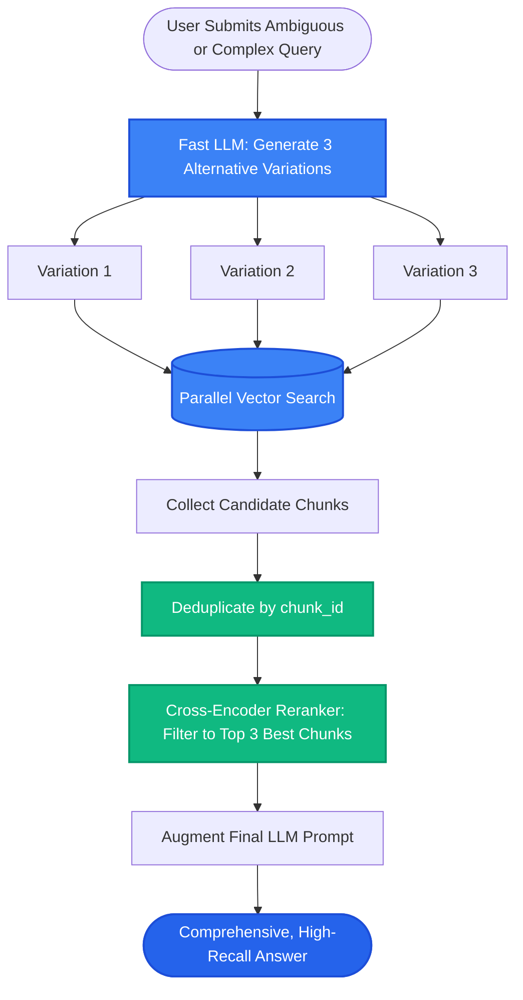

# Lesson 3: Query Expansion and Multi-Query Retrieval

Man, in Lessons 1 and 2 we saw reranking and HyDE. But what if the user's original question is vague, incomplete, or asks two completely different things in a single sentence?

If you only search for the user's exact raw words, you miss half the required documents. Let's learn how **Query Expansion** and **Multi-Query Retrieval** turn a single prompt into multiple search angles to guarantee high recall.

---

### Step 1: Why Do We Need This?

Real users rarely write perfect search queries. In production, you face two common user habits:

1. **The Terse, Ambiguous Query:**
   - A user types: *"Postgres speed"*
   - What do they actually want? Index tuning? Connection pooling? RAM allocation? Slow query logs?
   - A single vector embedding of *"Postgres speed"* will only match a narrow cluster of general overview articles.
2. **The Complex Multi-Part Question:**
   - A user asks: *"How does our US maternity leave policy compare to our European parental leave?"*
   - A single vector search tries to match both US and European documents in one go. Because documents are stored in separate regional folders, the search compromises and returns incomplete snippets from neither or only one.

If you rely on a single vector search per user message, you leave critical information behind.

---

### Step 2: What Is It?

There are two primary query transformation patterns:

1. **Multi-Query Retrieval (Query Expansion):**
   - An LLM takes the user's prompt and generates **3 to 5 different variations** written from different perspectives and using alternative vocabulary.
   - The system executes all variations against the vector database in parallel.
   - It merges and deduplicates all retrieved chunks.

2. **Sub-Query Decomposition:**
   - Takes a complex multi-part question and breaks it down into **independent sub-questions**.
   - Each sub-question is retrieved separately, and the answers are combined into a final synthesis.

#### The Everyday Analogy: Casting Multiple Fishing Nets
- Searching with a single user query is like throwing a single tiny fishing hook into a lake. If the fish swim 5 feet to the left, you catch nothing.
- Multi-Query Retrieval is throwing **four wide fishing nets from different sides of the boat**. You sweep the entire lake and catch all the fish, then throw back the duplicates on the deck.

---

### Step 3: Real-World Example

Imagine searching an enterprise customer support wiki:

- **User types:** *"cancel membership"*

Multi-Query Generator produces 3 variations:
1. *"How do I cancel my subscription in the billing settings?"*
2. *"Refund request procedure and account deactivation rules."*
3. *"Steps to stop automatic monthly billing renewal."*

Execution:
- Query 1 finds: The billing settings guide.
- Query 2 finds: The refund timeline policy.
- Query 3 finds: The auto-renewal switch guide.
- **Combined Result:** All three relevant guides are brought together. The LLM produces a complete, helpful answer explaining how to cancel, when renewals stop, and how to request a refund!

---

### Step 4: How Does It Work?

Here is the Multi-Query execution pipeline:

```
[User Question]
"cancel membership"
       │
[LLM Query Expander]
Generates 3 Alternate Perspectives:
- Q₁: "Subscription cancellation steps"
- Q₂: "Refund and billing deactivation"
- Q₃: "Stop auto-renewal"
       │
[Parallel Retrieval (Async)]
Q₁ ──► Vector Search ──► Chunks [A, B]
Q₂ ──► Vector Search ──► Chunks [B, C]
Q₃ ──► Vector Search ──► Chunks [D, A]
       │
[Deduplicate & Merge: Unique Chunks [A, B, C, D]]
       │
[Cross-Encoder Reranker: Pick Top 3 Chunks]
       │
[Pass to Final LLM Prompt]
```

#### Sub-Query Decomposition for Multi-Part Questions:
When a query asks: *"Compare Acme's 2024 revenue vs 2025 revenue"*
- Sub-query 1: *"What was Acme's total revenue in 2024?"* -> Retrieves 2024 annual report.
- Sub-query 2: *"What was Acme's total revenue in 2025?"* -> Retrieves 2025 annual report.
- Final LLM receives both reports and writes the comparison.

---

### Step 5: Code Example

Here is a Python implementation showing how Multi-Query expansion generates variations, runs parallel searches, and deduplicates chunks:

```python
"""
Multi-Query Expansion and Retrieval Pattern
"""

from typing import List, Set

def expand_query_with_llm(user_query: str) -> List[str]:
    """
    Asks an LLM to generate 3 alternative search variations.
    (Simulated for demonstration)
    """
    # In production, call: llm.invoke("Generate 3 alternative search queries for: ...")
    return [
        user_query,
        f"How to {user_query} in account settings",
        f"Official policy and rules regarding {user_query}",
        f"Troubleshooting issues when attempting to {user_query}"
    ]

def multi_query_retrieval(user_query: str, database: List[dict]) -> List[str]:
    # 1. Expand query into variations
    variations = expand_query_with_llm(user_query)
    print(f"Generated {len(variations)} search variations:")
    for v in variations:
        print(f"  - '{v}'")

    # 2. Retrieve for each query and collect unique chunks
    unique_chunk_ids: Set[str] = set()
    retrieved_chunks = []

    for query_var in variations:
        q_words = set(query_var.lower().split())
        for doc in database:
            doc_words = set(doc["text"].lower().split())
            if len(q_words.intersection(doc_words)) > 0:
                if doc["id"] not in unique_chunk_ids:
                    unique_chunk_ids.add(doc["id"])
                    retrieved_chunks.append(doc["text"])

    return retrieved_chunks

if __name__ == "__main__":
    mock_db = [
        {"id": "doc_1", "text": "Users can cancel membership in Settings > Billing."},
        {"id": "doc_2", "text": "Refund policy allows requests within 7 days."},
        {"id": "doc_3", "text": "If cancel button is disabled, contact support."}
    ]

    results = multi_query_retrieval("cancel membership", mock_db)
    print("\n--- DEDUPLICATED RETRIEVED CHUNKS ---")
    for r in results:
        print(f"- {r}")
```

---

### Step 6: How Is It Used in Production?

| Architecture Aspect | What Fails | The Production Fix | Real Impact |
| :--- | :--- | :--- | :--- |
| **Increased Database Load** | Expanding every query to 5 variations creates 5x more database queries | Run sub-queries asynchronously in parallel (`asyncio.gather`) | Total search latency stays under 30ms |
| **Prompt Token Explosion** | 4 queries returning 5 chunks each results in 20 chunks flooding the prompt | Deduplicate by chunk ID and pass results through a Cross-Encoder reranker | Keeps prompt tokens within budget |
| **Drifting Off-Topic** | LLM generates bizarre or overly broad query variations | Use strict system prompt guidelines: *"Generate 3 synonyms focusing strictly on the user's explicit intent"* | Prevents off-topic noise |
| **Cost of Query Expansion** | Calling GPT-4 for query expansion adds cost and 800ms of latency | Use lightweight fast models (e.g. `gpt-4o-mini`, `claude-3-haiku`, or fine-tuned 3B model) | Expansion takes < 150ms and costs fractions of a cent |

---

### Step 7: Quick Revision

- **The Single-Query Blindspot:** A single prompt only captures one phrasing; synonyms and related rules get missed.
- **Multi-Query Expansion:** Generates 3-5 variations using different perspectives, retrieves in parallel, and deduplicates.
- **Sub-Query Decomposition:** Slices multi-part questions into individual atomic searches.
- **Always Deduplicate:** Use a `Set` of chunk IDs or a Reranker to keep prompt budgets clean.
- **Interview Answer:** *"Multi-Query Retrieval uses an LLM to generate multiple semantic variations of a user's prompt, executing them in parallel across the vector store to overcome vocabulary mismatches and maximize recall. For complex comparison questions, Sub-Query Decomposition breaks the query into discrete sub-tasks before synthesizing a final answer."*

---

### Step 8: Final Flow Diagram



---

### Step 9: Quiz

Test your understanding of query expansion and multi-query retrieval. Submit your answers as `1-A, 2-B, 3-C, 4-D`:

**1. Why does a single vector search often fail to retrieve all necessary documents for an ambiguous user query?**
- A) Vector databases can only store 1 word per document.
- B) A single phrasing only navigates to one specific neighborhood in vector space, missing documents that describe the same solution using different words or sub-topics.
- C) Ambiguous queries automatically delete the database.
- D) Single queries cannot be translated into numbers.

**2. What is 'Sub-Query Decomposition'?**
- A) Breaking down a complex, multi-part user question into individual atomic questions that can each be searched independently.
- B) Deleting sub-folders from the server.
- C) Removing punctuation from queries.
- D) Splitting words into individual letters.

**3. What must you always do before passing the results of multi-query search to the final LLM prompt?**
- A) Translate all chunks into French.
- B) Deduplicate the chunks so that documents matched by multiple query variations are not repeated in the prompt.
- C) Delete the user's account.
- D) Turn off the vector database.

**4. How can you prevent Multi-Query retrieval from significantly increasing total user response latency?**
- A) Run the search queries sequentially in a slow loop.
- B) Execute the multiple vector queries asynchronously in parallel using a fast, lightweight LLM for the expansion step.
- C) Disable all vector indexing.
- D) Only allow users to ask 1 question per day.

*(Submit your answers to check your progress!)*
