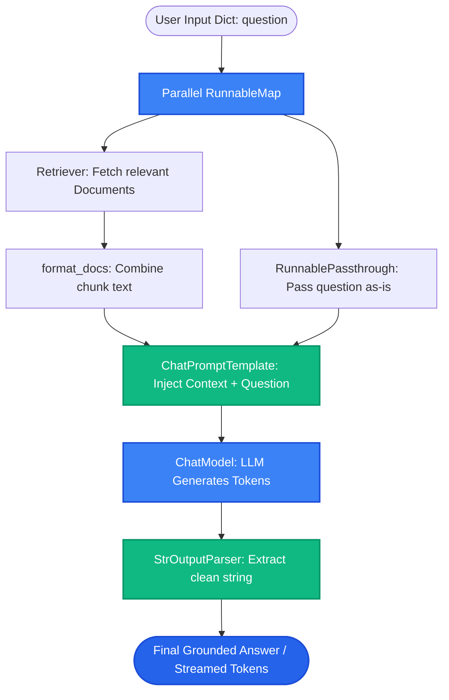

# Lesson 1: LangChain Core Concepts for RAG

Man, welcome to Phase 10! In Phases 1 through 9, we built every component of RAG by hand: loaders, chunkers, embeddings, vector databases, and rerankers. 

Now, how do you wire all these pieces together cleanly without writing hundreds of lines of brittle boilerplate code? Let's explore **LangChain** and **LCEL (LangChain Expression Language)**.


---

### Step 1: Why Do We Need This?

If you build RAG systems by manually gluing APIs together with raw Python, you run into three big problems:
1. **Brittle Provider Lock-in:** Your code is tightly coupled to specific SDKs (e.g., `openai.embeddings.create` and `pinecone.Index`). If your team decides to switch to local Ollama models or pgvector, you have to rewrite your entire codebase.
2. **Boilerplate Explosion:** Every new feature requires re-implementing streaming, async execution (`asyncio`), retries, error handling, and prompt interpolation by hand.
3. **Loss of Observability:** When a complex pipeline fails, you have to write manual logging code for every single step to figure out what prompt was sent and what raw text came back.

LangChain provides standardized, modular building blocks that snap together like Lego bricks, making your RAG code clean, provider-agnostic, and production-ready.

---

### Step 2: What Is It?

**LangChain** is an orchestration framework for building applications powered by large language models.

Its modern core is built on **LCEL (LangChain Expression Language)**, which uses the Unix pipe operator (`|`) to connect components into streamlined pipelines:

```python
chain = prompt | model | output_parser
```

#### Core LangChain Primitives for RAG:
- **`Document`:** Standardized container with `page_content` (the text) and `metadata` (dict of attributes).
- **`Embeddings`:** Standardized interface for turning text into vectors (`embed_documents`, `embed_query`).
- **`VectorStore`:** Common interface wrapping any database (Chroma, Pinecone, pgvector) with `.as_retriever()`.
- **`Retriever`:** A unified component that takes a query string and returns a list of `Document` objects.
- **`ChatPromptTemplate`:** Formats messages with dynamic variable substitutions.
- **`ChatModel`:** Unified interface for LLMs (OpenAI, Anthropic, Ollama, HuggingFace).
- **`StrOutputParser`:** Extracts the clean text string from raw LLM message responses.

#### The Everyday Analogy: Standardized Power Plugs
- Imagine if every appliance in your house had a unique, proprietary plug shape: a triangular plug for your lamp, a round plug for your microwave, and a hex plug for your TV. Swapping appliances would require rewiring your walls!
- LangChain is the **universal wall outlet**. Whether you plug in an OpenAI model or an Anthropic model, a Pinecone store or a Chroma store, they all share the exact same plug shape (the `Runnable` interface).

---

### Step 3: Real-World Example

Imagine building a multi-provider AI assistant:

- In **Development**, you want to run completely free and offline:
  - Local embeddings via HuggingFace + local Chroma vector store + local Ollama Llama-3 model.
- In **Production**, you want to scale in the cloud:
  - OpenAI embeddings + Pinecone vector database + Claude 3.5 Sonnet model.

With LangChain, your core RAG chain logic stays **100% identical**:
```python
# The chain never changes:
rag_chain = (
    {"context": retriever | format_docs, "question": RunnablePassthrough()}
    | prompt_template
    | chat_model
    | StrOutputParser()
)
```
To switch from local dev to production, you simply swap the `retriever` and `chat_model` variables. Zero application rewrites!

---

### Step 4: How Does It Work?

Every modern LangChain component implements the **Runnable Protocol**:

```
[The Runnable Standard Interface]
- .invoke(input)    ──► Synchronous single execution
- .ainvoke(input)   ──► Asynchronous execution (non-blocking)
- .stream(input)    ──► Real-time token streaming
- .batch(inputs)    ──► Parallel batch execution across multiple inputs
```

Because every component shares these exact methods, the Linux pipe operator (`|`) chains them together seamlessly:
The output of the component on the left becomes the input to the component on the right.

```
Input Dict: {"question": "..."}
               │
        [Retriever & Format Docs]
               │
Prompt Template: Context + Question combined
               │
        [Chat Model: LLM]
               │
    [StrOutputParser: Clean Text]
               │
Output String: "Grounded Answer"
```

---

### Step 5: Code Example

Here is a clean, modern Python script showing a minimal LCEL chain:

```python
"""
Minimal LCEL Chain Demonstration (LangChain modern standard)
Requires: pip install langchain-core langchain-xai
"""

import os
from langchain_core.prompts import ChatPromptTemplate
from langchain_core.output_parsers import StrOutputParser
from langchain_core.runnables import RunnablePassthrough
from langchain_xai import ChatXAI

def run_lcel_chain_demo():
    # 1. Initialize Model
    # (Requires XAI_API_KEY environment variable)
    model = ChatXAI(model="grok-2-latest", temperature=0)

    # 2. Define Prompt Template
    prompt = ChatPromptTemplate.from_template("""
    You are a technical support assistant.
    Answer the question based ONLY on the provided context:
    
    Context:
    {context}
    
    Question: {question}
    """)

    # 3. Simulate a retriever function
    def fake_retriever(query: str) -> str:
        return "SkillVault premium subscriptions include 1-on-1 mock interviews and resume reviews."

    # 4. Assemble the LCEL Pipeline with pipe operator (|)
    chain = (
        {
            "context": lambda x: fake_retriever(x["question"]),
            "question": lambda x: x["question"]
        }
        | prompt
        | model
        | StrOutputParser()
    )

    # 5. Execute using .invoke() or stream with .stream()
    print("Executing LCEL chain...")
    response = chain.invoke({"question": "What is included in the premium plan?"})
    print(f"\nAI Response:\n{response}")

if __name__ == "__main__":
    # Test requires API key; shows structural LCEL setup
    print("LCEL pipeline initialized.")
```

---

### Step 6: How Is It Used in Production?

| Framework Aspect | Legacy Trap | Modern Production Best Practice | Impact |
| :--- | :--- | :--- | :--- |
| **Legacy Chains Deprecation** | Using old classes like `RetrievalQA` or `LLMChain` (hard to customize and debug) | Always use modern **LCEL** (`prompt | model | parser`) | Full control and clean stack traces |
| **Streaming UI Delivery** | Waiting for the full answer before sending text to the user (3-second wait) | Use `chain.stream()` or `chain.astream()` to push tokens to frontend via Server-Sent Events | Instant UI response under 200ms |
| **Over-Abstraction Frustration** | Relying on mysterious black-box magic chains when things break | Build custom logic into plain Python functions and wrap them with `RunnableLambda` | Easy debugging with standard print/breakpoints |
| **Dependency Version Sprawl** | Installing all of `langchain` with hundreds of unused sub-dependencies | Install only lightweight modular packages: `langchain-core`, `langchain-openai`, `langchain-community` | Docker image sizes shrink from 2GB to 250MB |

---

### Step 7: Quick Revision

- **LCEL (LangChain Expression Language):** Modern standard using the `|` pipe operator to build clean pipelines.
- **Runnable Protocol:** Every component automatically supports `.invoke()`, `.ainvoke()`, `.stream()`, and `.batch()`.
- **Core Interfaces:** `Document`, `Embeddings`, `VectorStore`, `Retriever`, `PromptTemplate`, `ChatModel`.
- **Avoid Legacy QA Chains:** Do not use deprecated `RetrievalQA` classes; compose explicit LCEL pipelines.
- **Interview Answer:** *"LangChain provides standardized abstractions that decouple LLM applications from specific vector stores and model providers. Through the Runnable protocol and LCEL, developers compose modular, type-safe pipelines that natively support streaming, async execution, and tracing."*

---

### Step 8: Final Flow Diagram



---

### Step 9: Quiz

Test your understanding of LangChain core concepts. Submit your answers as `1-A, 2-B, 3-C, 4-D`:

**1. What does the pipe operator (`|`) do in modern LangChain Expression Language (LCEL)?**
- A) It deletes files from the operating system.
- B) It connects Runnables together, passing the output of the left component directly as the input to the right component.
- C) It converts text into integers.
- D) It closes the network connection.

**2. Which method on a LangChain `Runnable` allows you to stream generated output tokens to the user in real-time?**
- A) `.stream()` (or `.astream()` for async).
- B) `.wait_until_finished()`
- C) `.print_all()`
- D) `.save_to_disk()`

**3. Why is using modern LCEL preferred over legacy pre-built classes like `RetrievalQA`?**
- A) `RetrievalQA` only runs on Windows 95.
- B) LCEL provides transparent, customizable pipelines that are easy to debug and natively support streaming, async, and custom logic.
- C) `RetrievalQA` requires a credit card fee per function call.
- D) LCEL does not use Python.

**4. What are the two core fields of a LangChain `Document` object?**
- A) `page_content` (the text string) and `metadata` (dictionary of attributes).
- B) `file_size` and `hard_drive_id`.
- C) `username` and `password`.
- D) `gpu_temperature` and `fan_speed`.

*(Submit your answers to check your progress!)*
