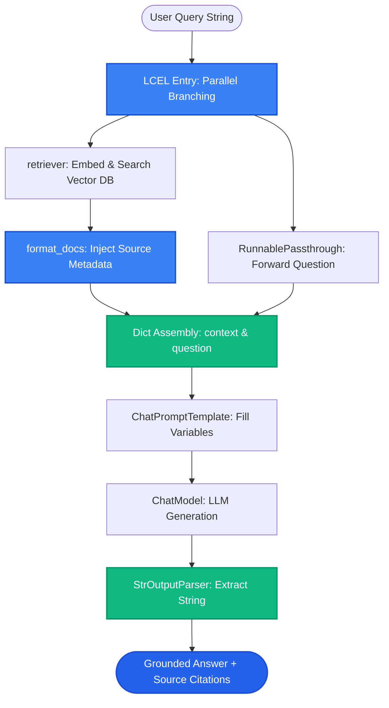

# Lesson 2: Building Retrievers and LCEL Chains

Man, in Lesson 1 we learned the core abstractions of LangChain. Now let's explore **Retrievers** and how to assemble a complete, streaming-ready RAG chain in LCEL.

Let's learn how to turn any vector database into a LangChain retriever and pipe its documents directly into your prompt.

---

### Step 1: Why Do We Need This?

Vector databases have different client APIs:
- In Chroma, you write: `collection.query(query_texts=[...], n_results=5)`
- In Pinecone, you write: `index.query(vector=..., top_k=5)`
- In pgvector, you write: `SELECT ... ORDER BY embedding <=> ... LIMIT 5`

If your application code calls these specific methods directly, you cannot easily swap databases, pipe results into standard prompt templates, or apply uniform streaming and caching.

The **Retriever** abstraction wraps any vector database behind a single, universal contract:
> *Input:* A query string.  
> *Output:* A list of `Document` objects.

Once your database is wrapped as a Retriever, you can connect it directly into an LCEL chain with a single pipe (`|`) operator.

---

### Step 2: What Is It?

A **Retriever** in LangChain is a `Runnable` component that retrieves relevant documents based on an un-embedded string query.

You don't need to manually embed the query before calling a Retriever—the Retriever handles embedding and searching automatically!

```python
# Convert any vector store into a retriever in one line:
retriever = vectorstore.as_retriever(
    search_type="similarity",    # or "mmr"
    search_kwargs={"k": 4}
)
```

#### The Everyday Analogy: The Universal Power Adapter
- If you travel between the US, UK, and Europe, electrical wall sockets are shaped differently.
- A **Retriever** is a universal power adapter. It plugs into whichever local database socket exists, and gives your application a standard USB-C port on the other side.
- Your laptop (the LCEL chain) only plugs into the standard USB-C port, completely unaware of what the wall looks like.

---

### Step 3: Real-World Example

Imagine building a technical support bot for a software platform:

- **User asks:** *"How do I generate an API key?"*
- **What the Retriever does:**
  1. Receives the query string `"How do I generate an API key?"`.
  2. Embeds the string using the configured embedding model.
  3. Executes similarity search on the vector database with $k=3$.
  4. Returns 3 `Document` objects containing text and metadata (e.g. `doc_id`, `url`).
- **What the LCEL Chain does:**
  1. Formats the 3 documents into a clean string with source headers.
  2. Injects the text into `{context}` in the prompt template.
  3. The LLM generates the answer and cites the documentation link!

---

### Step 4: How Does It Work?

Here is the exact data flow through an LCEL RAG chain:

```
User Query String: "How do I reset my password?"
                      │
   ┌──────────────────┴──────────────────┐
   ▼                                     ▼
[retriever | format_docs]       [RunnablePassthrough()]
   │                                     │
Formats documents into text string       Keeps raw question as-is
   │                                     │
   └──────────────────┬──────────────────┘
                      ▼
Input Dict: {"context": "...", "question": "..."}
                      │
             [ChatPromptTemplate]
                      │
                 [ChatModel]
                      │
              [StrOutputParser]
                      │
Final String Output / Real-Time Token Stream
```

#### Formatting Documents with Citations:
A helper function formats retrieved chunks into a structured context block before passing it to the prompt:
```python
def format_docs(docs):
    return "\n\n".join(
        f"[Source: {d.metadata.get('source', 'Unknown')}]\n{d.page_content}"
        for d in docs
    )
```

---

### Step 5: Code Example

Here is a complete, runnable Python script showing how to build an in-memory vector store, convert it to a retriever, and run an LCEL RAG chain:

```python
"""
Building Retrievers and LCEL Chains in LangChain
Requires: pip install langchain-core langchain-community
"""

from langchain_core.documents import Document
from langchain_core.prompts import ChatPromptTemplate
from langchain_core.runnables import RunnablePassthrough
from langchain_core.output_parsers import StrOutputParser
from langchain_community.vectorstores import InMemoryVectorStore
from langchain_core.embeddings import FakeEmbeddings

def run_retriever_chain_demo():
    # 1. Create simulated embeddings and in-memory vector store
    # (In production, use OpenAIEmbeddings or HuggingFaceEmbeddings)
    embeddings = FakeEmbeddings(size=4)
    vectorstore = InMemoryVectorStore(embeddings)

    # 2. Add sample documents
    docs = [
        Document(
            page_content="SkillVault accounts can be upgraded in the Billing dashboard.",
            metadata={"source": "billing_guide.md"}
        ),
        Document(
            page_content="Refunds are processed within 5 to 7 business days via original payment method.",
            metadata={"source": "refund_policy.md"}
        )
    ]
    vectorstore.add_documents(docs)

    # 3. Convert VectorStore into a standard Retriever
    retriever = vectorstore.as_retriever(
        search_type="similarity",
        search_kwargs={"k": 1}
    )

    # 4. Helper to format documents with source citations
    def format_docs(documents):
        return "\n\n".join(
            f"[{d.metadata['source']}]: {d.page_content}" 
            for d in documents
        )

    # 5. Define prompt
    prompt = ChatPromptTemplate.from_template("""
    Answer the question using the following context. Always cite the source file!
    
    Context:
    {context}
    
    Question: {question}
    """)

    # 6. Assemble LCEL Chain (Using a dummy LLM function for demonstration)
    def mock_llm(formatted_prompt):
        return f"Mock AI Answer synthesized from prompt:\n{formatted_prompt.to_string()}"

    rag_chain = (
        {"context": retriever | format_docs, "question": RunnablePassthrough()}
        | prompt
        | mock_llm
    )

    # 7. Execute chain
    user_query = "How long does a refund take?"
    result = rag_chain.invoke(user_query)
    print("--- CHAIN EXECUTION RESULT ---")
    print(result)

if __name__ == "__main__":
    run_retriever_chain_demo()
```

---

### Step 6: How Is It Used in Production?

| Chain Feature | Common Mistake | The Production Fix | Impact |
| :--- | :--- | :--- | :--- |
| **Search Type Misconfiguration** | Defaulting to simple similarity when redundant chunks clutter the prompt | Use `search_type="mmr"` in `.as_retriever(search_kwargs={"k": 4, "lambda_mult": 0.5})` | Automatically diversifies retrieved chunks |
| **Missing Source Citations** | Formatting docs with only `page_content`, throwing away metadata | Include `metadata['source']` and `page` in the `format_docs` string | Enables the LLM to write verifiable footnotes |
| **Blocking Asynchronous Calls** | Calling `.invoke()` inside a FastAPI async route blocks the entire event loop | Always call `await rag_chain.ainvoke()` or `rag_chain.astream()` | Enables high concurrent web throughput |
| **Hardcoded Inputs** | Passing raw strings when components expect dictionaries | Use `RunnablePassthrough()` to route variables cleanly | Eliminates variable mapping errors |

---

### Step 7: Quick Revision

- **Retriever = Standard Interface:** Takes a query string and returns `List[Document]`.
- **Easy Conversion:** Turn any vector database into a retriever with `vectorstore.as_retriever()`.
- **Configurable Search:** Supports `search_type="similarity"` and `search_type="mmr"`.
- **`RunnablePassthrough`:** Passes the input question unchanged to the prompt alongside the formatted context.
- **Interview Answer:** *"In LangChain, a Retriever wraps underlying storage systems in a unified Runnable interface that accepts an un-embedded string query and returns standardized Document objects. Using LCEL, we pipe the retriever through a formatting function directly into a ChatPromptTemplate, ensuring seamless provider switching and async streaming support."*

---

### Step 8: Final Flow Diagram



---

### Step 9: Quiz

Test your understanding of retrievers and LCEL chains. Submit your answers as `1-A, 2-B, 3-C, 4-D`:

**1. What is the fundamental role of a `Retriever` in LangChain?**
- A) To delete files from the computer.
- B) To provide a standardized interface that takes an un-embedded query string and returns a list of relevant `Document` objects.
- C) To translate Python into JavaScript.
- D) To turn off the database.

**2. What is the purpose of `RunnablePassthrough()` in an LCEL RAG chain?**
- A) It skips the LLM call entirely.
- B) It passes the incoming user question through untouched so it can be mapped into the prompt template alongside the retrieved context.
- C) It converts text into uppercase letters.
- D) It pauses execution for 5 seconds.

**3. How can you configure a LangChain retriever to use Maximal Marginal Relevance (MMR) for diversity instead of pure similarity search?**
- A) `vectorstore.as_retriever(search_type="mmr", search_kwargs={"k": 5})`
- B) By renaming the database to 'MMR'.
- C) By setting the CPU clock speed higher.
- D) MMR is not supported in LangChain.

**4. Why should the `format_docs` function include document metadata (such as filename and page number)?**
- A) To make the prompt longer so the API costs more.
- B) To provide the LLM with source context so it can generate verifiable citations for the user.
- C) Metadata is required to run Python syntax.
- D) To encrypt the prompt.

*(Submit your answers to check your progress!)*
