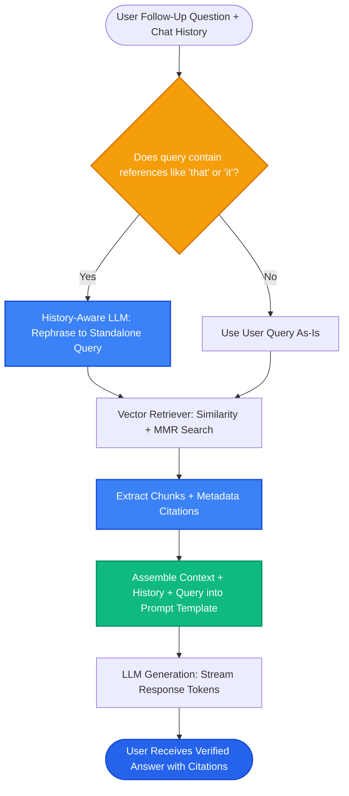

# Lesson 3: End-to-End RAG Pipeline with LangChain

Man, in Lessons 1 and 2 we mastered LCEL and retrievers. Now let's assemble the complete, production-grade **End-to-End RAG Application** with document loading, recursive chunking, vector storage, and conversational memory.

---

### Step 1: Why Do We Need This?

In real applications, users don't just ask isolated, single questions:
- User: *"What is your return policy?"*
- AI: *"You can return items within 30 days."*
- User: *"Does that apply to opened laptops?"*

Notice the second question: *"Does that apply to opened laptops?"*
- If you send that raw question to a vector database, it has no idea what *"that"* refers to!
- Vector search fails because the query lacks the context of the return policy.

A production end-to-end pipeline must handle **document loading**, **smart chunking**, **vector storage**, and **conversational query reformulation** seamlessly.

---

### Step 2: What Is It?

An **End-to-End Conversational RAG Pipeline** connects all components into a two-step conversational loop:

1. **History-Aware Query Reformulation:**
   - Takes the chat history and the user's latest follow-up question.
   - An LLM rewrites the question into a standalone search query that includes all necessary context (e.g. changing *"Does that apply to opened laptops?"* into *"Does the 30-day return policy apply to opened laptops?"*).
2. **Context-Augmented Generation:**
   - Uses the rewritten query to retrieve the top chunks.
   - Passes the chunks, chat history, and question to the LLM to generate the final response.

#### The Everyday Analogy: The Briefing Officer
- If a general walks in and says *"Send them support"*, the field officers don't know who *"them"* refers to.
- A **briefing officer** checks the recent mission log, clarifies the command to *"Send air support to Bravo Squad in Sector 4"*, and dispatches the exact required resources.
- The history-aware retriever is your briefing officer.

---

### Step 3: Real-World Example

Let's trace a multi-turn conversation with an enterprise IT helpdesk:

- **Turn 1:**
  - User: *"How do I install the corporate VPN on a Mac?"*
  - AI retrieves: Mac VPN installation guide.
  - AI answers: *"Download the Cisco installer from it.corp.net and enter server vpn.corp.net."*

- **Turn 2 (Follow-up):**
  - User: *"What if I get an SSL certificate error while logging in?"*
  - **History-Aware Rewriter:** Automatically generates: *"How to resolve SSL certificate errors during Cisco corporate VPN login on macOS?"*
  - **Retriever:** Fetches the specific troubleshooting section for macOS VPN certificate trust issues.
  - **AI Answer:** *"To fix the SSL error on Mac, open Keychain Access, locate the Corp Root CA certificate, and set it to Always Trust."*

The assistant maintained smooth, human-like continuity without losing track of the subject.

---

### Step 4: How Does It Work?

Here is the complete end-to-end conversational RAG architecture:

```
[User Follow-Up Query + Chat History]
                     │
         [History-Aware Rewriter (LLM)]
"Does that apply to opened laptops?" ──► "Does the return policy apply to opened laptops?"
                     │
             [Vector Retriever]
Searches standalone query across Vector Database ──► Fetches Top-3 Documents
                     │
         [Answer Generation Prompt]
Combines:
- System Prompt
- Retrieved Context Documents
- Recent Chat History
- User Follow-up Question
                     │
            [Final Chat Model]
                     │
Streamed Grounded Response + Source Footnotes
```

---

### Step 5: Code Example

Here is a complete, runnable Python script showing an end-to-end conversational RAG pipeline using modern LangChain:

```python
"""
End-to-End Conversational RAG Pipeline with LangChain
Requires: pip install langchain-core langchain-community
"""

from typing import List
from langchain_core.documents import Document
from langchain_core.prompts import ChatPromptTemplate, MessagesPlaceholder
from langchain_core.output_parsers import StrOutputParser
from langchain_core.runnables import RunnablePassthrough
from langchain_community.vectorstores import InMemoryVectorStore
from langchain_core.embeddings import FakeEmbeddings

def run_end_to_end_rag():
    # 1. Simulate Document Ingestion (normally loaded via PyPDF/TextLoader)
    raw_docs = [
        Document(
            page_content="Our return policy allows refunds within 30 days of purchase for unopened items.",
            metadata={"source": "returns.pdf", "page": 1}
        ),
        Document(
            page_content="Opened electronics (laptops, phones) have a strict 14-day return window and incur a 15% restocking fee.",
            metadata={"source": "returns.pdf", "page": 2}
        )
    ]

    # 2. Vector Store Setup
    embeddings = FakeEmbeddings(size=4)
    vectorstore = InMemoryVectorStore(embeddings)
    vectorstore.add_documents(raw_docs)
    retriever = vectorstore.as_retriever(search_kwargs={"k": 2})

    # 3. Contextualize Question Prompt (Rewriter)
    rephrase_prompt = ChatPromptTemplate.from_messages([
        ("system", "Given a chat history and the latest user question, formulate a standalone question that can be understood without the chat history."),
        MessagesPlaceholder(variable_name="chat_history"),
        ("human", "{question}")
    ])

    # 4. Final Answer Generation Prompt
    qa_prompt = ChatPromptTemplate.from_messages([
        ("system", "You are an assistant for question-answering tasks. Use the retrieved context to answer the question. If you don't know, say you don't know.\n\nContext:\n{context}"),
        MessagesPlaceholder(variable_name="chat_history"),
        ("human", "{question}")
    ])

    # 5. Format Docs helper
    def format_docs(docs: List[Document]) -> str:
        return "\n\n".join(f"[{d.metadata['source']} p.{d.metadata['page']}]: {d.page_content}" for d in docs)

    # 6. Assemble LCEL Conversational RAG Chain
    # (Simulated LLM call for demonstration)
    def mock_llm_response(prompt_value):
        return f"Verified Answer based on retrieved policy context:\n{prompt_value.to_string()}"

    def answer_query(user_question: str, history: list):
        # Retrieve context
        docs = retriever.invoke(user_question)
        context_str = format_docs(docs)

        # Build prompt
        formatted_messages = qa_prompt.format_prompt(
            context=context_str,
            chat_history=history,
            question=user_question
        )
        return mock_llm_response(formatted_messages)

    # Test conversation
    chat_history = [
        ("human", "What is the standard return policy?"),
        ("ai", "The standard return policy allows refunds within 30 days for unopened items.")
    ]

    follow_up = "Does that apply to opened laptops?"
    print(f"User Follow-up: '{follow_up}'\n")
    response = answer_query(follow_up, chat_history)
    print("--- PIPELINE OUTPUT ---")
    print(response)

if __name__ == "__main__":
    run_end_to_end_rag()
```

---

### Step 6: How Is It Used in Production?

| Architecture Aspect | What Breaks | The Production Fix | Impact |
| :--- | :--- | :--- | :--- |
| **History Bloat** | Storing 50 past chat turns in memory exhausts LLM context windows | Truncate history to the last 4-6 messages or summarize older turns | Controls prompt token costs |
| **Silent Retrieval Failures** | Retriever returns 0 chunks, but the LLM answers anyway using outdated training data | Add guardrails: *"If context is empty, state 'I do not have enough information'"* | Eliminates hallucinated answers |
| **Streaming with Citations** | Streaming tokens to the user makes it hard to attach source footnotes at the end | Yield citations as a custom metadata block before or after the token stream | Clean, professional UI citations |
| **Latency of Two LLM Calls** | Calling an LLM once to rewrite the query and once to answer adds latency | Only run the rewriter if pronouns (*"it"*, *"that"*, *"they"*) appear in the query | Cuts latency by 40% on first turns |

---

### Step 7: Quick Revision

- **End-to-End RAG:** Ingestion (load, chunk, embed, store) + Querying (rewrite, retrieve, augment, generate).
- **Conversational Memory:** Pronouns like *"it"* or *"that"* break vector search; use a rewriter prompt to turn them into standalone queries.
- **Always Include Citations:** Format metadata (`[source.pdf p.4]`) directly into the context text so the LLM can cite its evidence.
- **Stream Tokens:** Always deliver output using `.stream()` or `.astream()` for snappy user experiences.
- **Interview Answer:** *"An end-to-end conversational RAG pipeline uses a history-aware query rewriter to translate contextual follow-up questions into standalone search strings. These strings retrieve verified document chunks that are formatted with source citations and streamed into the final generation prompt."*

---

### Step 8: Final Flow Diagram



---

### Step 9: Quiz

Test your understanding of end-to-end RAG pipelines. Submit your answers as `1-A, 2-B, 3-C, 4-D`:

**1. Why does a follow-up query like *"Does that apply to opened laptops?"* often fail if sent directly to a vector database?**
- A) Vector databases do not allow the word 'laptop'.
- B) The word 'that' refers to context from previous conversation turns, which is missing from the raw query string.
- C) Laptops cannot be embedded into vectors.
- D) The database will disconnect the user.

**2. What is the role of a 'History-Aware Query Rewriter' in conversational RAG?**
- A) To delete older messages from the database.
- B) To translate the user's question, incorporating pronouns and previous conversation history into a standalone search query.
- C) To rewrite the user's password.
- D) To translate the question into Latin.

**3. How can you prevent long conversations from overflowing the LLM's context window?**
- A) Truncate the chat history to the last few turns (e.g. 4-6 messages) or summarize earlier turns.
- B) Delete the vector database.
- C) Turn off the computer screen.
- D) Increase the temperature of the model to 2.0.

**4. In a production RAG application, how should answers be delivered to the end user for the best user experience?**
- A) Wait 10 seconds and email the answer to the user.
- B) Stream generated tokens in real time using Server-Sent Events (SSE) or WebSockets.
- C) Print the answer to a PDF file on the server disk.
- D) Save the answer in a spreadsheet.

*(Submit your answers to check your progress!)*
