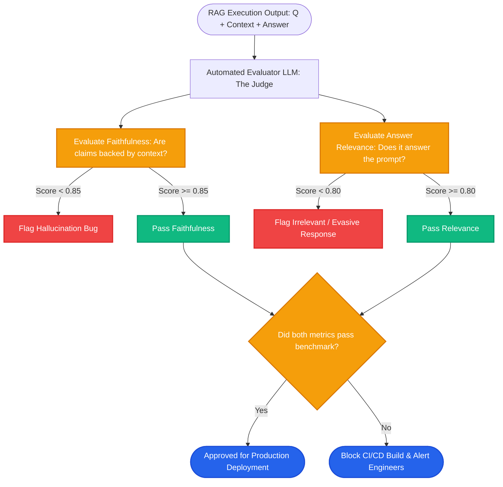

# Lesson 1: RAG Evaluation Metrics (The RAG Triad & RAGAS)

Man, welcome to Phase 11! In previous phases, we built advanced retrieval pipelines. But here is the most common mistake in AI engineering: **judging your system by running 3 manual test questions and saying *"It looks good to me!"***

In production, you cannot read thousands of answers every day. You need automated, objective numbers to know if your system is hallucinating or retrieving garbage. Let's learn how to evaluate RAG systems like a seasoned AI engineer.


---

### Step 1: Why Do We Need This?

LLMs are trained to write smooth, confident, and persuasive sentences—even when they are completely wrong.

If you don't evaluate your RAG pipeline with automated metrics:
1. **The Silent Hallucination Trap:** A customer asks about a warranty. The LLM writes a beautiful 3-paragraph answer with fake promises. Because it reads nicely, you don't realize it lied until customers demand illegal refunds.
2. **Blind Model Swapping:** Your team switches from OpenAI to a cheaper open-source model to save money. How do you prove that accuracy didn't drop by 20%? Without metrics, you are guessing.
3. **Unidentified Bottlenecks:** When an answer is wrong, was it because retrieval failed to find the document, or because the LLM misread the document? Without separate metrics for retrieval and generation, you cannot debug your system.

Evaluation gives you clear mathematical scores so you can catch regressions before users do.

---

### Step 2: What Is It?

Modern RAG evaluation splits quality into two separate halves: **Retrieval Metrics** and **Generation Metrics**.

The industry standard framework (popularized by RAGAS and the RAG Triad) defines four core metrics:

1. **Faithfulness / Groundedness (Generation):**
   - *Question:* Does every claim in the answer come directly from the retrieved context?
   - *What it catches:* **Hallucinations.** If the LLM makes up facts, faithfulness drops to 0.

2. **Answer Relevance (Generation):**
   - *Question:* Did the LLM actually answer what the user asked?
   - *What it catches:* Wandering off-topic or giving evasive non-answers.

3. **Context Precision (Retrieval):**
   - *Question:* Are the retrieved chunks relevant signal, or are they mostly useless clutter?
   - *What it catches:* Wasted prompt tokens and low-quality retrieval.

4. **Context Recall (Retrieval):**
   - *Question:* Did the retriever find all the necessary facts required to answer the question?
   - *What it catches:* Missing facts and under-retrieval.

#### The Everyday Analogy: The Essay Exam Grader
- A student takes an open-book history exam.
- **Context Precision:** Did the student pull the right textbook chapter, or did they grab 5 random books off the shelf?
- **Context Recall:** Did they find all the pages discussing the war?
- **Faithfulness:** Did they quote the textbook accurately, or did they invent fake historical dates?
- **Answer Relevance:** Did their essay actually answer the prompt, or did they write about something else?

---

### Step 3: Real-World Example

Let's test an answer generated by an IT support bot:

- **User Question:** *"Can contractors use personal laptops for company work?"*
- **Retrieved Context:** *"All contractors must use company-managed laptops. Personal hardware is strictly prohibited on the corporate network."*
- **Generated Answer:** *"Contractors must use company-managed laptops because personal devices are prohibited. However, contractors can request a $500 hardware stipend from HR."*

Metric Evaluation:
- **Answer Relevance:** **1.0** (Directly addresses personal laptops).
- **Faithfulness:** **0.5 (Failed!)** The sentence about the "$500 hardware stipend" is completely absent from the retrieved text. The LLM hallucinated it from general training data!
- **Context Precision:** **1.0** (The retrieved context was 100% relevant).

Thanks to the faithfulness metric, the hallucination is caught immediately before going to production.

---

### Step 4: How Does It Work?

How do you compute these scores automatically without hiring hundreds of human reviewers? **LLM-as-a-Judge**.

We use an evaluator LLM (like GPT-4) prompted with strict rubrics to grade the system:

```
[Production RAG Interaction]
Input: User Question + Retrieved Context + Generated Answer
                           │
             [Evaluator LLM: The Judge]
                           │
       ┌───────────────────┴───────────────────┐
       ▼                                       ▼
[Check Faithfulness]                   [Check Relevance]
1. Break answer into claims.           1. Generate hypothetical questions
2. Verify each claim in context.          from the answer.
3. Score = Supported / Total Claims.   2. Compare with original question.
       │                                       │
Faithfulness Score: 0.0 - 1.0          Relevance Score: 0.0 - 1.0
```

---

### Step 5: Code Example

Here is a Python script showing how to build an automated LLM-as-a-Judge faithfulness checker:

```python
"""
LLM-as-a-Judge: Automated Faithfulness Evaluator
"""

from typing import List, Dict

def evaluate_faithfulness(question: str, context: str, answer: str) -> Dict[str, any]:
    """
    Evaluates whether the generated answer is strictly grounded in the context.
    """
    # Prompt template for the Evaluator LLM
    evaluator_prompt = f"""
    You are an impartial judge evaluating a Retrieval-Augmented Generation (RAG) answer.
    
    Context:
    {context}
    
    Answer:
    {answer}
    
    Instructions:
    1. Break down the Answer into individual factual claims.
    2. Check if each claim is directly supported by the Context.
    3. Output the verdict in JSON format:
       - "claims": [list of extracted claims]
       - "supported_claims": [list of claims supported by context]
       - "score": (number of supported claims / total claims)
       - "reason": brief explanation
    """
    
    # In production, send this prompt to GPT-4o or Claude-3.5-Sonnet:
    # response = llm.invoke(evaluator_prompt)
    
    # Simulated judge output:
    return {
        "claims": [
            "Contractors must use company-managed laptops.",
            "Personal devices are prohibited.",
            "Contractors can request a $500 hardware stipend."
        ],
        "supported_claims": [
            "Contractors must use company-managed laptops.",
            "Personal devices are prohibited."
        ],
        "score": 0.67,  # 2 out of 3 claims supported
        "verdict": "FAILED_FAITHFULNESS",
        "reason": "Claim about $500 hardware stipend is not supported by context."
    }

if __name__ == "__main__":
    test_context = "All contractors must use company-managed laptops. Personal hardware is strictly prohibited."
    test_answer = "Contractors must use company-managed laptops. Personal devices are prohibited. Contractors can request a $500 hardware stipend."
    
    result = evaluate_faithfulness("Can contractors use personal laptops?", test_context, test_answer)
    print("--- EVALUATION REPORT ---")
    print(f"Score: {result['score']:.2f} ({result['verdict']})")
    print(f"Reason: {result['reason']}")
```

---

### Step 6: How Is It Used in Production?

| Evaluation Strategy | What Breaks | The Production Fix | Impact |
| :--- | :--- | :--- | :--- |
| **Evaluating Only in Production** | Discovering bad retrieval after customers complain | Run automated evaluation test suites on 100 golden benchmark questions in CI/CD | Catches regressions before deployment |
| **Using Weak Evaluator Models** | Using a cheap 3B model as the judge gives inconsistent, forgiving scores | Use state-of-the-art models (GPT-4o or Claude-3.5-Sonnet) with temperature=0 for judging | Highly reliable, repeatable grades |
| **Evaluating 100% of Production Traffic** | Judging every live user query with GPT-4 doubles your monthly API bill | Sample 5% to 10% of live traffic randomly for continuous production monitoring | Keeps evaluation costs under control |
| **Conflating Precision and Recall** | High context precision does not mean all facts were found | Measure both precision and recall independently | Pinpoints exact retrieval flaws |

---

### Step 7: Quick Revision

- **The Four Core Metrics:**
  - **Faithfulness:** Is the answer grounded in context? (Checks hallucination).
  - **Answer Relevance:** Does the answer address the question?
  - **Context Precision:** Is the retrieved context signal or noise?
  - **Context Recall:** Did retrieval find all the required facts?
- **LLM-as-a-Judge:** Uses an advanced LLM with a strict rubric to score answers objectively.
- **CI/CD Integration:** Run evaluation test suites on golden benchmark datasets before merging code changes.
- **Interview Answer:** *"RAG evaluation separates retrieval performance (Context Precision and Recall) from generation quality (Faithfulness and Answer Relevance). Using LLM-as-a-Judge frameworks like RAGAS, teams measure groundedness to detect hallucinations and benchmark pipeline changes objectively in CI/CD."*

---

### Step 8: Final Flow Diagram



---

### Step 9: Quiz

Test your understanding of RAG evaluation metrics. Submit your answers as `1-A, 2-B, 3-C, 4-D`:

**1. What does the 'Faithfulness' metric evaluate in a RAG system?**
- A) How polite the AI is when speaking to customers.
- B) Whether all factual claims in the generated answer are directly supported by the retrieved context (detecting hallucinations).
- C) How fast the server responds in milliseconds.
- D) Whether the user paid their subscription fee.

**2. If an AI generates a fluent, well-written answer that completely ignores the user's specific question, which metric will catch this failure?**
- A) Context Precision.
- B) Answer Relevance.
- C) Disk Read Speed.
- D) Embedding Dimension.

**3. What is the 'LLM-as-a-Judge' technique?**
- A) An AI lawyer arguing a real lawsuit in court.
- B) Using an advanced language model (like GPT-4o) prompted with an objective rubric to automatically evaluate and grade RAG responses.
- C) Banning users who ask bad questions.
- D) A model that writes code for judges.

**4. Why is manual human review alone insufficient for evaluating a production RAG system?**
- A) Humans cannot read English.
- B) Humans cannot manually review thousands of live daily queries, and can easily be fooled by fluent-sounding hallucinations without cross-checking source texts.
- C) Vector databases forbid human reviews.
- D) Human reviews are only allowed once a year.

*(Submit your answers to check your progress!)*
