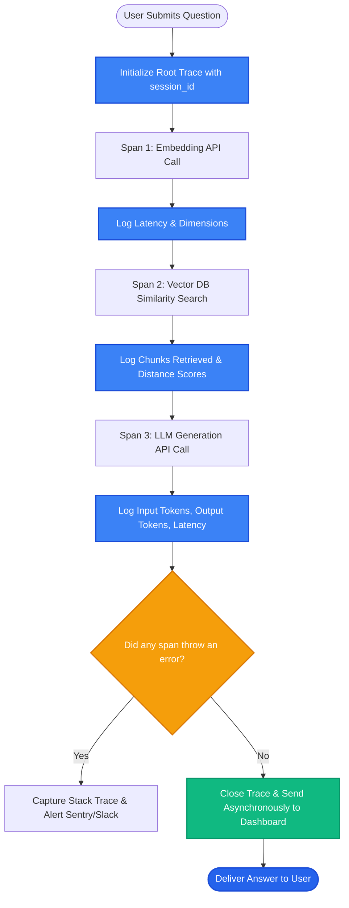

# Lesson 2: Tracing a RAG Pipeline (Observability & Spans)

Man, in Lesson 1 we saw how to evaluate RAG metrics. But what happens when a live production request takes 8 seconds to reply or returns an empty answer?

If you only rely on standard terminal print statements (`print()`), you cannot see where the time was spent or what raw text was passed between components. Let's learn how **Distributed Tracing** and **Observability** provide full X-ray vision into your RAG pipeline.

---

### Step 1: Why Do We Need This?

A RAG pipeline is not a single function call; it is a chain of interconnected micro-steps:
1. Embed the user query.
2. Search the vector database.
3. Rerank the top 20 candidate chunks.
4. Format the prompt template.
5. Call the LLM API and stream tokens.

When an error happens in production:
- Did the embedding call timeout?
- Did the vector database return 0 results?
- Did the prompt exceed the token limit?
- Why did the request take 5.2 seconds? (Was it the vector database or the LLM generation?)

Without distributed tracing, your RAG system is a dark black box. You cannot debug latency, pinpoint errors, or track API costs.

---

### Step 2: What Is It?

**Tracing** is the practice of recording every step of a request as a hierarchical tree of **Spans**:

- **Trace:** Represents the entire journey of a single user request from input to output.
- **Span:** A single unit of work inside that trace (e.g. `vector_search`, `rerank`, `llm_call`).
- Each span records:
  - Exact input and output data.
  - Start time, end time, and duration (latency).
  - Token counts (input tokens, output tokens).
  - Error messages and stack traces if it failed.

#### The Everyday Analogy: The Itemized Hospital Bill
- A generic invoice just says: *"Total: $8,500"*. You have no idea what you paid for or why it was so high.
- An **itemized bill** lists every single medication, doctor consultation, room fee, and laboratory test with exact timestamps and individual prices.
- Tracing gives you the itemized bill for every single millisecond and cent spent during a RAG query.

---

### Step 3: Real-World Example

Imagine a customer support bot experiencing sudden latency spikes:

- **Users report:** *"The bot is taking over 6 seconds to answer questions."*
- **The Engineer opens the tracing dashboard (e.g. LangSmith or Langfuse):**
  - Trace Total: `6,120 ms`
    - Span 1: `query_embedding` — `45 ms` (Normal)
    - Span 2: `pinecone_search` — **`4,850 ms` (FATAL BOTTLENECK!)**
    - Span 3: `reranker` — `32 ms` (Normal)
    - Span 4: `llm_generation` — `1,193 ms` (Normal)

The engineer immediately sees that the issue wasn't the LLM or the prompt—it was the vector database experiencing a network connection timeout in another cloud region. The problem is diagnosed and fixed in 5 minutes!

---

### Step 4: How Does It Work?

Here is the hierarchical span tree for a production RAG query:

```
[Root Trace: RAG_Query_Execution] (Duration: 1,420 ms | Cost: $0.003)
│
├── [Span 1: Query_Embedding]
│   Input: "How to reset password?"
│   Output: [0.12, -0.45, ...] (1536 floats)
│   Duration: 35 ms
│
├── [Span 2: Vector_Database_Search]
│   Filter: {dept: "it"}
│   Output: 15 candidate chunks
│   Duration: 22 ms
│
├── [Span 3: Cross_Encoder_Rerank]
│   Output: Top 3 chunks
│   Duration: 38 ms
│
└── [Span 4: LLM_Chat_Completion]
    Input: System Prompt + 3 Chunks + Question
    Output: "To reset your password, visit it.corp.net/reset..."
    Tokens: 820 input, 45 output
    Duration: 1,325 ms
```

#### Popular RAG Tracing Platforms:
- **LangSmith:** Native observability platform built by the LangChain team. One environment variable setup (`LANGCHAIN_TRACING_V2=true`).
- **Langfuse:** Leading open-source, self-hostable LLM observability platform.
- **Arize Phoenix:** Open-source platform specializing in evaluations and OpenInference tracing.

---

### Step 5: Code Example

Here is a Python demonstration showing how to implement lightweight structured span tracing:

```python
"""
Simple Span-Based Execution Tracer for RAG
"""

import time
from dataclasses import dataclass, field
from typing import List, Any, Dict

@dataclass
class Span:
    name: str
    start_time: float = field(default_factory=time.perf_counter)
    end_time: float = 0.0
    duration_ms: float = 0.0
    inputs: Dict[str, Any] = field(default_factory=dict)
    outputs: Dict[str, Any] = field(default_factory=dict)

    def close(self, outputs: Dict[str, Any] = None):
        self.end_time = time.perf_counter()
        self.duration_ms = (self.end_time - self.start_time) * 1000
        if outputs:
            self.outputs = outputs

class RAGTracer:
    def __init__(self, trace_name: str):
        self.trace_name = trace_name
        self.spans: List[Span] = []

    def start_span(self, name: str, inputs: Dict[str, Any] = None) -> Span:
        span = Span(name=name, inputs=inputs or {})
        self.spans.append(span)
        return span

    def print_trace_summary(self):
        total_duration = sum(s.duration_ms for s in self.spans)
        print(f"\n=== TRACE: {self.trace_name} (Total: {total_duration:.2f} ms) ===")
        for s in self.spans:
            print(f"  [{s.name}] Duration: {s.duration_ms:.2f} ms")
            if s.outputs:
                print(f"     Output: {s.outputs}")

# Simulated RAG execution with tracing
def traced_rag_pipeline(query: str):
    tracer = RAGTracer("User_Question_Flow")

    # Step 1: Embed Query
    span_embed = tracer.start_span("embed_query", {"query": query})
    time.sleep(0.04)  # 40ms simulation
    span_embed.close({"dimensions": 1536})

    # Step 2: Vector Search
    span_search = tracer.start_span("vector_search", {"k": 5})
    time.sleep(0.02)  # 20ms simulation
    span_search.close({"chunks_found": 5})

    # Step 3: LLM Generation
    span_llm = tracer.start_span("llm_generation", {"model": "gpt-4o-mini"})
    time.sleep(0.15)  # 150ms simulation
    span_llm.close({"output_text": "To reset password, click settings.", "tokens": 85})

    tracer.print_trace_summary()

if __name__ == "__main__":
    traced_rag_pipeline("How to reset password?")
```

---

### Step 6: How Is It Used in Production?

| Observability Challenge | What Breaks | The Production Solution | Real Impact |
| :--- | :--- | :--- | :--- |
| **Silent API Cost Surges** | A prompt engineering change doubles token usage, triggering a $10,000 monthly bill | Set automated budget alerts and track per-user token consumption in tracing tools | Prevents runaway API bills |
| **Masking PII in Traces** | Customer credit cards and passwords get saved in plaintext trace logs | Implement scrubbing middleware that masks emails, credit cards, and SSNs before logging | 100% HIPAA and GDPR compliance |
| **Production Performance Overhead** | Sending traces synchronously over HTTP slows down user response times | Send traces asynchronously in non-blocking background threads | Zero added latency to end users |
| **No Session Association** | Traces are floating independently; cannot see multi-turn user conversations | Attach a consistent `session_id` and `user_id` tag to every trace | Enables end-to-end conversation replay |

---

### Step 7: Quick Revision

- **Tracing Provides X-Ray Vision:** Shows the exact duration, inputs, outputs, and token counts of every micro-step.
- **Trace vs Span:** A Trace represents the entire user request; Spans represent individual steps (embed, search, generate).
- **Pinpoint Bottlenecks:** Instantly reveals whether slow performance is caused by the database or the LLM.
- **Mask Sensitive Data:** Always scrub PII (passwords, payment info) before sending traces to external platforms.
- **Interview Answer:** *"Distributed tracing instruments RAG pipelines into a hierarchy of spans, recording inputs, outputs, latency, and token consumption for each stage. In production, tools like LangSmith and Langfuse enable engineers to monitor real-time latency bottlenecks, inspect retrieved context, and audit LLM costs."*

---

### Step 8: Final Flow Diagram



---

### Step 9: Quiz

Test your understanding of RAG tracing and observability. Submit your answers as `1-A, 2-B, 3-C, 4-D`:

**1. What is the fundamental difference between a 'Trace' and a 'Span' in distributed observability?**
- A) A Trace represents the entire user request journey, while a Span represents an individual sub-step (such as vector search or LLM generation) within that journey.
- B) A Trace is written in C++, while a Span is written in HTML.
- C) Traces are only used for audio files.
- D) Spans cannot record time.

**2. Why are standard print statements (`print()`) inadequate for debugging RAG latency issues in production?**
- A) Python disables the print function in production.
- B) Print statements do not provide structured timing breakdowns across nested async calls, token tracking, or centralized dashboards for thousands of concurrent users.
- C) Print statements delete the database.
- D) Print statements only work on Tuesdays.

**3. If a RAG request takes 7 seconds, how does tracing help engineers fix it?**
- A) It automatically buys faster hardware.
- B) It shows the exact latency duration of each span, revealing whether the delay was in embedding, vector retrieval, or token generation.
- C) It translates the question into French.
- D) It restarts the computer.

**4. What critical security precaution must be taken before logging RAG traces to third-party dashboards?**
- A) Mask or scrub Personally Identifiable Information (PII) such as passwords and credit cards.
- B) Delete the source code.
- C) Disconnect the internet.
- D) Encrypt the computer monitor.

*(Submit your answers to check your progress!)*
