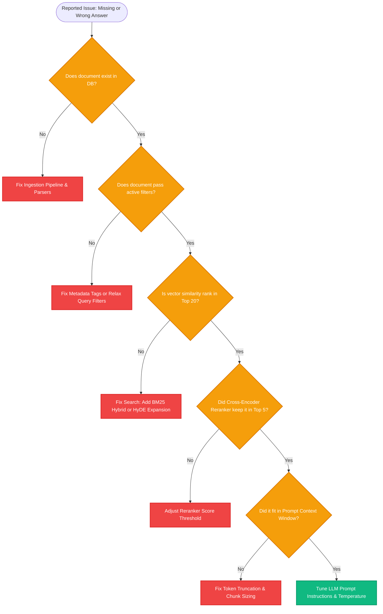

# Lesson 3: Debugging Bad Retrievals (Diagnostic Playbook)

Man, in Lessons 1 and 2 we learned metrics and tracing. But what do you do when a user submits a bug report saying: *"The AI told me we don't have a 401(k) match, but I know it's in our handbook!"*

When RAG fails, junior engineers guess and change random prompts. Senior AI engineers follow a systematic **diagnostic playbook** to find the exact root cause. Let's learn how to debug bad retrievals.

---

### Step 1: Why Do We Need This?

When an AI gives a wrong or unhelpful answer, beginners blame the LLM: *"GPT-4 is stupid!"*

In reality, **over 80% of RAG failures happen before the LLM ever sees the prompt**:
1. The document was never loaded (parsing error).
2. The key sentence was sliced in half (bad chunking).
3. The metadata filter excluded the row by accident (bad filter).
4. The vector search ranked the chunk at position #45 instead of top 5 (vocabulary mismatch).
5. The reranker dropped the chunk (over-aggressive cutoff).

If you don't know how to isolate each step, you will waste days tweaking system prompts when the prompt was never the problem.

---

### Step 2: What Is It?

A **Diagnostic Playbook** is a step-by-step checklist that traces the lifecycle of a missing piece of evidence through your pipeline.

It tests five discrete hypotheses in order:
1. **The Ingestion Check:** Is the text actually in the database?
2. **The Metadata Check:** Did an over-restrictive filter exclude it?
3. **The Embedding Distance Check:** Did vector similarity rank it too low?
4. **The Reranker Check:** Did the reranker accidentally demote it?
5. **The Prompt Assembly Check:** Did it get truncated by context limits?

#### The Everyday Analogy: The Lost Car Keys
- When you lose your car keys, you don't call a mechanic to disassemble the car engine!
- You retrace your steps logically:
  1. Did you bring them inside the house? (Ingestion check)
  2. Are they in your coat pocket? (Metadata filter check)
  3. Did they fall between the couch cushions? (Similarity threshold check)
- You check the simplest, earliest failure points first before blaming the engine.

---

### Step 3: Real-World Example

Let's trace a real production failure:

- **User asks:** *"What is the warranty period for the Apex-X drone battery?"*
- **AI replies:** *"I do not have information about the Apex-X drone battery warranty."*
- **Engineer's Investigation:**
  - *Hypothesis 1 (Is it in DB?):* Engineer runs a direct SQL query: `SELECT * FROM docs WHERE content ILIKE '%battery%'`. **Result: Found!** The chunk exists.
  - *Hypothesis 2 (Did metadata block it?):* Check query filters: `WHERE category = 'drones'`. The chunk was mistakenly tagged `category = 'accessories'`. **BINGO!**
  - The metadata filter physically blocked the correct document from ever being searched!
- **Fix:** Update document tagging rules or remove the over-restrictive category filter. The bug is resolved in minutes without touching the LLM.

---

### Step 4: How Does It Work?

Here is the 5-step diagnostic decision tree:

```
[Reported Failure: Answer is Missing or Hallucinated]
                         │
1. Does the target text exist in raw database storage?
   ├── No  ──► Ingestion Bug (PDF parser failed or file was missed)
   └── Yes ──► Proceed to Step 2
                 │
2. Does the target chunk pass all active metadata filters?
   ├── No  ──► Metadata Filtering Bug (Over-restrictive tags)
   └── Yes ──► Proceed to Step 3
                 │
3. What is the raw vector similarity score of the target chunk?
   ├── Low (< 0.60) ──► Semantic Mismatch (Need Hybrid BM25 or HyDE)
   └── High (> 0.80) ──► Proceed to Step 4
                 │
4. Was the chunk in the top candidate list before reranking?
   ├── Dropped by Reranker ──► Reranker Threshold Bug (Adjust cutoff)
   └── Passed Reranker ──► Proceed to Step 5
                 │
5. Did the chunk appear in the final LLM prompt text?
   ├── No  ──► Context Window Truncation / Token Budget Bug
   └── Yes ──► LLM Generation Bug (Prompt phrasing / Lost in the Middle)
```

---

### Step 5: Code Example

Here is a Python diagnostic script that isolates whether a failure is caused by metadata filtering or vector distance:

```python
"""
RAG Diagnostic Script: Isolating Retrieval Failure Points
"""

from typing import List, Dict, Any

def diagnose_retrieval_failure(
    query: str,
    target_doc_id: str,
    database_records: List[Dict[str, Any]],
    active_filters: Dict[str, Any],
    top_k: int = 3
):
    print(f"=== DIAGNOSTIC REPORT FOR QUERY: '{query}' ===")
    
    # Check 1: Ingestion Existence
    target_record = next((r for r in database_records if r["id"] == target_doc_id), None)
    if not target_record:
        print("[FAIL - STEP 1]: Target document does not exist in the database at all!")
        return

    print("[PASS - STEP 1]: Target document exists in storage.")

    # Check 2: Metadata Filter Evaluation
    for key, expected_val in active_filters.items():
        actual_val = target_record["metadata"].get(key)
        if actual_val != expected_val:
            print(f"[FAIL - STEP 2]: Blocked by metadata filter! Key '{key}': expected '{expected_val}', got '{actual_val}'.")
            return

    print("[PASS - STEP 2]: Target document passed all metadata filters.")

    # Check 3: Semantic Score Check
    q_words = set(query.lower().split())
    doc_words = set(target_record["text"].lower().split())
    overlap_score = len(q_words.intersection(doc_words)) / max(len(q_words), 1)

    print(f"[STEP 3]: Target document relevance score = {overlap_score:.2f}")
    if overlap_score == 0:
        print("[FAIL - STEP 3]: Vocabulary mismatch! Query shares 0 words with target document. (Use HyDE or BM25).")
    else:
        print("[PASS - STEP 3]: Semantic overlap detected.")

if __name__ == "__main__":
    mock_db = [
        {
            "id": "battery_doc_42",
            "text": "Apex-X drone replacement battery comes with a 12-month manufacturer warranty.",
            "metadata": {"category": "accessories", "active": True}
        }
    ]

    # Query was filtered with category="drones"
    diagnose_retrieval_failure(
        query="battery warranty period",
        target_doc_id="battery_doc_42",
        database_records=mock_db,
        active_filters={"category": "drones"}
    )
```

---

### Step 6: How Is It Used in Production?

| Common Symptom | Likely Root Cause | Diagnostic Test | Production Fix |
| :--- | :--- | :--- | :--- |
| **"I don't have information about that"** | Metadata pre-filter is silently dropping valid documents | Run query with `filter={}` (no filters) and observe if doc appears | Relax metadata filters; use softer post-filtering |
| **LLM quotes wrong product rules** | Chunk was sliced mid-sentence, cutting off the product name | Inspect raw chunk text in database | Increase chunk size or add breadcrumbs/parent retrieval |
| **Search fails on abbreviations (e.g. 'SSO')** | Pure vector model was trained without internal company acronyms | Check cosine similarity of acronym to full phrase | Switch to Hybrid Search (BM25 + Vector) |
| **Correct chunk is in prompt, but LLM ignores it** | Fact was placed in the middle of a 20-chunk prompt | Check chunk position in prompt text | Reorder chunks (best at top/bottom) or drop $k$ to 3 |

---

### Step 7: Quick Revision

- **Don't Blame the LLM First:** 80% of RAG bugs are retrieval or ingestion failures.
- **5-Step Playbook:**
  1. Did the doc ingest?
  2. Did metadata block it?
  3. Did vector similarity rank it low?
  4. Did the reranker drop it?
  5. Did prompt limits truncate it?
- **Vocabulary Mismatches:** If query words don't match document words, add **BM25 Hybrid Search** or **HyDE**.
- **Inspect the Raw Prompt:** Always print the final prompt string to see what the LLM actually received.
- **Interview Answer:** *"Debugging bad retrievals requires a systematic triage: verifying document existence in raw storage, testing for over-restrictive metadata filters, analyzing raw similarity scores to identify vocabulary mismatches, and inspecting the final formatted prompt to ensure critical context was not lost to truncation."*

---

### Step 8: Final Flow Diagram



---

### Step 9: Quiz

Test your understanding of debugging bad retrievals. Submit your answers as `1-A, 2-B, 3-C, 4-D`:

**1. When a user reports that an AI failed to answer a question that exists in company documentation, where should you look first?**
- A) Rewrite the entire application in a new programming language.
- B) Check if the document was actually loaded into the database and whether it passes active metadata filters.
- C) Blame the LLM for being incapable.
- D) Delete the vector database.

**2. If a document exists in your database and matches the query well, but is completely absent from search results, what is a frequent silent cause?**
- A) An over-restrictive metadata filter (e.g. `department == 'HR'`) that accidentally excluded the record.
- B) The computer ran out of electricity.
- C) The document was typed in lowercase.
- D) The user typed too fast.

**3. What retrieval upgrade resolves failures caused by users searching with exact acronyms or part numbers that vector models fail to match?**
- A) Deleting all numbers from the text.
- B) Adding BM25 Keyword Hybrid Search alongside vector search.
- C) Increasing the temperature of the model to 1.5.
- D) Running the database on a smartphone.

**4. If the correct chunk was retrieved and appears in the prompt, but the LLM still gives a wrong answer, what is a likely cause?**
- A) The chunk was buried in the middle of a long prompt (Lost in the Middle effect), or the system prompt instructions were ambiguous.
- B) The vector database crashed.
- C) Embeddings lost their numbers.
- D) The monitor screen was too small.

*(Submit your answers to check your progress!)*
